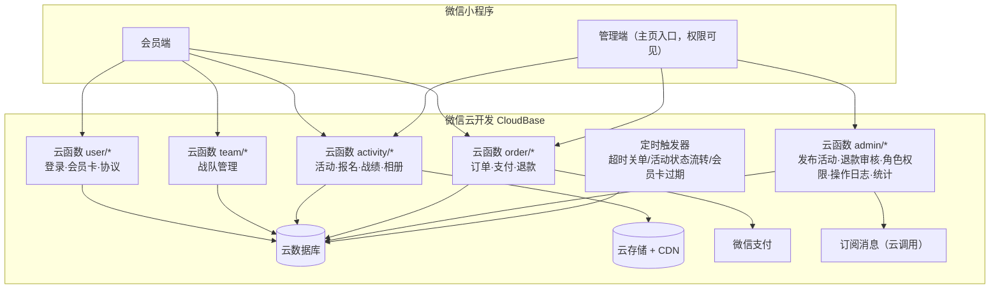
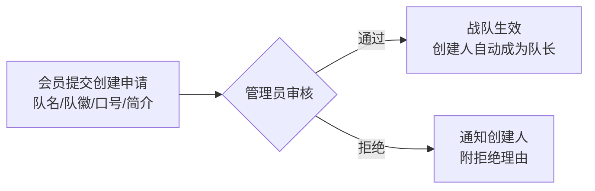
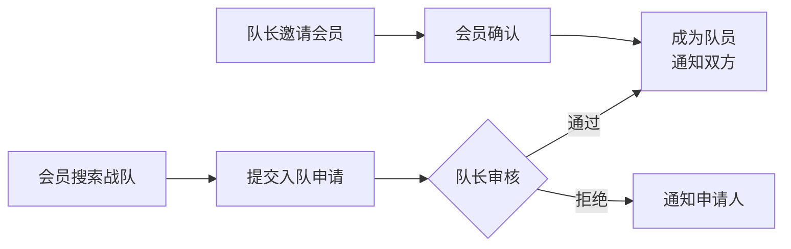
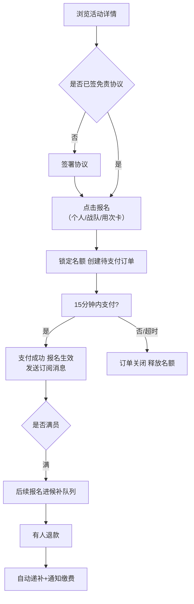
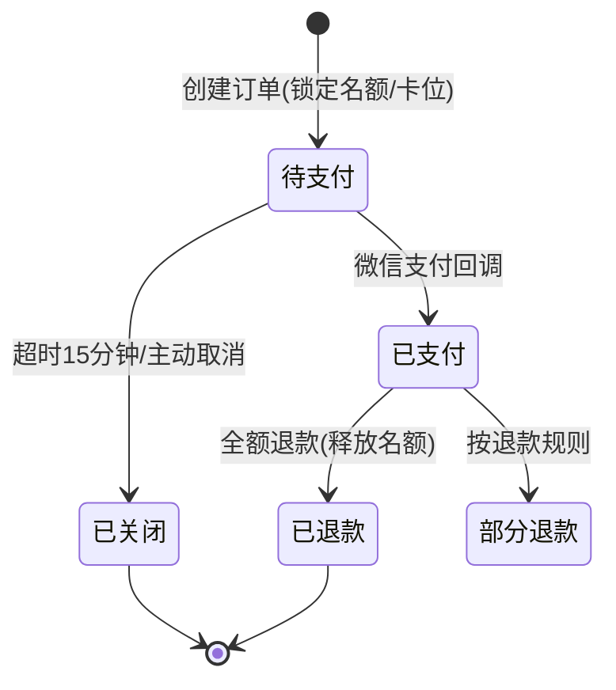
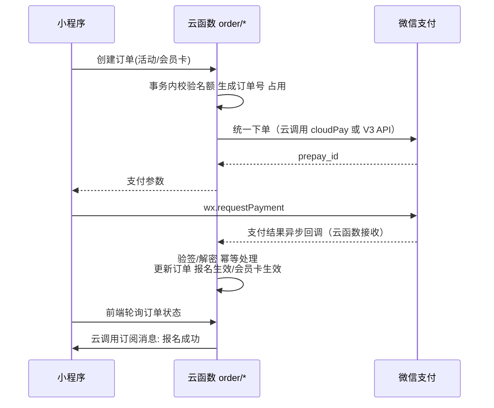
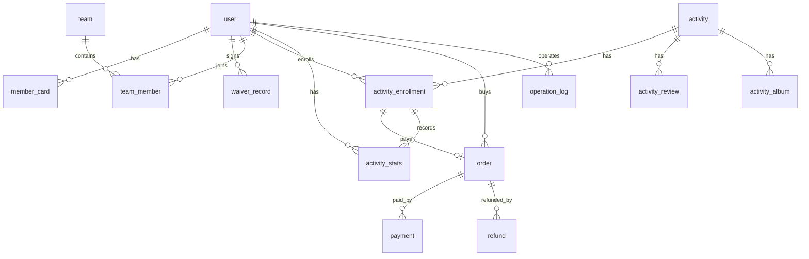

# 真人CS俱乐部小程序 · 架构设计文档

| 项目 | 内容 |
| --- | --- |
| 文档状态 | v0.8（军衔表扩展至 14 档，新增少校以上 4 档，见 3.3） |
| 更新日期 | 2026-10-08 |
| 目标平台 | 微信小程序（默认，见 Q1） |
| 技术底座 | 微信云开发（云函数 + 云数据库 + 云存储） |
| 核心模块 | 用户（会员）/ 战队 / 活动 / 支付 |

---

## 1. 项目概述

### 1.1 一句话描述

为真人CS（激光/水弹/彩弹对抗射击）俱乐部提供一套微信小程序，实现 **会员沉淀、战队运营、活动组织与线上收费** 的闭环。

### 1.2 核心业务闭环

```
微信授权登录 → 完善资料/签免责协议 → 购买会员卡（可选）
     → 创建或加入战队 → 浏览活动并报名 → 微信支付
     → 现场扫码签到 → 赛后录入战绩（手动/Excel）→ 升级 / 晋升军衔 / 获得荣誉（MVP 等）
     → 评价活动/查看相册 → 复购（闭环）
```

### 1.3 角色定义

| 角色 | 说明 | 权限要点 |
| --- | --- | --- |
| 游客 | 未登录/未注册用户 | 仅可浏览活动列表、俱乐部介绍 |
| 会员 | 完成微信授权注册的用户 | 报名活动、加入战队、支付、查看战绩 |
| 战队队长 | 会员的附加身份 | 管理战队成员、以战队名义报名 |
| 教练/裁判 | 俱乐部工作人员 | 现场签到、录入战绩、上传相册 |
| 管理员 | 俱乐部运营者 | 发布活动、退款审核、会员管理、数据统计 |

**角色与权限配置（已确认）**：角色的划分与各角色的权限**在管理端（小程序内嵌管理后台）配置**，不硬编码：

- 管理端提供「角色权限管理」功能：维护角色（预置上表 5 种，可增改）、给用户分配/变更角色、配置角色可用的权限点（如 `publish_activity` 发布活动、`audit_team` 战队审核、`record_stats` 战绩录入、`upload_album` 上传相册、`audit_refund` 退款审核、`view_operation_log` 查询操作日志等）
- `user.role` 存角色标识，角色→权限点映射存云数据库（见 3.4 `role_permission` 集合），调整权限无需发版
- 所有云函数入口按权限点统一鉴权，防止越权

> 待确认 Q2：教练/裁判与管理员是否需要区分？起步阶段可合并为单一"工作人员"角色。

### 1.4 管理端形态（已确认）

**管理功能内嵌在小程序中，不单独开发 Web 管理后台**：

- 小程序**主页设置「管理」入口**，仅持有特定权限的角色（管理员/教练）可见
- 角色与权限由管理端「角色权限管理」在线配置（见 1.3），`user.role` 字段控制，云函数入口统一做权限校验，防止越权
- **后台操作全量日志（P0）**：管理端所有写操作记录操作日志，并提供管理端「操作日志」查询页面（见 1.5）
- 后期用户量增长、需要复杂报表时，再评估独立 Web 后台（作为演进项，非本期范围）

### 1.5 后台操作审计日志（新增需求）

**记录范围**：管理端（小程序内嵌后台）的**所有写操作**：

| 模块 | 典型操作 |
| --- | --- |
| 活动 | 发布/编辑/取消活动、退款审核、候补递补处理 |
| 战队 | 创建审核（通过/拒绝）、解散 |
| 用户 | 角色分配/变更、权限点配置、会员卡人工调整、封禁/解封 |
| 战绩 | 手动录入、Excel 批量导入（记一条批量日志，含成功/失败条数明细） |
| 相册 | 上传/删除（俱乐部统一上传） |
| 其他 | 现场签到核验、订单人工干预、角色权限管理本身的变更 |

**记录内容**（operation_log 集合）：

| 字段 | 说明 |
| --- | --- |
| operator_id / operator_name / operator_role | 操作人 user_id、冗余昵称（展示用）、操作时角色 |
| module | 模块：activity / team / user / stats / album / order / admin |
| action | 操作类型：`activity.publish`、`order.refund`、`team.audit`、`role.update`、`stats.import` 等 |
| target_type / target_id | 操作对象类型与 ID（如 活动ID/订单号/用户ID） |
| detail | 变更摘要（before/after 关键字段，JSON；**敏感字段脱敏**） |
| result / error_msg | 成功 / 失败及原因 |
| created_at | 操作时间 |

**实现机制**：

- 管理端写操作云函数统一走**公共入口封装**：鉴权 → 执行业务 → 写日志；日志写入失败不阻断业务，但需记录告警
- 日志写入采用 fire-and-forget（不增加业务接口延迟）
- 量级估算：日均数百条（单条 < 1KB），存储成本可忽略
- 默认保留 **1 年**，定时触发器按月归档/清理

**查询页面（管理端「操作日志」，M2）**：

- 筛选：操作人、模块、操作类型、时间范围、结果（成功/失败）、关键词
- 分页列表 + 详情查看（变更前后对比）
- 权限：默认仅管理员可见（权限点 `view_operation_log`，可在角色权限管理中调整）
- 日志导出 Excel：P2 可选

---

## 2. 总体技术架构

### 2.1 技术选型（已确认：微信云开发）

| 项 | 选型 |
| --- | --- |
| 前端 | 微信小程序（原生或 Taro，见 Q1） |
| 后端 | 云函数（Node.js + wx-server-sdk） |
| 数据库 | 云数据库（文档型，类 MongoDB） |
| 文件存储 | 云存储（自带 CDN） |
| 支付 | 云函数调用微信支付（云调用 cloudPay 或 V3 API） |
| 消息 | 云调用 subscribeMessage 订阅消息 |
| 定时任务 | 云函数定时触发器 |
| 环境隔离 | 云开发自带 test / prod 双环境 |
| 运维 | 免运维、按量付费，无需服务器与域名备案 |

**云开发路线的注意事项（设计约束）**：

- 文档型数据库无外键/联表查询，关联数据（报名↔用户↔活动）需用**聚合查询或冗余字段**（如报名记录冗余用户昵称头像，避免列表页多次查询）
- 名额防超卖使用云数据库**事务/条件更新**实现（替代 Redis 原子操作）
- 高频热点（活动开抢）注意云函数并发配额与数据库读写配额的按量费用
- 为保持可迁移性：**前端只调云函数**，业务逻辑全部收敛在云函数内，不在前端直连数据库

### 2.2 总体架构图



### 2.3 支撑能力

- **登录鉴权**：云函数调用天然携带 openid（免 code2Session），首次登录落库 user 表并维护 role 字段（会员/管理员/教练）
- **消息触达**：云调用 subscribeMessage（报名成功、活动提醒、退款通知、战队申请通知）
- **定时任务**：云函数定时触发器（待支付订单超时关闭、活动状态自动流转、会员卡过期处理）
- **权限控制**：角色/权限映射存于云数据库（管理端可配置），所有云函数入口统一校验 openid 对应角色的权限点；云函数默认仅本小程序可调用，天然隔离外部请求
- **操作审计日志**：管理端写操作统一埋点（操作人/模块/操作类型/变更前后/结果，见 1.5），管理端提供日志查询页面；敏感字段脱敏存储

---

## 3. 模块一：用户（会员）模块

### 3.1 功能清单

| 优先级 | 功能 | 说明 |
| --- | --- | --- |
| P0 | 微信授权登录 | openid/unionid，头像昵称（小程序新版需用户主动填） |
| P0 | 个人资料 | 昵称、头像、性别、生日、紧急联系人 |
| P0 | 手机号绑定 | **强制**：报名前必须绑定；未成年人绑定**监护人**手机号（云调用获取，需小程序为企业认证主体） |
| P0 | 免责协议签署 | 参与前必须签署（电子留痕：时间、IP、协议版本）；**未成年人须签署监护人同意条款**——协议分成人版 / 未成年人监护人版 |
| P1 | 会员卡 | 次卡/期限卡，购买、续费、核销（已确认，不做储值卡） |
| P1 | 会员等级 | 累计参与场次 → 等级 → 报名折扣（积分体系已砍，等级仅按场次） |
| P1 | 个人军衔 | **总击杀数 + 胜场数**双门槛晋升的荣誉体系（徽章展示，不绑定折扣/权益，见 3.3） |
| P2 | 实名认证 | 身份证号加密存储（可用于未成年人年龄核验，非本期强制） |
| P2 | 收货地址 | 仅当有周边商城/纪念品时需要 |

### 3.2 会员卡方案（已确认：次卡 + 期限卡）

| 卡类型 | 规则示例 |
| --- | --- |
| 次卡 | 10次/30次，购买后12个月内有效，1次=1场常规活动 |
| 期限卡 | 月卡/季卡/年卡，期限内常规活动免费，主题赛享折扣 |

> 具体定价由俱乐部方提供后填入；不涉及储值余额，规避单用途预付卡合规问题。

### 3.3 会员等级与军衔规则（默认提案，可改）

**会员等级（资历线，绑定报名折扣）**：

- 等级：累计报名 `1-9 场=LV1 新兵`，`10-29=LV2 老兵`，`30-59=LV3 精英`，`60+=LV4 王牌`；高等级享受报名费折扣（LV3 95折、LV4 9折）。
- 积分体系已确认**先不做**（Q8）：不做积分获取/抵扣，等级仅由累计场次驱动；后续有需要再扩展。

**个人军衔（实力线，纯荣誉徽章，Q21）**：

- 依据：**总击杀数 + 胜场数**双门槛（数据源：activity_stats 聚合；胜场 = is_win 为 true 的场次）。
- 晋升规则：**与门**（短板决定）——取同时满足「总击杀 ≥ 击杀门槛 且 胜场 ≥ 胜场门槛」的最高档。
- 与会员等级互不干扰：等级 = 资历（场次→折扣），军衔 = 实力（战绩→徽章）；**军衔不绑定任何折扣/权益**，避免两套体系冲突。
- 军衔**如实升降**：战绩覆盖修正（录入纠错）后按新数据重算，可能降衔（区别于等级只升不降，细则可调）。
- 换算规则、字段与展示归 user 模块；**重算执行方为 activity 模块**——战绩写入（录入/Excel 导入/覆盖修正）成功后异步触发（fire-and-forget，失败不阻断录入，下次写入自愈）。

| 军衔 code | 名称 | 击杀门槛 | 胜场门槛 |
| --- | --- | --- | --- |
| recruit | 新兵 | 0 | 0 |
| pfc | 一等兵 | 15 | 1 |
| corporal | 下士 | 50 | 4 |
| sergeant | 中士 | 100 | 8 |
| staff_sergeant | 上士 | 180 | 14 |
| master_sergeant | 军士长 | 300 | 21 |
| second_lieutenant | 少尉 | 450 | 30 |
| first_lieutenant | 中尉 | 650 | 40 |
| captain | 上尉 | 900 | 52 |
| major | 少校 | 1200 | 66 |
| lieutenant_colonel | 中校 | 1600 | 88 |
| colonel | 上校 | 2100 | 112 |
| senior_colonel | 大校 | 2800 | 140 |
| major_general | 少将 | 3600 | 180 |

> 门槛数值为默认提案（可调，Q21），**按年均 10~30 场活动标定**（胜率约五成、场均击杀 5~10）：一等兵约 2~3 场（首季度可达）；中士约 1 年（年均 30 场）/约 2 年（年均 10 场）；军士长约 2 年（年均 30 场）/约 5~6 年（年均 10 场，多数休闲会员的长期段位）；少校需 130+ 场，对应常年满勤且胜率过半的高手约 4~5 年；中校/上校约 6~8 年（俱乐部资深骨干）；大校约 10 年、少将约 12 年+（终身荣誉段位，元老级玩家）。`user.rank` 存军衔 code（新用户默认 recruit），另冗余 `total_kills/total_wins` 供个人主页、战队成员列表与排行榜展示。

### 3.4 核心数据模型

| 集合（collection） | 关键字段 |
| --- | --- |
| user | _id, openid, union_id, nickname, avatar, phone, phone_owner(self/guardian), is_minor, gender, birthday, role, status, total_games(累计场次), total_kills(总击杀), total_wins(胜场), rank(军衔code，默认recruit), created_at |
| member_card | _id, user_id, card_type(次卡/期限卡), remain_times, expire_at, status |
| waiver_record | _id, user_id, agreement_version(成人版/未成年人监护人版), guardian_name, guardian_phone, signed_at, ip |
| role_permission | _id, role_key, name, permissions(权限点数组), is_preset, updated_at |
| user_address | _id, user_id, receiver, phone, region, detail, is_default |

> 云数据库说明：报名列表等高频展示场景在业务集合中冗余昵称/头像等展示字段，资料变更时同步更新。

### 3.5 待确认问题（用户模块）

- Q6：✅ 手机号绑定**强制**（报名前必须绑定；未成年人可绑定监护人手机号）
- Q7：✅ **不限制未成年人参与**，但必须签署**监护人同意条款**（免责协议未成年人监护人版）
- Q8：✅ 积分体系**先不做**（等级仅按累计场次计算）
- Q21：✅ 需要军衔体系（总击杀 + 胜场双门槛，纯荣誉徽章不绑权益）；门槛按年均 10~30 场活动标定（默认提案，可调）

---

## 4. 模块二：战队模块

### 4.1 功能清单

| 优先级 | 功能 | 说明 |
| --- | --- | --- |
| P0 | 创建战队 | 队名、队徽（图片上传）、口号、简介；**提交后需管理员审核**，通过后生效（Q9） |
| P0 | 加入/退出战队 | 搜索队名加入，队长审核制（默认） |
| P0 | 成员管理 | 申请列表、通过/拒绝、移除成员、转让队长 |
| P0 | 战队主页 | 成员列表、战绩统计（总场次/胜率）、近期活动 |
| P1 | 战队排名 | **按胜率排序**的俱乐部内排行榜（Q11） |
| P1 | 战队报名活动 | 队长为全队（或部分成员）统一报名并支付 |
| P2 | 战队解散 | 队长操作，需全员无进行中的报名 |

### 4.2 战队创建与加入流程

**创建战队（需管理员审核，Q9 已确认；不限制创建者会员等级）**：



**加入战队（队长审核制）**：



### 4.3 战队规则（已确认）

- 人数上限：**100 人/队**
- 创建战队：**需管理员审核**；不限制创建者会员等级
- 一人同一时间**仅可属于 1 个战队**：申请入队/创建新战队时校验当前无在职战队，须先退出
- 允许**无战队个人**报名活动（散兵由现场/系统临时组队）

### 4.4 核心数据模型

| 集合（collection） | 关键字段 |
| --- | --- |
| team | _id, name, logo, slogan, captain_user_id, member_count, status(审核中/正常/已拒绝/解散), reject_reason, created_at |
| team_member | _id, team_id, user_id, role(队长/队员), status(申请中/在职/已退出/被移除), joined_at |

> 约束：同一 user_id 在 team_member 中仅允许一条 status=在职 记录（一人一队）；入队申请与创建战队时校验当前无在职战队。

战队战绩（总场次/胜场/胜率）从 activity_stats 聚合计算，战队排行榜**按胜率排序**（Q11）；建议加 team_stats 冗余集合缓存统计值，加速排行榜。

### 4.5 待确认问题（战队模块）

- Q9：✅ 创建战队**需管理员审核**；不限制创建者会员等级
- Q10：✅ 人数上限 **100 人/队**；**不允许**一人同时属于多个战队
- Q11：✅ 战队排行榜按**胜率**排名（P1）

---

## 5. 模块三：活动模块

### 5.1 活动类型（默认提案）

| 类型 | 说明 | 收费 |
| --- | --- | --- |
| 新手体验课 | 教学+轻度对抗，吸引转化 | 低价/免费 |
| 常规对抗赛 | 平时晚场/日场，5v5 等模式 | 单场收费（可用次卡） |
| 主题赛事 | 周末主题活动（吃鸡模式/夜战/剧情战） | 单场收费 |
| 俱乐部联赛 | 周期性积分赛，多轮次 | 按赛季收费 |
| 团建定制 | 企业客户包场 | 商务报价（**待定**，见 Q12） |

> Q12（团建是否纳入）**待定**：订单集合 `biz_type` 已预留扩展（活动报名/会员卡/团建…）。若后续纳入，需增加"团体报名（非会员手机号登记）"能力，不影响现有模型。

### 5.2 功能清单

| 优先级 | 功能 | 说明 |
| --- | --- | --- |
| P0 | 活动发布/编辑（管理端） | 标题、封面、类型、场地、时间、费用、人数上下限、报名截止 |
| P0 | 活动列表/详情/搜索 | 按时间/类型筛选，展示剩余名额 |
| P0 | 在线报名 | 个人报名或（P1）战队报名，创建订单进入支付 |
| P0 | 候补机制 | 满员后进入候补队列，有人退费自动递补并通知 |
| P1 | 扫码签到 | ✅ 已确认需要（Q14）：现场二维码，工作人员核验；联动次卡核销与到场统计 |
| P1 | 战绩录入 | 击杀/阵亡/治疗/补给/占领/胜负/荣誉；录入方式：**管理端手动输入 + Excel 批量导入** |
| P1 | 活动相册 | ✅ **俱乐部统一上传**（Q16），会员仅浏览（规避 UGC 内容审核） |
| P1 | 活动评价 | 星级+文字，仅限已参加者 |
| P2 | 积分赛赛程 | 联赛多轮次对阵表 |

### 5.3 报名流程（含名额控制）



名额防超卖：报名下单时在**云数据库事务**中对活动记录做条件更新（校验剩余名额 > 0 后扣减），支付成功才正式生效，未支付超时由**定时触发器**自动释放。

### 5.4 活动状态机

```
草稿 → 已发布(报名中) → 报名截止 → 进行中 → 已结束
                    ↘ 已取消（触发自动全额退款）
```

### 5.5 战绩与荣誉（已细化）

**个人战绩统计维度**：

| 维度 | 说明 |
| --- | --- |
| 基础数据 | 总场次、胜/负、胜率、总击杀、总阵亡、K/D |
| 任务数据 | **总治疗量、总补给量、总占领点数** |
| 荣誉次数 | MVP、SVP、最佳治疗、最佳补给、最佳占领（累计获得次数） |
| 军衔依据 | **总击杀数、胜场数**（双门槛驱动个人军衔晋升，见 3.3） |

**荣誉评定规则（每场评定）**：

| 荣誉 | 规则 | 每场数量 |
| --- | --- | --- |
| MVP | **胜方**击杀数第一 | 1 人 |
| SVP | **败方**击杀数第一 | 1 人 |
| 最佳治疗 | 全场（所有参与人）治疗量第一 | 1 人 |
| 最佳补给 | 全场补给量第一 | 1 人 |
| 最佳占领 | 全场占领点数第一 | 1 人 |

- 荣誉由系统在战绩录入后**自动评定**（按上表取第一名）；并列第一时默认并列均获得（细则开发期可调）
- 荣誉次数累计展示于个人主页与排行榜

**战绩录入方式（已确认：两种）**：

1. **手动输入**：管理端表单逐人录入（工作人员权限）
2. **Excel 导入**：管理端下载模板 → 填写 → 上传，云函数逐行校验（参赛人是否已报名签到、数值合法性）后批量写入 activity_stats，返回成功/失败明细
3. （后期演进）对接计时/感应设备自动采集

**排行榜**：

- 个人榜：总击杀 / 胜率 / 各项荣誉次数等维度；榜单项展示军衔徽章（读 user.rank 冗余字段，见 3.3）
- 战队榜：**按胜率**（Q11）
- 赛季榜（P2 可选）：胜 +3 / 平 +1 / 负 +0 的赛季积分——仅用于赛季排名，与已砍掉的会员积分体系（Q8）无关

### 5.6 核心数据模型

| 集合（collection） | 关键字段 |
| --- | --- |
| activity | _id, title, type, cover, venue, address, start_time, end_time, signup_deadline, price, max_num, min_num, status, cancel_reason |
| activity_enrollment | _id, activity_id, user_id, team_id(可空), status(待支付/已报名/候补/已签到/已完成/已取消), order_id, checkin_time |
| activity_stats | _id, activity_id, user_id, kills, deaths, heals(治疗量), supplies(补给量), captures(占领点数), is_win, honors(MVP/SVP/最佳治疗/最佳补给/最佳占领), source(manual/excel), created_at |
| activity_review | _id, activity_id, user_id, stars, content, created_at |
| activity_album | _id, activity_id, file_id(云存储), media_type(图/视频), uploader_id(俱乐部工作人员) |

### 5.7 待确认问题（活动模块）

- Q13：✅ 已确认 —— 一活动**单场次**（不做多档时间）
- Q14：✅ **需要扫码签到**（联动次卡核销与到场统计）
- Q15：活动最多提前多久取消可全额退（默认见 6.4）？
- Q16：✅ 相册由**俱乐部统一上传**，会员仅浏览（无 UGC 审核需求）

---

## 6. 模块四：支付模块

### 6.1 支付场景

| 场景 | 说明 |
| --- | --- |
| 活动报名费 | 个人报名、战队批量报名（队长一次支付多人） |
| 会员卡购买/续费 | 次卡/期限卡 |
| 团建定金/尾款 | 待定（Q12），订单 biz_type 已预留 |
| （P1）次卡核销 | 报名常规活动时扣次，不走微信支付（积分抵扣已随 Q8 砍掉） |

### 6.2 订单状态机



### 6.3 支付流程（云函数 + 微信支付）



### 6.4 退款规则（默认提案，可改）

| 情形 | 规则 |
| --- | --- |
| 活动开始前 ≥ 24h 申请 | 全额退款 |
| 活动开始前 < 24h | 退 50% |
| 活动已开始/已签到 | 不退 |
| 俱乐部原因取消 | 全额自动退款 + 订阅消息通知 |
| 会员卡 | 未使用可 7 天无理由退；次卡已使用按剩余次数比例退（规则需最终确认） |

> 待确认 Q17：以上退款比例是否符合你方经营习惯？退款是否需要管理员人工审核（默认 ≥24h 自动退，<24h 需人工）？

### 6.5 安全与对账（必做项）

- 支付结果**以回调为准**（云调用模式由微信侧推送至云函数；直连 V3 模式需验签解密），金额以服务端计算为准，回调幂等（订单号去重）
- 每日对账单下载核对（微信支付资金账单 vs 本地订单集合）
- 退款需管理员权限二次确认（防止误操作/盗用），退款等敏感操作全量记入操作日志（见 1.5）
- 所有金额字段用**分**为单位存储，避免浮点误差

### 6.6 核心数据模型

| 集合（collection） | 关键字段 |
| --- | --- |
| order | _id, order_no, user_id, biz_type(活动报名/会员卡/团建), biz_id, amount(分), pay_amount, status, expire_at, paid_at |
| payment | _id, order_id, transaction_id, channel, paid_at, callback_raw |
| refund | _id, order_id, refund_no, amount, reason, status, apply_user_id, auditor_id, refunded_at |
| coupon / user_coupon | （P1）优惠券领取与核销 |

### 6.7 待确认问题（支付模块）

- Q18：是否需要**优惠券/折扣码**（拉新促销）？默认 P2 暂不做。
- Q19：战队批量报名时，支付人与实际参加人可能不同，发票/收据如何处理？
- Q20：微信支付商户号是否已办理（需企业主体资质）？

---

## 7. 数据库 ER 总览



> 云数据库为文档模型，以上关系通过集合内冗余外键字段（user_id/activity_id 等）表达，用聚合查询或冗余展示字段实现"联表"效果。

---

## 8. 非功能需求

### 8.1 合规（重点）

- 小程序需**企业认证主体**（获取手机号、使用微信支付的硬性要求）
- 真人CS有一定危险性：免责协议 + 健康告知为**报名前置条件**（P0）
- 个人信息保护：手机号/身份证加密存储（AES），日志脱敏；操作日志（见 1.5）中的敏感字段同样脱敏后存储
- 未成年人：不限制参与（Q7 已确认），但**必须签署监护人同意条款**（免责协议监护人版 + 监护人手机号绑定留痕）

### 8.2 性能与可用性

- 报名高峰（热门活动开抢）：名额扣减用云数据库事务/条件更新防超卖；关注云函数并发与数据库配额（可临时提额）
- 图片/视频走云存储（自带 CDN），小程序主包 < 2MB
- 定时触发器兜底：订单超时关闭、活动状态流转、会员卡过期
- 冷启动：高频云函数保持精简、减少依赖，降低首调用延迟

### 8.3 运营数据（P2）

- 活动上座率、复购率、会员卡销量、渠道转化（带小程序码参数统计）

---

## 9. 建议开发阶段

| 阶段 | 范围 | 目标 |
| --- | --- | --- |
| M1 MVP | 登录+资料+免责协议；活动发布/浏览/报名；微信支付；订单退款；操作日志埋点（见 1.5） | 能组织一场收费活动并收到钱 |
| M2 | 会员卡/次卡核销；战队创建（审核）/加入；扫码签到；战绩录入（手动/Excel）与个人主页（含**军衔计算与徽章展示**，见 3.3）；操作日志查询页面 | 运营日常化 |
| M3 | 等级/优惠券；战队排名/联赛；相册/评价；数据报表 | 留存与增长 |

---

## 10. 待确认问题汇总（请逐条回复编号即可）

| 编号 | 问题 | 状态/当前默认 |
| --- | --- | --- |
| Q1 | 平台是否仅为微信小程序（不考虑 H5/抖音/支付宝）？ | ⏳ 待确认（默认仅微信） |
| Q2 | 教练/裁判与管理员是否区分角色？ | ⏳ 默认合并为"工作人员" |
| Q3 | 独立 Web 管理后台？ | ✅ 不建独立后台；管理入口在小程序主页，按权限可见 |
| Q4 | 技术方案 | ✅ 微信云开发（云函数/云数据库/云存储/云调用） |
| Q5 | 会员卡类型 | ✅ 次卡 + 期限卡（不做储值卡）；定价待提供 |
| Q6 | 手机号绑定强制 or 可选？ | ✅ 强制；未成年人可绑监护人手机号 |
| Q7 | 未成年人监护同意流程？ | ✅ 不限参与；须监护人同意条款 |
| Q8 | 积分体系是否要做？ | ✅ 先不做 |
| Q9 | 战队创建是否管理员审核？ | ✅ 需审核；不限创建者等级 |
| Q10 | 战队人数上限？可属多个战队吗？ | ✅ 100 人/队；仅可属 1 个 |
| Q11 | 战队排行榜是否需要？ | ✅ 需要，按胜率排名 |
| Q12 | 企业团建包场是否纳入？ | ⏸ 待定（biz_type 已预留，随时可加） |
| Q13 | 一个活动是否多场次？ | ✅ 单场次 |
| Q14 | 扫码签到是否需要？ | ✅ 需要（P1） |
| Q15 | 退款时间节点规则？ | ⏳ 默认 ≥24h 全退 / <24h 退50% |
| Q16 | 相册由谁上传？ | ✅ 俱乐部统一上传 |
| Q17 | 退款是否需人工审核？ | ⏳ 默认 ≥24h 自动 |
| Q18 | 优惠券/折扣码？ | ⏳ 默认 P2 暂不做 |
| Q19 | 批量报名的收据/发票处理？ | ⏳ 默认暂不开票 |
| Q20 | 微信支付商户号是否已办理？ | ⏳ 待确认 |
| Q21 | 军衔体系是否按默认提案（14 档，击杀+胜场双门槛，纯荣誉不绑权益）？ | ✅ 需要；门槛按年均 10~30 场活动标定（默认提案，可调） |

---

## 11. 运营成本估算（按 1000 用户规模）

> 依据微信云开发现行计费（[官方计费说明](https://developers.weixin.qq.com/miniprogram/dev/wxcloudservice/wxcloud/billing/price)），价格为估算值，实际以官方账单为准。

**结论：基础设施约 40~130 元/月（常态 ~1000 元/年量级），另有微信支付手续费 0.6% 从流水中扣、小程序认证 300 元/年；开发期前 6 个月云环境免费。**

### 11.1 用量假设

1000 注册会员、月活 ~50%、日活 ~100、每月 10 场活动。

### 11.2 月度基础设施成本

| 计费项 | 基础套餐内配额（19.9 元/月） | 预估用量 | 超出单价 | 预估月费用 |
| --- | --- | --- | --- | --- |
| 基础套餐 | — | — | — | 19.9 |
| 调用次数（云函数/数据库读写/存储操作合并计） | 20 万次 | 15~40 万次 | 0.5 元/万次 | 0~10 |
| CDN 流量（相册图片/视频浏览） | 5 GB | 10~35 GB | 0.21 元/GB | 1~6 |
| 存储容量（活动照片/视频，**成本大头**） | 2 GB | 每月新增 5~10 GB | ≈3 元/GB/月 | 0~90 |
| 云函数资源使用量 | 10 万 GBs | ~3 万 GBs | ≈0.0001 元/GBs | 0 |
| **合计** | | | | **约 40~130 元/月** |

### 11.3 其他成本

- **微信支付手续费 0.6%**：从每笔收款中扣除（非平台费用）；月流水 2 万 → 约 120 元/月，结算到对公账户免费
- **小程序微信认证（企业主体）**：300 元/年；支付商户号免费办理
- **一次性开发成本**：云开发新账号有 6 个月免费体验环境（配额同基础套餐），小程序上线后第 15 天起需转付费——开发与试运营期近乎零成本
- **通知**：使用订阅消息（免费），不使用短信（0.05 元/条）

### 11.4 成本控制要点

1. **相册是唯一成本大头**：照片上传前压缩至 1MB 内、限制视频时长与数量、仅保留最近 2~3 个月相册（旧照片归档下载后删除）——存储费可控制在 30 元/月以内
2. 1000 用户规模用不到标准版（199 元/月），基础套餐 + 按量付费即可；套餐 QPS 上限 500，远超活动"开抢"峰值
3. 前端对活动列表等高频页面做本地缓存，减少调用次数
