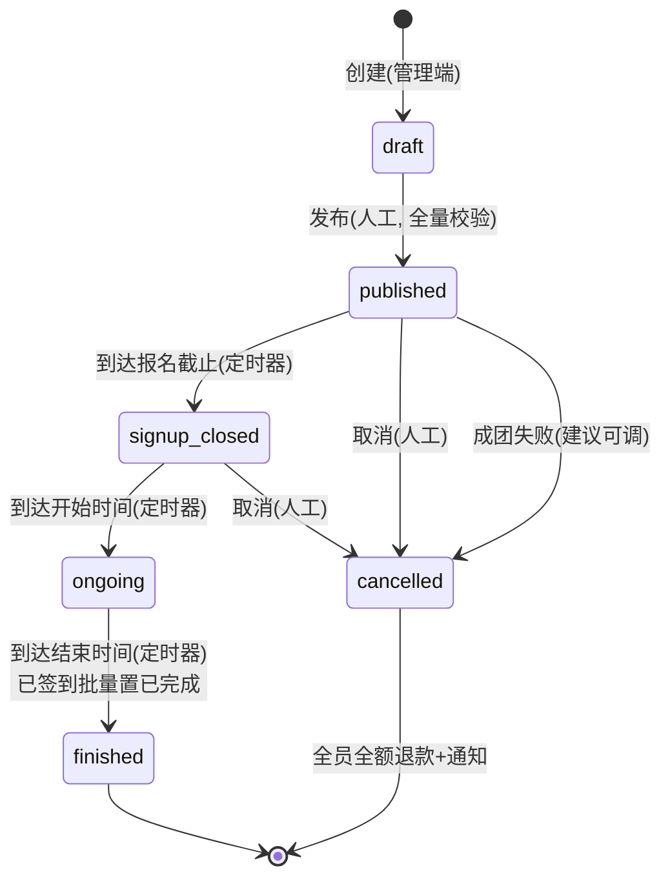
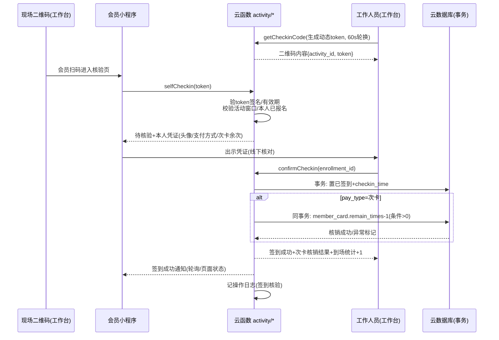

# 真人CS俱乐部小程序 · 活动模块详细设计文档

| 项目 | 内容 |
| --- | --- |
| 文档版本 | v1.0 |
| 依据架构文档 | v0.5（h:\CS_miniapp\docs\architecture.md，唯一事实源） |
| 更新日期 | 2026-10-08 |
| 模块范围 | 活动发布/浏览/报名/候补/签到/战绩/相册/评价（云函数 activity/*） |
| 技术底座 | 微信云开发（云函数 Node.js + wx-server-sdk、云数据库、云存储、云调用、定时触发器） |

> 约定：全文金额单位为**分**（整数）；时间为**毫秒时间戳**（字段以 `_at` / `_time` 结尾）；云函数统一返回 `{ code, msg, data }`，`code=0` 表示成功；所有入参均在**云函数侧**做校验；文档型数据库无外键，跨集合关联使用**冗余外键字段 + 同步策略**（见 6.6）。标注「建议，可调」的内容为实现细节建议，不构成已确认决策。

---

## 1. 模块概述

### 1.1 职责边界

本模块负责从**活动发布**到**赛后沉淀**的全生命周期：

- 活动的发布、编辑、取消（管理端，记操作日志）
- 活动列表/详情/搜索展示（游客可浏览）
- 在线报名（含个人散兵报名、战队报名 P1 预留）、名额防超卖、15 分钟支付锁、候补队列与自动递补
- 活动状态机流转（定时触发器驱动）
- 扫码签到（现场二维码 + 工作人员核验，联动次卡核销与到场统计）
- 战绩录入（管理端手动输入 + Excel 批量导入）、荣誉自动评定、个人战绩统计、**军衔冗余重算执行**（战绩写入后异步聚合 total_kills/total_wins 并按 user 模块 R15 军衔表换算 rank 写回 user，架构 §3.3）
- 活动相册（俱乐部统一上传，会员仅浏览）、活动评价（仅限已参加者）

**不属于本模块**：订单支付/退款资金流（order 模块，本模块负责名额联动）、Excel 通用上传/解析框架与模板下载入口（admin 管理端模块，本模块定义战绩模板字段与逐行校验规则）、战队选人交互细节（team 模块）、会员卡购买（user 模块，本模块仅做次卡/期限卡的资格校验与核销联动）、会员积分（**已随 Q8 砍掉，本模块不设计任何积分**；赛季榜积分仅为 P2 可选的排名用途，见 1.4）。

### 1.2 架构文档章节引用

| 主题 | 架构文档章节 |
| --- | --- |
| 活动类型 5 种 / 单场次（Q13） | §5.1、§5.7 |
| 功能清单与优先级 | §5.2 |
| 报名流程与名额控制（防超卖、15 分钟锁、候补递补） | §5.3 |
| 活动状态机 | §5.4 |
| 战绩与荣誉评定规则 | §5.5 |
| 军衔体系（总击杀+胜场双门槛，重算执行方为本模块） | §3.3、Q21 |
| 核心数据模型（5 集合） | §5.6 |
| 免责协议 / 手机号前置（Q6/Q7） | §3.1、§8.1 |
| 次卡/期限卡规则 | §3.2、§6.1 |
| 退款规则与取消活动全额退款 | §6.4 |
| 金额单位、支付以回调为准、金额服务端计算 | §6.5 |
| 操作审计日志 | §1.5 |
| 角色权限点（管理端在线配置） | §1.3、§2.3 |
| 相册成本控制（1MB 压缩、保留 2~3 个月） | §11.4 |
| 开发阶段 M1/M2/M3 | §9 |

### 1.3 关键已确认决策（本模块必须遵守）

| # | 决策 | 来源 |
| --- | --- | --- |
| 1 | 活动类型 5 种：新手体验课/常规对抗赛/主题赛事/俱乐部联赛/团建定制（团建待定 Q12，订单 `biz_type` 预留）；**一个活动单场次**（不做多档时间） | §5.1、Q13 |
| 2 | 报名前置校验：**已签免责协议**（未成年人须监护人版）+ **已绑手机号**（强制） | Q6/Q7 |
| 3 | 名额防超卖：**云数据库事务/条件更新**（校验剩余名额>0 后扣减）；待支付订单**锁名额 15 分钟**，超时由定时触发器释放 | §5.3 |
| 4 | 候补机制：满员进候补队列，退款释放名额**自动递补 + 订阅消息通知** | §5.2 |
| 5 | 状态机：草稿→已发布(报名中)→报名截止→进行中→已结束；已取消（触发自动全额退款） | §5.4 |
| 6 | 扫码签到：现场二维码、工作人员核验、**联动次卡核销与到场统计** | Q14 |
| 7 | 荣誉 5 项每场评定：MVP=胜方击杀第一、SVP=败方击杀第一、最佳治疗/最佳补给/最佳占领=全场第一，各 1 人；录入后系统自动评定；并列默认均获得（可调） | §5.5 |
| 8 | 战绩录入两种方式：管理端手动输入 + Excel 批量导入（逐行校验→批量写入→返回成功/失败明细） | §5.5 |
| 9 | 相册**俱乐部统一上传**（工作人员权限），会员仅浏览；照片压缩至 1MB 内、仅保留 2~3 个月 | Q16、§11.4 |
| 10 | 评价：星级+文字，仅限已参加者 | §5.2 |
| 11 | 管理端写操作（发布/编辑/取消、战绩录入、相册上传等）**全量记操作日志** | §1.5 |
| 12 | 允许无战队个人报名（散兵）；战队报名 P1 | §4.3、§5.2 |
| 13 | **军衔重算**：战绩写入（录入/导入/覆盖修正）成功后异步聚合 `total_kills/total_wins`，按 user 模块 R15 军衔表（与门，短板决定）换算 rank 写回 user；fire-and-forget 不阻断录入（Q21） | §3.3、Q21 |

### 1.4 P0/P1/P2 功能清单

| 优先级 | 功能 | 说明 |
| --- | --- | --- |
| P0 | 活动发布/编辑/取消（管理端） | 5 种类型、单场次、发布校验、取消触发自动全额退款 |
| P0 | 活动列表/详情/搜索 | 游客可浏览，按时间/类型/状态筛选，展示剩余名额 |
| P0 | 在线报名（个人散兵） | 前置校验链、云数据库事务防超卖、15 分钟支付锁 |
| P0 | 候补机制 | 满员入队、名额释放自动递补 + 订阅消息通知 |
| P0 | 报名取消/退款联动 | 用户取消转 order 模块退款；活动取消自动全额退款 |
| P0 | 操作日志埋点 | 本模块全部管理端写操作（§1.5） |
| P1 | 扫码签到 | 现场二维码、工作人员核验、次卡核销联动、到场统计 |
| P1 | 战绩录入 | 手动输入 + Excel 批量导入（逐行校验） |
| P1 | 荣誉自动评定 | 5 项荣誉、并列默认均获得（标注可调） |
| P1 | 个人战绩统计 | 总场次/胜负/胜率/K/D/治疗/补给/占领/荣誉次数 + 当前军衔（R15 冗余字段读取） |
| P1 | 活动相册 | 俱乐部统一上传、会员浏览、容量与保留策略 |
| P1 | 活动评价 | 星级+文字，仅限已参加者 |
| P1 | 战队报名（接口预留） | 队长统一报名多人、一次支付；选人细节属战队模块 |
| P2 | 个人排行榜 | 总击杀/胜率/各荣誉次数维度 |
| P2 | 赛季榜（可选） | 胜+3/平+1/负+0 的**赛季积分**，仅用于赛季排名（与已砍掉的会员积分体系无关，Q8） |
| P2 | 相册归档自动化、数据报表（上座率等） | 配合 admin 模块报表 |

---

## 2. 页面设计

### 2.1 页面清单

| # | 页面路径 | 标题 | TabBar? | 可见角色 | 主要交互 |
| --- | --- | --- | --- | --- | --- |
| 1 | /pages/activity/list | 活动 | 建议（可调） | 游客/会员 | 列表分页下拉刷新、按类型/状态筛选、搜索标题关键词、点击进详情；展示类型标签、时间、价格、**剩余名额/已满员**角标 |
| 2 | /pages/activity/detail | 活动详情 | 否 | 游客/会员 | 图文详情、时间/场地/费用/名额/报名进度、已结束态展示战绩与荣誉、评价列表（含平均星级）、相册入口、报名按钮（状态随活动状态机与本人报名态变化）、分享 |
| 3 | /pages/activity/signup-confirm | 确认报名 | 否 | 会员 | 展示费用明细（原价/等级折扣/卡抵扣/应付）、支付方式选择（微信支付/次卡/期限卡）、勾选「已阅读并同意免责协议」、提交报名；前置项缺失时给出去签署协议/绑手机引导 |
| 4 | /pages/activity/my-enrollments | 我的报名 | 否 | 会员 | 全部/待支付/已报名/候补/历史分组；待支付项展示 15 分钟倒计时与「去支付」「取消」；候补项展示队列位次与「退出候补」；已报名项可发起退款申请 |
| 5 | /pages/activity/checkin-verify | 现场签到 | 否 | 会员 | 扫现场二维码后进入；自动调 selfCheckin 提交核验请求；展示本人报名凭证（昵称/头像/报名状态/支付方式）；等待工作人员核验，核验通过后展示签到成功与次卡核销结果 |
| 6 | /pages/activity/review | 评价活动 | 否 | 会员 | 星级（1~5）选择、文字（≤200 字）、提交；仅已参加者可进入 |
| 7 | /pages/activity/album | 活动相册 | 否 | 会员 | 俱乐部上传的图片/视频九宫格流式加载、点击大图浏览（云存储 CDN）；无上传入口 |
| 8 | /pages/admin/activity/list | 活动管理 | 否 | 工作人员（publish_activity） | 全部状态（含草稿/已取消）管理列表；入口：编辑/发布/取消/报名名单/签到/战绩录入/相册管理 |
| 9 | /pages/admin/activity/edit | 发布/编辑活动 | 否 | 工作人员（publish_activity） | 表单：标题/封面/类型/场地地址/起止时间/报名截止/价格(分)/人数上下限/图文简介；草稿保存与发布两个动作；已发布活动的可编辑字段受限（见 3.1.3） |
| 10 | /pages/admin/activity/enroll-list | 报名/候补名单 | 否 | 工作人员（publish_activity） | 报名名单（昵称/头像/手机号脱敏展示/支付方式/状态/签到时间）、候补队列（位次）、手动触发递补、导出名单（Excel，走 admin 通用框架） |
| 11 | /pages/admin/activity/checkin | 签到工作台 | 否 | 工作人员（checkin_activity） | 生成并展示现场签到二维码（动态 token 轮播）、待核验请求列表（实时轮询刷新）、逐条确认核验（联动次卡核销）、到场统计（已签到/总报名）实时展示 |
| 12 | /pages/admin/activity/stats-record | 战绩录入 | 否 | 工作人员（record_stats） | 单人录入表单（选择已签到成员、六项数值、胜负）；Excel 导入入口（下载模板→上传→展示成功/失败明细）；录入后自动展示本场荣誉评定结果 |
| 13 | /pages/admin/activity/stats-list | 战绩与荣誉 | 否 | 工作人员（record_stats） | 单场全员战绩表格、荣誉评定结果（MVP/SVP/最佳治疗/最佳补给/最佳占领）、修改入口 |
| 14 | /pages/admin/activity/album-manage | 相册管理 | 否 | 工作人员（upload_album） | 图片/视频上传（前端压缩至 1MB 内）、删除、容量进度（当前数量/上限）、过期归档提示 |
| 15 | /pages/admin/activity/review-list | 评价查看 | 否 | 工作人员（publish_activity） | 单场评价列表与星级汇总（P1，仅查看） |

> 页面路径与 TabBar 归属为建议（可调），最终以全局页面路由设计为准；管理端页面均从主页「管理」入口按权限点可见（架构 §1.4）。

### 2.2 关键状态展示说明

| 状态 | 适用页面 | 展示与交互 |
| --- | --- | --- |
| 空态（无进行中活动） | 列表 | 插画 +「近期暂无活动，去看看往期精彩」+ 已结束活动推荐位（建议，可调） |
| 报名中（有余量） | 详情/列表 | 「立即报名」主按钮 + 剩余名额 `remain_num/max_num`；本人已报名则显示「已报名 · 查看我的报名」 |
| 满员态 | 详情/列表 | 按钮变「加入候补」，显示候补人数；详情页提示「已满员，加入候补将按排队顺序自动递补」 |
| 候补态 | 我的报名/详情 | 队列位次（按 enqueue_at 序实时计算）、「退出候补」、递补规则说明文案 |
| 待支付态 | 我的报名 | 15 分钟倒计时、「去支付」「取消报名」；倒计时归零提示已释放 |
| 报名截止 | 详情 | 按钮置灰「报名已截止」；候补入口同步关闭 |
| 进行中 | 详情 | 「活动进行中」；签到入口引导（已报名者） |
| 已结束 | 详情 | 展示单场战绩榜与荣誉名单（建议公开，可调）、评价列表与平均星级、相册入口、「已结束」标记 |
| 已取消 | 列表/详情 | 列表默认隐藏（可筛「已取消」）；详情显示取消原因与「报名费将原路全额退回」提示 |
| 未达开团人数 | 详情/通知 | 报名截止时已报名 < min_num → 活动自动取消，全员通知全额退款（建议，可调，见 3.11） |

---

## 3. 业务规则详细设计

### 3.1 活动发布/编辑校验规则

**描述**：管理端创建/编辑活动时的字段合法性约束，发布时全量校验，草稿仅做宽松保存。

**触发时机**：`activity/create`（保存草稿）、`activity/update`（编辑）、`activity/publish`（发布）。

**校验/计算逻辑**（云函数侧逐项校验，任一失败即拒绝并返回首个错误）：

| 字段 | 规则 |
| --- | --- |
| title | 必填，1~30 字（建议，可调） |
| type | 必填，枚举 `novice`(新手体验课)/`regular`(常规对抗赛)/`theme`(主题赛事)/`league`(俱乐部联赛)/`custom`(团建定制)；`custom` 发布需二次确认（Q12 团建待定，订单 `biz_type` 已预留，不影响模型） |
| cover | 必填，云存储 fileID，单张 ≤ 2MB（前端压缩，云函数校验 size 字段） |
| venue / address | 必填；建议附经纬度 `location{lat,lng}` 用于导航（可调，非必填） |
| start_time / end_time | 必填，均为毫秒时间戳；`end_time > start_time`；单场时长 ≤ 12h（建议，可调）；发布时 `start_time > now + 30min`（最小提前量，建议，可调）。**单场次**：一个活动仅一对起止时间，不设多档（Q13） |
| signup_deadline | 必填；`now < signup_deadline ≤ start_time` |
| price | 必填，整数**分**，≥ 0；0 表示免费（新手体验课允许 0） |
| max_num / min_num | 必填整数；`1 ≤ min_num ≤ max_num`；`max_num ≤ 500`（建议，可调） |
| intro | 可选，图文详情 ≤ 5000 字（建议，可调） |
| pay_types | 建议可选 `[wxpay, times_card, period_card]` 默认全开（可调）；次卡/期限卡仅对 `regular` 常规对抗赛默认生效（期限卡对 `theme` 折扣的细节属支付/会员卡策略，由服务端计价，见 3.2） |

**边界条件**：

1. **草稿宽松保存**：`draft` 状态仅校验 title 非空，其余字段允许缺失，发布时全量校验。
2. **已发布活动的编辑限制**（防止影响已成立报名）：
   - 价格：已有**有效报名**（存在 status ∈ {待支付,已报名,候补,已签到} 记录）后**不可修改**（防止支付歧义，架构 §6.5 金额以服务端计算为准）；
   - max_num：只能调大不能调小（调小后不得低于当前已报名+待支付数）；
   - 时间/标题/封面可修改，但 start_time 修改后若晚于原值需向已报名用户发订阅消息「活动时间变更」（建议，可调）；
   - 报名截止时间只能延长不能提前到早于 now；
   - 报名截止/开始后不可再修改时间类字段。
3. **重复发布**：仅 `draft` 状态可发布；已发布活动重复调用返回状态冲突错误。
4. 团建 `custom` 类型涉及商务报价与团体报名（非会员手机号登记，架构 Q12），本期不开放报名入口，仅可发布为展示/线下登记（待 Q12 确认后扩展）。

### 3.2 报名费用计算规则（服务端计价）

**描述**：报名应付金额一律由云函数计算，前端仅展示。

**触发时机**：`activity/signup`（个人）、`activity/notifyRefund` 递补创建订单时。

**计算逻辑**（金额全部为分，整数；顺序执行）：

```
基础价 = activity.price
折扣：会员等级折扣（user 模块等级规则：LV3 95折 / LV4 9折，来自架构 §3.3，等级数据由 user 模块提供）
支付方式：
- wxpay（微信支付）：应付 = 折后价
- times_card（次卡）：仅常规对抗赛可用；应付 = 0（不创建支付订单；次卡次数在【签到核验成功时】核销，见 3.7）
- period_card（期限卡）：期限内常规对抗赛免费（应付=0）；主题赛事享折扣（折扣率属会员卡运营配置，由 user/order 模块计价规则提供，本模块透传）
免费结果（应付=0）：不创建微信支付订单，报名直接生效为「已报名」（见边界 2）
```

**边界条件**：

1. 等级折扣与支付方式折扣不叠加时以「先等级折扣、再卡规则」顺序计算，四舍五入到分（建议，可调）。
2. **0 元报名**（免费活动 / 次卡 / 期限内免费）：不产生微信支付订单与 15 分钟锁，事务内直接置 `enrollment.status=已报名` 并发送报名成功订阅消息；`pay_type` 如实记录（`free`/`times_card`/`period_card`），`price_snapshot` 记录应付 0（建议 0 元不落 order 记录，如需对账可由 admin 报表统计，可调）。
3. 金额精度：所有中间计算用整数分运算，禁止浮点。

### 3.3 报名前置校验链

**描述**：点击报名到创建订单前的完整校验顺序，任一失败终止并返回引导信息。

**触发时机**：`activity/signup`（个人散兵报名；战队报名 P1 复用同一校验链后叠加批量逻辑）。

**校验/计算逻辑**（按序执行）：

| # | 校验项 | 逻辑 | 失败处理 |
| --- | --- | --- | --- |
| 1 | 登录态 | 云函数天然携带 openid；游客无 openid | 返回未登录错误，前端引导授权 |
| 2 | 用户状态 | `user.status` 正常（未封禁） | 返回账号受限错误 |
| 3 | 活动可报名 | `activity.status = published(已发布)` 且 `now < signup_deadline` | 返回活动状态错误（3004/3005） |
| 4 | **已签免责协议** | `waiver_record` 存在该 user 的有效签署记录；`user.is_minor=true` 时必须为**未成年人监护人版**（Q6/Q7） | 返回 3010，前端跳转协议签署页 |
| 5 | **已绑手机号** | `user.phone` 非空（未成年人绑定监护人手机号亦视为有效） | 返回 3011，前端跳转手机号绑定 |
| 6 | 无重复报名 | 该 `activity_id + user_id` 不存在 status ∈ {待支付,已报名,候补,已签到,已完成} 的记录 | 返回 3009 |
| 7 | 支付方式资格 | `times_card`：`member_card` 存在有效卡（status 有效、未过期、remain_times>0，仅常规赛）；`period_card`：期限内有效 | 返回 3012/3013 |
| 8 | 时间冲突（可选） | 与本人其他「已报名/待支付」活动时间区间重叠时**提示但允许**（默认不强拦截，建议，可调；递补时会强校验，见 8.3） | 前端弹确认 |

**边界条件**：

1. 协议与手机号校验顺序固定：先协议后手机号（与架构 §1.2 闭环顺序一致）。
2. 前置项缺失是**状态错误而非异常**，返回结构化 `data.need_action`（如 `sign_waiver`/`bind_phone`）供前端直接路由。
3. 免费活动同样走完整前置校验链（协议/手机号是参与合规要求，架构 §8.1）。

### 3.4 名额防超卖事务（云数据库事务方案）

**描述**：报名扣减名额使用**云数据库事务 + 条件更新**实现原子防超卖（不引入 Redis，架构 §2.1 约束）。

**触发时机**：`activity/signup`（有余量报名）、候补递补锁位（3.6）。

**事务步骤**（wx-server-sdk `db.startTransaction()`，伪代码）：

```js
const t = await db.startTransaction();
try {
  // S1. 条件更新扣减名额：仅当状态为已发布且剩余名额>0 时扣减
  const upd = await db.collection('activity')
    .where({ _id: activityId, status: 'published', remain_num: _.gt(0) })
    .update({ data: { remain_num: _.inc(-1) } });
  if (upd.stats.updated !== 1) {
    await t.rollback(); // 名额不足或状态变化 → 走候补分支（见 3.6）
    return enterWaitlist(...);
  }
  // S2. 事务内创建报名记录（冗余展示字段见 6.2）
  const enrid = await t.collection('activity_enrollment').add({ data: {
    activity_id, user_id, nickname, avatar,
    activity_title, activity_cover, activity_start_time, // 冗余（见 6.6）
    status: 'pending',            // 待支付
    pay_type, price_snapshot,     // 服务端计算金额（3.2）
    order_id: null,
    expire_at: now + 15 * 60 * 1000,  // 15 分钟锁（3.5）
    created_at: now,
  }});
  // S3. 事务内创建订单（biz_type='活动报名'，架构 §6.6；金额服务端计算）
  const ord = await t.collection('order').add({ data: {
    order_no: genOrderNo(), user_id,
    biz_type: 'activity_enroll', biz_id: enrid._id, // 订单业务对象指向报名记录
    amount: payAmount, status: 'pending',
    expire_at: now + 15 * 60 * 1000, created_at: now,
  }});
  // S4. 回写报名记录的 order_id
  await t.collection('activity_enrollment')
    .doc(enrid._id).update({ data: { order_id: ord._id } });
  await t.commit();
} catch (e) { await t.rollback(); throw e; }
// 事务提交后：S5. 统一下单（云调用 cloudPay / V3，架构 §6.3）；
// 若统一下单失败：执行反补偿（补偿事务：名额+1、报名置已取消、订单置已关闭），返回下单失败
```

**边界条件**：

1. **条件更新是防超卖核心**：`where` 中带 `remain_num > 0` 与 `status='published'`，数据库层保证并发下仅 N 个请求能成功扣减（updated=1 判定）。
2. 事务冲突/失败：向客户端返回可重试错误（3006），前端提示「当前报名人数较多，请重试」（建议重试 1 次，可调）。
3. **开抢高峰**（架构 §8.2）：条件更新失败的请求走候补分支（见 3.6）；云函数并发与数据库读写配额按量付费，热门活动可临时提配额。
4. `remain_num` 为冗余字段（默认= max_num，创建/调整 max_num 时同步初始化），一切名额变动（扣减/释放）必须经事务更新，禁止前端计算。
5. 次卡/0 元报名：不创建 order（S3 跳过），事务内直接置 `status='enrolled'`（已报名）并发报名成功订阅消息（事务外发送）。
6. 订单号生成：`业务前缀 + 日期 + 随机序列`，保证唯一（细则属 order 模块）。

### 3.5 15 分钟名额锁与超时释放

**描述**：创建待支付订单即锁定名额 15 分钟；超时未支付由**定时触发器**释放名额并联动候补递补。

**触发时机**：报名创建订单（写入 `expire_at`）；定时触发器每分钟扫描。

**校验/计算逻辑**：

1. 锁定：`enrollment.expire_at = now + 15min`（常量 `LOCK_MINUTES=15`，建议，可调），同一订单 `order.expire_at` 一致（订单超时关闭规则与架构 §6.2 订单状态机一致）。
2. 释放（`activity/timer` 每分钟执行）：
   - 查询 `activity_enrollment`：`status='pending'` 且 `expire_at < now`；
   - 对每条记录执行事务：`enrollment.status='cancelled'`（cancel_type=`pay_timeout`）+ `activity.remain_num +1` + 关联 `order.status='closed'`（待支付订单置已关闭，架构 §6.2）；
   - 事务提交后触发**候补递补**（见 3.6）；
   - 发送「报名超时释放」订阅消息（若用户已订阅该模板，建议，可调）。
3. 主动取消待支付：用户在「我的报名」取消，走同一释放事务（cancel_type=`user_cancel`），同步释放名额并触发递补。

**边界条件**：

1. **支付回调晚于超时释放**（先释放后到账）：回调幂等检查发现订单已 closed → 触发**自动原路全额退款**并通知用户（见 8.2）。
2. 释放必须与递补串联但**分步执行**：先释放成功再递补；递补失败不影响释放结果（递补可重试，见 8.4）。
3. 释放时活动可能已被取消/已截止：仍需执行报名记录置已取消（名额回补无意义但保持数据一致，`cancelled` 活动不再递补）。
4. 定时扫描批量上限：单次处理 ≤ 200 条（建议，可调），超出部分下轮继续，避免单次执行超时。

### 3.6 候补队列与递补规则

**描述**：满员后新报名进入候补队列；名额释放（超时/退款）时自动递补队首并通知缴费，递补者同样受 15 分钟锁约束。

**触发时机**：报名时满员（进入队列）；名额释放后（递补）；用户退出候补。

**校验/计算逻辑**：

1. **入队**：报名事务条件更新失败（满员）且活动仍 `published` 且未过报名截止 → 创建 `enrollment` 记录 `status='waitlist'`、`enqueue_at=now`（不扣名额、不创建订单、不收费）；`activity.waitlist_count+1`。
   - 若已过报名截止或活动非 published，返回不可报名错误（不入队）。
2. **队列序**：按 `enqueue_at` 升序（同毫秒按 `_id` 序，保证稳定，建议，可调）；队列位次 = 该活动 waitlist 记录中排在本人之前的数量 +1。
3. **递补**（名额释放后触发，事务）：
   - 取队首 waitlist 记录；无候补则结束；
   - **递补前校验**：用户状态正常、未重复报名（本人是否已通过其他途径报名）、**时间冲突强校验**（与本人其他有效报名活动时间区间重叠 → 跳过该用户：置 `cancelled`（cancel_type=`waitlist_conflict`）+ 通知 + 继续取下一位，见 8.3）；
   - 通过校验：条件更新 `remain_num > 0` 扣减 → 队首记录置 `status='pending'`（待支付）+ `expire_at = now+15min` + 创建订单（金额按递补时活动价格与用户卡/等级重算，服务端计价）；
   - 事务外发送「候补递补成功，请在 15 分钟内完成支付」**订阅消息**（云调用 subscribeMessage）；
   - 递补者超时未支付 → 释放（3.5）→ 递补下一位（链式，单轮最多递补 1 名有效锁位者，循环由定时器多轮完成）。
4. **退出候补**：用户可随时退出（置 `cancelled`，cancel_type=`user_cancel`），`waitlist_count-1`；退出后位次自动前移。
5. **手动递补**：管理端 `activity/promoteWaitlist`（权限 publish_activity，记操作日志）用于自动递补异常时人工触发，逻辑与自动递补一致。
6. **活动取消/截止**：活动取消时全部候补置 `cancelled` 并通知（3.8）；报名截止后不再递补（截止即冻结名单，建议，可调——若运营需要截止后递补需改为人工管理端操作）。

**边界条件**：

1. 订阅消息为**一次性授权**：递补通知可能因用户未订阅/授权次数用尽而发送失败——**递补资格不以通知送达为前提**（15 分钟超时机制自然把名额传递给下一位）；「我的报名」页可主动查看候补状态（架构 §2.3）。
2. 递补与并发释放（两个名额同时释放）：递补事务的条件更新 `remain_num>0` 保证不超补；同一候补用户不会被两个递补事务同时锁定（事务内二次校验 status='waitlist' 的条件更新，updated=1 才继续）。
3. 候补人数无上限（建议 ≤ 500 提示运营关注，可调）。
4. 免费活动满员：同样入候补，递补时直接置已报名（0 元，不创建订单）。

### 3.7 扫码签到规则（含次卡核销联动）

**描述**：现场二维码 + 工作人员核验的双重确认签到；核验通过时联动次卡核销，并累计到场统计。

**触发时机**：工作人员在工作台生成签到二维码（`activity/getCheckinCode`）；会员扫码（`activity/selfCheckin`）；工作人员确认（`activity/confirmCheckin`）。

**校验/计算逻辑**：

1. **签到二维码**：内容携带 `{ activity_id, token }`；`token` 由云函数签发（`activity_id + 时间窗口` 的签名，动态轮换，**有效期 60 秒**（建议，可调）），工作台页面到时自动刷新；仅 `checkin_activity` 权限可获取。防伪造：token 含 HMAC 签名，云函数侧验签。
2. **会员扫码提交**（selfCheckin）：
   - 校验 token 签名与有效期（过期提示等待二维码刷新重扫）；
   - 校验活动状态 ∈ {报名截止, 进行中} 且 `now ∈ [start_time - 30min, end_time]`（签到窗口，建议，可调）；
   - 校验本人存在该活动 `status='enrolled'` 的报名记录（待支付/候补/已签到给出对应提示文案）；
   - 通过则生成「待核验」请求（挂在报名记录上：`checkin_request={requested_at, status:'waiting'}`），返回本人凭证信息（昵称/头像/支付方式/次卡余次）供现场比对。
3. **工作人员核验**（confirmCheckin，权限 `checkin_activity`，记操作日志）：
   - 工作台待核验列表（按 requested_at 排序）→ 核对本人身份（人脸/装备号，线下动作）后点「确认核验」；
   - 事务执行：`enrollment.status='checked_in'`（已签到）+ `checkin_time=now` + `checkin_by=工作人员id`；
   - **次卡核销联动**：若 `pay_type='times_card'`，同事务内对 `member_card` 条件更新 `remain_times -1`（条件：`remain_num... 即 remain_times>0` 且卡未过期），核销成功结果随签到返回；核销失败（卡过期/余次不足）→ **签到仍成功**但返回核销异常标记，由工作人员现场处理（现场补费/人工核销，见 8.6），异常记录落日志；
   - 更新活动到场统计冗余（`activity.checkin_count+1`，建议，可调）。
4. **到场统计**：工作台实时展示 `已签到人数 / 有效报名数`；未到场列表可现场催到。

**边界条件**：

1. **未签到处理**：活动结束后未到场用户保持 `status='enrolled'`（不退款——架构 §6.4「活动已开始不退」；不参与战绩录入与评价（Excel 导入含未签到人员会被逐行校验拒绝，见 3.9）；`checkin_time` 为空即为未到场标识）。
2. 重复扫码/重复核验：幂等——已 `checked_in` 再扫码返回「已签到」；待核验状态重复扫码仅刷新请求时间。
3. 0 元（免费/期限卡）报名签到：无核销动作，直接置已签到。
4. 次卡报名者签到窗口内次卡过期：见边界 3 的核销异常标记流程（不阻断签到，避免现场卡死）。
5. 签到窗口外（活动结束后补签）：不允许系统补签；确有特殊情况由管理端人工处理并记操作日志（建议走 admin 人工干预，可调）。

### 3.8 取消活动的退款触发

**描述**：管理端取消活动时，对全部有效报名触发**自动全额退款**（架构 §6.4「俱乐部原因取消 → 全额自动退款 + 订阅消息通知」）。

**触发时机**：`activity/cancel`（权限建议独立权限点 `cancel_activity`（建议，可调），记操作日志）。

**校验/计算逻辑**：

1. 前置校验：活动 `status ∈ {published, signup_closed}`（**进行中/已结束不允许取消**，见边界 1）；入参 `cancel_reason` 必填（≤100 字）。
2. 事务主记录更新：`activity.status='cancelled'`、`cancel_reason`、`updated_at`。
3. **批量联动**（逐条处理，单条失败不影响其余，失败明细返回）：
   - `已报名(enrolled)` + 微信支付订单：调用 order 模块退款能力（云函数间调用）创建**全额退款单**（`refund_type=club_cancel`，无需用户申请、无需人工审核），`enrollment.status='cancelled'`（cancel_type=`activity_cancel`）；
   - `已报名` + 次卡/期限卡/免费：无资金流，直接置 `cancelled`（次卡未核销不扣次）；
   - `待支付(pending)`：直接关闭订单（`order.status='closed'`）、置 `cancelled`，**不产生退款**（未收款）；
   - `候补(waitlist)`：置 `cancelled`，无退款；
   - 全员（含上述）发送「活动取消·退款原路退回」**订阅消息**（云调用）。
4. 退款到账为异步：微信退款受理成功 ≠ 到账，退款单状态跟踪由 order 模块负责（架构 §6.4/6.6）；本模块只保证报名状态与退款单创建的联动。
5. 记操作日志：`action=activity.cancel`，detail 含取消原因、涉及报名数、退款单数（脱敏）。

**边界条件**：

1. `ongoing/finished` 状态取消请求直接拒绝（3005）；若活动中途突发中止（天气/场地），由管理员线下决策后用 admin 人工干预渠道处理并记日志（本模块不提供进行中取消）。
2. **取消时已有签到**：因设计上取消仅发生在开始前，正常不会出现；若数据异常存在已签到记录，该类记录同样全额退款并人工复核（见 8.4）。
3. 批量退款规模：单活动 ≤ 500 人，逐条调用退款接口；失败条目（微信侧拒绝）落入失败明细，由管理端「退款审核/人工干预」跟进（order 模块）。
4. 取消后 `remain_num/waitlist_count` 清零冻结，列表页默认隐藏该活动。

### 3.9 战绩录入与荣誉评定

**描述**：工作人员以两种方式录入单场战绩（手动/Excel），录入后系统**自动评定** 5 项荣誉，并**异步重算**该用户军衔冗余字段；个人战绩统计从 `activity_stats` 聚合。

**触发时机**：`activity/recordStats`（手动单人）、`activity/importStats`（Excel 批量）；每次成功录入/导入后自动触发该活动荣誉重评定 + 触发涉改用户军衔重算。

**校验/计算逻辑**：

1. **录入对象资格**：`activity.status ∈ {ongoing, finished}`（建议已结束也可补录，可调）且该用户 `enrollment.status ∈ {checked_in, completed}`（**必须已签到**，未签到人员不可录入战绩）。
2. **数值校验**：kills/deaths/heals/supplies/captures 均为 ≥0 整数，单场建议上限 ≤ 999（防误填，可调）；`is_win` 必填布尔（true=胜/false=负）。
3. **幂等写入（upsert）**：以 `activity_id+user_id` 为键——不存在则插入，存在则覆盖更新（便于修正错误），`source` 如实标记 `manual`/`excel`，`recorded_by` 记录入人；覆盖更新同样记操作日志。
4. **荣誉自动评定算法**（每次录入/导入后，对该活动全量 stats 重新评定，幂等覆盖 `honors` 字段）：

```
输入：该 activity 的全部 activity_stats 记录 S
MVP 候选集 W = { s ∈ S | s.is_win = true }
SVP 候选集 L = { s ∈ S | s.is_win = false }
MVP   = W 中 kills 最大者（可能并列多人，默认并列均获得，可调）
SVP   = L 中 kills 最大者（同上）
最佳治疗 = S 中 heals 最大者
最佳补给 = S 中 supplies 最大者
最佳占领 = S 中 captures 最大者
每项写入对应记录 honors 数组，重评前清空该活动全部 honors 再写入（幂等）
```

5. **个人战绩统计**（`activity/myStats`，聚合该用户全部 activity_stats）：总场次=记录数、胜场=`is_win=true` 数、负场=`is_win=false` 数、胜率=胜场/总场次（百分比保留 1 位，建议）、总击杀=Σkills、总阵亡=Σdeaths、K/D=总击杀/总阵亡（阵亡为 0 时显示为击杀数，建议）、总治疗=Σheals、总补给=Σsupplies、总占领=Σcaptures、荣誉次数=按 5 项分别计数（MVP/SVP/最佳治疗/最佳补给/最佳占领）；**当前军衔块 rank 读 user 冗余字段**（`user.rank/total_kills/total_wins`，R15 口径，不实时聚合）。
6. **军衔冗余重算**（战绩写入成功后异步执行，fire-and-forget，与录入非同事务）：

```
涉改用户集 U = 本次录入/导入覆盖的 user_id（单人=1 个，批量=合法行集）
对每个 u ∈ U：
  total_kills(u) = Σ activity_stats[u].kills          // 全量聚合（非增量）
  total_wins(u)  = Σ activity_stats[u].is_win = true
  rank(u) = user 模块 R15 军衔表中同时满足
            total_kills ≥ 击杀门槛 且 total_wins ≥ 胜场门槛 的最高档（与门）
  写回 user：{ total_kills, total_wins, rank, rank_updated_at: now }
失败（DB 抖动等）：不阻断录入、不回滚战绩，下次战绩写入全量聚合自愈（用户模块 8.12）
```

7. **手动录入**：管理端单人表单（选人下拉来源=该活动已签到名单）→ upsert → 重评定 → 触发军衔重算 → 返回该场最新荣誉结果。
8. **Excel 导入**（`activity/importStats`，逐行校验）：

**Excel 导入流程**（模板下载入口属管理端 Excel 通用框架，本模块定义字段与校验）：

```
下载模板（云存储固定 fileID，admin 模块提供入口）
→ 填写（每行=一名参赛人的单场战绩）
→ 小程序 wx.chooseMessageFile 选择文件 → wx.cloud.uploadFile 上传云存储得 fileID
→ 调用 activity/importStats（传 activity_id + file_id）
→ 云函数 cloud.downloadFile 拉取文件流 → 解析 xlsx（建议 node-xlsx/exceljs 依赖，可调）
→ 逐行校验 → 合法行批量 upsert 写入 activity_stats（source=excel）
→ 重新评定该活动荣誉 → 触发涉改用户军衔重算 → 返回成功/失败明细
```

**模板列定义**（首行为表头，顺序固定）：

| 列 | 表头 | 类型 | 必填 | 说明 |
| --- | --- | --- | --- | --- |
| A | 用户ID | string | 是 | user_id，从报名名单导出后复制（管理端可导出已签到名单含 user_id） |
| B | 姓名 | string | 是 | 冗余核对列，与 user_id 昵称不一致时**警告但不阻断**（建议，可调） |
| C | 击杀 | int | 是 | ≥0 |
| D | 阵亡 | int | 是 | ≥0 |
| E | 治疗量 | int | 是 | ≥0 |
| F | 补给量 | int | 是 | ≥0 |
| G | 占领点数 | int | 是 | ≥0 |
| H | 胜负 | string | 是 | 仅填「胜」/「负」 |
| I | 备注 | string | 否 | ≤50 字 |

**逐行校验规则**（任一失败该行跳过，不阻断其他行；返回行号+失败原因）：

| # | 规则 | 失败原因文案（示例） |
| --- | --- | --- |
| 1 | 活动状态 ∈ {ongoing, finished}（整表前置校验） | 活动状态不允许录入 |
| 2 | 用户ID 存在且属于该活动已签到名单 | 第N行：用户未报名或未签到 |
| 3 | 数值列均为 ≥0 整数 | 第N行：击杀/阵亡/…数值非法 |
| 4 | 胜负列 ∈ {胜, 负} | 第N行：胜负只能填「胜」或「负」 |
| 5 | 同一用户ID 在表内重复出现 | 第N行：用户ID重复（保留首行，后续行失败） |
| 6 | 姓名与昵称不一致 | 第N行：姓名与系统昵称不一致（警告，默认放行） |

**批量写入与返回**：合法行 upsert（覆盖已有记录）；返回 `{ total, success, failed:[{row, reason}] }`；整次导入记**一条**操作日志（`action=stats.import`，detail 含成功/失败条数明细，架构 §1.5）。单次行数上限 500、文件 ≤ 2MB（建议，可调）。

**边界条件**：

1. **荣誉并列人数过多**：并列默认均获得（架构 §5.5 默认，可调）；若单项并列人数 > 5（建议阈值，可调）→ 记告警日志提示运营复核数据合理性（仍照常发放，不阻断）。
2. 平局场次：当前模型仅 `is_win` 布尔，无法表达「平」（联赛 P2 赛季积分胜+3/平+1/负+0 暗示存在平局）；**建议**平局时双方 `is_win=false` 录入，此时 MVP/SVP 按规则取「is_win=true 组」与「false 组」各自击杀第一（平局则两组均为败方口径，语义降级）——更严谨做法是后续扩展 `is_draw` 字段（**建议，可调**，需架构文档确认后再引入）。
3. 全场无人 `is_win=true`（数据异常，如全部填「负」）：MVP 不产生，记告警；最佳治疗/补给/占领不受影响。
4. 已结束活动补录：允许（可调）；补录触发重评定，用户端战绩/荣誉累计随之更新（聚合即时生效），军衔同步重算。
5. 导入后修正：再次导入同活动数据按 `activity_id+user_id` 覆盖，无需先删；覆盖修正后军衔**如实升降**（聚合值下降则 rank 下调，user 模块 R15 边界①，区别于等级只升不降）。
6. 军衔重算失败：fire-and-forget 不阻断录入，下次战绩写入自愈；期间 user.rank 停留旧值仅影响展示（无权益绑定），user 模块 8.12 口径。

### 3.10 评价规则

**描述**：星级 + 文字评价，仅限**已参加者**提交。

**触发时机**：`activity/submitReview`。

**校验/计算逻辑**：

1. 资格：该用户在该活动 `enrollment.status ∈ {checked_in, completed}`（已签到/已完成=已参加）**且** `activity.status='finished'`（活动已结束）。
2. 唯一性：`activity_id + user_id` 唯一（每场一条，唯一索引建议见 6.5），重复提交返回已评价。
3. 内容：`stars` 整数 1~5 必填；`content` ≤ 200 字（建议，可调）；内容建议接入微信内容安全检测 `msgSecCheck`（云调用，**建议，可调**，属合规实现细节）。
4. 展示：详情页（已结束）展示评价列表（冗余昵称头像）与平均星级（保留 1 位，建议）；不支持修改与删除（会员端，建议，可调）。

**边界条件**：未签到者（status=enrolled 未到场）不可评价；活动取消/未结束不可评价；评价写入后活动战绩/状态变化不影响已发布评价。

### 3.11 活动状态流转（定时触发器清单）

**描述**：状态机流转由定时触发器扫描驱动 + 管理端人工操作触发。

```
draft ──发布(人工)──> published ──到 signup_deadline──> signup_closed ──到 start_time──> ongoing ──到 end_time──> finished
   └────────────────────── published / signup_closed ──取消(人工)──> cancelled（触发自动全额退款）
```

| 流转 | 触发条件 | 触发方 |
| --- | --- | --- |
| draft → published | 管理端发布，通过 3.1 全量校验，写 `published_at` | `activity/publish`（人工） |
| published → signup_closed | `now ≥ signup_deadline` | 定时触发器（每 5 分钟，建议，可调） |
| signup_closed → ongoing | `now ≥ start_time` | 定时触发器（每 5 分钟） |
| ongoing → finished | `now ≥ end_time`；同时将该活动 `checked_in` 记录批量置 `completed`（已完成） | 定时触发器（每 5 分钟） |
| published/signup_closed → cancelled | 管理端取消 + 自动全额退款（3.8） | `activity/cancel`（人工） |
| 成团校验（建议，可调） | signup_deadline 到点时 `有效报名数(已报名+待支付+已签到) < min_num` → 活动自动置 `cancelled`（cancel_type=`not_reached_min`）并按 3.8 执行全额退款与全员通知 | 定时触发器（报名截止扫描） |

**定时触发器清单**（挂载于 `activity/timer` 云函数，云开发 cron 为 7 字段：秒 分 时 日 月 星期 年）：

| # | 任务 | 频率 | cron 示例 | 逻辑 |
| --- | --- | --- | --- | --- |
| 1 | 待支付超时释放与递补 | 每 1 分钟 | `0 * * * * * *` | 3.5 + 3.6（释放→关闭订单→递补链式） |
| 2 | 活动状态流转 | 每 5 分钟 | `0 */5 * * * * *` | 报名截止/开始/结束判定 + 成团校验 + 已签到置已完成 |
| 3 | 相册归档清理 | 每日 03:00 | `0 0 3 * * * *` | 3.12 保留期扫描：标记归档 → 通知管理员下载留存 → 确认后删除 |
| 4 | （联动提醒，建议可调）活动开始前提醒 | 每日 09:00 | `0 0 9 * * * *` | 对 24h 内开始的活动的已报名用户发订阅消息提醒 |

> 订单超时关闭（order.status → closed）由任务 1 在释放名额的同事务中联动更新；若 order 模块另有独立超时关单触发器，二者以 `order.expire_at` 为准幂等收敛（模块间协调点，见 7.2）。

---

### 3.12 相册容量与保留策略

**描述**：相册由俱乐部工作人员统一上传（Q16），会员仅浏览；容量受限、保留 2~3 个月（架构 §11.4 成本控制）。

**触发时机**：`activity/uploadAlbum`（登记）、`activity/deleteAlbum`（删除）、定时任务 3（归档）。

**校验/计算逻辑**：

1. 上传权限：权限点 `upload_album`（工作人员，角色权限在线配置，架构 §1.3）；**会员端无任何上传入口**（无 UGC，规避内容审核，Q16）。
2. 上传流程：前端压缩（图片压至 **≤1MB**，建议用 canvas/压缩库）→ `wx.cloud.uploadFile` 得 fileID → 调 `activity/uploadAlbum` 登记（校验 fileID 归属、size ≤ 1MB、类型）→ 写 `activity_album`（冗余活动标题/封面，见 6.6）→ 记操作日志（`action=album.upload`）。
3. 容量上限（建议，可调）：单活动图片 ≤ 200 张、视频 ≤ 10 个；视频单条时长 ≤ 60s、大小 ≤ 50MB（前端压缩/裁剪后上传，云函数校验 size）。
4. 保留策略（建议取 **90 天**（≈3 个月），可调）：
   - 每日 03:00 扫描 `created_at < now - 90d` 且 `status='normal'` 的记录 → 置 `status='archived'`（立即从会员端相册隐藏）；
   - 归档当批生成清单（活动/数量/文件）并通知管理员（订阅消息/管理端待办，建议，可调）；
   - 管理员在管理端下载归档包留存后确认删除 → 物理删除云存储文件与数据库记录（建议两步确认防误删，可调；也可配置为全自动删除）。
5. 删除：管理端 `activity/deleteAlbum`（权限 `upload_album`，记操作日志），删除云存储文件 + 记录。
6. 浏览：会员登录态可浏览（相册涉及会员肖像，游客不可见，**建议，可调**）；图片走云存储自带 CDN；列表页做本地缓存降低调用量（架构 §11.4）。

**边界条件**：活动取消后相册仍可留存（俱乐部自决删除）；归档期间重复扫描幂等（status 已 archived 跳过）；上传中断不产生孤儿记录（先传文件后登记，登记失败由定时任务对无登记的孤儿文件清理，建议，可调）。

---

## 4. 流程图

### 4.1 报名流程（事务锁名额 / 候补 / 支付 / 超时释放）

```mermaid
flowchart TD
    A[浏览活动详情] --> B{前置校验链<br/>登录/未封禁/活动可报名}
    B -- 失败 --> B1[返回引导: 签协议/绑手机等]
    B -- 通过 --> C{已签免责协议+已绑手机?}
    C -- 否 --> C1[跳转签署/绑定页] --> C2[返回重试]
    C -- 是 --> D[提交报名<br/>服务端计算金额]
    D --> E{云数据库事务<br/>条件更新 remain_num>0 扣减}
    E -- 成功 --> F[创建报名记录(待支付)+订单<br/>expire_at=15分钟后]
    E -- 失败(满员) --> W{报名中且未截止?}
    W -- 是 --> W1[进入候补队列<br/>status=候补 不收费]
    W -- 否 --> W2[返回不可报名]
    W1 --> W3[有人退款/超时释放名额]
    W3 --> W4{自动递补: 队首校验<br/>冲突/重复则跳过下一位}
    W4 --> F2[置待支付+创建订单+订阅消息通知缴费]
    F --> G{15分钟内支付?}
    G -- 是 --> H[支付回调 notifyPaid<br/>报名生效=已报名<br/>发订阅消息]
    G -- 否/主动取消 --> I[定时触发器释放事务<br/>报名置已取消 订单关闭 remain_num+1]
    I --> W3
    F2 --> G
    H --> J{满员?}
    J -- 是 --> K[后续报名走候补]
    J -- 否 --> L[正常报名]
    H --> M[活动开始 扫码签到]
    M --> N[赛后战绩录入/荣誉评定/评价/相册]
```

### 4.2 活动状态机



> 报名记录状态机（activity_enrollment）：待支付 → 已报名（支付回调/0元/次卡）→ 已签到（核验）→ 已完成（活动结束批量）；待支付 → 已取消（超时/主动取消）；候补 → 待支付（递补）→ …；已报名 → 已取消（用户退款成功/活动取消/递补冲突）。

### 4.3 扫码签到流程（会员提交 + 工作人员核验 + 次卡核销联动）



### 4.4 战绩录入与荣誉评定流程

```mermaid
flowchart TD
    A[活动进行中/已结束] --> B{录入方式}
    B -- 手动 --> C[管理端单人表单<br/>选已签到成员+六项数值+胜负]
    B -- Excel --> D[下载模板→填写→上传云存储]
    D --> E[importStats: 传fileID<br/>下载解析→逐行校验]
    E --> F{逐行校验<br/>已签到?数值合法?胜负合法?重复?}
    F -- 部分失败 --> G[合法行批量写入<br/>返回成功/失败明细]
    F -- 全部失败 --> G2[返回明细, 不写入]
    C --> H[upsert写入 activity_stats<br/>source=manual/excel]
    G --> H
    H --> I[记操作日志(单条/批量一条)]
    I --> J[系统自动重评定该场荣誉<br/>清空后重算, 幂等]
    J --> K[MVP=胜方击杀第一<br/>SVP=败方击杀第一<br/>最佳治疗/补给/占领=全场第一]
    K --> L[并列默认均获得(可调)<br/>并列人数>5记告警]
    L --> M[写入各记录honors数组]
    M --> N[个人战绩/荣誉累计<br/>从activity_stats聚合即时更新]
    N --> O[军衔冗余重算<br/>聚合total_kills/total_wins按user模块R15军衔表换算rank<br/>异步fire-and-forget写回user, 失败自愈]
```

### 4.5 取消活动退款联动流程

```mermaid
flowchart TD
    A[管理端 activity/cancel<br/>校验状态∈已发布/报名截止] --> B[事务: activity置已取消<br/>记录cancel_reason]
    B --> C{遍历全部有效报名记录}
    C -- 已报名+微信支付 --> D[调用order模块<br/>创建全额退款单(自动, 免审)]
    C -- 已报名+次卡/期限卡/免费 --> E[直接置已取消<br/>次卡未核销不扣次]
    C -- 待支付 --> F[关闭订单+置已取消<br/>未收款不退款]
    C -- 候补 --> G[置已取消]
    D --> H[enrollment置已取消<br/>cancel_type=activity_cancel]
    E --> H
    H --> I[全员订阅消息: 活动取消+退款原路退回]
    I --> J[退款单状态跟踪(order模块)<br/>到账异步, 失败条目人工跟进]
    J --> K[记操作日志 activity.cancel<br/>含原因/人数/退款单数]
```

---

## 5. 云函数接口设计

> 统一约定：请求入口为云函数 `activity`（action 分发，`activity/<action>`）；返回 `{ code, msg, data }`，`code=0` 成功；金额单位分；时间毫秒时间戳；所有写操作先鉴权（角色权限点，架构 §2.3）再校验再执行；管理端写操作走公共入口封装记操作日志（fire-and-forget，架构 §1.5）。

### 5.0 公共错误码

| code | msg（示例） | 说明 |
| --- | --- | --- |
| 0 | ok | 成功 |
| 1001 | 未登录或登录态失效 | 无有效 openid |
| 1002 | 参数校验失败：{字段} | 入参不合法（msg 带字段名） |
| 1003 | 无权限 | 缺少所需权限点 |
| 1004 | 资源不存在 | 活动/记录不存在 |
| 1005 | 数据状态冲突 | 状态不允许该操作/并发冲突 |
| 1006 | 服务器开小差了 | 服务内部错误（5xxx 统一映射，建议） |
| 3001 | 活动已满员，已为您加入候补 | 满员转候补（此时 code 仍为 0，以 data 区分；或业务码，建议） |
| 3004 | 活动不在报名中 | status 非 published |
| 3005 | 报名已截止/活动状态不允许 | 过截止或状态流转后 |
| 3006 | 报名人数较多，请稍后重试 | 事务冲突可重试 |
| 3009 | 您已报名该活动，请勿重复报名 | 重复报名 |
| 3010 | 请先签署免责协议 | 前置缺失（data.need_action=sign_waiver） |
| 3011 | 请先绑定手机号 | 前置缺失（data.need_action=bind_phone） |
| 3012 | 次卡不可用（无效/过期/次数不足） | 卡资格失败 |
| 3013 | 期限卡不可用 | 卡资格失败 |
| 3021 | 签到二维码已过期，请重扫 | token 过期 |
| 3022 | 未找到有效报名记录，无法签到 | 未报名/状态不符 |
| 3031 | 仅已参加者可评价 | 评价资格 |
| 3032 | 您已评价过该活动 | 评价重复 |
| 3041 | Excel 导入失败：{明细} | 导入业务失败（data 带明细） |

### 5.1 会员端接口

#### 5.1.1 activity/list — 活动列表（游客可访问）

- **用途**：分页查询对会员可见的活动（published/signup_closed/ongoing/finished，cancelled 默认隐藏）。
- **权限**：无登录要求。
- **入参**：

```json
{
  "action": "list",
  "page": 1,
  "page_size": 10,
  "type": "regular",          // 可选，类型筛选
  "status": "published",      // 可选，默认报名中优先+近期结束
  "keyword": "夜战",           // 可选，标题模糊搜索
  "order": "start_time_asc"   // 建议默认按开始时间正序（近期在前，可调）
}
```

- **出参**：

```json
{
  "code": 0,
  "msg": "ok",
  "data": {
    "total": 23,
    "list": [
      {
        "_id": "act_001",
        "title": "周六晚 5v5 常规对抗赛",
        "type": "regular",
        "cover": "cloud://xxx",
        "start_time": 1760000000000,
        "price": 8000,
        "max_num": 30,
        "remain_num": 7,          // 冗余字段，实时展示
        "status": "published"
      }
    ]
  }
}
```

- **核心逻辑**：① 参数校验（page/page_size ≤ 50）；② where status ∈ 可见集合 + 可选条件，orderBy start_time，分页 skip/limit；③ 输出列表精简字段（详情走 detail）。
- **错误码**：1002。

#### 5.1.2 activity/detail — 活动详情（游客可访问）

- **用途**：活动全量信息 + 本人报名态 + 已结束态附加（战绩榜/荣誉/评价摘要/相册数）。
- **权限**：无登录要求；`my_enrollment` 字段仅登录时有值。
- **入参**：

```json
{ "action": "detail", "activity_id": "act_001" }
```

- **出参**：

```json
{
  "code": 0,
  "msg": "ok",
  "data": {
    "activity": {
      "_id": "act_001", "title": "周六晚 5v5 常规对抗赛", "type": "regular",
      "cover": "cloud://xxx", "venue": "XX基地", "address": "XX路1号",
      "start_time": 1760000000000, "end_time": 1760010800000,
      "signup_deadline": 1759900000000, "price": 8000,
      "max_num": 30, "min_num": 10, "remain_num": 7,
      "waitlist_count": 3, "status": "published", "intro": "……",
      "pay_types": ["wxpay", "times_card", "period_card"]
    },
    "my_enrollment": {
      "status": "enrolled", "position": null, "expire_at": null
    },
    "stats_summary": null,
    "review_summary": { "avg_stars": 4.8, "count": 26 },
    "album_count": 0
  }
}
```

- **核心逻辑**：① 查活动（不存在 1004）；② 登录则查本人有效报名（含候补位次计算：count enqueue_at < 本人）；③ status=finished 时附单场战绩榜（kills 前十+荣誉名单，建议，可调）、评价摘要；④ album_count 计数。
- **错误码**：1002、1004。

#### 5.1.3 activity/signup — 报名下单（事务锁名额）

- **用途**：个人散兵报名：前置校验链 → 事务锁名额 → 创建报名记录与订单 → 返回支付参数。
- **权限**：会员（登录）。
- **入参**：

```json
{
  "action": "signup",
  "activity_id": "act_001",
  "pay_type": "wxpay",          // wxpay / times_card / period_card
  "team_id": null               // P1 战队报名预留，本期恒空
}
```

- **出参**（微信支付）：

```json
{
  "code": 0,
  "msg": "ok",
  "data": {
    "result": "pay",            // pay=待支付 / enrolled=直接生效(0元/次卡) / waitlist=进候补
    "enrollment_id": "enr_001",
    "order_id": "ord_001",
    "amount": 7600,             // 服务端计算(等级折扣后, 分)
    "expire_at": 1750000000000, // 15分钟锁
    "pay_params": { "timeStamp": "", "nonceStr": "", "package": "", "signType": "", "paySign": "" }
  }
}
```

- **核心逻辑**：① 前置校验链 3.3（含协议/手机号，结构化 need_action）；② 服务端计价 3.2；③ 事务防超卖 3.4（条件更新失败→候补分支 3.6，返回 result=waitlist）；④ 0 元/次卡：事务内直接置已报名并发订阅消息（result=enrolled）；⑤ 事务提交后统一下单（云调用），失败执行反补偿；⑥ 幂等与防重（3009）。
- **错误码**：1001、1002、3004、3005、3006、3009、3010、3011、3012、3013。

#### 5.1.4 activity/cancelSignup — 取消报名/退出候补

- **用途**：待支付取消（直接释放名额）；已报名取消（创建退款申请转 order 模块）；候补退出。
- **权限**：会员（仅本人记录）。
- **入参**：

```json
{ "action": "cancelSignup", "enrollment_id": "enr_001", "reason": "临时有事" }
```

- **出参**：

```json
{
  "code": 0,
  "msg": "ok",
  "data": {
    "result": "released",       // released=名额已释放 / refund_applied=已发起退款 / waitlist_quited
    "refund_id": "rfd_001",     // 发起退款时返回
    "notice": "按退款规则, 活动开始前≥24h全额退; <24h退50%"
  }
}
```

- **核心逻辑**：① 校验记录归属本人与当前状态；② status=pending：事务释放（置 cancelled、关订单、remain_num+1）→ 触发候补递补（3.6）；③ status=enrolled（微信支付）：校验退款时间规则（按架构 §6.4：活动开始前 ≥24h 全额自动退、<24h 退 50%（默认提案，Q17 待确认），已开始/已签到不退）→ 云函数间调用 order 模块创建退款单（refund_type=user_apply），enrollment 保持已报名，退款成功回调（notifyRefund）才置 cancelled 并释放名额递补；④ status=enrolled（次卡/期限卡/免费）：无资金流，事务直接置 cancelled 并释放名额 → 递补；⑤ status=waitlist：退出候补（waitlist_count-1）；⑥ 记操作日志（会员主动操作，模块 user，非管理端写操作，不入 operation_log——operation_log 仅管理端写操作，架构 §1.5）。
- **错误码**：1001、1002、1004、1005。

#### 5.1.5 activity/selfCheckin — 会员扫码签到提交

- **用途**：会员扫现场二维码后提交核验请求，进入待核验状态。
- **权限**：会员（登录）。
- **入参**：

```json
{ "action": "selfCheckin", "activity_id": "act_001", "token": "xxxx" }
```

- **出参**：

```json
{
  "code": 0,
  "msg": "ok",
  "data": {
    "checkin_status": "waiting",   // waiting=待核验 / checked_in=已签到(幂等)
    "enrollment": {
      "nickname": "老王", "avatar": "cloud://xxx",
      "pay_type": "times_card", "card_remain_times": 6,
      "status": "enrolled"
    },
    "tip": "请向工作人员出示此凭证完成核验"
  }
}
```

- **核心逻辑**：① 验 token 签名与有效期（60 秒，3021）；② 校验活动状态与签到窗口（3.7）；③ 查本人有效报名（status=enrolled，否则 3022；已 checked_in 幂等返回 checked_in）；④ 置 checkin_request={requested_at, status:'waiting'}；⑤ 返回本人凭证。
- **错误码**：1001、1002、3005、3021、3022。

#### 5.1.6 activity/submitReview — 提交评价

- **用途**：已参加者对已结束活动提交星级+文字评价。
- **权限**：会员（登录，本人已签到记录）。
- **入参**：

```json
{ "action": "submitReview", "activity_id": "act_001", "stars": 5, "content": "组织得很好" }
```

- **出参**：

```json
{ "code": 0, "msg": "ok", "data": { "review_id": "rev_001" } }
```

- **核心逻辑**：① 校验 stars ∈ 1~5 整数、content ≤ 200 字；② 校验活动 status=finished 且本人 enrollment.status ∈ {checked_in, completed}（3031）；③ 唯一性校验（activity_id+user_id，3032）；④ （建议，可调）云调用 msgSecCheck 内容安全检测；⑤ 写入 activity_review（冗余昵称头像，6.5）。
- **错误码**：1001、1002、3005、3031、3032。

#### 5.1.7 activity/myEnrollments — 我的报名列表

- **用途**：本人全部报名记录分组展示（待支付/已报名/候补/历史）。
- **权限**：会员（登录，仅本人）。
- **入参**：

```json
{ "action": "myEnrollments", "status": "pending", "page": 1, "page_size": 20 }
```

- **出参**：

```json
{
  "code": 0,
  "msg": "ok",
  "data": {
    "list": [
      {
        "_id": "enr_001",
        "activity_id": "act_001",
        "activity_title": "周六晚 5v5 常规对抗赛",   // 冗余字段(见6.6)
        "activity_cover": "cloud://xxx",
        "activity_start_time": 1760000000000,
        "status": "pending", "pay_type": "wxpay",
        "price_snapshot": 7600, "order_id": "ord_001",
        "expire_at": 1750000000000,
        "waitlist_position": null,
        "checkin_time": null
      }
    ],
    "total": 8
  }
}
```

- **核心逻辑**：① 按 user_id 查询（可选 status 过滤），orderBy created_at 倒序分页；② 候补记录实时计算位次（count 该活动 enqueue_at 更小者）。
- **错误码**：1001、1002。

#### 5.1.8 activity/myStats — 我的战绩汇总

- **用途**：个人战绩全维度统计（战绩体系对外只读聚合，含当前军衔块）。
- **权限**：会员（登录，仅本人；他人战绩公开页走 P2 排行榜或详情页单场榜）。
- **入参**：

```json
{ "action": "myStats" }
```

- **出参**：

```json
{
  "code": 0,
  "msg": "ok",
  "data": {
    "total_matches": 24, "wins": 15, "losses": 9, "win_rate": 62.5,
    "total_kills": 312, "total_deaths": 180, "kd": 1.73,
    "total_heals": 58, "total_supplies": 41, "total_captures": 27,
    "honor_counts": { "mvp": 3, "svp": 2, "best_heal": 1, "best_supply": 0, "best_capture": 1 },
    "rank": {
      "key": "staff_sergeant", "name": "上士",
      "total_kills": 312, "total_wins": 15,
      "next_thresholds": { "total_kills": 300, "total_wins": 21 }
    }
  }
}
```

- **核心逻辑**：① 聚合本人全部 activity_stats（count/sum/group）；② 胜率=胜/总场次（百分比 1 位）；③ K/D=总击杀/总阵亡（阵亡=0 时取击杀数，建议）；④ 荣誉次数按 5 项分别计数；⑤ **当前军衔块（rank）读 user 冗余字段**（`user.rank/total_kills/total_wins`，3.9 第 6 条写入；key/name/next_thresholds 按用户模块 R15 军衔表换算，不实时聚合；少将封顶 next_thresholds 返 null；示例中 312 击杀已过军士长击杀门槛（300），但 15 胜场 < 21，与门短板制仍为上士）；⑥ 数据量小（人均几十条）实时聚合可行，量大后建议冗余 user_stats 缓存（P2 优化，建议，可调）。
- **错误码**：1001。

#### 5.1.9 activity/albumList — 活动相册浏览

- **用途**：分页浏览俱乐部上传的活动相册（图片/视频）。
- **权限**：会员（登录；游客不可见，建议，可调）。
- **入参**：

```json
{ "action": "albumList", "activity_id": "act_001", "page": 1, "page_size": 18 }
```

- **出参**：

```json
{
  "code": 0,
  "msg": "ok",
  "data": {
    "total": 96,
    "list": [
      { "_id": "alb_001", "file_id": "cloud://xxx", "media_type": "image", "created_at": 1760100000000 }
    ]
  }
}
```

- **核心逻辑**：① 查 activity_album（status=normal，archived 已隐藏），orderBy created_at 倒序分页；② 返回 fileID（前端经 CDN 临时链接渲染）；③ 列表本地缓存（架构 §11.4）。
- **错误码**：1001、1002、1004。

### 5.2 管理端接口（工作人员，均记操作日志）

#### 5.2.1 activity/create — 创建活动（草稿）

- **用途**：新建活动，默认草稿状态（宽松校验）。
- **权限**：权限点 `publish_activity`。
- **入参**：

```json
{
  "action": "create",
  "title": "周六晚 5v5 常规对抗赛",
  "type": "regular",
  "cover": "cloud://xxx",
  "venue": "XX基地", "address": "XX市XX路1号",
  "start_time": 1760000000000, "end_time": 1760010800000,
  "signup_deadline": 1759900000000,
  "price": 8000, "max_num": 30, "min_num": 10,
  "intro": "……", "pay_types": ["wxpay", "times_card", "period_card"]
}
```

- **出参**：

```json
{ "code": 0, "msg": "ok", "data": { "activity_id": "act_001" } }
```

- **核心逻辑**：① 鉴权 publish_activity；② 草稿宽松校验（title 必填即可）；③ 初始化 `status='draft'`、`remain_num=max_num`、`signup_count=0`、`waitlist_count=0`；④ 记操作日志（`action=activity.create`）。
- **错误码**：1001、1002、1003。

#### 5.2.2 activity/update — 编辑活动

- **用途**：草稿全字段编辑；已发布活动受限编辑（3.1.3）。
- **权限**：权限点 `publish_activity`。
- **入参**：

```json
{ "action": "update", "activity_id": "act_001", "patch": { "title": "周六晚 5v5 对抗赛(加场)", "start_time": 1760003600000 } }
```

- **出参**：

```json
{ "code": 0, "msg": "ok", "data": { "updated_fields": ["title", "start_time"] } }
```

- **核心逻辑**：① 鉴权；② 按当前 status 执行差异化校验（draft 宽松 / 已发布受限：价格锁定、max_num 只增不减、截止只延不缩，1005）；③ 已发布且修改时间字段 → 同步已报名者通知（建议，可调）；④ max_num 变化同步初始化/调整 remain_num 增量；⑤ 记操作日志（before/after 关键字段，敏感脱敏）。
- **错误码**：1001、1002、1003、1004、1005。

#### 5.2.3 activity/publish — 发布活动

- **用途**：草稿 → 已发布（进入报名中）。
- **权限**：权限点 `publish_activity`。
- **入参**：

```json
{ "action": "publish", "activity_id": "act_001" }
```

- **出参**：

```json
{ "code": 0, "msg": "ok", "data": { "status": "published", "published_at": 1750000000000 } }
```

- **核心逻辑**：① 鉴权；② 仅 draft 可发布（1005）；③ 执行 3.1 全量发布校验（时间/人数/价格/封面等，1002 带字段）；④ 置 published + published_at；⑤ 记操作日志（`action=activity.publish`）。
- **错误码**：1001、1002、1003、1004、1005。

#### 5.2.4 activity/cancel — 取消活动（触发自动全额退款）

- **用途**：取消活动并对全部有效报名自动全额退款（3.8）。
- **权限**：权限点 `cancel_activity`（建议命名，可调；亦可复用 publish_activity 由角色权限管理配置）。
- **入参**：

```json
{ "action": "cancel", "activity_id": "act_001", "cancel_reason": "场地临时检修" }
```

- **出参**：

```json
{
  "code": 0,
  "msg": "ok",
  "data": {
    "cancelled": 18,           // 置已取消的报名数
    "refund_created": 15,      // 创建的退款单数(微信支付)
    "refund_failed": 0,        // 退款创建失败(需人工跟进)
    "notified": 18
  }
}
```

- **核心逻辑**：① 鉴权；② 状态校验 ∈ {published, signup_closed}（1005）；③ 事务置活动 cancelled；④ 按 3.8 分支批量联动（已报名+微信支付 → 调 order 创建全额退款单；次卡/免费 → 直接取消；待支付 → 关单；候补 → 取消）；⑤ 全员订阅消息；⑥ 记操作日志（`action=activity.cancel`，含人数/退款单数）。
- **错误码**：1001、1002、1003、1004、1005。

#### 5.2.5 activity/adminList — 管理端活动列表

- **用途**：管理端全状态活动列表（含草稿/已取消）。
- **权限**：权限点 `publish_activity`。
- **入参**：

```json
{ "action": "adminList", "status": "all", "page": 1, "page_size": 20, "keyword": "" }
```

- **出参**：

```json
{
  "code": 0,
  "msg": "ok",
  "data": {
    "list": [
      {
        "_id": "act_001", "title": "……", "type": "regular", "status": "published",
        "start_time": 1760000000000, "price": 8000,
        "signup_count": 23, "waitlist_count": 3, "checkin_count": 0,
        "remain_num": 7, "max_num": 30
      }
    ],
    "total": 42
  }
}
```

- **核心逻辑**：① 鉴权；② 全状态分页（orderBy created_at 倒序）；③ 附运营统计字段（signup_count/waitlist_count/checkin_count）。
- **错误码**：1001、1002、1003。

#### 5.2.6 activity/enrollList — 报名/候补名单

- **用途**：管理端查看单场报名名单与候补队列（签到情况/导出名单数据源）。
- **权限**：权限点 `publish_activity`。
- **入参**：

```json
{ "action": "enrollList", "activity_id": "act_001", "group": "enrolled", "page": 1, "page_size": 50 }
// group: pending/enrolled/waitlist/checked_in/cancelled/all
```

- **出参**：

```json
{
  "code": 0,
  "msg": "ok",
  "data": {
    "summary": { "pending": 2, "enrolled": 21, "waitlist": 3, "checked_in": 0, "checkin_rate": 0 },
    "list": [
      {
        "_id": "enr_001", "user_id": "u_001", "nickname": "老王", "avatar": "cloud://xxx",
        "phone": "138****8000", "pay_type": "wxpay", "status": "enrolled",
        "order_id": "ord_001", "checkin_time": null, "team_id": null, "created_at": 1750000000000
      }
    ]
  }
}
```

- **核心逻辑**：① 鉴权；② 按 activity_id+状态组分页（候补组按 enqueue_at 升序带位次）；③ 手机号**脱敏展示**（架构 §8.1/§1.5）；④ 名单导出（Excel）走 admin 模块通用框架，本接口提供数据。
- **错误码**：1001、1002、1003、1004。

#### 5.2.7 activity/getCheckinCode — 获取签到二维码

- **用途**：签到工作台生成动态签到二维码内容。
- **权限**：权限点 `checkin_activity`（建议命名，可调）。
- **入参**：

```json
{ "action": "getCheckinCode", "activity_id": "act_001" }
```

- **出参**：

```json
{
  "code": 0,
  "msg": "ok",
  "data": {
    "qrcode_payload": "https://servicewechat.com/wxappid/pages/activity/checkin-verify?activity_id=act_001&token=xxxx",
    "token": "xxxx", "expire_in": 60
  }
}
```

- **核心逻辑**：① 鉴权 checkin_activity；② 校验活动状态 ∈ {signup_closed, ongoing}；③ 签发短时 token（HMAC(activity_id+window)（密钥存环境变量/加密配置，不落库），有效期 60 秒，前端到时自动刷新重取）。
- **错误码**：1001、1002、1003、1004、3005。

#### 5.2.8 activity/confirmCheckin — 工作人员核验签到（次卡核销联动）

- **用途**：核验会员签到请求，置已签到并联动次卡核销（3.7）。
- **权限**：权限点 `checkin_activity`。
- **入参**：

```json
{ "action": "confirmCheckin", "enrollment_id": "enr_001" }
```

- **出参**：

```json
{
  "code": 0,
  "msg": "ok",
  "data": {
    "checkin_time": 1760000001000,
    "card_write_off": "success",   // success / skipped(非次卡) / failed(核销异常, 现场处理)
    "checkin_count": 19, "total_enrolled": 23
  }
}
```

- **核心逻辑**：① 鉴权；② 校验记录 checkin_request 为 waiting（幂等：已 checked_in 返回成功）；③ 事务：置 checked_in + checkin_time + checkin_by；④ pay_type=times_card 同事务条件核销 member_card（remain_times>0 才扣，失败不阻断签到、返回 failed 标记并记告警日志）；⑤ checkin_count+1；⑥ 记操作日志（`action=activity.checkin`，target=报名记录）。
- **错误码**：1001、1002、1003、1004、1005。

#### 5.2.9 activity/recordStats — 手动录入单人战绩

- **用途**：管理端表单逐人录入单场战绩（upsert）。
- **权限**：权限点 `record_stats`。
- **入参**：

```json
{
  "action": "recordStats",
  "activity_id": "act_001",
  "user_id": "u_001",
  "kills": 12, "deaths": 5, "heals": 0, "supplies": 3, "captures": 2,
  "is_win": true
}
```

- **出参**：

```json
{
  "code": 0,
  "msg": "ok",
  "data": {
    "stats_id": "st_001",
    "honors_of_match": [
      { "user_id": "u_001", "nickname": "老王", "honors": ["mvp"] },
      { "user_id": "u_002", "nickname": "小李", "honors": ["svp", "best_supply"] }
    ]
  }
}
```

- **核心逻辑**：① 鉴权；② 资格校验（活动 ongoing/finished + 用户已签到，1005）；③ 数值校验（≥0 整数，1002）；④ upsert（activity_id+user_id，覆盖更新）；⑤ 触发该活动荣誉重评定（3.9.4）与该用户军衔冗余重算（3.9 第 6 条，异步 fire-and-forget）并返回最新荣誉结果；⑥ 记操作日志（`action=stats.record`，单条）。
- **错误码**：1001、1002、1003、1004、1005。

#### 5.2.10 activity/importStats — Excel 批量导入战绩

- **用途**：下载模板→填写→上传→逐行校验→批量写入→返回成功/失败明细（3.9.7）。
- **权限**：权限点 `record_stats`。
- **文件上传方式**：小程序端选择文件后 `wx.cloud.uploadFile` 上传至云存储获得 `fileID`，再以 `fileID` 传参调用本接口；云函数通过 `cloud.downloadFile({ fileID })` 拉取文件流解析（xlsx，建议 node-xlsx/exceljs 依赖，可调）。模板文件存放云存储固定位置，下载入口由管理端 Excel 通用框架（admin 模块）提供，模板列定义见 3.9.7。
- **入参**：

```json
{ "action": "importStats", "activity_id": "act_001", "file_id": "cloud://env.xxx.stats-xxxx.xlsx" }
```

- **出参**：

```json
{
  "code": 0,
  "msg": "ok",
  "data": {
    "total": 20,
    "success": 18,
    "failed": [
      { "row": 3, "user_id": "u_009", "reason": "用户未报名或未签到" },
      { "row": 7, "user_id": "u_011", "reason": "胜负只能填「胜」或「负」" }
    ],
    "honors_of_match": [ { "user_id": "u_001", "nickname": "老王", "honors": ["mvp"] } ]
  }
}
```

- **核心逻辑**：① 鉴权；② 活动状态校验（ongoing/finished）；③ 下载并解析 Excel（行数 ≤ 500、文件 ≤ 2MB，1002）；④ **逐行校验**（3.9.7 六条规则：已签到资格/数值合法/胜负枚举/表内去重/姓名警告）；⑤ 合法行批量 upsert（source=excel，覆盖更新）；⑥ 触发荣誉重评定与涉改用户军衔冗余重算（3.9 第 6 条，异步 fire-and-forget）；⑦ 返回明细；⑧ 记**一条**批量操作日志（`action=stats.import`，detail 含成功/失败条数与失败明细，架构 §1.5）；⑨ 导入完成删除临时云存储文件（建议，可调）。
- **错误码**：1001、1002、1003、1004、1005、3041（部分失败时 code=0，以 data.failed 区分；文件级失败返回 3041）。

#### 5.2.11 activity/statsList — 单场战绩与荣誉查询

- **用途**：管理端查看单场全员战绩与荣誉评定结果（核对/修正入口）。
- **权限**：权限点 `record_stats`。
- **入参**：

```json
{ "action": "statsList", "activity_id": "act_001" }
```

- **出参**：

```json
{
  "code": 0,
  "msg": "ok",
  "data": {
    "list": [
      {
        "_id": "st_001", "user_id": "u_001", "nickname": "老王",
        "kills": 12, "deaths": 5, "heals": 0, "supplies": 3, "captures": 2,
        "is_win": true, "honors": ["mvp"], "source": "excel",
        "recorded_by": "u_admin", "created_at": 1760000000000
      }
    ],
    "honor_summary": { "mvp": ["u_001"], "svp": ["u_002"], "best_heal": ["u_003"], "best_supply": ["u_002"], "best_capture": ["u_004"] }
  }
}
```

- **核心逻辑**：① 鉴权；② 查该活动全部 activity_stats（orderBy kills 倒序，建议，可调）；③ 汇总荣誉名单；④ 会员端单场战绩榜由 `activity/detail`（finished 态）返回精简版（不含 recorded_by）。
- **错误码**：1001、1002、1003、1004。

#### 5.2.12 activity/uploadAlbum — 相册登记（俱乐部统一上传）

- **用途**：工作人员上传媒体文件后登记相册记录（Q16：仅俱乐部上传）。
- **权限**：权限点 `upload_album`。
- **文件上传方式**：前端压缩（图片 ≤1MB）后 `wx.cloud.uploadFile` 得 fileID，再调本接口登记；云函数校验 fileID 与 size。
- **入参**：

```json
{
  "action": "uploadAlbum",
  "activity_id": "act_001",
  "items": [
    { "file_id": "cloud://xxx1", "media_type": "image", "size": 987654 },
    { "file_id": "cloud://xxx2", "media_type": "video", "size": 48210000 }
  ]
}
```

- **出参**：

```json
{ "code": 0, "msg": "ok", "data": { "created": 2, "album_total": 97, "limit": 200 } }
```

- **核心逻辑**：① 鉴权 upload_album；② 校验活动存在、媒体数量不超上限（图片 200/视频 10，1005）；③ 图片 size ≤ 1MB、视频 size ≤ 50MB（1002）；④ 批量写 activity_album（冗余 uploader_name 与活动标题封面，见 6.6）；⑤ 记操作日志（`action=album.upload`，含条数）。
- **错误码**：1001、1002、1003、1004、1005。

#### 5.2.13 activity/deleteAlbum — 删除相册媒体

- **用途**：删除单条或多条相册记录与云存储文件。
- **权限**：权限点 `upload_album`。
- **入参**：

```json
{ "action": "deleteAlbum", "ids": ["alb_001", "alb_002"] }
```

- **出参**：

```json
{ "code": 0, "msg": "ok", "data": { "deleted": 2 } }
```

- **核心逻辑**：① 鉴权；② 逐条删除云存储文件 + 数据库记录（物理删除）；③ 记操作日志（`action=album.delete`，含删除条数与活动 ID）。
- **错误码**：1001、1002、1003、1004。

#### 5.2.14 activity/promoteWaitlist — 手动触发候补递补

- **用途**：自动递补异常时，管理端人工触发一次递补（3.6.5）。
- **权限**：权限点 `publish_activity`。
- **入参**：

```json
{ "action": "promoteWaitlist", "activity_id": "act_001", "user_id": "u_005" }
```

- **出参**：

```json
{ "code": 0, "msg": "ok", "data": { "promoted_user_id": "u_005", "expire_at": 1750000000000, "notified": true } }
```

- **核心逻辑**：① 鉴权；② 校验活动 published 且未过截止、remain_num>0；③ 指定 user_id（须为队首或运营指定，建议默认仅队首，可调）执行递补事务（同 3.6.3）；④ 发递补订阅消息；⑤ 记操作日志（`action=activity.promote`，架构 §1.5「候补递补处理」）。
- **错误码**：1001、1002、1003、1004、1005。

#### 5.2.15 activity/reviewList — 评价列表查看（管理端）

- **用途**：管理端查看单场评价列表与星级汇总（仅查看）。
- **权限**：权限点 `publish_activity`。
- **入参**：

```json
{ "action": "reviewList", "activity_id": "act_001", "page": 1, "page_size": 20 }
```

- **出参**：

```json
{
  "code": 0,
  "msg": "ok",
  "data": {
    "summary": { "avg_stars": 4.8, "count": 26, "distribution": { "5": 20, "4": 4, "3": 2, "2": 0, "1": 0 } },
    "list": [ { "_id": "rev_001", "nickname": "老王", "stars": 5, "content": "组织得很好", "created_at": 1760100000000 } ]
  }
}
```

- **核心逻辑**：① 鉴权；② 查 activity_review 分页 + 星级分布聚合。
- **错误码**：1001、1002、1003、1004。

### 5.3 内部接口（云函数间调用 / 定时触发，无用户登录态）

#### 5.3.1 activity/notifyPaid — 支付成功回调（order 模块调用）

- **用途**：微信支付回调确认后，order 模块云函数间调用本接口将报名置为已报名。
- **权限**：仅云函数间调用（校验调用方为 order 函数，云开发云函数互调天然内网可信；建议附加内部签名校验，可调）。
- **入参**：

```json
{ "action": "notifyPaid", "order_id": "ord_001", "enrollment_id": "enr_001", "paid_at": 1750000000000 }
```

- **出参**：

```json
{ "code": 0, "msg": "ok", "data": { "status": "enrolled" } }
```

- **核心逻辑**：① **幂等**：enrollment 已 enrolled 直接返回成功；② 校验订单状态（若订单已 closed=超时释放后回调，返回 `data.refund_needed=true` 由 order 侧发起自动退款，见 8.2）；③ 事务置 status=enrolled、signup_count+1；④ 事务外发送「报名成功」订阅消息（云调用）。
- **错误码**：1002、1004。

#### 5.3.2 activity/notifyRefund — 退款成功回调（order 模块调用）

- **用途**：退款到账确认后释放名额并触发候补自动递补。
- **权限**：仅云函数间调用（同上）。
- **入参**：

```json
{ "action": "notifyRefund", "order_id": "ord_001", "enrollment_id": "enr_001", "refund_id": "rfd_001", "refund_type": "user_apply" }
```

- **出参**：

```json
{ "code": 0, "msg": "ok", "data": { "released": true, "promoted": { "user_id": "u_007", "notified": true } } }
```

- **核心逻辑**：① 幂等（已 cancelled 直接成功）；② 事务置 enrollment cancelled（cancel_type=refund）+ activity.remain_num+1；③ 触发候补递补（3.6.3，含冲突跳过逻辑）；④ 事务外发送递补订阅消息；⑤ 若 refund_type=club_cancel（活动取消批量退款）则**不再递补**（活动已取消）。
- **错误码**：1002、1004。

#### 5.3.3 activity/timer — 定时触发器入口

- **用途**：承载 3.11 定时触发器清单全部任务。
- **权限**：仅定时触发器（event.type==='Timer'），无用户鉴权。
- **入参**（定时触发事件，按触发器配置的 cron 分任务）：

```json
{ "action": "timer", "task": "pay_timeout_release", "batch_limit": 200 }
// task: pay_timeout_release(每分钟) / status_shift(每5分钟) / album_archive(每日) / start_remind(每日, 建议可调)
```

- **出参**（仅记日志，无客户端）：

```json
{ "code": 0, "msg": "ok", "data": { "task": "pay_timeout_release", "processed": 12, "promoted": 3, "duration_ms": 860 } }
```

- **核心逻辑**：① 按任务分发：pay_timeout_release（3.5 释放+递补链）/ status_shift（状态流转+成团校验+已签到置已完成）/ album_archive（3.12 归档标记）/ start_remind（开始前提醒，建议）；② 批量处理有上限、幂等可重入；③ 执行结果写云函数日志。
- **错误码**：内部异常仅记日志不外抛。

---

## 6. 数据模型设计

> 本模块 5 个集合（架构 §5.6）；字段类型：string/int(整数，金额单位分)/bool/number(毫秒时间戳)/array/object。文档型数据库无外键：以冗余外键（activity_id/user_id/order_id 等）+ 6.6 同步策略维护一致性；查询以单集合为主，列表场景靠冗余展示字段避免多查（架构 §2.1）。

### 6.1 activity（活动）

| 字段 | 类型 | 必填 | 默认值 | 说明 | 索引建议 |
| --- | --- | --- | --- | --- | --- |
| _id | string | 是 | 自动 | 活动ID | — |
| title | string | 是 | — | 标题，≤30 字（建议） | — |
| type | string | 是 | — | 枚举：novice/regular/theme/league/custom（5 种类型；custom 团建待定 Q12） | 复合：type+start_time |
| cover | string | 是 | — | 封面云存储 fileID | — |
| venue | string | 是 | — | 场地名 | — |
| address | string | 是 | — | 详细地址（建议附 location{lat,lng}，可调） | — |
| start_time | number | 是 | — | 开始时间（毫秒）；**单场次**仅一对起止（Q13） | 复合：status+start_time |
| end_time | number | 是 | — | 结束时间（毫秒） | — |
| signup_deadline | number | 是 | — | 报名截止时间 | — |
| price | int | 是 | — | 报名费，**分**，0=免费 | — |
| max_num | int | 是 | — | 人数上限 | — |
| min_num | int | 是 | 1 | 开团人数下限（成团校验用，建议） | — |
| remain_num | int | 是 | =max_num | **剩余名额（冗余，事务维护，防超卖核心）** | — |
| signup_count | int | 是 | 0 | 已报名数（冗余统计） | — |
| waitlist_count | int | 是 | 0 | 候补队列数（冗余统计） | — |
| checkin_count | int | 是 | 0 | 已签到数（冗余统计，到场统计） | — |
| status | string | 是 | draft | 枚举：draft/published/signup_closed/ongoing/finished/cancelled | 复合：status+start_time |
| cancel_reason | string | 否 | — | 取消原因 | — |
| pay_types | array | 否 | 全部 | 支持支付方式：wxpay/times_card/period_card（建议，可调） | — |
| intro | string | 否 | — | 图文详情 | — |
| published_at | number | 否 | — | 发布时间 | — |
| created_by | string | 是 | — | 创建人 user_id（记日志联动） | — |
| created_at / updated_at | number | 是 | now | 创建/更新时间 | — |

### 6.2 activity_enrollment（活动报名）

| 字段 | 类型 | 必填 | 默认值 | 说明 | 索引建议 |
| --- | --- | --- | --- | --- | --- |
| _id | string | 是 | 自动 | 报名记录ID | — |
| activity_id | string | 是 | — | 活动ID（冗余外键） | 复合：activity_id+status |
| user_id | string | 是 | — | 报名用户ID | 复合：user_id+created_at |
| nickname / avatar | string | 是 | — | **冗余**用户昵称/头像（名单页展示，见 6.6） | — |
| activity_title / activity_cover / activity_start_time | string/number | 是 | — | **冗余**活动标题/封面/开始时间（我的报名列表，见 6.6） | — |
| team_id | string | 否 | null | 战队报名（P1 预留，个人散兵为空） | — |
| status | string | 是 | — | **枚举：pending(待支付)/enrolled(已报名)/waitlist(候补)/checked_in(已签到)/completed(已完成)/cancelled(已取消)** | 复合：activity_id+status |
| pay_type | string | 是 | — | wxpay/times_card/period_card/free | — |
| order_id | string | 否 | null | 关联订单（0元/次卡无订单） | — |
| price_snapshot | int | 是 | — | 应付金额快照（分，服务端计算） | — |
| expire_at | number | 否 | — | 待支付过期时间（15 分钟锁） | 复合：status+expire_at（超时扫描） |
| enqueue_at | number | 否 | — | 进入候补时间（队列排序） | 复合：activity_id+enqueue_at |
| checkin_time | number | 否 | — | 签到时间（空=未到场） | — |
| checkin_by | string | 否 | — | 核验工作人员ID | — |
| checkin_request | object | 否 | — | 待核验请求 {requested_at, status} | — |
| cancel_type | string | 否 | — | user_cancel/pay_timeout/activity_cancel/waitlist_conflict/refund/not_reached_min | — |
| created_at / updated_at | number | 是 | now | 创建/更新时间 | — |

> 状态枚举完整值（6 态）：**待支付 / 已报名 / 候补 / 已签到 / 已完成 / 已取消**。同一 `activity_id+user_id` 允许多条历史记录（取消后重新报名），「无重复报名」校验=不存在 status ∈ {pending,enrolled,waitlist,checked_in,completed} 的记录（业务层校验，复合索引用于加速查询）。

### 6.3 activity_stats（活动战绩）

| 字段 | 类型 | 必填 | 默认值 | 说明 | 索引建议 |
| --- | --- | --- | --- | --- | --- |
| _id | string | 是 | 自动 | 战绩记录ID | — |
| activity_id | string | 是 | — | 活动ID | 复合：activity_id+user_id（建议唯一，upsert 键） |
| user_id | string | 是 | — | 参赛用户ID | 复合：user_id（个人战绩聚合） |
| nickname | string | 是 | — | **冗余**昵称（单场榜/荣誉榜展示） | — |
| kills | int | 是 | 0 | 击杀数 | — |
| deaths | int | 是 | 0 | 阵亡数 | — |
| heals | int | 是 | 0 | 治疗量 | — |
| supplies | int | 是 | 0 | 补给量 | — |
| captures | int | 是 | 0 | 占领点数 | — |
| is_win | bool | 是 | — | true=胜 / false=负 | — |
| honors | array | 是 | [] | 荣誉枚举数组：mvp/svp/best_heal/best_supply/best_capture（系统自动评定写入） | — |
| source | string | 是 | — | 录入来源：manual/excel | — |
| recorded_by | string | 是 | — | 录入人 user_id | — |
| created_at / updated_at | number | 是 | now | 创建/更新时间 | — |

### 6.4 activity_review（活动评价）

| 字段 | 类型 | 必填 | 默认值 | 说明 | 索引建议 |
| --- | --- | --- | --- | --- | --- |
| _id | string | 是 | 自动 | 评价ID | — |
| activity_id | string | 是 | — | 活动ID | 复合：activity_id+created_at |
| user_id | string | 是 | — | 评价用户ID | **复合唯一：activity_id+user_id**（每场一条） |
| nickname / avatar | string | 是 | — | **冗余**昵称/头像 | — |
| stars | int | 是 | — | 星级 1~5 | — |
| content | string | 否 | — | 评价文字 ≤200 字 | — |
| created_at | number | 是 | now | 创建时间 | — |

### 6.5 activity_album（活动相册）

| 字段 | 类型 | 必填 | 默认值 | 说明 | 索引建议 |
| --- | --- | --- | --- | --- | --- |
| _id | string | 是 | 自动 | 相册记录ID | — |
| activity_id | string | 是 | — | 活动ID | 复合：activity_id+created_at |
| activity_title / activity_cover | string | 是 | — | **冗余**活动标题/封面（相册页头部/分享卡片，见 6.6） | — |
| file_id | string | 是 | — | 云存储 fileID（走 CDN） | — |
| media_type | string | 是 | image | image/video | — |
| size | int | 是 | — | 文件大小（字节，校验 1MB/50MB 上限） | — |
| uploader_id | string | 是 | — | 上传工作人员ID（仅俱乐部上传，Q16） | — |
| uploader_name | string | 是 | — | **冗余**上传人昵称（操作追溯展示） | — |
| status | string | 是 | normal | normal/archived/deleted（保留期归档） | 复合：status+created_at（归档扫描） |
| created_at | number | 是 | now | 上传时间 | — |

### 6.6 冗余字段与同步策略

| 冗余位置 | 冗余内容 | 数据源 | 同步时机与策略 |
| --- | --- | --- | --- |
| activity_enrollment.nickname/avatar | 报名时用户昵称/头像 | user | **报名/递补时写入快照**；user 模块资料变更后触发批量同步（`where user_id` update，建议仅同步近 6 个月记录，异步 fire-and-forget，可调）；接受短暂不一致 |
| activity_enrollment.activity_title/cover/start_time | 活动标题/封面/开始时间 | activity | 报名/递补时写入快照；**活动编辑修改对应字段时**同步更新该活动全部未取消报名记录（update where activity_id），start_time 变更同时发变更通知（3.1.3） |
| activity_album.activity_title/cover | 活动标题/封面 | activity | 上传登记时写入快照；活动编辑同步（status=normal 的记录）；archived 后不再同步 |
| activity_stats.nickname | 参赛人昵称 | user | 录入时写入；不主动同步（排行榜展示接受短暂不一致，建议，可调；量大后可在 user 资料变更时按 user_id 批量刷） |
| user.total_kills/total_wins/rank/rank_updated_at | 个人军衔冗余字段 | activity_stats 聚合（按用户模块 R15 军衔表换算） | 战绩写入（录入/导入/覆盖修正）成功后异步全量聚合重算（3.9 第 6 条，fire-and-forget）；重算失败不阻断录入，下次战绩写入全量聚合自愈（用户模块 8.12）；军衔**如实升降**，对账修复任务人工触发 |
| activity.remain_num/signup_count/waitlist_count/checkin_count | 报名/签到统计 | 各事务维护 | 一切名额与统计变更必须经云数据库事务增减（3.4/3.5/3.6/3.7），禁止全量重算覆盖（除对账修复任务，人工触发） |
| activity_enrollment ↔ order | order_id 双向关联 | 事务内同时创建 | 订单状态由 order 模块维护；本模块以回调接口（notifyPaid/notifyRefund）接收状态推进，保证最终一致 |
| member_card 核销 | 次卡扣次 | 签到核验事务内条件更新 | 签到成功即核销（3.7）；核销失败不回滚签到，人工跟进 |

---

## 7. 与其他模块的依赖与交互

### 7.1 user 模块（用户/会员）

| 交互点 | 方向 | 说明 |
| --- | --- | --- |
| 报名前置 | activity → user 数据 | 校验 `user.status`（未封禁）、`waiver_record` 已签（未成年人须监护人版，Q6/Q7）、`user.phone` 非空；失败返回结构化 need_action 引导前端跳转 |
| 等级折扣 | activity → user 数据 | 报名计价读取用户等级（LV3 95折/LV4 9折，架构 §3.3，等级由累计场次驱动，user 模块计算） |
| 次卡/期限卡 | activity ↔ member_card | 报名校验卡资格（有效期/余次）；**签到核验时事务核销**（remain_times-1）；卡的购买/续费/过期由 user 模块与定时任务负责 |
| 昵称头像冗余同步 | user → activity | user 资料变更触发 enrollment/stats 冗余字段批量同步（6.6） |
| 个人战绩展示 | user ← activity | 个人主页的战绩区（总场次/K/D/荣誉/军衔等）调用 `activity/myStats`（页面归属 user 模块，数据由本模块提供；军衔块读 user 冗余字段，R15 口径） |
| 军衔冗余重算 | activity → user（写） | 战绩写入成功后聚合 `total_kills/total_wins` 并按用户模块 R15 军衔表换算 `rank` 写回 user（异步 fire-and-forget，6.6；规则定义与展示属 user 模块，重算执行属本模块） |
| 未成年人合规 | 共同 | 报名前置强制监护人版协议+监护人手机号留痕（架构 §8.1） |

### 7.2 order 模块（订单/支付/退款）

| 交互点 | 方向 | 说明 |
| --- | --- | --- |
| 报名下单 | activity → order 数据 | `activity/signup` 事务内创建 order（biz_type='activity_enroll'，biz_id=报名记录，金额服务端计算，分）；统一下单（cloudPay/V3）由 order 侧公共能力执行或本函数调用其内部方法（建议复用 order 下单逻辑，可调） |
| 支付回调 | order → activity | 支付回调确认后云函数间调用 `activity/notifyPaid`：报名置已报名+订阅消息；**订单已超时关闭则返回 refund_needed，由 order 发起自动退款**（8.2） |
| 用户退款 | activity → order | `activity/cancelSignup`（已报名+微信支付）按退款规则（≥24h 全额自动 / <24h 50%，Q17 待确认）创建退款单；**退款成功后 order 调用 `activity/notifyRefund`** 释放名额+候补递补 |
| 活动取消退款 | activity → order | `activity/cancel` 批量创建全额退款单（club_cancel，免人工审核）；到账跟踪由 order 负责 |
| 超时关单协调 | timer ↔ order | 名额释放与订单置 closed 在同一事务；若 order 模块另有独立超时触发器，以 `order.expire_at` 幂等收敛（双触发不冲突） |
| 0 元/次卡 | — | 不产生微信支付订单（3.2），无 order 交互 |

### 7.3 team 模块（战队）

| 交互点 | 方向 | 说明 |
| --- | --- | --- |
| 战队报名（P1） | team → activity | 队长为全队/部分成员统一报名：`activity/signup` 支持 `team_id` 与批量成员参数（本模块负责名额事务与逐人报名记录展开，选人交互与队内校验属战队模块设计）；一次支付由队长完成（支付人与参加人可不同，Q19 收据默认暂不开票） |
| 散兵报名 | — | 无战队个人直接报名（Q4.3 允许散兵，现场/系统临时组队），team_id=null |
| 战队战绩 | activity ← team | 战队总场次/胜率从 activity_stats+team_member 聚合；排行榜按胜率（Q11，建议 team_stats 冗余缓存，属战队模块） |

### 7.4 admin 模块（管理端/操作日志/权限）

| 交互点 | 方向 | 说明 |
| --- | --- | --- |
| 权限点校验 | admin → activity | 本模块所有管理端接口入口按权限点鉴权：`publish_activity`（发布/编辑/取消/名单/递补）、`checkin_activity`（签到核验，建议命名）、`record_stats`（战绩录入/导入/查询）、`upload_album`（相册）、`cancel_activity`（取消，建议命名）；权限点与角色映射存 role_permission 集合，在线可配（架构 §1.3） |
| 操作日志 | activity → operation_log | 管理端写操作全量记日志（公共入口封装：鉴权→执行→写日志，fire-and-forget，架构 §1.5）：`activity.create/update/publish/cancel/promote`、`activity.checkin`（签到核验）、`stats.record/stats.import`、`album.upload/album.delete` |
| Excel 通用框架 | admin ↔ activity | 模板下载（云存储固定 fileID）、文件选择与上传组件、名单导出由 admin 模块通用框架提供；本模块定义战绩模板列（3.9.7）与逐行校验规则、报名名单数据源（enrollList） |
| 管理端页面 | — | 活动管理/签到工作台/战绩录入/相册管理等页面在小程序内嵌管理端（主页「管理」入口，权限可见，架构 §1.4） |

### 7.5 subscribeMessage（订阅消息，云调用）

| 模板场景（建议命名） | 触发点 | 说明 |
| --- | --- | --- |
| 报名成功通知 | notifyPaid | 支付成功/0 元生效时 |
| 候补递补通知 | 递补事务后 | 「您已递补成功，请在 15 分钟内完成支付」；一次性授权可能送达失败，资格不以送达为前提（3.6） |
| 报名超时释放通知 | timer 释放后 | 提示名额已释放（建议，可调） |
| 活动取消通知 | activity/cancel | 全员通知+退款说明 |
| 活动提醒 | timer 每日任务 | 24h 内开始的已报名活动提醒（建议，可调） |
| 活动时间变更通知 | activity/update | 已发布活动修改时间时通知已报名者（建议，可调） |
| 会员在前端发起订阅授权 | 前端 | 报名确认页引导勾选所需模板（一次性订阅） |

### 7.6 定时触发器

挂载于 `activity/timer` 云函数（3.11 清单）：每分钟（超时释放+递补）、每 5 分钟（状态流转+成团校验）、每日 03:00（相册归档）、每日 09:00（开始提醒，建议）。云开发 cron 为 7 字段格式；触发器配置随云函数部署（config.json triggers）。

---

## 8. 异常与边界处理

| # | 场景 | 处理方案 |
| --- | --- | --- |
| 1 | **开抢并发**（热门活动瞬时高并发报名） | 防超卖由云数据库**条件更新**保证（`remain_num>0` 原子扣减，无 Redis）；事务冲突返回 3006 前端引导重试（建议 1 次）；条件更新失败者自动转候补；关注云函数并发与数据库读写配额，热门活动提前临时提额（架构 §8.2）；列表页本地缓存降低读压力 |
| 2 | **支付超时与候补同时发生**（用户 A 恰在释放后 1 秒支付成功） | 时间序：① 释放事务先提交（订单 closed）→ 递补锁位给候补 B；② A 的支付回调到达 → notifyPaid 幂等检查发现订单已 closed → 返回 refund_needed → order 模块对该笔**自动原路全额退款**（金额已收，超时非用户过错）并发「超时已退款」订阅消息；③ 极端时序（支付先到、释放扫描在后）：释放扫描以订单状态为条件（仅 closed/pending 未支付才释放），已支付订单不释放——两向判断保证不出现「钱收了名额没了且不退」 |
| 3 | **递补时用户已报名其他同时间活动** | 递补前强校验时间冲突（与本人其他有效报名活动区间重叠）：跳过该候补（置 cancelled，cancel_type=waitlist_conflict，发通知说明）→ 继续递补下一位；报名时的冲突校验默认仅提示不强拦（3.3.8），递补时强拦 |
| 4 | **取消活动时已有签到** | 设计约束：取消仅允许 published/signup_closed（开始前），正常无签到数据；数据异常（已签到仍执行取消）→ 该类记录同样全额退款（次卡报名者不涉及资金）并产出人工复核清单（记操作日志 detail 标记），由管理员线下补偿次卡/名额 |
| 5 | **导入 Excel 含未签到人员** | 逐行校验第 2 条拒绝（「用户未报名或未签到」），该行跳过不写入，其余合法行正常批量写入；失败明细含行号与 user_id 返回前端展示；操作日志记录失败明细（§1.5） |
| 6 | **荣誉并列人数过多** | 默认并列均获得（架构 §5.5，可调）；单项并列 >5 人（建议阈值，可调）记告警日志供运营复核（数据合理性疑点），不阻断评定；可配置切换为「仅取一人」（如按阵亡数少者优先，配置项，建议，可调） |
| 7 | 重复点击报名/双开提交 | 报名校验链第 6 条（无重复有效报名）+ 事务条件更新天然幂等；前端按钮防抖+提交中禁用 |
| 8 | 次卡签到时核销失败（报名时有效、签到时过期/余次不足） | 签到仍成功（不阻断现场），返回 failed 标记，工作人员现场处理（补费/人工核销），异常记告警日志；后续可由 admin 人工干预补录（建议，可调） |
| 9 | 候补递补通知送达失败 | 递补资格与 15 分钟锁不以通知送达为前提；未支付超时自然释放给下一位；「我的报名」主动可查；管理端递补记录可查 |
| 10 | 报名人数不足 min_num | 报名截止扫描触发成团校验：自动取消+全额退款+全员通知（建议，可调；也可配置为仅告警人工决策） |
| 11 | 已发布活动编辑引发数据不一致 | 受限编辑规则（价格锁定/max_num 只增/截止只延）+ 冗余字段同步（6.6）+ 时间变更通知；编辑操作记日志（before/after） |
| 12 | 待支付期间活动被取消 | 取消联动将待支付记录直接关单置已取消（未收款不退款）；此时用户拉起支付会因订单已关闭而失败，返回活动已取消提示 |
| 13 | 免费活动报名滥用（占名额不来） | 免费报名同样锁 15 分钟（仅微信支付场景；0 元直接生效）；未到场不退（无资金）但计入到场率统计；运营可通过到场率筛选（P2 报表） |
| 14 | Excel 文件损坏/格式错误/超限 | 文件级失败返回 3041（下载/解析/行列数>500/大小>2MB），不写入任何数据；操作日志记失败原因 |
| 15 | 定时触发器单轮超时/漏跑 | 任务幂等可重入（按状态条件扫描，重复执行无副作用）；批量上限 200 条分轮处理；下轮自动补漏；执行结果落云函数日志可观测 |
| 16 | 相册归档误删 | 两步确认（archived 标记 → 管理员下载留存确认 → 物理删除，建议，可调）；归档期间会员端已隐藏但数据可恢复（deleted 才物理清除） |
| 17 | 用户账号注销/封禁 | 封禁后不可新报名（3.3.2）；历史报名/战绩保留（匿名化策略属 user 模块全局方案，本模块不单独处理） |

---

## 9. 开发阶段落点

### 9.1 M1（MVP，架构 §9：能组织一场收费活动并收到钱）

| 范围 | 内容 |
| --- | --- |
| 活动 | create/update/publish/cancel、adminList、enrollList（名单基础版）、list/detail/搜索、signup（事务防超卖+15 分钟锁+计价）、cancelSignup、myEnrollments、候补入队与自动递补、notifyPaid/notifyRefund 内部接口、timer（超时释放+状态流转）、操作日志埋点（§1.5） |
| 页面 | 会员：列表/详情/报名确认/我的报名；管理端：活动管理/编辑/名单 |
| 验收要点 | ① 30 并发报名仅成功 ≤ max_num（**超卖 0 容忍**，条件更新验证）；② 待支付 15 分钟超时自动释放并递补队首、递补通知送达或超时链式传递；③ 支付回调幂等、超时后支付自动全额退款（8.2）；④ 取消活动全员自动全额退款+通知；⑤ 状态机流转到点准确（截止/开始/结束）；⑥ 管理端写操作 100% 有操作日志；⑦ 金额全链路为分、服务端计价 |

### 9.2 M2（架构 §9：运营日常化）

| 范围 | 内容 |
| --- | --- |
| 活动 | 扫码签到三件套（getCheckinCode/selfCheckin/confirmCheckin，**次卡核销联动**、到场统计）、战绩录入（recordStats+importStats Excel 逐行校验）、荣誉自动评定、**军衔重算与徽章展示（战绩写入后聚合 total_kills/total_wins 按用户模块 R15 军衔表换算写回 user，架构 §3.3/Q21）**、myStats 个人战绩、statsList、相册（uploadAlbum/deleteAlbum/albumList+归档 timer）、评价（submitReview/reviewList）、promoteWaitlist、reviewList、订阅消息完善（递补/取消/提醒） |
| 页面 | 会员：签到核验页/评价页/相册页；管理端：签到工作台/战绩录入/战绩查看/相册管理/评价查看 |
| 验收要点 | ① 签到二维码 token 60 秒动态有效、伪造 token 拒绝；② 次卡报名者核验签到后 remain_times 原子扣减（并发核销不超扣）、卡失效时签到不阻断并标记异常；③ Excel 导入：未签到行/非法数值行/胜负枚举错全部拦截并返回行号明细、合法行覆盖写入幂等；④ 荣誉评定：MVP 取胜方击杀第一、SVP 取败方击杀第一、最佳三项取全场第一，并列均获得且 >5 人告警；⑤ myStats 各维度计算正确（K/D、胜率、荣誉计数、**军衔块与 R15 军衔表换算一致**）；⑥ **军衔重算链路**：录入/导入后 `user.total_kills/total_wins/rank` 按全量聚合更新、与门短板制换档正确（击杀够胜场不够不升档）、重算失败不阻断录入且下次写入自愈；⑦ 相册仅 upload_album 权限可传、图片 ≤1MB、90 天归档隐藏；⑧ 评价仅已签到者可发、每场一条 |

### 9.3 M3（架构 §9：留存与增长）

| 范围 | 内容 |
| --- | --- |
| 活动 | 个人排行榜（总击杀/胜率/荣誉次数维度+军衔徽章展示，读 user.rank 冗余字段，建议 user_stats 冗余缓存）、赛季榜（P2 可选，胜+3/平+1/负+0 仅赛季排名，**非会员积分**）、战队报名（P1，team_id 批量展开+队长一次支付，配合战队模块）、相册归档自动化完善、上座率/复购数据支撑（admin 报表）、详情页单场战绩榜完善 |
| 验收要点 | ① 排行榜聚合性能达标（冗余缓存刷新策略生效）；② 战队批量报名名额事务原子（全员或全不占位）；③ 报表口径与 activity 冗余统计对账一致 |

---

## 附录A：本模块接口清单（共 27 个：会员端 9 + 管理端 15 + 内部 3）

| 分组 | 接口 | 权限 | 优先级 |
| --- | --- | --- | --- |
| 会员端 | activity/list | 游客 | P0 |
| 会员端 | activity/detail | 游客 | P0 |
| 会员端 | activity/signup | 登录+前置链 | P0 |
| 会员端 | activity/cancelSignup | 本人 | P0 |
| 会员端 | activity/selfCheckin | 登录 | P1 |
| 会员端 | activity/submitReview | 已参加者 | P1 |
| 会员端 | activity/myEnrollments | 本人 | P0 |
| 会员端 | activity/myStats | 本人 | P1 |
| 会员端 | activity/albumList | 登录 | P1 |
| 管理端 | activity/create | publish_activity | P0 |
| 管理端 | activity/update | publish_activity | P0 |
| 管理端 | activity/publish | publish_activity | P0 |
| 管理端 | activity/cancel | cancel_activity(建议) | P0 |
| 管理端 | activity/adminList | publish_activity | P0 |
| 管理端 | activity/enrollList | publish_activity | P0 |
| 管理端 | activity/getCheckinCode | checkin_activity(建议) | P1 |
| 管理端 | activity/confirmCheckin | checkin_activity(建议) | P1 |
| 管理端 | activity/recordStats | record_stats | P1 |
| 管理端 | activity/importStats | record_stats | P1 |
| 管理端 | activity/statsList | record_stats | P1 |
| 管理端 | activity/uploadAlbum | upload_album | P1 |
| 管理端 | activity/deleteAlbum | upload_album | P1 |
| 管理端 | activity/promoteWaitlist | publish_activity | P1 |
| 管理端 | activity/reviewList | publish_activity | P1 |
| 内部 | activity/notifyPaid / activity/notifyRefund / activity/timer | 云函数间/定时器 | P0 |

> 附录B：本模块操作日志动作清单（operation_log，module=activity）：`activity.create / activity.update / activity.publish / activity.cancel / activity.promote`、`activity.checkin`（签到核验）、`stats.record / stats.import`、`album.upload / album.delete`（模块标识与 action 命名对齐架构 §1.5 示例）。
