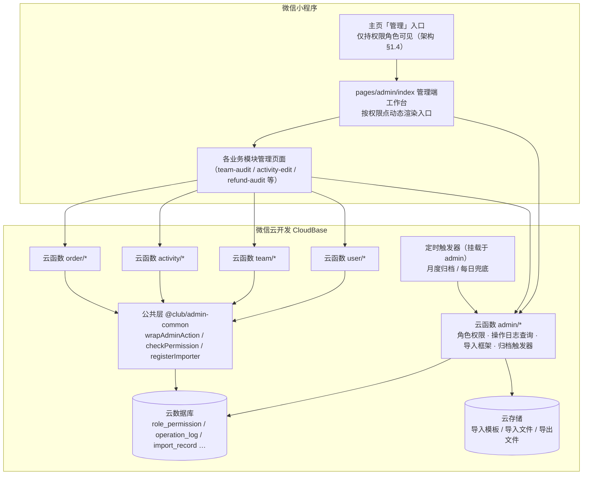
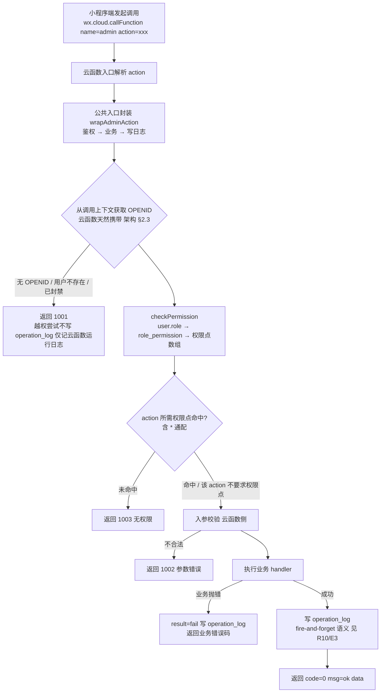
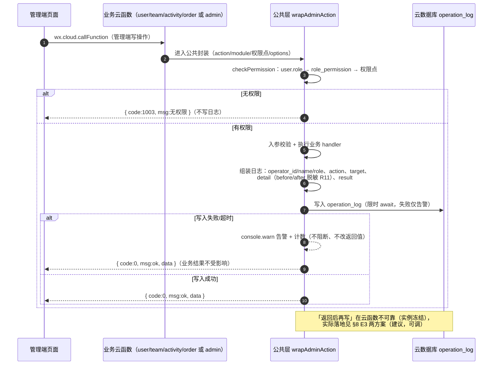
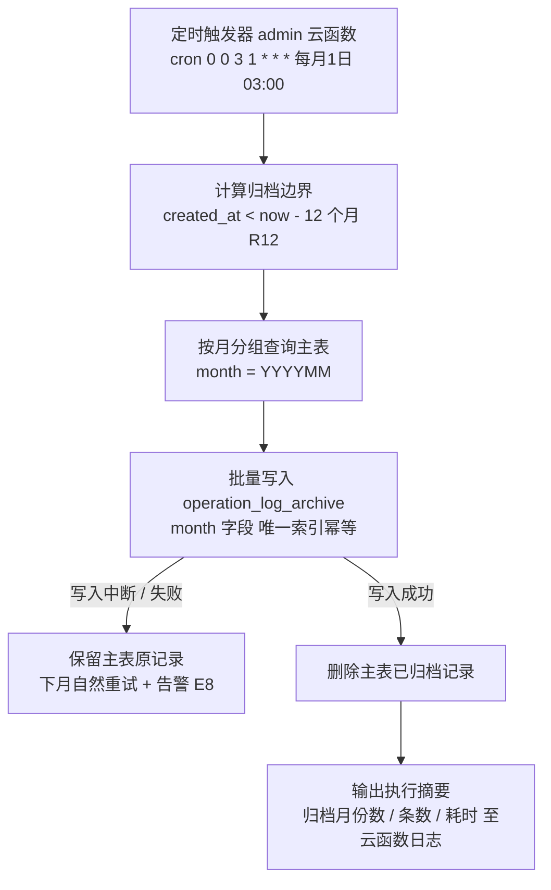
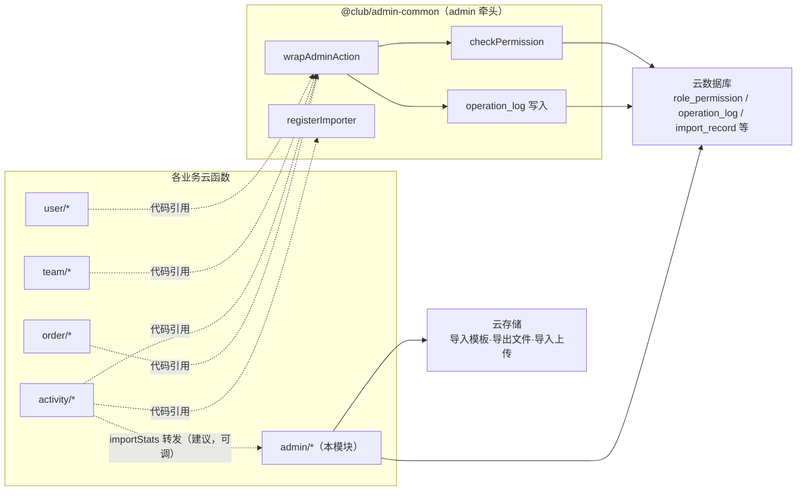

# 真人CS俱乐部小程序 · 管理端模块详细设计文档

| 字段 | 值 |
| --- | --- |
| 文档版本 | v1.0 |
| 依据文档 | 《真人CS俱乐部小程序架构设计文档》v0.5 |
| 文档状态 | 初稿 |
| 更新日期 | 2026-10-08 |
| 模块范围 | 管理端框架 / 角色与权限管理 / 操作审计日志 / Excel 导入通用框架 |
| 技术底座 | 微信云开发（云函数 + 云数据库 + 云存储 + 定时触发器） |
| 关联文档 | `docs/design/user-module.md`、`team-module.md`、`activity-module.md`、`payment-module.md`（均 v1.0） |

> **全文约定**：
> 1. 所有云函数接口返回统一结构 `{ code, msg, data }`，`code = 0` 表示成功，非 0 为失败（msg 为用户可读提示）。
> 2. 金额一律以**分**（整数）存储与计算（本模块自身不产生金额字段，日志 detail 中出现的金额沿用业务模块的分口径原样记录）。
> 3. 所有时间字段一律**毫秒时间戳**，命名以 `_at` 结尾。
> 4. 云函数统一按 `domain/action` 形式命名，本模块全部接口走 `admin/*`；部署形态为**单云函数 `admin` + action 分发**（与各业务模块一致，见 §5.0）。
> 5. 入参校验一律在**云函数侧**完成，前端校验仅为体验优化（前端不可信，见架构 §2.3）。
> 6. 云数据库为文档型、无外键/联表查询，跨集合关联一律使用**冗余外键字段 + 同步策略**（见 §6.6）。
> 7. 架构文档 v0.5 为唯一事实源：本文不改变任何架构已确认决策；架构未定的实现细节给出建议方案并标注「**建议，可调**」。
> 8. 本文所有 mermaid 图与表格均可在 GitHub / 飞书文档等 GFM 环境直接渲染。

---

## 目录

1. [模块概述](#1-模块概述)
2. [页面设计](#2-页面设计)
3. [业务规则](#3-业务规则)
4. [流程图](#4-流程图)
5. [云函数接口设计](#5-云函数接口设计)
6. [数据模型设计](#6-数据模型设计)
7. [与其他模块的依赖与交互](#7-与其他模块的依赖与交互)
8. [异常与边界处理](#8-异常与边界处理)
9. [开发阶段落点](#9-开发阶段落点)

---

## 1. 模块概述

### 1.1 模块定位

管理端模块是小程序的**横切能力模块**：管理功能内嵌在小程序中、不建独立 Web 后台（架构 §1.4，Q3 已确认），本模块为所有后台管理动作提供**统一框架**——入口与可见性、角色权限鉴权、操作审计埋点、Excel 批量导入通道，并直接承载「角色权限管理」与「操作日志查询」两个管理功能本身。

对应架构 §2.2 中的 `CFM 云函数 admin/*`（发布活动·退款审核·角色权限·操作日志·统计）中的「角色权限 · 操作日志」职责与公共鉴权/埋点能力。

### 1.2 职责边界

| 维度 | 内容 |
| --- | --- |
| **本模块负责** | ① 管理端框架：主页「管理」入口可见性、管理端工作台与页面导航、前端权限点渲染数据源；② 角色与权限管理：权限点总表维护、角色 CRUD、角色-权限点配置、用户授权（分配/撤销角色，写 `user.role`）；③ 操作审计日志：`operation_log` 集合与写入公共封装（供全模块复用）、日志查询/详情/导出页面与接口、月度归档定时任务；④ Excel 导入通用框架：模板下载、文件上传通道、解析与逐行校验调度、导入明细反馈（业务校验规则由业务模块注册，见 §5.20）；⑤ 公共鉴权工具 `checkPermission`（供全模块云函数复用，user-module 文档 §7.2 建议由本模块牵头） |
| **本模块不负责** | 各业务模块自身的管理业务逻辑（发布活动、战队审核、退款执行、战绩落库等——接口与规则归各业务模块）；会员端任何页面与接口；订阅消息内容（由各业务模块触发，架构 §2.2 CFM→MSG 仅示意管理端相关通知通道）；财务对账（payment 模块）；统计报表计算（架构 §8.3，P2 演进项） |
| **对外依赖** | user 集合（读 `user.role`/昵称做鉴权与授权展示）、云存储（导入模板、导出文件、xlsx 文件）、定时触发器（月度归档、每日兜底）、云函数公共层机制（npm 内部包，建议，可调） |

### 1.3 与其他模块的关系



要点：

- **公共层下沉**：鉴权与埋点以公共代码（建议命名 `@club/admin-common` 的内部 npm 包）形式被 user/team/activity/order 各云函数引用，而非跨云函数 HTTP 调用（避免链路放大延迟与配额消耗，建议，可调）。
- **页面双层归属**：管理端页面的**框架、导航、鉴权、样式**归本模块；各业务管理页面的**业务表单与交互**归各业务模块设计文档（见 §2.3）。
- **集合读写分工**：`role_permission`、`operation_log`、`import_record` 归本模块所有（读+写）；业务云函数通过公共层**只写** `operation_log`（user-module 文档 §6.6 同口径）。

### 1.4 权限点总表（权威口径）

本表汇总全系统权限点，是「角色-权限点配置」与各模块管理接口鉴权的**唯一权威口径**。命名统一采用架构 §1.3 示例的下划线 `snake_case` 风格；各业务模块文档中出现的点分风格命名（如 user 模块的 `user.manage`）需在开发前统一对齐到本表（**建议，可调**）。

| 权限点标识 | 权限名称 | 来源 | 管控的管理动作（所属模块） | 备注 |
| --- | --- | --- | --- | --- |
| `publish_activity` | 发布活动 | 架构 §1.3（已确认） | activity：活动发布/编辑/候补递补/报名名单管理 | activity 模块将「取消」单列 `cancel_activity`（建议，可调） |
| `cancel_activity` | 取消活动 | activity 模块文档（建议） | activity：取消活动（触发自动退款） | 建议，可调；不启用则并入 `publish_activity` |
| `audit_team` | 战队审核 | 架构 §1.3（已确认） | team：战队创建审核、解散处理 | — |
| `record_stats` | 战绩录入 | 架构 §1.3（已确认） | activity：战绩手动录入、Excel 批量导入 | Excel 导入入口权限即本权限点（见 §3 R17） |
| `upload_album` | 相册上传 | 架构 §1.3（已确认） | activity：俱乐部相册上传/删除 | — |
| `checkin_activity` | 现场签到核验 | activity 模块文档（建议） | activity：签到码生成与现场核验 | 建议，可调 |
| `audit_refund` | 退款审核 | 架构 §1.3/§6.5（已确认） | order：退款审核（二次确认）、订单人工干预 | 敏感操作，日志全量记录（架构 §6.5） |
| `view_operation_log` | 操作日志查询 | 架构 §1.3/§1.5（已确认） | admin：日志查询/详情/导出 | 默认仅管理员可见（架构 §1.5） |
| `role_manage` | 角色与权限配置 | 本模块（建议） | admin：角色 CRUD、权限点勾选配置 | 建议，可调；含角色列表/详情 |
| `user_role_assign` | 用户角色分配 | 本模块（建议） | admin：给用户设置/撤销角色 | 对齐 user 模块文档建议的 `user.role.assign`，建议，可调 |
| `user_manage` | 用户管理 | user 模块文档（建议） | user：用户搜索/详情查看 | 建议，可调 |
| `user_ban` | 封禁/解封 | user 模块文档（建议） | user：封禁与解封 | 建议，可调 |
| `user_card_adjust` | 会员卡人工调整 | user 模块文档（建议） | user：人工开卡/调次/延期/作废 | 建议，可调 |

补充约定：

- **通配符 `*`**：匹配全部权限点。仅预置 `admin` 角色使用（建议，可调）；`role_manage` 配置界面不向普通角色开放勾选 `*`（仅预置 admin 固有）。
- **登记制**：新增权限点必须先登记本总表（落地为 `permission_point` 集合，见 §6.5）方可被角色引用，防止配置出「幽灵权限点」（见 §3 R3）。
- **会员端能力不走权限点**：报名、支付、加入战队等会员端能力由登录态与业务状态天然控制，权限点仅约束**管理端动作**（架构 §1.3 口径，建议，可调）。

---

## 2. 页面设计

管理端页面统一挂在 `pages/admin/` 目录下，复用同一套页面框架（顶栏标题 + 内容区 + 底部安全区）、统一的错误码提示与无权限兜底样式（入口被隐藏为主防线，误入页面时展示「无权限」占位态）。

### 2.1 管理端入口与工作台

| 项 | 内容 |
| --- | --- |
| 入口 | 小程序**主页「管理」入口**（架构 §1.4），仅当登录用户命中**任一权限点**时可见；无管理权限的普通用户不可见，游客态不可见 |
| 可见性数据源 | 登录后调用 `admin/permission/my` 获取当前用户权限点数组并本地缓存（会话级）；工作台按权限点数组渲染入口卡片，未命中的功能不渲染（前端隐藏为第一防线，见 §3 R1） |
| 工作台内容 | 功能入口卡片分组：活动运营（发布活动/签到核验/战绩录入/相册管理）、战队（战队审核）、订单（退款审核）、用户（用户管理/用户授权）、管理（角色权限/操作日志）；每张卡片绑定所需权限点 |
| 兜底 | 云函数侧硬校验为第二防线（架构 §2.3）：即使页面被直达（分享/扫码路径），无权限调用统一返回 `1003`，页面展示无权限占位态 |

### 2.2 本模块页面清单

| 序号 | 页面 | 路径 | 入口 | 所需权限点 | 核心交互 |
| --- | --- | --- | --- | --- | --- |
| 1 | 管理端工作台 | `pages/admin/index` | 主页「管理」入口 | 任一管理权限点（无则入口不可见） | 按权限点动态渲染功能入口卡片；展示当前用户角色名；权限点变更后下拉刷新重新拉取 |
| 2 | 角色列表 | `pages/admin/role-list` | 工作台「角色权限」 | `role_manage` | 角色卡片列表（名称、role_key、权限点数量、是否预置、更新时间），点击进编辑；「新建角色」入口；删除仅对自定义角色开放 |
| 3 | 角色编辑 | `pages/admin/role-edit` | 角色列表 | `role_manage` | 新建/编辑角色：名称、role_key（仅新建可填）、描述、权限点勾选（按模块分组展示 §1.4 总表）；预置角色提示受限项；保存走乐观锁（携带 base_updated_at） |
| 4 | 用户授权 | `pages/admin/user-role` | 工作台「用户授权」 | `user_role_assign` | 搜索用户（昵称/手机号）→ 用户卡（头像/昵称/当前角色）→ 设置角色（单选下拉，来自角色列表）或「撤销回退会员」；操作成功 toast 并提示已记入操作日志 |
| 5 | 操作日志查询 | `pages/admin/log-list` | 工作台「操作日志」 | `view_operation_log` | 筛选区（见 §2.4）+ 分页列表（操作人、模块、action、对象、结果、时间）；点击行进详情；「导出 Excel」入口（P2，M3） |
| 6 | 操作日志详情 | `pages/admin/log-detail` | 日志列表点击 | `view_operation_log` | 全字段展示 + **before/after 变更对比**（差异字段高亮，架构 §1.5）；detail 中敏感字段按脱敏存储原样展示 |
| 7 | Excel 导入 | `pages/admin/import-excel` | 各业务管理页「批量导入」按钮（如战绩录入页） | 业务权限点（战绩导入 = `record_stats`） | 选择 biz_type（默认由入口页带入）→ 下载模板（展示列说明）→ `wx.chooseMessageFile/wx.chooseMedia` 选文件 → 上传 → 提交导入 → 轮询任务状态 → 结果页展示成功数与**失败明细（行号 + 原因）** → 失败明细可复制/导出修正后重导 |

### 2.3 业务模块管理页面挂载（框架归本模块，页面设计归各模块）

以下页面挂载在管理端框架下（导航入口由工作台按权限点渲染、云函数鉴权与日志埋点走本模块公共层），**页面业务交互设计以各模块文档为准**；路径未在对应文档中明确的以「建议，可调」标注。

| 页面 | 路径 | 所需权限点 | 设计归属 |
| --- | --- | --- | --- |
| 战队审核 | `pages/admin/team-audit` | `audit_team` | team-module.md（已定义） |
| 活动发布/编辑 | `pages/admin/activity-edit`（建议，可调） | `publish_activity` | activity-module.md |
| 报名名单/候补管理 | `pages/admin/enroll-list`（建议，可调） | `publish_activity` | activity-module.md |
| 现场签到核验 | `pages/admin/checkin`（建议，可调） | `checkin_activity` | activity-module.md |
| 战绩手动录入 | `pages/admin/stats-input`（建议，可调） | `record_stats` | activity-module.md（入口页内嵌 §2.2-7 导入按钮） |
| 相册管理 | `pages/admin/album`（建议，可调） | `upload_album` | activity-module.md |
| 退款审核列表 | `pages/admin/refund-audit`（建议，可调） | `audit_refund` | payment-module.md（页面框架由本模块承载） |
| 用户管理/详情 | `pages/admin/user-manage`（建议，可调） | `user_manage` / `user_ban` / `user_card_adjust` | user-module.md |

### 2.4 查询页面的筛选维度汇总

| 页面 | 筛选维度 | 默认值/默认行为 |
| --- | --- | --- |
| 操作日志查询（§2.2-5） | 操作人（operator_id 或昵称关键词）、模块（activity/team/user/stats/album/order/admin 七枚举）、操作类型（action，随模块联动二级列表）、时间范围（start_time/end_time，毫秒时间戳）、结果（success/fail）、关键词（模糊匹配 operator_name/target_id/action） | 默认近 7 天、全部模块、按 created_at 倒序、每页 20 条（≤100，建议，可调） |
| 用户授权（§2.2-4） | 用户关键词（昵称模糊 / 手机号后四位，手机号脱敏展示）、角色（筛选某角色下用户，用于迁移） | 默认按昵称搜索，分页每页 20 条 |
| 角色列表（§2.2-2） | 无（角色量级 < 50，全量返回） | 按 is_preset 优先、updated_at 倒序 |
| Excel 导入任务记录（§2.2-7 结果页「历史任务」） | biz_type、biz_id（业务对象 ID）、状态（processing/succeeded/partial/failed）、时间范围 | 默认近 30 天、按 created_at 倒序 |

---

## 3. 业务规则

### R1 管理端入口可见性（双层防线·前端）

| 项 | 内容 |
| --- | --- |
| 规则描述 | 小程序主页「管理」入口与工作台各功能卡片，仅对命中对应权限点的用户渲染；未命中者前端不可见（架构 §1.4）。 |
| 触发时机 | 登录后拉取 `admin/permission/my`（权限点数组）时渲染工作台。 |
| 约束与边界 | ① 前端隐藏仅为**体验层防线**，不承担安全职责（前端不可信，架构 §2.3）；② 权限点缓存为会话级，工作台提供下拉刷新；③ 游客态（未登录）一律不渲染入口。 |

### R2 云函数侧硬校验（双层防线·后端）

| 项 | 内容 |
| --- | --- |
| 规则描述 | 所有 `admin/*` 及各业务模块管理端接口在云函数入口统一校验：`openid → user.role → role_permission → 权限点数组`，未命中所需权限点返回 `1003`（架构 §2.3，user-module 文档 §5.19 同口径）。 |
| 触发时机 | 每次管理端接口调用（含被直达页面发起的调用）。 |
| 约束与边界 | ① 校验必须发生在**业务逻辑之前**，由公共封装 `wrapAdminAction` 强制保证（见 §5.18）；② 封禁用户按无登录态处理（返回 1001，user 模块口径）；③ `*` 通配命中视为拥有全部权限点。 |

### R3 权限点登记制与命名风格

| 项 | 内容 |
| --- | --- |
| 规则描述 | 权限点标识必须先登记权限点总表（§1.4，落地 `permission_point` 集合）后才能被角色引用；命名统一 `snake_case`。 |
| 触发时机 | `role/create`、`role/update` 提交 permissions 数组时逐项校验。 |
| 约束与边界 | ① 未登记权限点返回 `5002`；② 兄弟模块文档中的点分风格命名（`user.manage` 等）开发前统一对齐到本总表（**建议，可调**）；③ 新版本新增权限点时随云函数部署同步 upsert 总表（幂等）。 |

### R4 权限在线配置、不硬编码

| 项 | 内容 |
| --- | --- |
| 规则描述 | 角色→权限点映射存 `role_permission` 集合，管理端在线维护；调整权限**无需发版**（架构 §1.3 已确认）。 |
| 触发时机 | 管理员在角色编辑页保存权限点勾选。 |
| 约束与边界 | ① 云函数侧不缓存或仅短 TTL 缓存权限映射（见 §8 E2）；② 预置角色权限同样可在线调整（受 R5 限制）。 |

### R5 预置角色保护

| 项 | 内容 |
| --- | --- |
| 规则描述 | `is_preset = true` 的角色不可删除、`role_key` 不可修改；`admin` 预置角色不可移除 `*` 通配（防自锁，架构 §1.3「预置 5 种，可增改」）。 |
| 触发时机 | `role/delete`、`role/update` 操作预置角色时。 |
| 约束与边界 | ① 预置角色的 `name`、`permissions`（admin 的 `*` 除外）、`description` 允许在线调整（**建议，可调**）；② 违规操作返回 `5004`。 |

### R6 角色删除的引用检查

| 项 | 内容 |
| --- | --- |
| 规则描述 | 删除自定义角色前必须确保**无用户仍持有该角色**（`user.role` 引用计数 = 0），否则拒绝删除，提示先迁移用户。 |
| 触发时机 | `role/delete`。 |
| 约束与边界 | ① 引用计数用 `user` 集合 count 查询（冗余 `role_permission.user_count` 仅作展示，不作删除依据，见 §6.6）；② 拒绝返回 `5005`；③ 历史脏数据兜底见 §8 E6。 |

### R7 用户角色单值模型与回退

| 项 | 内容 |
| --- | --- |
| 规则描述 | `user.role` 为**单值**角色标识（架构 §1.3）；「分配角色」即整体变更，不做多角色叠加；「撤销角色」将 `user.role` 回退为 `member`（预置会员角色）。 |
| 触发时机 | `user/grant-role`、`user/revoke-role`。 |
| 约束与边界 | ① 战队队长为**附加身份**，由 team 模块 `team_member.role` 表达，不经 `user.role`（架构 §1.3）；② 回退目标角色固定 `member`，不做自定义回退目标（**建议，可调**）；③ 变更写入日志 detail 记 before/after 角色值。 |

### R8 授权自锁保护

| 项 | 内容 |
| --- | --- |
| 规则描述 | 操作者**不允许对自己的角色执行分配/撤销**（防误操作自锁）；撤销操作不得使系统失去最后一个拥有 `*`（管理员能力）的有效用户。 |
| 触发时机 | `user/grant-role`、`user/revoke-role` 的目标用户 = 操作者本人时；撤销命中最后一个管理员时。 |
| 约束与边界 | ① 前者返回 `5008`；后者返回 `5006`；② 极端兜底恢复路径（数据库直改）见 §8 E10；③ 仍建议俱乐部保留至少 2 名管理员（运营规范，**建议，可调**）。 |

### R9 操作日志记录范围

| 项 | 内容 |
| --- | --- |
| 规则描述 | 管理端**所有写操作**全量记录 `operation_log`（架构 §1.5 记录范围表：活动发布/编辑/取消、退款审核、战队审核/解散、角色分配/变更、权限点配置、会员卡人工调整、封禁/解封、战绩手动/Excel 录入、相册上传/删除、签到核验、订单人工干预、角色权限管理本身的变更）。 |
| 触发时机 | 各模块管理端写接口经 `wrapAdminAction` 封装自动触发。 |
| 约束与边界 | ① 会员端自助操作（报名、申请退款、取消报名等）**不入** operation_log（业务留痕在各自集合，架构 §1.5 限定管理端写操作）；② 系统/定时任务操作以 `operator_id = "system"` 标识（payment 模块同口径）；③ 读操作（列表、详情查询）不记日志，仅「导出」这类产生数据外流的读操作记录（**建议，可调**）。 |

### R10 日志写入 fire-and-forget

| 项 | 内容 |
| --- | --- |
| 规则描述 | 日志写入失败**不阻断业务**、不改变业务返回值，仅记录告警（架构 §1.5）；语义目标为不增加业务接口延迟。 |
| 触发时机 | `operation_log` 写库失败/超时。 |
| 约束与边界 | 云函数返回响应后实例会被冻结，真正「返回后再写」不可靠；落地为「写日志置于 handler 之后、限时 await + 失败仅告警」或「内存缓冲 + 定时触发器兜底补偿」两方案（见 §8 E3，**建议，可调**）。 |

### R11 敏感字段脱敏

| 项 | 内容 |
| --- | --- |
| 规则描述 | 日志 `detail`（before/after JSON）中的敏感字段**脱敏后存储**（架构 §1.5/§8.1）：手机号保留前 3 后 4（`138****1234`）、身份证保留前 6 后 4、金额保留原值（分，非敏感）、openid 保留前 6 后 4。 |
| 触发时机 | 公共层组装 detail 时统一过脱敏函数（白名单字段清单驱动）。 |
| 约束与边界 | ① 脱敏在**写日志时**执行（非查询时），存即脱敏（架构 §8.1 口径）；② 白名单外新敏感字段由开发评审补充（**建议，可调**）。 |

### R12 日志只读与保留策略

| 项 | 内容 |
| --- | --- |
| 规则描述 | `operation_log` 对管理端**只读**（不提供修改/删除接口）；保留 **1 年**（默认），由定时触发器**按月归档/清理**（架构 §1.5）。 |
| 触发时机 | 归档触发器每月执行（见 §5.13）；任何日志写操作仅来自公共层/触发器。 |
| 约束与边界 | ① 归档后历史数据入 `operation_log_archive`（保留策略同 1 年滚动，**建议，可调**）；② 日志查询页面默认仅查主表（近 12 个月），跨年查询本期不做（**建议，可调**）。 |

### R13 日志查询权限

| 项 | 内容 |
| --- | --- |
| 规则描述 | 操作日志查询/详情/导出统一要求权限点 `view_operation_log`；该权限点**默认仅配置给管理员角色**（架构 §1.5，可在角色权限管理中调整）。 |
| 触发时机 | `log/list`、`log/detail`、`log/export` 调用时。 |
| 约束与边界 | ① 无权限返回 `1003`；② 查询页面所有接口均走公共封装硬校验（防前端绕过）。 |

### R14 导入文件限制

| 项 | 内容 |
| --- | --- |
| 规则描述 | Excel 导入单文件 ≤ **2MB**、单次 ≤ **500 行**（数据行，不含表头）；超出直接拒绝并提示（**建议，可调**）。 |
| 触发时机 | `import/submit` 框架级校验（解析后行数、下载后文件大小）。 |
| 约束与边界 | ① 超限返回 `5010`；② 限制目的：控制云函数单次执行时长（同步导入方案，见 §5.15）与数据库批量写入压力；③ 更大批量拆分为多次提交。 |

### R15 导入逐行独立提交（事务性口径）

| 项 | 内容 |
| --- | --- |
| 规则描述 | 逐行校验通过后**逐行独立写入**，单行失败不影响其他行；整次导入**不整体回滚**，最终返回成功/失败明细（架构 §5.5「逐行校验后批量写入，返回成功/失败明细」）。 |
| 触发时机 | `import/submit` 执行 importer 的 writeRow。 |
| 约束与边界 | ① 选择理由：文档型数据库多文档事务能力有限、人工修正后重导的工作流天然要求部分成功可见；② 替代方案：`db.startTransaction` 包整批写入整体回滚（若未来业务要求原子性再启用，**建议，可调**）；③ 幂等：同一行重复导入的业务去重由 importer 校验规则负责（如战绩以 activity_id+user_id 唯一）。 |

### R16 权限配置并发控制

| 项 | 内容 |
| --- | --- |
| 规则描述 | 角色编辑保存采用**乐观锁**：入参携带读取时的 `base_updated_at`，条件更新 `updated_at == base_updated_at` 才生效，否则返回 `5007` 提示刷新后重试。 |
| 触发时机 | `role/update`。 |
| 约束与边界 | ① 冲突不自动合并（权限点勾选合并语义复杂，人工重试更安全）；② `user/grant-role` 对 `user.role` 的并发覆盖采用条件更新 `role == base_role`（**建议，可调**）。 |

### R17 导入权限跟随业务权限点

| 项 | 内容 |
| --- | --- |
| 规则描述 | Excel 导入框架**不设独立权限点**：按 `biz_type` 路由到业务模块注册的权限点（战绩导入 = `record_stats`，未来名单导入 = `publish_activity` 等）。 |
| 触发时机 | `import/template`、`import/submit`、`import/status`、`import/result` 鉴权时查 importer 注册表。 |
| 约束与边界 | ① 好处：权限语义与业务动作一一对应，不新增配置项；② 若未来导入场景多到需要独立控制，再增设 `import_manage`（**建议，可调**）。 |

---

## 4. 流程图

### 4.1 管理端统一鉴权流程（双层防线）



### 4.2 操作日志写入时序（公共封装）



### 4.3 Excel 导入总流程（通用框架 + 业务扩展点）

```mermaid
flowchart TD
    A[管理端业务页面<br/>如 战绩录入页 record_stats] --> B[admin/import/template<br/>biz_type 查注册表 → 模板 fileID + 列定义]
    B --> C[下载模板 填写 保存]
    C --> D[wx.cloud.uploadFile 上传 xlsx<br/>获得 cloud:// fileID]
    D --> E[admin/import/submit<br/>biz_type / biz_id / file_id]
    E --> F{框架级校验 R14}
    F -- 文件>2MB / 非xlsx / 行数>500 / 表头不匹配 --> X1[import_record 置 failed<br/>返回 5010 / 5011 及原因]
    F -- 通过 --> G[逐行业务校验 validateRow<br/>规则由业务模块注册 §5.20]
    G -- 校验失败 --> H1[记录 {row, reason}]
    G -- 校验通过 --> H2[逐行独立写入 writeRow<br/>如 activity_stats R15]
    H1 --> I
    H2 --> I[汇总 total / success / failed<br/>更新 import_record 状态]
    I --> J[写一条批量操作日志<br/>action=stats.import detail 含成功/失败条数 架构 §1.5]
    J --> K[前端轮询 import/status<br/>完成后 import/result 展示明细]
    K --> L{存在失败行?}
    L -- 是 --> M[展示失败明细 行号+原因<br/>人工修正后重新提交]
    L -- 否 --> N[导入完成]
```

### 4.4 月度归档流程（定时触发器）



---

## 5. 云函数接口设计

### 5.0 接口总览与统一约定

**部署形态**：本模块为**单云函数 `admin` + action 分发**（与各业务模块一致，`domain/action` 中的 `admin/` 为域名、`xxx` 为 action 值，经 `event.action` 路由）；定时触发器直接挂载在 `admin` 云函数上（trigger 配置，见 §5.13）。

**调用方式**：前端统一 `wx.cloud.callFunction({ name: 'admin', data: { action: 'xxx', ...入参 } })`；返回统一 `{ code, msg, data }`，`code = 0` 成功。

**接口清单**（19 个云函数 action + 3 个公共层能力）：

| 接口名 | 所需权限点 | 功能 |
| --- | --- | --- |
| `admin/role/create` | `role_manage` | 新建自定义角色 |
| `admin/role/update` | `role_manage` | 更新角色（含权限点配置，乐观锁） |
| `admin/role/delete` | `role_manage` | 删除自定义角色（引用检查） |
| `admin/role/list` | `role_manage` / `user_role_assign`（任一） | 角色列表 |
| `admin/role/detail` | `role_manage` | 角色详情（权限点展开） |
| `admin/permission/list` | `role_manage` | 权限点总表查询 |
| `admin/permission/my` | 登录即可（无权限点要求） | 当前用户权限点数组（工作台渲染） |
| `admin/user/grant-role` | `user_role_assign` | 设置/变更用户角色（写 user.role） |
| `admin/user/revoke-role` | `user_role_assign` | 撤销用户角色（回退 member） |
| `admin/user/role-list` | `user_role_assign` | 按角色/关键词查询用户及其角色 |
| `admin/log/list` | `view_operation_log` | 操作日志分页查询 |
| `admin/log/detail` | `view_operation_log` | 操作日志详情（before/after） |
| `admin/log/export` | `view_operation_log` | 日志导出 Excel（P2，M3） |
| `admin/import/template` | 业务权限点（随 biz_type） | 导入模板下载（fileID + 列定义） |
| `admin/import/submit` | 业务权限点（随 biz_type） | 提交导入（解析/校验/写入） |
| `admin/import/status` | 业务权限点（随 biz_type） | 导入任务状态查询 |
| `admin/import/result` | 业务权限点（随 biz_type） | 导入明细（成功/失败行） |
| `admin/cron/monthly-archive` | 定时触发器（无用户上下文） | 日志月度归档/清理 |
| `admin/cron/daily-guard` | 定时触发器（无用户上下文） | 悬挂导入任务清理等兜底（建议，可调） |
| 公共层 `wrapAdminAction` | —（被各模块管理接口引用） | 统一鉴权 → 业务 → 写日志 → 返回（§5.18） |
| 公共层 `checkPermission` | —（被各模块引用） | openid → 权限点判定（§5.19） |
| 公共层 `registerImporter` | —（业务模块启动时注册） | Excel 导入扩展点（§5.20） |

**通用错误码**（1xxx 段，语义与 activity-module 文档一致；各业务模块 1xxx 存在语义漂移，建议联调前统一，**建议，可调**）：

| code | msg | 场景 |
| --- | --- | --- |
| 1001 | 未登录或登录态失效 | 无有效 openid / 用户不存在 / 已封禁 |
| 1002 | 参数校验失败：{字段} | 入参不合法（msg 注明字段与原因） |
| 1003 | 无权限 | 缺少所需权限点 |
| 1004 | 资源不存在 | 用户/日志等资源不存在（角色不存在专用 5003、导入任务专用 5012） |
| 1005 | 数据状态冲突 | 并发冲突 / 状态不允许该操作 |
| 1006 | 服务器开小差了 | 服务内部错误（兜底） |

**本模块业务错误码**（5xxx 段；2xxx 归 user、3xxx 归 activity、4xxxx 归 team、42xxx 归 payment，互不冲突）：

| code | msg | 场景 |
| --- | --- | --- |
| 5001 | 角色标识或名称已存在 | role/create 唯一性冲突 |
| 5002 | 存在未登记的权限点：{key} | permissions 数组含总表外标识 |
| 5003 | 角色不存在 | role_key / _id 未命中 |
| 5004 | 预置角色不允许该操作 | 删除预置角色 / 改 role_key / 移除 admin 的 `*` |
| 5005 | 该角色仍有用户使用，请先迁移 | role/delete 引用计数 > 0 |
| 5006 | 系统需保留至少一名管理员 | 撤销最后一个持有 `*` 的有效用户 |
| 5007 | 配置已被他人修改，请刷新重试 | 乐观锁冲突（R16） |
| 5008 | 不能对本人执行该操作 | 授权自锁保护（R8） |
| 5009 | 不支持的导入类型 | biz_type 未注册 importer |
| 5010 | 文件超出导入限制 | > 2MB 或 > 500 行（R14） |
| 5011 | 文件格式错误 | 非 xlsx / 表头不匹配 / 解析失败 |
| 5012 | 导入任务不存在 | import_id 无效 |
| 5013 | 导出范围过大 | 超出单次导出上限（E9） |
| 5014 | 导出文件生成失败 | 生成/上传异常 |
| 5015 | 归档执行失败（已告警） | 定时任务内部异常（触发器日志可见） |

以下各接口小节的「错误码」行列出该接口的关键返回码（业务码与场景强相关的通用码），未列出的通用错误码（1001/1002/1003/1004/1006）按场景默认适用。

---

### 5.1 admin/role/create

| 项 | 内容 |
| --- | --- |
| 接口名 | `admin/role/create` |
| 调用角色 | 持有 `role_manage` 权限点的角色 |
| 功能 | 新建自定义角色（角色-权限点配置入口） |

**入参**：

| 字段 | 类型 | 必填 | 说明 | 校验规则 |
| --- | --- | --- | --- | --- |
| role_key | string | 是 | 角色标识（存入 `user.role`） | `^[a-z][a-z0-9_]{1,30}$`；全库唯一，否则 5001 |
| name | string | 是 | 角色显示名 | 1~20 字符；与现有角色 name 不重复，否则 5001 |
| permissions | string[] | 是 | 权限点数组 | 每项须在权限点总表内，否则 5002；去重；不可为 `["*"]`（`*` 仅预置 admin 固有） |
| description | string | 否 | 角色说明 | ≤ 100 字符 |

**出参**：`data: { role_id: string }`（role_id 即插入记录的 _id）

**核心处理**：鉴权 → 参数校验 → 唯一性检查（role_key/name）→ 权限点登记校验 → 插入 `role_permission`（`is_preset=false, updated_at/created_at=now`）→ 写日志（module=admin，action=`role.create`，target_type=role，target_id=role_key，detail={after: 全量角色定义}）。

**错误码**：5001 / 5002 / 1006。

---

### 5.2 admin/role/update

| 项 | 内容 |
| --- | --- |
| 接口名 | `admin/role/update` |
| 调用角色 | 持有 `role_manage` 权限点的角色 |
| 功能 | 更新角色名称/权限点/描述（含预置角色受限调整，R4/R5/R16） |

**入参**：

| 字段 | 类型 | 必填 | 说明 | 校验规则 |
| --- | --- | --- | --- | --- |
| role_key | string | 是 | 目标角色标识 | 须存在，否则 5003 |
| name | string | 否 | 新显示名 | 1~20 字符；不与其他角色重名（5001） |
| permissions | string[] | 否 | 新权限点数组 | 同 5.1；预置 admin 角色提交不含 `*` 时返回 5004 |
| description | string | 否 | 新说明 | ≤ 100 字符 |
| base_updated_at | long | 是 | 读取时的版本（毫秒时间戳） | 乐观锁：与库中 `updated_at` 相等才生效，否则 5007 |

**出参**：`data: { role_key, updated_at: long }`

**核心处理**：鉴权 → 校验角色存在 → 预置保护（role_key 本身不可改；admin 的 `*` 不可移除）→ 权限点登记校验 → 条件更新（`where role_key 且 updated_at == base_updated_at`）→ 写日志（action=`role.update`，detail={before: 旧权限数组, after: 新权限数组, name 变更}）→ 生效即时（无缓存或短 TTL，E2）。

**错误码**：5001 / 5002 / 5003 / 5004 / 5007 / 1006。

---

### 5.3 admin/role/delete

| 项 | 内容 |
| --- | --- |
| 接口名 | `admin/role/delete` |
| 调用角色 | 持有 `role_manage` 权限点的角色 |
| 功能 | 删除自定义角色（须先迁移持有用户，R6） |

**入参**：

| 字段 | 类型 | 必填 | 说明 | 校验规则 |
| --- | --- | --- | --- | --- |
| role_key | string | 是 | 目标角色标识 | 须存在（5003）；`is_preset=true` 拒绝（5004） |

**出参**：`data: null`

**核心处理**：鉴权 → 校验存在 → 预置校验 → `user` 集合 count（`role == role_key`，须 = 0，否则 5005）→ 删除 `role_permission` 记录 → 写日志（action=`role.delete`，detail={before: 角色定义}，result=success/fail）。

**错误码**：5003 / 5004 / 5005 / 1006。

---

### 5.4 admin/role/list

| 项 | 内容 |
| --- | --- |
| 接口名 | `admin/role/list` |
| 调用角色 | 持有 `role_manage` 或 `user_role_assign`（任一，供授权页下拉） |
| 功能 | 角色全量列表（量级 < 50 不分页，**建议，可调**） |

**入参**：无业务参数（可选 `include_user_count: boolean`，默认 true，统计各角色用户数）。

**出参**：`data: { list: [{ role_key, name, permissions, is_preset, description, user_count, updated_at }] }`

**核心处理**：鉴权 → 全量查询 `role_permission`（is_preset 优先、updated_at 倒序）→ `user_count` 用聚合（按 role 分组 count）→ 读操作不写日志（R9）。

**错误码**：1006。

---

### 5.5 admin/role/detail

| 项 | 内容 |
| --- | --- |
| 接口名 | `admin/role/detail` |
| 调用角色 | 持有 `role_manage` 权限点的角色 |
| 功能 | 单个角色详情（权限点以名称展开，供编辑回显） |

**入参**：

| 字段 | 类型 | 必填 | 说明 | 校验规则 |
| --- | --- | --- | --- | --- |
| role_key | string | 是 | 目标角色标识 | 须存在（5003） |

**出参**：`data: { role_key, name, permissions, permission_details: [{ key, name, module_group }], is_preset, description, user_count, updated_at, created_at }`

**核心处理**：鉴权 → 查角色 → 关联 `permission_point` 展开权限点中文名与分组 → 读操作不写日志。

**错误码**：5003 / 1006。

---

### 5.6 admin/permission/list（含 admin/permission/my）

#### 5.6.1 admin/permission/list

| 项 | 内容 |
| --- | --- |
| 接口名 | `admin/permission/list` |
| 调用角色 | 持有 `role_manage` 权限点的角色（供角色编辑页勾选权限点） |
| 功能 | 拉取全部权限点登记项，按模块分组返回 |

**入参**：无业务入参（分页不需要，权限点总量 ≤ 50，全量返回）。

**出参**：`data: { groups: [{ module_group, points: [{ key, name, description, status }] }] }`

**核心处理**：鉴权 → 读 `permission_point` 集合（按 `module_group` 分组、`key` 升序）→ 返回。读操作不写日志。

**错误码**：1006。

> 说明：权限点在代码内以常量表登记、部署时幂等 upsert 到 `permission_point`（见 §6.5）。若集合暂未启用（建议，可调），本接口退化为直接返回代码内置常量表，出参结构不变。

#### 5.6.2 admin/permission/my

| 项 | 内容 |
| --- | --- |
| 接口名 | `admin/permission/my` |
| 调用角色 | 登录用户（仅需登录态，无权限点要求） |
| 功能 | 返回当前用户角色与权限点数组，是管理端入口可见性控制的数据源（见 §2.1、R1） |

**入参**：无业务入参（openid 由云函数上下文获取）。

**出参**：`data: { role, role_name, permissions: [string] }`

- `role`：用户当前角色标识（user.role，老数据缺省为 member，见 E13）。
- `role_name`：角色中文名（冗余展示字段）。
- `permissions`：该角色权限点数组；预置 admin 角色返回 `["*"]`。

**核心处理**：openid → user.role → role_permission → 权限点数组。读操作不写日志。用户不存在或被封禁时返回 `code: 1001`（登录态失效口径，与 user 模块一致）。

**错误码**：1001 / 1006。

### 5.7 admin/user/grant-role

| 项 | 内容 |
| --- | --- |
| 接口名 | `admin/user/grant-role` |
| 调用角色 | 持有 `user_role_assign` 权限点的角色 |
| 功能 | 将某用户的角色变更为指定角色（整体变更，user.role 为单值，见 §3 R7） |

**入参**：

| 字段 | 类型 | 必填 | 说明 | 校验规则 |
| --- | --- | --- | --- | --- |
| user_id | string | 是 | 目标用户 ID | 须存在且非封禁状态（1004/1001） |
| role_key | string | 是 | 目标角色 | 须为已存在且启用的角色（5003） |
| remark | string | 否 | 授权备注（写入日志 detail） | ≤ 200 字 |

**出参**：`data: { user_id, role, role_name }`

**核心处理**：鉴权 → 校验目标用户与角色 → 校验非操作自己（5008，见 R8/E10）→ 更新 `user.role`（与现值相同则返回成功但不写日志）→ 异步刷新 role_permission 冗余 `user_count`（见 §6.6）→ 写操作日志（module=admin，action=role.grant，detail 记 before/after 角色，见 §6.2 埋点清单）。

**错误码**：1001 / 1004 / 5003 / 5008 / 1006。

### 5.8 admin/user/revoke-role

| 项 | 内容 |
| --- | --- |
| 接口名 | `admin/user/revoke-role` |
| 调用角色 | 持有 `user_role_assign` 权限点的角色 |
| 功能 | 收回用户的管理角色，回退为普通成员（member，见 R7） |

**入参**：

| 字段 | 类型 | 必填 | 说明 | 校验规则 |
| --- | --- | --- | --- | --- |
| user_id | string | 是 | 目标用户 ID | 须存在（1004） |
| remark | string | 否 | 收回备注 | ≤ 200 字 |

**出参**：`data: { user_id, role: "member" }`

**核心处理**：鉴权 → 校验目标用户 → 校验非操作自己（5008）→ 若目标为最后一个 admin 角色持有者则拒绝（5006，见 R8/E10）→ 将 `user.role` 置回 member → 异步刷新 user_count → 写操作日志（module=admin，action=role.revoke，detail 记 before/after 角色）。

**错误码**：1004 / 5006 / 5008 / 1006。

### 5.9 admin/user/role-list

| 项 | 内容 |
| --- | --- |
| 接口名 | `admin/user/role-list` |
| 调用角色 | 持有 `user_role_assign` 权限点的角色 |
| 功能 | 按角色查询/搜索用户，供用户授权页（§2.2-4）选择目标用户 |

**入参**：

| 字段 | 类型 | 必填 | 说明 | 校验规则 |
| --- | --- | --- | --- | --- |
| role_key | string | 否 | 角色筛选 | 缺省返回全部角色的用户 |
| keyword | string | 否 | 昵称/手机号模糊搜索 | ≤ 32 字，服务端二次校验长度（1002） |
| page / page_size | int / int | 否 | 分页 | 缺省 1/20，page_size ≤ 100（1002） |

**出参**：`data: { total, list: [{ user_id, nickname, phone, role, role_name, created_at, role_updated_at }] }`

**核心处理**：鉴权 → 组合查询 user 表（role、keyword 昵称/手机号正则）→ 按分页返回精简字段。读操作不写日志。

> 说明：user.role 的变更时间若无 user.role_updated_at 字段支撑（user 模块未约定），role_updated_at 返回 null 并在页面上隐藏该列（建议，可调，联调时与 user 模块对齐，见 §7）。

**错误码**：1002 / 1006。

### 5.10 admin/log/list

| 项 | 内容 |
| --- | --- |
| 接口名 | `admin/log/list` |
| 调用角色 | 持有 `view_operation_log` 权限点的角色 |
| 功能 | 分页查询操作日志列表（列表项不含 detail 大字段） |

**入参**：

| 字段 | 类型 | 必填 | 说明 | 校验规则 |
| --- | --- | --- | --- | --- |
| operator_id | string | 否 | 操作人筛选 | — |
| module | string | 否 | 业务模块筛选 | 枚举：activity/team/user/stats/album/order/admin（1002） |
| action | string | 否 | 动作筛选（精确） | 点分式字符串 |
| result | string | 否 | 结果筛选 | 枚举：success/fail（1002） |
| keyword | string | 否 | operator_name/error_msg 模糊搜索 | ≤ 32 字（1002） |
| start_time / end_time | long | 否 | 操作时间范围（毫秒时间戳） | end > start；范围 ≤ 92 天（1002，防全表扫描，见 E9） |
| page / page_size | int / int | 否 | 分页 | 缺省 1/20，page_size ≤ 100（1002） |

**出参**：`data: { total, list: [{ log_id, operator_id, operator_name, operator_role, module, action, target_type, target_id, result, error_msg, created_at }] }`

**核心处理**：鉴权 → 校验筛选参数 → 组合查询 `operation_log`（按 created_at 倒序 + module/created_at、operator_id/created_at 组合索引，见 §6.6）→ 列表项剔除 detail 字段 → 返回。读操作不写日志。

> 说明：本接口只查主表 `operation_log`（近 1 年，见 R12）；超过归档线的历史日志需导出后线下查看（§5.12），不做跨表联合查询（建议，可调）。

**错误码**：1002 / 1006。

### 5.11 admin/log/detail

| 项 | 内容 |
| --- | --- |
| 接口名 | `admin/log/detail` |
| 调用角色 | 持有 `view_operation_log` 权限点的角色 |
| 功能 | 日志详情（含 detail.before/after，供前后对比展示） |

**入参**：

| 字段 | 类型 | 必填 | 说明 | 校验规则 |
| --- | --- | --- | --- | --- |
| log_id | string | 是 | 日志 ID | 须存在（1004） |

**出参**：`data: { log_id, operator_id, operator_name, operator_role, module, action, target_type, target_id, detail: { before, after }, result, error_msg, created_at }`

**核心处理**：鉴权 → 按 _id 读单条 → 返回全字段。detail 中敏感字段（手机号/实付金额/收款账号等）在写入时已脱敏（见 R11、§4.2 与 §6.2 脱敏规则），查询侧不再二次处理。读操作不写日志。

**错误码**：1004 / 1006。

### 5.12 admin/log/export

| 项 | 内容 |
| --- | --- |
| 接口名 | `admin/log/export` |
| 调用角色 | 持有 `view_operation_log` 权限点的角色 |
| 功能 | 按当前筛选条件导出日志为 Excel（P2 交付，M3 落地，见 §9） |

**入参**：与 §5.10 `admin/log/list` 完全一致（同一套筛选参数）。

**出参**：`data: { file_id, download_url, total, expire_at }`

- `file_id`：导出文件在云存储的 fileID。
- `download_url`：临时下载链接（临时开链，时效默认 2 小时，建议，可调）。
- `total`：本次导出行数。
- `expire_at`：链接过期时间（毫秒时间戳）。

**核心处理**：鉴权 → 校验筛选（时间范围必填且 ≤ 92 天，1002）→ 计数查询，结果 > 10000 行返回 5013 提示缩小范围（E9）→ 逐页拉取字段组装为 xlsx（列：时间/操作人/角色/模块/动作/对象/结果/错误信息）→ 上传云存储 `exports/operation_log/{yyyyMMddHHmmss}.xlsx` → 生成临时链接返回 → **导出动作本身写一条操作日志**（module=admin，action=log.export，detail 记筛选条件与导出行数，见 R9）。

**错误码**：1002 / 5013 / 5014 / 1006。

> 说明：链接过期后可重新发起导出（E14）；导出文件不清理，依赖云存储生命周期规则统一管理（建议，可调，见 §8 E14）。

### 5.13 归档与守护定时触发器

定时触发器直接挂载在 `admin` 云函数上（云函数目录 `config.json` 的 triggers 配置，见 R12），无需独立部署。配置示例：

```json
{
  "triggers": [
    {
      "name": "monthly-archive",
      "type": "timer",
      "config": "0 0 3 1 * * *"
    },
    {
      "name": "daily-guard",
      "type": "timer",
      "config": "0 0 4 * * * *"
    }
  ]
}
```

> 微信云开发定时触发器为 7 字段 cron（秒 分 时 日 月 周 年）：`monthly-archive` 为每月 1 日 03:00:00；`daily-guard` 为每日 04:00:00。触发时云函数 event 携带 `TriggerName` 字段用于区分。

#### 5.13.1 admin/cron/monthly-archive（月度归档）

| 项 | 内容 |
| --- | --- |
| 接口名 | `admin/cron/monthly-archive`（定时触发，非小程序端调用） |
| 调用角色 | 系统定时触发（operator_id 固定记 `"system"`，见 §6.2） |
| 功能 | 将上一自然月的 operation_log 批量搬移至 `operation_log_archive` 并删除主表数据（见 R12/§4.4） |

**核心处理**：计算上月的 `month = "YYYYMM"` → 检查归档表是否已有该 month（幂等，见 E8）→ 分批（每批 ≤ 1000 条，规避 100 条/次批量写上限与内存限制）按 created_at 范围拉取主表数据 → 批量写入 `operation_log_archive`（附 month 字段） → 确认写入条数一致后删除主表对应区间 → 循环直至该月数据搬完 → 写一条归档动作日志（module=admin，action=log.archive，detail 记 month、搬移条数）。

**失败处理**：任一批次失败立即中断并保留主表数据（宁可重复归档不可丢日志，见 E8）；下月触发时通过 month 唯一性先补齐未完成的月份；连续失败接入告警（云函数运行日志关键字监控，建议，可调）。

#### 5.13.2 admin/cron/daily-guard（每日兜底守护）

| 项 | 内容 |
| --- | --- |
| 接口名 | `admin/cron/daily-guard`（定时触发） |
| 调用角色 | 系统定时触发（operator_id = `"system"`） |
| 功能 | 兜底巡检：悬挂导入任务标记、日志写入失败补偿（方案 B 时）、user_count 冗余校正 |

**核心处理**：① 将 status=processing 且 created_at 超过 10 分钟的 import_record 标记为 failed（E12）；② 若采用 E3 方案 B，将进程内日志缓冲未落库部分写入 operation_log；③ 抽样校正 role_permission.user_count 冗余（与 user 表实际计数比对，偏差 > 5 时重算，见 §6.6）。巡检动作不写操作日志（避免自激产生日志），结果仅记云函数运行日志。

### 5.14 admin/import/template

| 项 | 内容 |
| --- | --- |
| 接口名 | `admin/import/template` |
| 调用角色 | 持有对应业务权限点的角色（按 biz_type 映射，如 stats → `record_stats`，见 R17） |
| 功能 | 返回指定业务类型的导入模板下载地址与列定义（供导入页展示填写说明） |

**入参**：

| 字段 | 类型 | 必填 | 说明 | 校验规则 |
| --- | --- | --- | --- | --- |
| biz_type | string | 是 | 业务类型 | 当前仅 `stats`；须在 importer 注册表中（5009，见 §5.20） |

**出参**：`data: { biz_type, version, file_id, download_url, columns: [{ col, title, required, example, desc }] }`

**核心处理**：鉴权（按注册表 def.permission）→ 从注册表取模板元信息 → 云存储临时开链返回。读操作不写日志。

**错误码**：1002 / 5009 / 1006。

### 5.15 admin/import/submit

| 项 | 内容 |
| --- | --- |
| 接口名 | `admin/import/submit` |
| 调用角色 | 持有对应业务权限点的角色（如 stats → `record_stats`） |
| 功能 | 提交导入任务：拉取已上传文件 → 框架级校验 → 逐行业务校验与写入 → 返回汇总结果（同步导入方案，见 R14） |

**入参**：

| 字段 | 类型 | 必填 | 说明 | 校验规则 |
| --- | --- | --- | --- | --- |
| biz_type | string | 是 | 业务类型 | 须在 importer 注册表中（5009） |
| biz_id | string | 视业务 | 业务对象 ID（如战绩导入的 activity_id） | stats 必填且活动须存在（1002/1004） |
| file_id | string | 是 | 小程序端 `wx.cloud.uploadFile` 上传后的 fileID | 须为有效 fileID 且可下载（1004；下载/解析失败 5011） |

**出参**：`data: { import_id, status, total, success_count, fail_count }`

- `status`：`succeeded`（全部成功）/ `partial`（部分失败）/ `failed`（整体失败，如文件格式错误）。

**核心处理**（对应 §4.3 流程图）：

1. 鉴权（按注册表 def.permission）→ 创建 `import_record`（status=processing）；
2. 框架级校验：文件后缀 xlsx（5011）、大小 ≤ 2MB（5010）、数据行 ≤ 500（5010）、表头与注册表 columns 逐列匹配（5011）；
3. 逐行执行注册表 `validateRow`（业务校验规则归业务模块，如 stats 的已报名且已签到校验）；
4. 逐行执行 `writeRow`（**逐行独立提交，失败行不影响已成功行**，见 R15/E5）；
5. 更新 import_record（status/total/success_count/fail_count/failed_rows）；
6. 写一条批量导入操作日志（module/action 取注册表 def，如 module=stats、action=stats.import，detail 记 biz_id、总数、成功数、失败明细摘要，见 §6.2）。

> 同步导入方案说明：云函数默认执行时长上限内（约 60s，可配置）完成全流程并同步返回结果，导入页一次交互拿到结果（M2 交付口径）。500 行 × 逐行写入的耗时上限估算约 30s 内（建议，可调）；若未来行数上限提升或写入变慢，切换为异步方案：submit 仅落 import_record 返回 import_id，由定时触发器或消息队列消费（届时 import/status 的轮询页面不变，见 §8 E12）。

**错误码**：1002 / 1004 / 5009 / 5010 / 5011 / 1006。

### 5.16 admin/import/status

| 项 | 内容 |
| --- | --- |
| 接口名 | `admin/import/status` |
| 调用角色 | 提交人本人或持有对应业务权限点的角色 |
| 功能 | 查询导入任务状态（同步方案下供页面刷新兜底/历史任务回看） |

**入参**：

| 字段 | 类型 | 必填 | 说明 | 校验规则 |
| --- | --- | --- | --- | --- |
| import_id | string | 是 | 任务 ID | 须存在（5012）；非本人且无对应权限点则拒绝（1003） |

**出参**：`data: { import_id, biz_type, biz_id, status, total, success_count, fail_count, submitter_id, created_at, finished_at }`

**核心处理**：鉴权 → 读 import_record 单条 → 返回（不含 failed_rows 大字段）。读操作不写日志。

**错误码**：1003 / 5012 / 1006。

### 5.17 admin/import/result

| 项 | 内容 |
| --- | --- |
| 接口名 | `admin/import/result` |
| 调用角色 | 提交人本人或持有对应业务权限点的角色 |
| 功能 | 返回导入失败明细（行号 + 原因），供导入页「下载/查看失败原因」 |

**入参**：

| 字段 | 类型 | 必填 | 说明 | 校验规则 |
| --- | --- | --- | --- | --- |
| import_id | string | 是 | 任务 ID | 须存在（5012）；非本人且无对应权限点则拒绝（1003） |

**出参**：`data: { import_id, status, failed_rows: [{ row, reason }] }`

- `failed_rows`：失败行明细，最多返回 50 条（超出截断并在 reason 汇总提示，见 §6.3）。

**核心处理**：鉴权 → 读 import_record → 返回失败明细。读操作不写日志。

**错误码**：1003 / 5012 / 1006。

### 5.18 wrapAdminAction（管理操作统一封装）

公共层以内部 npm 包 `@club/admin-common` 形式被 user / team / activity / order 云函数以代码引用方式复用（非跨云函数调用，见 §1.2、§7）。本函数是所有管理写操作的唯一入口封装，强制「统一鉴权 → 业务 → 写日志 → 返回」链路（见 R2/§4.1/§4.2）。

```js
// @club/admin-common/wrap-admin-action.js（本模块牵头实现，建议，可调）
const { checkPermission } = require('./check-permission');
const { writeOperationLog, sanitizeDetail } = require('./operation-log');

const LOG_WRITE_TIMEOUT = 800; // 日志写入限时（ms），超时即放弃并告警（E3 方案 A，建议，可调）

async function wrapAdminAction(action, handler, options = {}) {
  // options: { permission, module, targetType, targetId?, detail? } —— 见下方 options 约定表
  return async (event, context) => {
    const { OPENID } = cloud.getWXContext(); // 云调用天然携带调用者 openid（架构 §2.3）

    // 1. 统一鉴权（openid → user.role → role_permission → 权限点，见 §5.19）
    let auth;
    try {
      auth = await checkPermission(OPENID, options.permission);
    } catch (err) {
      return { code: 1001, msg: '登录态失效或账号不可用', data: null }; // 未登录/被封禁
    }
    if (options.permission && !auth.hasPermission) {
      // 越权尝试：拒绝且【不写 operation_log】（见 R9/E1），仅记云函数运行日志供告警统计
      console.warn(`[authz-deny] openid=${OPENID} permission=${options.permission} action=${action}`);
      return { code: 1003, msg: '无权限执行该操作', data: null };
    }

    // 2. 执行业务 handler（业务内部自行抛 BizError：{ code, msg }）
    let result = null;
    let bizError = null;
    try {
      result = await handler(event, auth, context);
    } catch (err) {
      bizError = (err && err.code && err.msg) ? err : { code: 1006, msg: '服务器开小差了' };
      console.error(`[biz-error] action=${action}`, err); // 原始错误进云函数运行日志，便于排障
    }

    // 3. 写操作日志：限时 await + 失败仅告警、不阻断业务返回（fire-and-forget 落地，见 R10/E3）
    try {
      await withTimeout(writeOperationLog({
        operator: auth.operator,            // { id, name, role } —— 名称/角色为写入时快照
        module: options.module,
        action,
        targetType: options.targetType,
        targetId: options.targetId ? options.targetId(event, result) : null,
        detail: sanitizeDetail(options.detail ? await options.detail(event, result) : null), // 脱敏（R11）
        result: bizError ? 'fail' : 'success',
        errorMsg: bizError ? bizError.msg : null,
      }), LOG_WRITE_TIMEOUT);
    } catch (logErr) {
      console.warn('[op-log] write failed (非阻断):', logErr); // 触发告警统计，不改变业务返回（E3）
    }

    // 4. 统一返回 { code, msg, data }
    if (bizError) return { code: bizError.code, msg: bizError.msg, data: null };
    return { code: 0, msg: 'ok', data: result ?? null };
  };
}
```

**options 约定表**：

| 字段 | 类型 | 必填 | 说明 |
| --- | --- | --- | --- |
| permission | string | 是 | 所需权限点（snake_case，见 §1.4）；传 null 表示仅需登录 |
| module | string | 是 | 日志归属模块：activity/team/user/stats/album/order/admin（架构 §1.5） |
| targetType | string | 是 | 操作对象类型：activity/team/user/role/order/stats/album/import 等（枚举见 §6.2） |
| targetId | function | 否 | `(event, result) => string`，从入参或业务结果中提取对象 ID |
| detail | function | 否 | `(event, result) => object`，返回 `{ before, after }` 或业务快照；写入前统一脱敏 |

### 5.19 checkPermission（统一鉴权）

供 wrapAdminAction 与各模块只读管理接口（列表/详情）复用。实现要点：openid → user.role（老数据缺省 member，E13）→ role_permission → 权限点数组 → 判定（R2）。权限配置查询在云函数实例内做 60 秒 TTL 内存缓存（E2，建议，可调）。

```js
// @club/admin-common/check-permission.js
const CACHE_TTL = 60 * 1000; // 角色权限缓存时长（ms），配置变更后至多 60s 生效（E2，建议，可调）
const cache = new Map();     // role_key -> { permissions, expiresAt }（云函数实例级内存）

async function checkPermission(openid, permissionKey) {
  // 1. 用户身份与状态（user 表，openid 唯一）
  const u = await db.collection('user').where({ openid }).limit(1).get();
  const user = u.data[0];
  if (!user || user.status === 'banned') throw new Error('user_invalid'); // → 1001

  // 2. 角色与权限点（user.role 单值；缺省/脏值按普通成员兜底，见 E13/E6）
  const roleKey = user.role || 'member';
  let role = cache.get(roleKey);
  if (!role || Date.now() > role.expiresAt) {
    const r = await db.collection('role_permission').where({ role_key: roleKey }).limit(1).get();
    // 角色被异常删除等脏数据：按无任何权限兜底并告警（E6），不阻断调用
    const permissions = r.data[0] ? r.data[0].permissions : [];
    console.warn(!r.data[0] && `[checkPermission] 角色缺失: ${roleKey}`);
    role = { permissions, expiresAt: Date.now() + CACHE_TTL };
    cache.set(roleKey, role);
  }

  // 3. 判定：* 通配仅预置 admin 角色配置；permissionKey 为 null 表示仅需登录
  const hasPermission = permissionKey == null
    || role.permissions.includes('*')
    || role.permissions.includes(permissionKey);

  return { hasPermission, operator: { id: user._id, name: user.nickname, role: roleKey } };
}
```

> 输出的 `operator` 直接用于日志写入快照（operator_name/operator_role 为操作时值，见 §6.2、§6.6）。

### 5.20 registerImporter（Excel 导入扩展点）

业务校验规则归各业务模块，本模块仅提供框架与注册扩展点（见 R17、§4.3）。activity 模块在其云函数代码中注册（代码级依赖，非运行时调用）：

```js
// activity 云函数内注册（示例：战绩导入）
const { registerImporter } = require('@club/admin-common');

registerImporter({
  bizType: 'stats',                       // 业务类型（import/submit 的 biz_type）
  permission: 'record_stats',             // 导入入口权限点（R17）
  module: 'stats',                        // 批量日志归属模块（架构 §1.5）
  logAction: 'stats.import',              // 批量日志 action（§6.2 埋点清单）
  requireBizId: true,                     // stats 必须携带 activity_id
  templateFileId: 'cloud://xxx/templates/stats-template-v1.xlsx', // 模板（存云存储，版本随 version 升级换 fileID）
  version: 'v1',
  columns: [                              // 列定义：表头匹配校验 + 模板页说明文案
    { col: 'A', title: '用户昵称', required: true, example: '张三', desc: '须为已报名且已签到成员' },
    { col: 'B', title: '手机号', required: true, example: '13800000000', desc: '用于定位用户（展示时脱敏）' },
    { col: 'C', title: '击杀数', required: true, example: '12', desc: '非负整数' },
    { col: 'D', title: '阵亡数', required: true, example: '5', desc: '非负整数' },
    { col: 'E', title: '胜负', required: true, example: '胜', desc: '枚举：胜/负/平' },
    { col: 'F', title: 'MVP', required: false, example: '是', desc: '枚举：是/否，缺省否' },
    // ... G/I 列：备注等（列清单最终以 activity 模块文档为准，此处为框架示例）
  ],
  validateRow: async (row, ctx) => {      // 逐行业务校验（归 activity）：返回 null=通过，string=失败原因
    // 校验用户存在、已报名且已签到该活动（activity_id = ctx.biz_id）
    // 校验击杀/阵亡为非负整数、胜负枚举合法
    // 通过时将解析后的 user_id 等挂到 row 上，供 writeRow 使用
  },
  writeRow: async (row, ctx) => {         // 逐行写入（独立提交，失败不回滚已成功行，R15/E5）
    // upsert activity_stats（source='excel'，覆盖式/累加式口径以 activity 模块文档为准）
  },
});
```

框架执行流程 `runImport`（admin 模块实现，被 §5.15 调用）：按 bizType 取注册表 def → 下载解析 → 表头逐列比对 → 循环 `{ validateRow → writeRow }` → 汇总更新 import_record → 写一条批量日志（def.module + def.logAction）。

> 未注册的 biz_type 提交时返回 5009（§5.14/§5.15）。新增业务导入（如会员卡批量调整）只需业务模块注册一份 def，admin 侧接口与页面零改动（M3 扩展点，见 §9）。

## 6. 数据模型设计

### 6.0 集合总览

| 集合 | 归属 | 状态 | 说明 |
| --- | --- | --- | --- |
| `role_permission` | admin | 架构 §3.4 已定义 | 角色 → 权限点映射，在线配置（§6.1） |
| `operation_log` | admin | 架构 §1.5 已定义 | 操作审计日志主表，保留 1 年（§6.2） |
| `import_record` | admin | 本模块**建议新增** | Excel 导入任务记录（§6.3） |
| `operation_log_archive` | admin | 本模块**建议新增** | 日志月度归档表（§6.4） |
| `permission_point` | admin | 本模块**建议新增**（可调） | 权限点登记表，供分组展示与引用检查（§6.5） |

> 全部集合为文档型（类 MongoDB），无外键约束，关联通过冗余外键字段 + 同步策略表达（架构 §2.2 约束，见 §6.6）。金额单位为分、时间为毫秒时间戳（`*_at`）的全文约定同样适用于本模块集合。

### 6.1 role_permission（角色-权限点映射）

架构 §3.4 字段定义原文：`_id, role_key, name, permissions(权限点数组), is_preset, updated_at`。字段级设计：

| 字段 | 类型 | 必填 | 说明 |
| --- | --- | --- | --- |
| _id | string | 自动 | 系统生成 |
| role_key | string | 是 | 角色标识（英文小写，如 member/staff/admin）；唯一索引；预置角色不可修改（R5） |
| name | string | 是 | 角色中文名（如「工作人员」） |
| permissions | string[] | 是 | 权限点数组（snake_case，取值见 §1.4）；`["*"]` 仅允许预置 admin 角色配置（R5） |
| is_preset | boolean | 是 | 是否预置角色（种子数据）；预置角色不可删除（R5）；缺省 false |
| updated_at | long | 是 | 最后更新时间（毫秒时间戳）；乐观锁基准（R16/§5.2） |
| description | string | 否 | 角色说明（≤ 200 字，页面展示用）——本模块建议，可调 |
| user_count | int | 是 | 持有该角色的用户数（冗余展示字段，异步刷新，见 §6.6）——本模块建议，可调 |

**预置角色种子数据**（架构 §1.3 五种角色，Q2 起步阶段教练/裁判与管理员的前置权限合并进单一 staff，管理员独立 admin）：

| role_key | name | is_preset | permissions（出厂值，均在线可调） |
| --- | --- | --- | --- |
| guest | 游客 | true | []（未登录/未注册，不进入管理端） |
| member | 会员 | true | []（普通会员） |
| captain | 战队队长 | true | []（队长权限走战队自身归属校验，不走权限点，见 §1.4 说明） |
| staff | 工作人员 | true | [checkin_activity, record_stats, upload_album] |
| admin | 管理员 | true | ["*"] |

> 种子数据随 M1 部署脚本写入（幂等 upsert，以 role_key 为准）。`user.role` 缺省/历史数据统一视为 member（E13）；captain 为会员附加身份的说法见架构 §1.3，但 `user.role` 为单值，战队队长身份由 team 模块的归属关系表达，不占用 role 值（建议，可调，与 user/team 模块联调对齐，见 §7）。

### 6.2 operation_log（操作审计日志）

本集合为架构 §1.5 唯一事实源，**字段表必须与其逐字段一致**。架构原文记录内容如下（逐字引用）：

| 字段 | 说明 |
| --- | --- |
| operator_id / operator_name / operator_role | 操作人 user_id、冗余昵称（展示用）、操作时角色 |
| module | 模块：activity / team / user / stats / album / order / admin |
| action | 操作类型：`activity.publish`、`order.refund`、`team.audit`、`role.update`、`stats.import` 等 |
| target_type / target_id | 操作对象类型与 ID（如 活动ID/订单号/用户ID） |
| detail | 变更摘要（before/after 关键字段，JSON；**敏感字段脱敏**） |
| result / error_msg | 成功 / 失败及原因 |
| created_at | 操作时间 |

字段级补充设计（类型/必填/取值约束，不改变上表语义）：

| 字段 | 类型 | 必填 | 补充约束 |
| --- | --- | --- | --- |
| _id | string | 自动 | 系统生成，即对外 log_id |
| operator_id | string | 是 | 操作人 user_id；定时触发器固定 `"system"`（§5.13） |
| operator_name | string | 是 | 写入时昵称快照，不同步用户后续改名（§6.6）；system 时为 `"system"` |
| operator_role | string | 是 | 写入时角色快照（role_key） |
| module | string | 是 | 枚举：activity / team / user / stats / album / order / admin（架构 §1.5） |
| action | string | 是 | 点分式：`{对象}.{动作}`，小写；完整清单见下表 |
| target_type | string | 是 | 枚举：activity / order / user / team / stats / album / role / import / log / config |
| target_id | string | 是 | 对象 ID（活动ID/订单号/用户ID 等）；批量导入记业务对象 ID（如 activity_id），全局操作记 `"-"` |
| detail | object | 否 | `{ before, after, ...摘要 }`；JSON ≤ 4KB；敏感字段脱敏（见下方脱敏规则） |
| result | string | 是 | 枚举：success / fail |
| error_msg | string | 否 | result=fail 时必填；≤ 500 字 |
| created_at | long | 是 | 操作时间（毫秒时间戳） |

**action 埋点清单**（本模块牵头约定，各模块通过 wrapAdminAction 的 options 落实；module 归属遵循架构 §1.5 记录范围表）：

| module | action | 触发接口 | 说明 |
| --- | --- | --- | --- |
| activity | activity.create / activity.update / activity.publish | activity/publishActivity 等 | 活动发布/编辑（activity 模块埋点） |
| activity | activity.cancel | activity/cancelActivity | 取消活动 |
| activity | activity.promote | 候补递补接口 | 候补递补处理 |
| activity | activity.checkin | activity/checkinActivity | 现场签到核验（架构记于「其他」，module 统一 activity，建议，可调） |
| stats | stats.record | activity 战绩录入接口 | 手动录入战绩 |
| stats | stats.import | admin/import/submit（biz_type=stats） | Excel 批量导入，detail 记成功/失败条数明细（架构 §1.5 战绩行） |
| album | album.upload / album.delete | activity 相册接口 | 相册上传/删除 |
| team | team.audit | team/auditTeam | 战队创建审核（通过/拒绝） |
| team | team.dissolve | team 战队解散接口 | 战队解散 |
| user | user.ban / user.unban | user 封禁接口 | 封禁/解封 |
| user | card.adjust | user 会员卡人工调整接口 | 会员卡人工调整 |
| order | order.refund | order/refundAudit | 退款审核（payment 模块已约定） |
| admin | role.create / role.update / role.delete | admin/role/*（§5.1-§5.3） | 角色管理本身的变更 |
| admin | role.grant / role.revoke | admin/user/grant-role、revoke-role（§5.7/§5.8） | 用户角色分配/收回；架构 §1.5 将「角色分配/变更」列于用户模块典型操作，本模块统一按 module=admin 记录（action 命名风格与架构示例 `role.update` 一致；建议，可调） |
| admin | log.export | admin/log/export（§5.12） | 日志导出本身留痕 |
| admin | log.archive | admin/cron/monthly-archive（§5.13.1） | 月度归档动作 |

**敏感字段脱敏规则**（写入前由 `sanitizeDetail` 统一处理，架构 §8.1）：

| 敏感项 | 脱敏方式 |
| --- | --- |
| 手机号 | 保留前 3 后 4 位：`138****0000` |
| 收款账号等支付账号要素 | 打码为 `***`（订单号、退款单号不脱敏，用于追溯；实付金额保留原值（单位分，非敏感，见 R11）） |
| 身份证号（如涉及监护人条款） | 保留前 6 后 4 位 |
| 用户 openid | 保留前 6 后 4 位 |

> 检索不依赖脱敏字段，因此脱敏不影响审计追溯（按 operator_id/target_id 检索）。detail 中不写明文密码/密钥类字段（本系统无密码体系，防患于未然）。

### 6.3 import_record（导入任务记录，本模块建议新增）

| 字段 | 类型 | 必填 | 说明 |
| --- | --- | --- | --- |
| _id | string | 自动 | 即对外 import_id |
| biz_type | string | 是 | 业务类型（当前仅 stats，见 §5.20） |
| biz_id | string | 视业务 | 业务对象 ID（stats 为 activity_id） |
| file_id | string | 是 | 导入文件云存储 fileID（上传者直传，见 §4.3） |
| file_name | string | 否 | 原始文件名（页面展示） |
| status | string | 是 | 枚举：processing / succeeded / partial / failed（failed 为整体失败，如格式错误） |
| total | int | 是 | 数据总行数（框架校验通过后回填） |
| success_count | int | 是 | 成功行数 |
| fail_count | int | 是 | 失败行数 |
| failed_rows | array | 否 | `[{ row: 行号, reason: 失败原因 }]`；**最多保留 50 条**，超出截断并在末尾追加汇总行（建议，可调） |
| submitter_id | string | 是 | 提交人 user_id |
| submitter_name | string | 是 | 提交人昵称快照（冗余展示） |
| error_msg | string | 否 | 整体失败原因（status=failed 时） |
| created_at | long | 是 | 提交时间（毫秒时间戳） |
| finished_at | long | 否 | 完成时间（毫秒时间戳；悬挂任务被 daily-guard 标记 failed 时回填，见 E12） |

> 保留策略：近 6 个月的记录在线可查，更早记录随月度归档触发器一并清理（建议，可调，见 §4.4）。

### 6.4 operation_log_archive（日志归档表，本模块建议新增）

字段结构与 `operation_log` 完全一致（§6.2），仅新增归档维度字段：

| 字段 | 类型 | 必填 | 说明 |
| --- | --- | --- | --- |
| month | string | 是 | 归档月份 `"YYYYMM"`（该记录 created_at 所属自然月） |

> 归档为「整月搬移 + 删除主表」语义（R12/§4.4）：主表只保留近 1 年（架构 §1.5 默认保留 1 年），归档表按 month 组织，供偶发合规追溯线下查询（不提供在线查询接口）。month + 原 _id 组成唯一性（幂等重试依据，见 E8）。归档表无脱敏前明文数据——归档数据即主表数据的原样搬移（写入时已脱敏）。

### 6.5 permission_point（权限点登记表，本模块建议，可调）

| 字段 | 类型 | 必填 | 说明 |
| --- | --- | --- | --- |
| _id | string | 自动 | 系统生成 |
| key | string | 是 | 权限点标识（snake_case）；唯一索引；与 §1.4 权限点总表一致 |
| name | string | 是 | 权限点中文名（角色编辑页勾选项文案） |
| module_group | string | 是 | 展示分组：activity / team / user / order / admin（对应 §5.6 返回分组） |
| description | string | 否 | 权限点说明 |
| status | string | 是 | 枚举：enabled / disabled；disabled 仅从勾选列表隐藏，存量角色配置保留 |
| updated_at | long | 是 | 最后更新时间（毫秒时间戳） |

> 登记来源：代码内置权限点常量表（§1.4 的 13 项 + `*` 说明）随部署幂等 upsert 入库，防止线上权限点与代码脱节（R3 登记制）。若团队选择不建此集合（纯代码常量），§5.6 退化为直读常量表，出参结构不变（建议，可调）。

### 6.6 索引建议与冗余字段同步策略

**索引建议**（云数据库组合索引，查询模式见 §2.4/§5.10）：

| 集合 | 索引 | 支撑场景 |
| --- | --- | --- |
| role_permission | role_key 唯一索引 | checkPermission 点查、角色 CRUD 幂等 |
| operation_log | created_at（倒序） | 日志列表默认排序 |
| operation_log | module + created_at（倒序） | 按模块筛选 |
| operation_log | operator_id + created_at（倒序） | 按操作人筛选 |
| operation_log | action + created_at（倒序） | 按动作筛选 |
| import_record | submitter_id + created_at（倒序） | 我的导入任务 |
| import_record | biz_type + biz_id + created_at | 某活动的历史导入 |
| operation_log_archive | month + _id | 归档幂等与按月追溯 |
| permission_point | key 唯一索引 | 部署幂等 upsert |

**冗余字段同步策略**（文档型数据库无联表/外键，架构 §2.2 约束）：

| 冗余字段 | 宿主集合 | 事实源 | 同步策略 |
| --- | --- | --- | --- |
| operator_name / operator_role | operation_log | user 表（昵称/角色） | **写入时快照，永不回改**（审计要求：记录操作当时的身份，用户改名/改角色不影响历史日志） |
| submitter_name | import_record | user 表昵称 | 同上，写入时快照 |
| role_permission.user_count | role_permission | user.role 计数 | grant/revoke 时异步 +1/-1；daily-guard 每日抽样校正（偏差 > 5 重算，§5.13.2）；仅用于展示，鉴权不依赖 |
| user.role | user 表（本模块只写不拥有） | role_permission 仅约束取值合法性 | grant/revoke 直接更新；角色删除前引用检查（R6/§5.3） |

## 7. 与其他模块的依赖与交互

### 7.1 依赖关系总表

| 对端模块 | 我方依赖对方 | 对方依赖我方 | 交互形式 |
| --- | --- | --- | --- |
| user | 读写 user.role（grant/revoke，§5.7/§5.8）；读 user 昵称/状态做快照（§5.19/§6.6）；user 表 openid 唯一（登录态） | user 模块的封禁/解封、会员卡人工调整等管理接口埋点用 `@club/admin-common`（wrapAdminAction，module=user）；其文档约定的「role_permission 集合与查询接口归属 admin 模块」「checkPermission 公共工具由 admin 牵头」由本模块兑现 | 集合读写 + 公共代码包；不互相跨云函数调用 |
| team | 战队审核/解散动作的埋点由 team 云函数通过 wrapAdminAction 落实（module=team，action=team.audit/team.dissolve） | team/auditTeam 等接口的鉴权走 checkPermission（权限点 audit_team）；战队审核页面挂载在管理端（§2.3） | 公共代码包 + 页面挂载 |
| activity | 战绩/相册/活动管理动作埋点由 activity 云函数通过 wrapAdminAction 落实（module=activity/stats/album）；战绩导入的业务校验与写入（registerImporter，§5.20） | activity 原生 `activity/importStats` 兼容入口内部转发 `admin/import/submit`（用户上下文透传，建议，可调）；导入模板列定义归 activity | 公共代码包 + 接口转发 + 注册表 |
| order（payment） | 退款审核动作埋点由 order 云函数通过 wrapAdminAction 落实（module=order，action=order.refund）；operator_id="system" 口径一致 | order/refundAudit 的鉴权走 checkPermission（权限点 audit_refund）；退款审核列表等页面框架由本模块承载（payment 模块已声明页面归属） | 公共代码包 + 页面挂载 |

### 7.2 交互关系图



### 7.3 联调对齐清单（建议，可调）

| # | 对齐项 | 对端 | 状态 |
| --- | --- | --- | --- |
| 1 | 通用错误码 1xxx 语义统一（user 模块文档存在 1003 封禁/1005 资源不存在等漂移） | user | 待联调统一 |
| 2 | user.role 字段命名与缺省值（member） | user | 架构 §3.2 已确认 |
| 3 | 队长身份不占用 user.role（由 team 归属关系表达） | user / team | 本模块建议，待确认 |
| 4 | activity/importStats 与 admin/import/submit 的入口归并 | activity | 本模块建议，待确认 |
| 5 | 权限点命名风格统一 snake_case（兄弟文档存在点分式） | activity / team | 本模块牵头，以 §1.4 为准 |
| 6 | 埋点 action 清单落地（§6.2）逐模块认领 | 全部 | M1 联调项 |
| 7 | role.grant/role.revoke 的 module 归属（admin vs user） | user | 本模块定为 admin，待确认 |

## 8. 异常与边界处理

### 8.0 异常清单

| # | 异常场景 | 处理方案 | 涉及规则 |
| --- | --- | --- | --- |
| E1 | 无权限调用（越权尝试） | 云函数侧 checkPermission 拒绝（1003）；**不写 operation_log**（写日志本身即权限泄露面），仅云函数运行日志计数，高频触发接入告警（E16） | R2/R9 |
| E2 | 权限点配置变更后的缓存刷新 | checkPermission 实例内存缓存 60s TTL（建议，可调）：配置变更至多 60 秒生效；紧急情况可重启云函数实例立即生效 | R4 |
| E3 | 日志写入失败不阻断业务 | 云函数实例返回响应后进程可能被冻结，「真正 fire-and-forget」不可靠。方案 A（默认，建议，可调）：handler 执行完后限时 await 写日志（800ms），超时/失败仅记运行日志告警，不改业务返回；方案 B（备选）：进程内缓冲 + daily-guard 定时补偿写入。两方案均满足「不阻断业务 + 记录告警」（架构 §1.5） | R10 |
| E4 | 导入文件超限/格式错误 | 框架级校验：非 xlsx/表头不匹配/解析失败返回 5011；超 2MB/超 500 行返回 5010；import_record 记 status=failed + error_msg；不写业务日志（未产生业务变更），但 failed 任务可查（§5.16） | R14 |
| E5 | 部分行导入失败的事务性 | 逐行独立提交：失败行跳过并记 failed_rows，不回滚已成功行（文档型数据库事务成本高、行级业务校验本就允许部分成功口径）；页面展示成功/失败明细，失败行修正后可重新导入（幂等由业务 upsert 保证，stats 覆盖式） | R15 |
| E6 | 角色被删但仍有用户持有 | role/delete 前做 user.role 引用计数检查（>0 拒绝 5005）；若脏数据仍出现（并发窗口），checkPermission 查不到角色按无权限兜底 + 运行日志告警 | R6 |
| E7 | 并发编辑权限配置 | 乐观锁：role/update 携带 base_updated_at 条件更新，冲突返回 5007 提示刷新重试 | R16 |
| E8 | 归档失败重试 | 月度归档按 month 幂等：失败批次中断并保留主表数据（宁重复不丢日志）；下次触发先补齐缺口；连续失败告警 | R12 |
| E9 | 导出日志数据量控制 | 时间范围必填且 ≤ 92 天；计数 > 10000 行返回 5013 提示缩小范围；生成 xlsx 走云函数内存组装 + 云存储临时链接 | R12 |
| E10 | 管理员误操作自锁 | 三重防护：①不可操作自己的角色（5008）；②最后一个 admin 持有者不可被降级（5006）；③预置 admin 角色不可删、不可去除 `*`（R5）。兜底：云开发控制台直改数据库恢复（应急预案文档化） | R8 |
| E11 | 预置角色被误改 | is_preset 角色禁删；role_key/name 不可改（页面禁用输入）；permissions 出厂值可在线调整（业务诉求：权限需可配置） | R5 |
| E12 | 导入任务悬挂（进程崩溃） | 同步方案下 submit 崩溃则 import_record 停留 processing；daily-guard 将超过 10 分钟的 processing 标记 failed（error_msg="任务异常中断"），页面可查可重提 | R14 |
| E13 | 用户无 role 字段/空值（老数据） | checkPermission 统一 `user.role \|\| 'member'` 兜底；permission/my 同口径返回 member | R7 |
| E14 | 导出文件临时链接过期 | 临时开链默认 2 小时（建议，可调）；过期后页面提示重新导出；导出动作本身已写日志留痕；导出文件由云存储生命周期规则统一清理（建议，可调） | R9 |
| E15 | 新增管理接口漏埋点 | 集成规范：所有管理写接口必须经 wrapAdminAction 包装（§5.18）；CI 用例：对已知 action 清单做运行时断言（每次管理写操作后断言 operation_log 新增对应记录），防止漏埋 | R2 |
| E16 | 越权高频尝试告警 | 云函数运行日志按 `[authz-deny]` 关键字监控（云开发控制台日志告警，建议，可调）：单 openid 5 分钟超 20 次触发告警；**不自动封禁**（防误伤），人工处置（封禁走 user 模块流程并留痕） | R2 |

### 8.1 兜底数据修复预案（运维手册口径，建议，可调）

| 场景 | 兜底操作 |
| --- | --- |
| 全部管理员被锁死（极端） | 云开发控制台直改 `user.role` 恢复任一管理员；该操作不产生 operation_log（控制台直改），需线下登记 |
| role_permission 种子数据损坏 | 重跑部署幂等 upsert 脚本（以 role_key 为准恢复 5 条预置角色） |
| operation_log 出现明文敏感数据（脱敏遗漏） | 按记录 _id 定点更新 detail；排查 sanitizeDetail 规则缺口并补测试 |
| 归档表与主表条数不一致 | 以主表为准（宁重复不丢）：归档表按 month 清空重归档该月（幂等语义支持） |

## 9. 开发阶段落点

对齐架构 §9 的三阶段里程碑，本模块按「先公共底座、后管理界面、再增强能力」的顺序交付：

### 9.1 M1（里程碑一：基础框架 + 核心业务）

| 交付项 | 内容 | 优先级 |
| --- | --- | --- |
| 公共层 `@club/admin-common` | wrapAdminAction / checkPermission / operation_log 写入（含 sanitizeDetail 脱敏）（§5.18/§5.19/§6.2） | P0 |
| operation_log 集合 + 索引 | 建集合、建索引（§6.2/§6.6）、action 埋点清单（§6.2）随各模块 M1 管理接口同步落地 | P0 |
| role_permission 种子数据 | 5 条预置角色幂等 upsert（§6.1），支撑 M1 发布活动/退款审核等接口的鉴权 | P0 |
| admin/permission/my | 管理端入口可见性控制数据源（§2.1/R1） | P0 |
| 支撑联调 | M1 各业务模块管理写接口（活动发布、退款审核等）接入 wrapAdminAction 埋点 | P0（随业务模块） |

> M1 目标即架构 §9「操作日志埋点」交付项：管理端写操作全部产生审计日志。

### 9.2 M2（里程碑二：管理端完整能力）

| 交付项 | 内容 | 优先级 |
| --- | --- | --- |
| 角色权限管理页面 | pages/admin/role-list、role-edit、user-role + 接口 role/create、update、delete、list、detail、permission/list、user/grant-role、revoke-role、role-list（§5.1-§5.9） | P0 |
| 操作日志查询页面 | pages/admin/log-list、log-detail + 接口 log/list、log/detail（筛选/分页/前后对比，架构 §1.5 查询页面 M2） | P0 |
| Excel 导入框架 | 接口 import/template、submit、status、result + 页面 import-excel + activity 战绩导入接入（registerImporter，§5.14-§5.17/§5.20） | P0 |
| 月度归档触发器 | admin/cron/monthly-archive（§5.13.1，架构 §1.5「定时触发器按月归档」） | P1 |
| 用户授权页 role_updated_at | 视 user 模块是否补 user.role_updated_at 字段（§5.9 说明，联调项） | P1 |

### 9.3 M3（里程碑三：增强能力）

| 交付项 | 内容 | 优先级 |
| --- | --- | --- |
| 日志导出 | admin/log/export（§5.12，架构 §1.5「日志导出 Excel：P2 可选」） | P2 |
| daily-guard 完善 | 悬挂任务标记、user_count 校正、（如选方案 B）日志补偿（§5.13.2） | P2 |
| 导入框架扩展 | 新 biz_type 仅需业务模块注册 def（§5.20，如会员卡批量调整） | P2 |
| 管理端工作台数据卡片 | 运营数据汇总（报名统计/退款统计等，联动架构 §8.3 运营统计，仅 admin 云函数只读聚合） | P2 |
| 独立 Web 后台评估 | 架构 §1.4 演进项（用户量增长后），非本期范围 | 演进项 |

> 阶段依赖：M2 的角色权限页面依赖 M1 的种子数据与 permission/my；M2 导入框架独立可并行；M3 导出依赖 M2 日志查询页面的筛选交互复用。

---

## 附：本文档约定的关键设计决策

| # | 决策 | 内容 | 依据 |
| --- | --- | --- | --- |
| D1 | 管理端形态 | 功能内嵌小程序，不建独立 Web 后台；主页「管理」入口按权限可见 | 架构 §1.4（已确认） |
| D2 | 权限模型 | user.role 单值角色 → role_permission 权限点数组，在线配置不发版；`*` 通配仅预置 admin | 架构 §1.3/§3.4 |
| D3 | 双层防线 | 前端 permission/my 控制入口可见性 + 云函数 checkPermission 硬校验，前端不可信 | 架构 §1.4/§2.3 |
| D4 | 统一入口封装 | 所有管理写操作经 wrapAdminAction：鉴权 → 业务 → 写日志 → 返回（模块内接口与各业务云函数同口径） | 架构 §1.5 实现机制 |
| D5 | 日志写入语义 | fire-and-forget 落地为「限时 await 800ms + 失败告警不阻断」（方案 A，可切方案 B） | 架构 §1.5 + 云函数实例冻结约束（本文档建议，可调） |
| D6 | 日志保留与归档 | 主表保留 1 年；月度触发器整月搬移至 operation_log_archive；宁重复不丢 | 架构 §1.5 |
| D7 | operation_log 字段 | 与架构 §1.5 逐字段一致；operator_name/operator_role 为写入时快照永不回改；敏感字段写入前脱敏 | 架构 §1.5/§8.1 |
| D8 | 越权不写日志 | 越权尝试拒绝且不产生 operation_log，仅运行日志告警统计 | 本文档约定（安全考量，建议，可调） |
| D9 | 导入框架边界 | admin 提供框架（模板/上传/解析/汇总/记录），业务校验与写入归业务模块（registerImporter 注册） | 架构 §5.5 + 模块边界原则 |
| D10 | 导入事务性 | 逐行独立提交不回滚；失败明细可查可重导；同步导入方案（≤500 行），量大再演进异步 | 本文档建议，可调 |
| D11 | 预置角色保护 | 预置角色不可删、标识不可改；admin 不可失去 `*`；不可自操作角色；最后管理员保护 | 本文档约定（E10/E11） |
| D12 | 并发控制 | 权限配置编辑用乐观锁（base_updated_at） | 本文档建议，可调 |

> 以上「本文档建议，可调」项均为架构未定细节的实现建议，最终以联调结论与架构文档后续版本为准。


