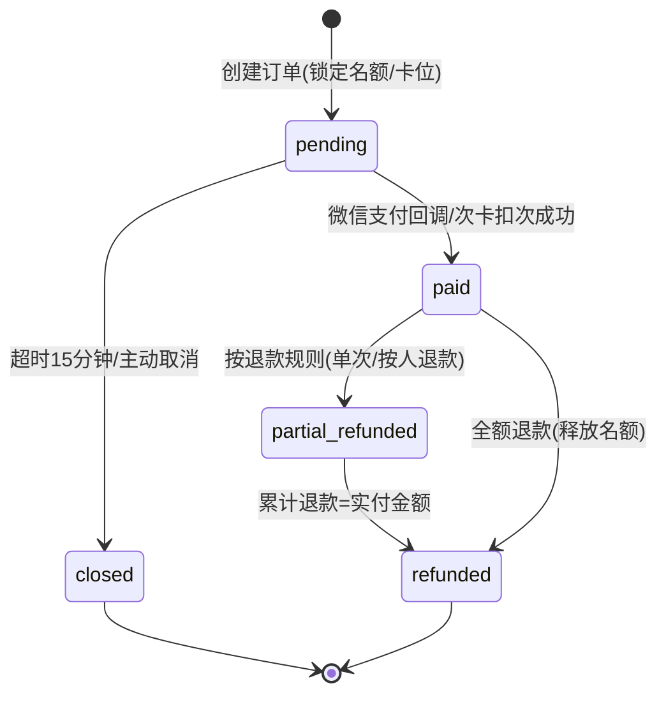
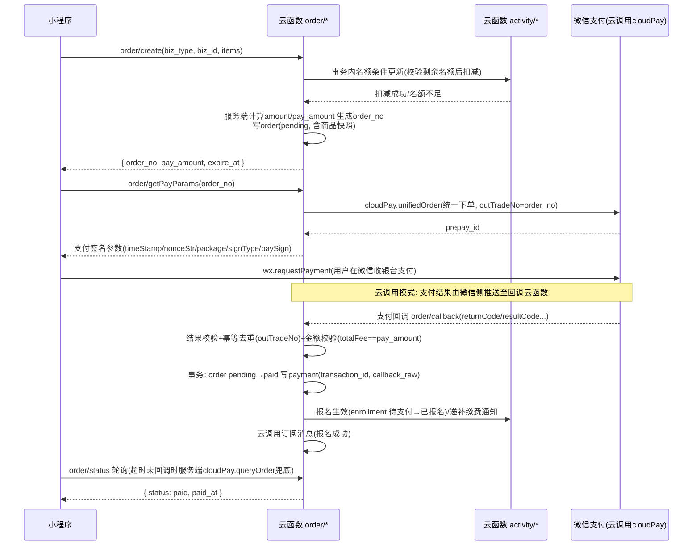
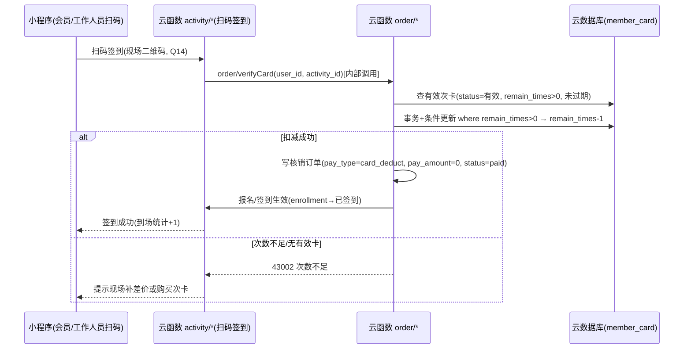

# 真人CS俱乐部小程序 · 支付模块详细设计文档

| 项目 | 内容 |
| --- | --- |
| 文档版本 | v1.0 |
| 依据文档 | 架构设计文档 v0.5（`docs/architecture.md`，唯一事实源） |
| 更新日期 | 2026-10-08 |
| 模块范围 | 订单 / 支付 / 退款 / 次卡核销 / 对账 |
| 技术底座 | 微信云开发（云函数 Node.js + wx-server-sdk、云数据库、云调用 cloudPay、定时触发器） |

> 本文实现细节凡标注「建议，可调」处均为开发期可调整项；业务规则凡标注「待确认 Q15/Q17/Q12/Q20」处沿用架构文档默认提案，未经确认不得擅自变更。

---

## 1. 模块概述

### 1.1 职责边界

支付模块负责**订单全生命周期、微信支付、退款、次卡核销与资金对账**，是小程序「线上收费」闭环的收口模块。

| 归属 | 内容 |
| --- | --- |
| **本模块负责** | 订单创建（含订单号生成、金额服务端计算、商品快照）、支付参数获取与支付回调、订单状态机流转、15 分钟超时关单、退款（用户申请 / 人工审核 / 俱乐部取消自动退）、次卡核销扣次、每日对账、支付相关操作日志埋点（module=order） |
| **活动模块负责**（双方约定接口，见第 7 章） | 名额的锁定与释放（报名记录创建、名额条件更新）、报名生效状态流转、候补队列与递补通知、活动取消事件触发 |
| **用户模块负责**（双方约定接口，见第 7 章） | 会员卡模板定义与定价、member_card 数据的生效/续期/扣次数据口径 |
| **管理端模块负责** | 退款审核列表页面、对账结果页面、操作日志查询页面的页面实现（调用本模块云函数接口） |

架构文档章节引用：支付场景与流程（§6.1–§6.3）、退款规则（§6.4）、安全与对账（§6.5）、数据模型（§6.6）、待确认问题（§6.7）、报名流程与名额控制（§5.3）、操作日志（§1.5）、角色权限点（§1.3）、定时触发器（§2.3）、开发阶段（§9）。

### 1.2 支付场景（与架构文档 §6.1 一致）

| 场景 | biz_type | 说明 |
| --- | --- | --- |
| 活动报名费 | `activity_signup` | 个人报名；战队批量报名（队长一次支付多人） |
| 会员卡购买/续费 | `member_card` | 次卡 / 期限卡 |
| 团建定金/尾款 | `team_build`（预留） | 待定 Q12，本设计仅预留字段与枚举，不展开流程 |
| 次卡核销 | `activity_signup` + `pay_type=card_deduct` | 报名常规活动扣次，**不走微信支付**（0 元订单流水） |

> **明确不做**：积分抵扣 / 混合支付（Q8 已砍，禁止出现任何积分相关支付设计）；优惠券 / 折扣码（Q18 默认 P2 暂不做，本文不展开）。

### 1.3 支付技术方案：推荐与备选

| 方案 | 说明 | 结论 |
| --- | --- | --- |
| **云调用 cloudPay（推荐）** | `wx-server-sdk` 内 `cloudPay.unifiedOrder` 统一下单等接口；支付回调由**微信侧直接推送至指定云函数**（云开发控制台配置回调云函数），event 为微信侧解析后的 JSON，**无需自行验签/解密**；云函数免证书密钥管理 | **推荐方案**。与架构文档「云函数 + 云调用」技术底座一致，开发与运维成本最低 |
| 微信支付 V3 API 直连（备选） | 云函数内直连 V3（JSAPI 支付、回调需验签 Wechatpay-Signature + 平台证书验签、AES-256-GCM 解密 resource）；需商户号 API v3 密钥/证书部署到云函数环境 | 备选。适用于需要服务商/特约商户模式、分账或 V3 独有账单能力时切换 |

本文后续接口设计均以**推荐方案（云调用 cloudPay）**展开，涉及 V3 备选差异处单独注明。前提依赖：微信支付商户号办理完成（Q20 待确认，需企业认证主体）。

### 1.4 功能优先级清单

| 优先级 | 功能 | 备注 |
| --- | --- | --- |
| P0 | 订单创建（个人报名/会员卡）、金额服务端计算、商品快照 | |
| P0 | 获取支付参数、支付回调（幂等+金额校验）、订单状态轮询 | |
| P0 | 15 分钟超时关单（定时触发器）+ 名额释放联动 | |
| P0 | 用户主动取消待支付订单 | |
| P0 | 申请退款、管理员退款审核（`audit_refund` 权限点 + 二次确认） | |
| P0 | 俱乐部取消活动 → 全额自动退款 + 订阅消息 | |
| P0 | 每日对账（架构 §6.5 安全与对账为必做项） | 差异处理闭环 M2 完善 |
| P0 | 退款等敏感操作日志埋点（module=order，§1.5） | |
| P1 | 次卡核销扣次（0 元订单流水）、会员卡按比例退 | M2 |
| P1 | 战队批量支付（一人付款多人名额）、部分退款按人退 | M2 |
| P2 | 团建定金/尾款（若 Q12 确认后启动） | 仅 biz_type 预留 |
| P2 | 对账差异报表导出 | |

---

## 2. 页面设计

本模块页面为**会员端订单相关页面**；管理端「退款审核列表」「对账页」「操作日志查询」页面属管理端模块（架构 §1.4），本模块仅提供其调用的云函数接口，不在本文展开页面设计。

| # | 页面 | 建议路径 | 入口 | 主要内容 | 调用接口 |
| --- | --- | --- | --- | --- | --- |
| 1 | 订单确认页 | `pages/order/confirm` | 活动报名确认按钮 / 会员卡购买按钮 | 商品快照摘要（活动标题/时间/场地或卡类型）、人数（个人/战队批量成员列表）、单价、应付金额（仅展示，金额以服务端计算为准）、支付方式选择（微信支付/次卡扣次，次卡可用时）、免责协议签署状态提示 | `order/create` |
| 2 | 收银台（支付参数拉起） | `pages/order/cashier` | 订单确认页「去支付」 | 倒计时（15 分钟剩余时间，超时置灰）、订单摘要、金额（分转元展示，保留两位）、「立即支付」按钮拉起 `wx.requestPayment`、超时/失败重试入口、取消订单入口 | `order/getPayParams`、`order/status`（轮询）、`order/cancel` |
| 3 | 我的订单列表 | `pages/order/list` | 「我的」-「我的订单」 | 状态 Tab（全部/待支付/已支付/退款中/已退款/已关闭）、分页列表（订单号、快照标题、金额、状态、下单时间）、待支付单「去支付」快捷入口 | `order/list` |
| 4 | 订单详情 | `pages/order/detail` | 订单列表点击 | 订单全量信息：快照、金额明细（应付/实付/已退）、状态与时间线、支付流水（transaction_id 脱敏展示）、战队批量明细（每人报名状态/退款状态）、退款记录、操作按钮（按状态展示：去支付/取消/申请退款） | `order/detail` |
| 5 | 申请退款 | `pages/order/refund-apply` | 订单详情「申请退款」 | 退款规则提示（按 §3.4/§3.5 动态展示预计可退金额）、退款原因（必填）、战队批量单按人勾选（仅批量单）、提交后进入退款进度 | `order/refundApply` |
| 6 | 退款进度 | `pages/order/refund-progress` | 订单详情/申请退款提交后 | 退款单状态时间线（申请→审核中→处理中→已退款/已驳回）、退款金额、退款原因、驳回理由展示 | `order/detail`（含退款记录） |

> 页面路径为建议，可调；前端仅调云函数（架构 §2.1 设计约束），不直连数据库。

---

## 3. 业务规则详细设计

> 通用约定：所有金额字段一律以**分**（整数）存储与计算；所有时间字段一律**毫秒时间戳**（命名 `*_at`）；退款基数一律为**实付金额 `pay_amount`**（应付金额 `amount` 减折扣后）。

### 3.1 订单创建规则（幂等防重复下单 + 金额服务端计算）

| 项 | 内容 |
| --- | --- |
| 描述 | 用户在订单确认页提交下单请求，云函数在**数据库事务**内校验前置条件、锁定名额/卡位、生成订单号并写入订单（状态=待支付）。**入参不含任何金额字段**，金额、单价全部由服务端按下单时刻的数据计算。 |
| 触发时机 | 会员点击「提交订单」：个人报名 / 战队批量报名（队长操作）/ 会员卡购买（含续费） |
| 计算/校验逻辑 | ① 前置校验：已登录、已绑手机号（Q6 强制）、已签免责协议（报名单）、活动处于「已发布/报名中」且未过报名截止；② 金额计算（服务端）：活动报名 `amount = activity.price（下单时刻快照）× 人数`；会员卡 `amount = 卡模板价格`；等级折扣（P1，会员等级 LV3 95 折 / LV4 9 折，架构 §3.3）由服务端计算：`pay_amount = amount − 折扣额`，M1 无折扣时 `pay_amount = amount`；③ 事务内：调活动模块名额条件更新（校验剩余名额 ≥ 人数后扣减，防超卖，架构 §5.3），生成 `order_no`，写 order（含商品快照）；④ 幂等防重复下单：提交时校验**同一 user_id + 同一 biz_id** 是否存在未过期的「待支付」订单或「已支付」订单——存在待支付订单则直接返回原订单并标记 `is_exist=true` 引导继续支付（防连点/防重复下单）；存在已支付订单则返回错误（活动报名：重复报名，见 41006）。 |
| 边界条件 | ① 战队批量人数 ≤ 战队在职成员数且逐人校验协议/手机号/重复报名，任一人不满足则整单失败（事务回滚，不产生部分锁位）；② 同一事务内名额扣减失败（名额不足）整单失败；③ `order_no` 生成碰撞由唯一索引兜底，冲突时重试一次生成（建议，可调）；④ 快照规则：下单时固化活动标题/单价/封面或卡类型/次数，此后活动改价不影响已创建订单（见 §6.4 冗余与同步）；⑤ 前端展示的金额仅用于展示，回调时以服务端 `pay_amount` 与微信侧 `totalFee` 双向核对。 |

### 3.2 待支付订单 15 分钟超时关单

| 项 | 内容 |
| --- | --- |
| 描述 | 待支付订单锁定名额 15 分钟，超时未支付由**定时触发器**自动关单并释放名额（架构 §5.3/§6.2；名额释放动作本身由活动模块执行，本模块负责关单与联动）。 |
| 触发时机 | `order/closeTimeout` 定时触发器（建议每分钟执行一次，可调）；扫描 `status=pending` 且 `expire_at < 当前时间` 的订单 |
| 计算/校验逻辑 | ① `expire_at = created_at + 15 × 60 × 1000`（900000ms，下单时写入）；② 每单关单前先调 `cloudPay.queryOrder` 查询微信侧真实支付状态：`trade_state != SUCCESS`（未支付）→ 条件更新 `pending → closed`（`closed_reason=timeout`，幂等，条件更新失败说明已被并发处理则跳过）→ 调活动模块释放名额接口；`trade_state = SUCCESS`（已支付但回调未到）→ 不关单，转执行支付成功流程（回调兜底，见 §8.2）；③ 分批处理（建议每批 100 单，可调），避免单次触发超出执行时长。 |
| 边界条件 | ① 关单与支付并发以**条件更新**裁决：只有 `pending → closed` 更新成功的一方生效；② 关单成功后微信侧再收到/补推的成功回调 → 按已关闭订单收到成功回调处理（自动原路退款，见 §8.2）；③ 会员卡/次卡扣位同理超时释放（次卡核销 0 元单即时完成，无待支付态，不涉及关单）；④ 定时触发器异常未执行时，`order/getPayParams` 入口做兜底校验：`expire_at` 已过期的待支付订单拒绝发放支付参数并触发关单（建议，可调）。 |

### 3.3 支付回调幂等处理（验签/解密 + 订单号去重 + 金额校验）

| 项 | 内容 |
| --- | --- |
| 描述 | 支付结果**以回调为准**（架构 §6.5）；云调用模式下回调由微信侧推送至本模块回调云函数 `order/callback`，**推送与验签/解密由微信平台完成**（云函数收到的 event 即解析后的 JSON），无需自行验签；备选 V3 直连模式则须自行验签（Wechatpay-Signature + 平台证书）并 AES-256-GCM 解密 resource。 |
| 触发时机 | 微信侧支付完成（或补推/重推）→ 推送至 `order/callback` |
| 计算/校验逻辑 | ① 结果校验：`returnCode` 与 `resultCode` 均为 `SUCCESS` 才视为支付成功；② **幂等去重**：按 `outTradeNo`（= `order_no`）查订单——订单已是 `paid/partial_refunded/refunded` → 判定为重复回调，直接应答成功，不重复处理；以 `transaction_id` 唯一索引兜底防重复入 payment；③ **金额校验**：回调 `totalFee` 必须 == 订单 `pay_amount`，不一致则不置已支付、原文存档 `callback_raw` 并写告警日志，转人工处理（详见 §8.7）；④ 状态流转：数据库事务内条件更新 `pending → paid`（并发只有一方成功）+ 写 payment（含 `transaction_id`、`paid_at`、`callback_raw`）；⑤ 联动（同一事务提交后异步执行，失败重试不回滚订单）：活动报名 → 调活动模块「报名生效」（enrollment 待支付→已报名）；会员卡 → 调用户模块「会员卡生效/续期」；发送订阅消息（报名成功/购卡成功）。 |
| 边界条件 | ① 微信重推机制：应答 `errcode != 0` 或抛错时微信按其策略重推，重推同样走幂等；② 回调晚于超时关单/主动取消（订单已 `closed` 但收到成功回调）→ 自动原路全额退款并通知用户（§8.2/§8.3）；③ 回调与前端轮询并发：轮询查询不改变订单状态，仅读；④ 回调处理内的联动子步骤失败：记告警 + 重试队列（定时触发器扫未完成的联动任务，建议可调），订单已支付状态不回退。 |

### 3.4 活动报名退款金额计算（默认提案，待确认 Q15/Q17）

| 项 | 内容 |
| --- | --- |
| 描述 | 按退款申请时刻与活动 `start_time` 的关系计算可退金额，与架构 §6.4 完全一致；退款基数为该人（或该单）实付金额。 |
| 触发时机 | 会员在订单详情申请退款 / 退款单审核通过执行时（以**审核执行时刻**重算，取两次计算较小值，建议可调） |
| 计算/校验逻辑 | 设 `now = 申请时刻`，`start = activity.start_time`（下单快照或活动当前值一致，活动时间变更场景以活动模块最新值为准）：① `start − now ≥ 24h` → 可退 = `pay_amount` 全额，**自动退款免审核**（Q17 默认：≥24h 自动退）；② `start − now < 24h` 且 `now < start` → 可退 = `round(pay_amount × 50%)`，**需管理员人工审核**（Q17 默认，标注待确认）；③ `now ≥ start`（已开始）或该人已签到（enrollment 已签到）→ **不退**；④ 俱乐部原因取消活动（活动状态→已取消）→ 全部相关订单**全额自动退款** + 订阅消息通知（见 3.6）。 |
| 边界条件 | ① 部分退款叠加：累计退款 ≤ `pay_amount`，见 §8.5；② 团购整单折扣分摊到人的口径见 §3.9；③ 退款申请入口对「不退」情形前置拦截（返回 42002），不生成退款单；④ 50% 舍入采用四舍五入到分（`Math.round`），标注建议可调；⑤ 会员等级折扣导致的实付与应付差额按实付退（用户实际支出为退款上限）。 |

### 3.5 会员卡退款金额计算（默认提案，待确认 Q17）

| 项 | 内容 |
| --- | --- |
| 描述 | 次卡/期限卡退款：未使用 7 天无理由全退；次卡已使用按剩余次数比例退（架构 §6.4，规则需最终确认）。 |
| 触发时机 | 会员在订单详情对 `biz_type=member_card` 的已支付订单申请退款 |
| 计算/校验逻辑 | ① **未使用**（次卡 `remain_times == total_times` 且无任何核销流水）且 `now − paid_at ≤ 7 天` → 全退 `pay_amount`；② **次卡已使用**（剩余次数 > 0 且未过期）→ `退款金额 = round(pay_amount × remain_times / total_times)`（total_times 为该卡总次数）；③ 期限卡已生效的退款比例架构文档未明确，**建议** `round(pay_amount × 剩余天数 / 总天数)`（标注：建议，待俱乐部确认，与 Q17 一并确认）；④ 会员卡审核口径同 §3.4：符合「无理由全退」条件的默认自动退，其余转人工审核（Q17 默认，待确认）。 |
| 边界条件 | ① 卡已过期（`expire_at < now`）默认**不退**（待确认 Q17）；② 超出 7 天且未使用的次卡：默认按②比例公式处理（此时比例为全额，实际退全款），是否限制仅 7 天内可退**待确认 Q17**——默认提案为「未使用可 7 天无理由退」，超出 7 天未使用是否仍可退由俱乐部确认；③ 退款成功后会员卡处置：未使用 → 卡作废；按比例退 → 卡作废（或冻结剩余次数，**建议作废**，标注可调）；④ 续费订单退款：续费金额按上述规则独立计算，不影响原卡期。 |

### 3.6 俱乐部取消活动 → 全额自动退款

| 项 | 内容 |
| --- | --- |
| 描述 | 活动因俱乐部原因取消（活动状态流转为「已取消」，架构 §5.4）时，对该活动全部已支付订单自动发起**全额原路退款**并向用户发送订阅消息。 |
| 触发时机 | 活动模块（管理端取消活动）调用本模块内部接口 `order/autoRefund`，入参 `activity_id` |
| 计算/校验逻辑 | ① 按 `biz_type=activity_signup` 且 `biz_id=activity_id` 检索 `status ∈ {paid, partial_refunded}` 的订单，逐单生成 `type=auto` 的退款单（`refund_amount = pay_amount − refunded_total`，即剩余可退部分）；② 逐单调 `cloudPay.refund` 原路退回；③ 该活动的**待支付订单**直接关闭（`closed_reason=timeout` 同类处理，释放名额）；④ 全程写操作日志（module=order，action=`order.refund.auto`，target 为活动 ID）并发订阅消息（退款通知）。 |
| 边界条件 | ① 批量退款分批执行（建议每批 20 单/次，受定时触发器或分页调用保护，可调）；② 某一单退款失败不影响其余订单，失败单进入退款失败重试（§8.4）；③ 取消活动与用户正在支付并发：回调到达时订单若因活动取消已被退款/关闭，按 §8.2 已关闭订单收到成功回调处理（自动原路退）。 |

### 3.7 次卡核销规则（P1，不走微信支付）

| 项 | 内容 |
| --- | --- |
| 描述 | 会员使用次卡报名常规活动时**扣次**（1 次 = 1 场常规活动，架构 §3.2/§6.1），不经过微信支付；本模块以 `pay_type=card_deduct` 的 **0 元订单**记录核销流水，保持订单/退款/对账口径统一。 |
| 触发时机 | **建议：签到时扣次**（现场扫码签到时核销，与 Q14 扫码签到联动，架构 §5.2）——避免「报名后未到场白扣一次」；备选：报名时扣次（防占坑更彻底）。**扣次时机为建议，可调**，两种时机的接口（`order/verifyCard`）不变，仅调用方与时机不同。 |
| 计算/校验逻辑 | ① 校验：会员持有一张 `status=有效` 且 `expire_at > now` 且 `remain_times ≥ 1` 的次卡（多张卡时**建议先用临期卡**：按 `expire_at` 升序取第一张，标注建议可调）；② **并发防超扣**：在云数据库事务内对 member_card 做**条件更新**（`where remain_times > 0` 原子减 1），更新失败即次数不足/并发冲突，返回 43002；③ 防重复扣次：同一 `activity_id + user_id` 仅允许一条核销流水（order 上建组合唯一校验 + 签到记录去重，双重防护）；④ 核销成功 → 生成 0 元订单（`amount=0, pay_amount=0, pay_type=card_deduct`，状态直接 `paid`）→ 报名/签到生效；不产生 payment 记录（无微信交易）。 |
| 边界条件 | ① 多人同时签到并发扣同一张卡：条件更新保证不会扣成负数；② 次数不足时引导现场补差价（转微信支付新订单）或购卡（收银台场景）；③ 核销后退款/取消：活动未开始取消报名 → 系统回退次数（`remain_times + 1` 条件加回，记操作）；已开始/已签到不回退；④ 扣次卡位（下单时锁定）与 15 分钟机制不适用（0 元单即时完成）。 |

### 3.8 战队批量支付规则（P1：一人付款、多人名额）

| 项 | 内容 |
| --- | --- |
| 描述 | 队长为全队或部分成员统一报名并**一次支付多人**名额（架构 §4.1/§6.1）：订单归属队长（付款人），items 明细记录每位实际参加人。 |
| 触发时机 | 队长在活动详情选择成员（含本人）提交战队报名订单 |
| 计算/校验逻辑 | ① 校验：操作人为队长（team_member 中 role=队长且在职）；所选成员均为该战队在职成员且逐人满足报名前置（手机号/协议/未重复报名）；② 金额：`amount = 单价快照 × 成员数`，`pay_amount` 服务端计算（含等级折扣时见 §3.9 分摊口径）；③ 名额：事务内一次性扣减 `成员数` 个名额（任一环节失败整单回滚）；④ 支付：队长一人拉起微信支付；⑤ 支付成功后：**逐人生成/激活报名记录**（每人一条 activity_enrollment，order_id 指向本单），每人独立发报名成功订阅消息。 |
| 边界条件 | ① 支付人与实际参加人不同 → 架构 Q19（发票/收据）默认暂不开票，不做展开；② 队长自身是否含在成员列表由前端勾选决定，订单 user_id 恒为队长；③ 批量人数上限（建议一次 ≤ 50 人，可调）；④ 成员在支付期间被移出战队：以**下单事务时刻**的在职校验为准，支付成功后正常生效（建议，可调）。 |

### 3.9 战队批量退款：部分退款按人退

| 项 | 内容 |
| --- | --- |
| 描述 | 批量单退款以**人为最小单位**：队长/参加人申请退款时勾选要退的人，退款单只退勾选成员的分摊金额，其余成员报名不受影响。 |
| 触发时机 | 队长（或订单详情入口，建议限队长，可调）在批量单上申请退款并勾选成员 |
| 计算/校验逻辑 | ① **单人实付分摊**（建议，可调）：`unit_pay = floor(pay_amount / n)`（n 为明细人数），余数 `pay_amount − unit_pay × n` 计入**最后一个勾选人**（保证多人多次退款累计恰等于 pay_amount）；无等级折扣时 `unit_pay = unit_price` 快照；② **单人可退金额**：按 §3.4 规则以该人为单位计算（`round(unit_pay × 比例)`）；③ 退款单 `items` 记录本次退款涉及的 user_id 列表；退款成功后：`order.refunded_total` 累加、对应成员 enrollment 置已取消并释放名额、其余成员状态不变；④ 订单状态：`refunded_total < pay_amount` → `partial_refunded`；`refunded_total == pay_amount` → `refunded`。 |
| 边界条件 | ① 多次按人退叠加：每次校验 `待退成员未被重复退`（以 enrollment/items 的 per-item 退款标记去重）且 `refunded_total + 本次金额 ≤ pay_amount`；② 某成员已签到但其他人未签：已签到者单独不可退（§3.4），不影响其他人；③ 俱乐部取消活动：全额自动退时对整单所有人一次性退（§3.6）。 |

### 3.10 每日对账规则（必做，架构 §6.5）

| 项 | 内容 |
| --- | --- |
| 描述 | 每日定时将微信支付侧账单（资金账单）与本地 order/payment/refund 逐笔核对，发现差异立即告警并生成对账报告（架构 §6.5 必做项）。 |
| 触发时机 | `order/reconcile` 定时触发器，**建议每日 05:00**（可调），核对**前一日**（自然日，北京时间）账单 |
| 计算/校验逻辑 | ① 账单获取：从微信支付侧下载前一日资金账单（含收入/支出/退款流水）——获取方式：优先云调用支付能力，若 wx-server-sdk 未提供账单下载接口则采用备选方案 B（V3 直连）或商户平台每日导出后导入（**建议，可调**，Q20 商户号确定后落地）；② 本地侧：统计同日 `payment`（支付流水）与 `refund`（退款成功流水）；③ **比对维度**：订单号/退款单号、transaction_id、金额（分）、方向（收/退）；④ 差异分类处理：**微信有本地无**（漏回调）→ 查单确认后按回调逻辑补记订单并联动生效；**本地有微信无** → 调 `cloudPay.queryOrder` 核实，确未支付/未退款则修正本地数据并告警；**金额不一致** → 高危，写告警日志、通知管理员人工核查；**退款状态不一致** → 查单确认终态后修正本地退款单状态；⑤ 输出：对账报告（JSON/CSV，存**云存储**）+ 差异告警（订阅消息通知管理员）+ 写一条操作日志（module=order，action=`order.reconcile`，detail 含差异条数摘要）。 |
| 边界条件 | ① 账单延迟未出：触发器内置重试（当日内再试，建议最多 3 次，可调），仍失败则告警；② 0 点前后跨日交易：以微信账单的账单日为准，本地按 `paid_at/refunded_at` 所在自然日统计，差异在 ±1 日窗口内二次比对（建议，可调）；③ 手续费口径：微信支付手续费（0.6%）及其退款返还政策以商户平台实际规则为准，对账以账单金额为准，不做本地推算；④ 对账差异处理完成后再出报告终稿（差异处理动作本身记操作日志）。 |

### 3.11 敏感操作日志规则

| 项 | 内容 |
| --- | --- |
| 描述 | 退款等敏感操作全量记入操作日志（架构 §1.5/§6.5），module=order。 |
| 触发时机 | 管理员退款审核（同意/驳回）、俱乐部取消自动退款、订单人工干预、每日对账（汇总一条）、次卡人工调整涉及退次等 |
| 计算/校验逻辑 | 按 §1.5 公共入口封装：鉴权 → 执行业务 → fire-and-forget 写 `operation_log`（写入失败不阻断业务，记告警）；action 枚举（module=order）：`order.refund.audit`（人工审核）、`order.refund.auto`（自动退款）、`order.refund.retry`（退款重试）、`order.intervene`（订单人工干预）、`order.reconcile`（对账）、`order.verifyCard.adjust`（次卡人工回退，如有）。detail 记 before/after 关键字段（order_no、金额、状态），敏感字段脱敏。 |
| 边界条件 | ① 自动退款/对账等系统操作的 operator 以 `system` 标识记录；② 用户侧自助操作（申请退款、取消订单）不写 operation_log（非管理端操作，架构 §1.5 范围限定为管理端写操作），业务留痕在 order/refund 本身。 |

---

## 4. 流程图

### 4.1 订单状态机（与架构 §6.2 一致）

状态取值：`pending` 待支付 / `paid` 已支付 / `partial_refunded` 部分退款 / `refunded` 已退款（终态）/ `closed` 已关闭（终态）。



> 与架构 §6.2 相比补充一条 `partial_refunded → refunded` 迁移：多次部分退款叠加至全额后的自然收敛，非新增业务决策。终态为 `closed` / `refunded`。

### 4.2 支付时序图（小程序 / 云函数 order/* / 活动云函数 / 微信支付）



### 4.3 退款流程（自动退款 + 人工审核）

```mermaid
flowchart TD
    A[退款触发] --> B{触发来源}
    B -- 用户申请 order/refundApply --> C{按规则计算可退金额}
    B -- 俱乐部取消活动 order/autoRefund --> D[全额自动退款 type=auto]
    B -- 管理员后台人工退款干预 --> D
    C -- 活动前>=24h 或 会员卡未使用7天内 --> D
    C -- 活动前<24h(默认提案 待确认Q17) --> E[生成待审核退款单 status=pending]
    C -- 已开始/已签到/次数不足/已过期 --> F[拒绝申请 code=42002 不生成退款单]
    E --> G{管理员审核 order/refundAudit<br/>权限点 audit_refund 二次确认}
    G -- 同意 --> H[调用cloudPay.refund<br/>退款单 status=processing]
    G -- 驳回(必填理由) --> I[status=rejected 通知申请人<br/>写操作日志 order.refund.audit]
    D --> H
    H --> J{微信退款结果}
    J -- 成功 --> K[refund status=success<br/>order refunded/partial_refunded<br/>释放名额/作废或回退次卡<br/>发订阅消息 写操作日志]
    J -- 失败/超时未确认 --> L[status=failed 记录fail_reason<br/>定时触发器重试(最多N次)<br/>仍失败则告警转人工]
    L --> H
```

### 4.4 次卡核销时序（扣次，不走微信支付）



> 若业务最终选择「报名时扣次」（§3.7 备选时机），时序中触发方改为订单确认页（`order/create` 内 `pay_type=card_deduct` 分支），扣次成功即报名生效、无 15 分钟待支付态。

### 4.5 每日对账流程

```mermaid
flowchart TD
    A[定时触发器 每日05:00 order/reconcile] --> B[下载前一日微信支付资金账单<br/>(云调用优先/备选V3或商户平台导出)]
    B -- 账单未出 --> B1[当日内重试(最多3次, 建议可调)] --> B
    B --> C[解析账单: 收款/退款流水逐笔]
    C --> D[本地统计: 当日payment支付流水 + refund退款成功流水]
    D --> E{逐笔比对: 单号/transaction_id/金额/方向}
    E -- 账单有本地无 --> F[疑似漏回调: cloudPay.queryOrder查单确认<br/>确认后按回调逻辑补记订单并联动生效]
    E -- 本地有账单无 --> G[疑似本地脏数据: 查单核实<br/>未支付则修正本地并告警]
    E -- 金额不一致 --> H[高危: 告警通知管理员人工核查]
    E -- 退款状态不一致 --> I[查单确认终态后修正本地退款单]
    E -- 全部一致 --> J[对账平: 生成正常报告]
    F & G & H & I --> K[生成对账差异报告(JSON/CSV存云存储)]
    K --> L[写操作日志 module=order action=order.reconcile<br/>差异告警订阅消息通知管理员]
    J --> L
```

---

## 5. 云函数接口设计

### 5.0 公共约定

- 部署形态：本模块所有接口收敛为**一组云函数** `order/*`（架构 §2.2 CFP），以 action 路由（如 `cloud.callFunction({ name: 'order', data: { action: 'create', ... } })`）；回调云函数 `order/callback` 为独立入口（微信支付回调配置指向）。部署拆分粒度为**建议，可调**（如拆为 `order`、`order-callback`、`order-timer` 三个函数以隔离冷启动与权限）。
- **统一返回结构** `{ code, msg, data }`，`code = 0` 表示成功，非 0 为错误码；`data` 仅在成功时必有。
- 入参一律**云函数侧校验**（类型、枚举、必填、长度），不信任前端。
- 金额字段一律**分**（整数）；时间字段一律**毫秒时间戳**。
- 用户身份：云函数天然携带 openid，经用户模块换取 user_id（架构 §2.3）；管理端权限按权限点校验（架构 §1.3，`role_permission` 在线配置）。
- **唯一例外**：`order/callback` 出参为微信侧要求的应答格式 `{ errcode, errmsg }`（不是统一结构），见 5.3。

**公共错误码**（所有接口通用，接口专属错误码见各节）：

| code | msg 示例 | 说明 |
| --- | --- | --- |
| 0 | ok | 成功 |
| 40001 | 未登录或身份失效 | openid 无法解析/用户不存在 |
| 40101 | 参数校验失败 | 入参类型/枚举/必填不合法 |
| 40301 | 无权限 | 角色权限点不足（如缺 audit_refund） |
| 40302 | 无权访问该资源 | 非订单本人/非本人退款单 |
| 40401 | 资源不存在 | 订单/退款单不存在 |
| 40901 | 状态冲突 | 订单/退款单当前状态不允许该操作 |
| 42901 | 操作过于频繁 | 触发频控/防连点 |
| 50000 | 服务内部错误 | 未分类异常 |
| 50001 | 微信支付接口调用失败 | cloudPay 调用异常（网络/参数/商户侧） |
| 50002 | 数据库事务失败 | 事务冲突，建议前端提示重试 |

### 5.1 order/create 创建订单

| 项 | 内容 |
| --- | --- |
| 用途 | 创建订单：个人/战队批量活动报名、会员卡购买/续费；事务内锁名额/卡位并写入订单（待支付） |
| 权限 | 登录会员（登录态校验；战队批量须队长身份） |

**入参示例（活动报名-战队批量）**：

```json
{
  "action": "create",
  "biz_type": "activity_signup",
  "biz_id": "act_8f3k2",
  "pay_type": "wxpay",
  "team_id": "team_2k9",
  "items": [
    { "user_id": "u_10001", "nickname": "老王" },
    { "user_id": "u_10002", "nickname": "小李" }
  ]
}
```

**入参示例（个人报名用次卡，扣次时机=报名时分支，§3.7 备选）**：

```json
{
  "action": "create",
  "biz_type": "activity_signup",
  "biz_id": "act_8f3k2",
  "pay_type": "card_deduct",
  "items": [{ "user_id": "u_10001", "nickname": "老王" }]
}
```

**入参示例（会员卡购买）**：

```json
{ "action": "create", "biz_type": "member_card", "biz_id": "card_tpl_30", "pay_type": "wxpay", "items": [{ "qty": 1 }] }
```

**入参字段**：`biz_type`（枚举 `activity_signup|member_card|team_build`，后者 Q12 预留暂拒）、`biz_id`、`pay_type`（`wxpay|card_deduct`）、`team_id`（战队批量必填）、`items`（报名单为参加人列表 ≤50 人，个人单恰 1 人且 user_id 须为本人；会员卡单为 `[{qty}]`）。**入参不含任何金额字段**。

**出参示例**：

```json
{
  "code": 0,
  "msg": "ok",
  "data": {
    "is_exist": false,
    "order_no": "CS26100812300111A1B2C3",
    "amount": 40000,
    "pay_amount": 40000,
    "status": "pending",
    "expire_at": 1791449580000
  }
}
```

**核心处理逻辑**：① 登录态校验；② 参数校验（枚举/人数/本人一致性）；③ 报名单前置校验（手机号已绑、免责协议已签、活动可报名、逐人未重复报名）；④ 幂等检查（同 user_id+biz_id 的未过期待支付单 → 返回原单 `is_exist=true`；已支付单 → 报 41006）；⑤ 事务：调活动模块名额条件更新（防超卖）→ 服务端计算 `amount/pay_amount` → 固化商品快照 → 生成 `order_no` → 写 order（`pending`、`expire_at`）；⑥ `pay_type=card_deduct` 分支：事务内次卡条件扣减，成功则订单直接 `paid` 并联动报名生效（无微信支付环节）；⑦ 返回订单摘要。

**错误码**：

| code | msg 示例 | 说明 |
| --- | --- | --- |
| 41001 | 名额不足 | 剩余名额 < 申请人数 |
| 41002 | 请先签署免责协议 | 报名单未签协议（本人或成员） |
| 41003 | 请先绑定手机号 | 未绑手机号（Q6 强制） |
| 41004 | 活动不可报名 | 非报名中状态/已过报名截止 |
| 41005 | 存在未支付订单 | （旧版保留位，现以 is_exist 返回） |
| 41006 | 重复报名 | 本人/成员已存在已支付报名 |
| 41007 | 非战队队长或成员状态异常 | 战队批量校验失败 |
| 43001 | 无可用次卡 | card_deduct 分支无有效卡 |

### 5.2 order/getPayParams 获取支付参数

| 项 | 内容 |
| --- | --- |
| 用途 | 按 order_no 获取拉起微信收银台的支付签名参数（收银台页/订单列表「继续支付」复用） |
| 权限 | 订单本人 |

**入参示例**：

```json
{ "action": "getPayParams", "order_no": "CS26100812300111A1B2C3" }
```

**出参示例**：

```json
{
  "code": 0,
  "msg": "ok",
  "data": {
    "timeStamp": "1791448680",
    "nonceStr": "5K8264ILTKCH16CQ2502SI8ZNMTM67VS",
    "package": "prepay_id=wx2510130000000abc",
    "signType": "RSA",
    "paySign": "oRsgdCJ...",
    "pay_amount": 40000,
    "expire_at": 1791449580000
  }
}
```

**核心处理逻辑**：① 登录态 + 本人校验；② 订单须 `pending` 且 `expire_at > now`（过期则触发关单并返回 40901）；③ 调 `cloudPay.unifiedOrder`：`outTradeNo = order_no`、`totalFee = pay_amount`、`body = 快照标题`（建议 ≤ 128 字符，可调）、`subMchId` 商户号（Q20）、回调云函数名（云开发控制台支付回调配置）；④ 组装前端支付参数返回（V3 备选模式：JSAPI 下单 + 前端签名）。注：对**同一待支付订单重复调用**可直接复用未过期 prepay（微信侧 prepay 有效期内，建议缓存，可调）。

**错误码**：

| code | msg 示例 | 说明 |
| --- | --- | --- |
| 40901 | 订单已关闭/已支付/已过期 | 非 pending 或超 15 分钟 |
| 50001 | 统一下单失败 | cloudPay 返回异常（含商户号未配置等，透出 errmsg 摘要） |

### 5.3 order/callback 支付回调接收（云函数回调入口）

| 项 | 内容 |
| --- | --- |
| 用途 | 接收微信支付结果回调。**云调用模式（推荐）**：在云开发控制台将支付回调配置指向本云函数，微信侧推送并完成验签/解密，event 即支付结果 JSON；**V3 备选模式**：本函数自行验签（Wechatpay-Signature + 平台证书）并 AES-256-GCM 解密 resource |
| 权限 | 无用户上下文（微信支付服务端推送；云函数默认仅本小程序/配置的支付回调可触达） |

**入参示例（云调用模式，字段以微信侧实际推送为准）**：

```json
{
  "returnCode": "SUCCESS",
  "returnMsg": "OK",
  "resultCode": "SUCCESS",
  "errCode": "SUCCESS",
  "errMsg": "ORDER_SUCCESS",
  "outTradeNo": "CS26100812300111A1B2C3",
  "transactionId": "4200001234202610081230",
  "totalFee": 40000,
  "openid": "oXXXX...",
  "timeEnd": "20261008123045"
}
```

**出参示例（微信侧要求的应答格式，非统一结构）**：

```json
{ "errcode": 0, "errmsg": "OK" }
```

**核心处理逻辑**：① `returnCode` 与 `resultCode` 均为 `SUCCESS` 才继续（失败通知仅记日志后应答成功，不改变订单）；② 幂等：按 `outTradeNo` 查订单——已是 `paid/partial_refunded/refunded` → 直接应答成功；③ 金额校验 `totalFee == pay_amount`，不一致 → 存 `callback_raw` + 告警 + 应答成功但不置已支付（§8.7）；④ 事务：条件更新 `pending → paid`（写 `paid_at` = `timeEnd` 转毫秒）+ 写 payment（`transaction_id` 唯一索引 + `callback_raw` 原文）；⑤ 订单若已 `closed`（回调晚于关单）→ 转自动原路全额退款（§8.2）；⑥ 支付成功联动（异步，失败进重试不回滚）：活动 → 报名生效 + 递补通知；会员卡 → 生效/续期；订阅消息（报名成功/购卡成功）；⑦ 任一步骤异常 → 抛错/返回 `errcode != 0`，由微信按策略重推兜底。

**错误码（内部处理结果，影响是否应答成功）**：

| 内部错误 | 处理 |
| --- | --- |
| 订单不存在 | 记告警日志，应答成功（防无限重推），转人工 |
| 金额不一致 | 记告警，应答成功，转人工（§8.7） |
| 事务冲突 | 抛错应答失败，等待微信重推（幂等保护重入） |

### 5.4 order/status 查询订单状态（前端轮询）

| 项 | 内容 |
| --- | --- |
| 用途 | 收银台支付后的状态轮询（建议 2s 间隔、最长 60s，可调）；轮询时若发现超时未回调，服务端主动 `cloudPay.queryOrder` 兜底核实（见核心逻辑③） |
| 权限 | 订单本人 |

**入参示例**：

```json
{ "action": "status", "order_no": "CS26100812300111A1B2C3" }
```

**出参示例**：

```json
{ "code": 0, "msg": "ok", "data": { "order_no": "CS26100812300111A1B2C3", "status": "paid", "pay_amount": 40000, "paid_at": 1791448685000 } }
```

**核心处理逻辑**：① 登录态 + 本人校验；② 读订单当前状态返回；③ 兜底（建议，可调）：订单 `pending` 且 `created_at` 距今超过一定阈值（如 20s）仍未支付 → 主动调 `cloudPay.queryOrder` 查真实状态，若 `trade_state=SUCCESS` 按回调逻辑补记（回调丢失兜底）。

**错误码**：40401 订单不存在、40302 非本人。

### 5.5 order/list 我的订单列表

| 项 | 内容 |
| --- | --- |
| 用途 | 会员端「我的订单」分页列表 |
| 权限 | 登录会员（仅本人订单） |

**入参示例**：

```json
{ "action": "list", "page": 1, "page_size": 10, "status": "pending", "biz_type": "activity_signup" }
```

`status` 可选值：`pending|paid|partial_refunded|refunded|closed` 或缺省=全部；`biz_type` 可选筛选。

**出参示例**：

```json
{
  "code": 0,
  "msg": "ok",
  "data": {
    "total": 23,
    "list": [
      {
        "order_no": "CS26100812300111A1B2C3",
        "biz_type": "activity_signup",
        "title": "周末5v5常规对抗赛",
        "status": "pending",
        "pay_amount": 40000,
        "item_count": 2,
        "created_at": 1791448680000,
        "expire_at": 1791449580000
      }
    ]
  }
}
```

**核心处理逻辑**：① 登录态校验；② 按 `user_id` 组合索引分页查询（`page_size ≤ 50`，超出截断）；③ 列表仅返回摘要字段（快照标题冗余在 order，无需联查）；④ 待支付单附带 `expire_at` 供前端倒计时。

**错误码**：40101 参数校验失败（页码越界/枚举非法）。

### 5.6 order/detail 订单详情

| 项 | 内容 |
| --- | --- |
| 用途 | 订单详情页 + 退款进度页数据源（含支付流水摘要与退款记录数组） |
| 权限 | 订单本人 **或** 持 `view_order` 权限的管理员（权限点建议，可调） |

**入参示例**：

```json
{ "action": "detail", "order_no": "CS26100812300111A1B2C3" }
```

**出参示例**：

```json
{
  "code": 0,
  "msg": "ok",
  "data": {
    "order_no": "CS26100812300111A1B2C3",
    "biz_type": "activity_signup",
    "biz_id": "act_8f3k2",
    "team_id": "team_2k9",
    "snapshot": { "title": "周末5v5常规对抗赛", "type": "常规对抗赛", "start_time": 1791500000000, "venue": "旗舰店场地A", "unit_price": 20000 },
    "items": [
      { "user_id": "u_10001", "nickname": "老王", "unit_price": 20000, "refund_status": "none" },
      { "user_id": "u_10002", "nickname": "小李", "unit_price": 20000, "refund_status": "none" }
    ],
    "amount": 40000,
    "pay_amount": 40000,
    "refunded_total": 0,
    "pay_type": "wxpay",
    "status": "paid",
    "created_at": 1791448680000,
    "paid_at": 1791448685000,
    "expire_at": 1791449580000,
    "payment": { "transaction_id": "4200001234202610081230", "channel": "wxpay", "paid_at": 1791448685000 },
    "refunds": []
  }
}
```

**核心处理逻辑**：① 权限校验（本人/管理员）；② 读 order（含 items/snapshot）；③ 联查 payment（取 1 条成功流水，transaction_id 前端展示时脱敏：`4200****1230`，建议可调）与 refund（按 `order_id` 查全部退款单，含状态/金额/驳回理由）；④ 管理员视角额外返回 `user_id` 与下单人昵称（冗余字段）。

**错误码**：40401 订单不存在、40302 无权访问。

### 5.7 order/cancel 主动取消订单

| 项 | 内容 |
| --- | --- |
| 用途 | 用户主动取消**待支付**订单（收银台/订单列表入口），联动释放名额 |
| 权限 | 订单本人 |

**入参示例**：

```json
{ "action": "cancel", "order_no": "CS26100812300111A1B2C3" }
```

**出参示例**：

```json
{ "code": 0, "msg": "ok", "data": { "order_no": "CS26100812300111A1B2C3", "status": "closed" } }
```

**核心处理逻辑**：① 登录态 + 本人校验；② 订单须 `pending`；③ **取消前查单**（建议，可调）：调 `cloudPay.queryOrder`——若 `trade_state=SUCCESS`（用户已支付但回调未达），返回 40901「已支付，请稍候」并等待回调/补记；未支付则继续；④ 事务：条件更新 `pending → closed`（`closed_reason=user_cancel`）→ 调活动模块释放名额（幂等，失败重试）；⑤ 微信侧同步关单（`cloudPay.closeOrder`，建议，可调）。

**错误码**：

| code | msg 示例 | 说明 |
| --- | --- | --- |
| 40901 | 订单非待支付状态 | 已支付/已关闭等 |
| 40902 | 已完成支付，取消失败 | 查单发现已支付（等回调后走退款） |

### 5.8 order/refundApply 申请退款

| 项 | 内容 |
| --- | --- |
| 用途 | 用户对已支付订单申请退款：服务端按 §3.4/§3.5 计算可退金额；满足自动退款条件直接执行，否则生成待审核退款单 |
| 权限 | 订单本人（战队批量单建议限队长操作，可调） |

**入参示例（活动报名单全额退）**：

```json
{ "action": "refundApply", "order_no": "CS26100812300111A1B2C3", "reason": "临时有事无法参加" }
```

**入参示例（战队批量按人退）**：

```json
{ "action": "refundApply", "order_no": "CS26100812300111A1B2C3", "reason": "小李出差退一人", "refund_user_ids": ["u_10002"] }
```

**出参示例**：

```json
{
  "code": 0,
  "msg": "ok",
  "data": { "refund_no": "RF26100814000122C3D4E5", "amount": 20000, "status": "pending", "need_audit": true }
}
```

**核心处理逻辑**：① 登录态 + 本人校验；② 订单状态须 `paid/partial_refunded` 且 `refunded_total < pay_amount`；③ 服务端按规则计算本次可退金额（活动单按 §3.4；会员卡单按 §3.5；批量单按 §3.9 以勾选人为单位）；可退金额为 0 → 返回 42002 不生成退款单；④ 自动/人工分流（Q17 默认，待确认）：满足自动条件（活动 ≥24h 全退、俱乐部取消、会员卡 7 天内未使用全退）→ 生成 `type=auto` 退款单并直接调 `cloudPay.refund`（`status=processing`）；否则生成 `type=manual`、`status=pending` 待审核单并通知管理员（订阅消息/管理端待办）；⑤ 写 refund（`apply_user_id`、`reason`、按人明细）；⑥ 返回退款单号与金额。

**错误码**：

| code | msg 示例 | 说明 |
| --- | --- | --- |
| 42001 | 订单状态不允许退款 | pending/closed/refunded |
| 42002 | 不满足退款条件（已开始/已签到/已过期/无可退余额） | 前置拦截，不生成退款单 |
| 42003 | 退款金额为零 | 计算结果为 0 分 |
| 42004 | 重复申请 | 已存在未终态（pending/processing）退款单 |

### 5.9 order/refundAudit 管理员退款审核

| 项 | 内容 |
| --- | --- |
| 用途 | 管理员对 `pending` 待审核退款单执行同意/驳回（管理端「退款审核列表」页面数据可经 `order/list`-管理端变体或 admin 模块查询，本接口为审核动作入口） |
| 权限 | 权限点 `audit_refund`（架构 §1.3）；前端页面强制**二次确认弹窗**（架构 §6.5：防止误操作/盗用），驳回必须填写理由 |

**入参示例（同意）**：

```json
{ "action": "refundAudit", "refund_no": "RF26100814000122C3D4E5", "audit_action": "approve", "audit_remark": "同意，符合规则" }
```

**入参示例（驳回）**：

```json
{ "action": "refundAudit", "refund_no": "RF26100814000122C3D4E5", "audit_action": "reject", "audit_remark": "距开始不足2小时且非俱乐部原因" }
```

**出参示例**：

```json
{ "code": 0, "msg": "ok", "data": { "refund_no": "RF26100814000122C3D4E5", "status": "processing" } }
```

**核心处理逻辑**：① 鉴权 `audit_refund` 权限点（角色权限在线配置，架构 §1.3）；② 查退款单须 `pending`（防并发重复审核：条件更新 `pending → 审核结果`，失败返回 42004）；③ 同意：**以执行时刻重算可退金额**（取申请与执行两次计算的较小值，§3.4，建议可调）→ 调 `cloudPay.refund`（`out_refund_no = refund_no`、退款金额、原单 transaction_id）→ 更新 `status=processing`、`auditor_id`、`audit_at`；驳回：更新 `status=rejected` + 通知申请人（订阅消息）；④ 写操作日志（module=order，action=`order.refund.audit`，target=refund_no，detail 记 before/after 状态与金额）；⑤ 退款到账结果由退款回调/对账查单确认后置 `success` 并联动（§4.3）。

**错误码**：

| code | msg 示例 | 说明 |
| --- | --- | --- |
| 40301 | 无退款审核权限 | 权限点 audit_refund 校验失败 |
| 40401 | 退款单不存在 | |
| 42004 | 退款单状态不允许审核 | 非 pending（已审/处理中/已驳回） |
| 42005 | 驳回必须填写理由 | audit_remark 空 |
| 42006 | 退款金额超出可退余额 | 重算后 refunded_total 超限 |

### 5.10 order/autoRefund 自动退款（内部接口）

| 项 | 内容 |
| --- | --- |
| 用途 | 俱乐部取消活动 → 批量全额自动退款（§3.6）；以及「已关闭订单收到成功回调」「对账补单」等系统场景的单笔自动退款 |
| 权限 | **内部调用**（活动模块/回调与对账任务以系统身份调用；不开放给前端） |

**入参示例（按活动批量）**：

```json
{ "action": "autoRefund", "source": "internal", "activity_id": "act_8f3k2", "reason": "club_cancel" }
```

**入参示例（单笔）**：

```json
{ "action": "autoRefund", "source": "internal", "order_no": "CS26100812300111A1B2C3", "reason": "closed_order_paid_callback" }
```

**出参示例**：

```json
{ "code": 0, "msg": "ok", "data": { "total_orders": 12, "refund_created": 12, "failed": 0, "batch_no": "AR20261008-01" } }
```

**核心处理逻辑**：① 校验 `source=internal`（拒绝前端直调；云函数间调用以系统密钥/固定标记区分，建议可调）；② 按入参检索目标订单（活动批量/单笔）；③ 逐单生成 `type=auto` 退款单（`refund_amount = pay_amount − refunded_total`）→ 调 `cloudPay.refund`（分批，建议 20 单/批，可调）；④ 写操作日志（action=`order.refund.auto`，operator=system）+ 逐用户发订阅消息（退款通知）；⑤ 失败单标记 `failed` 进入重试（§8.4）。

**错误码**：40301 非内部调用、40401 目标订单不存在。

### 5.11 order/closeTimeout 超时关单触发（定时触发器入口）

| 项 | 内容 |
| --- | --- |
| 用途 | 定时触发器入口：扫描并关闭超时未支付订单、释放名额、兜底处理「已支付但回调未达」订单（§3.2） |
| 权限 | 定时触发器（无用户上下文；入口校验 event 来源为 Timer 触发） |

**入参（定时触发器 event，微信侧固定格式）**：

```json
{ "Type": "Timer", "TriggerName": "order-close-timeout", "Time": "2026-10-08T12:31:00+08:00" }
```

**出参示例（执行结果，同时写入云函数日志）**：

```json
{ "code": 0, "msg": "ok", "data": { "scanned": 36, "closed": 34, "paid_late": 1, "skipped": 1 } }
```

**核心处理逻辑**：① 校验 `Type=Timer`；② 分批查询 `status=pending && expire_at < now`（建议每批 100 单，可调）；③ 逐单：`cloudPay.queryOrder` 查真实状态——未支付 → 条件更新 `pending → closed`（`closed_reason=timeout`）→ 调活动模块释放名额（幂等重试）→ （建议，可调）微信侧 `cloudPay.closeOrder`；已支付 → 执行支付成功补记（同回调逻辑）；④ 汇总结果写日志与云函数返回。

**错误码**：40301 非定时触发来源（防前端调用）。

### 5.12 order/reconcile 每日对账触发（定时触发器入口）

| 项 | 内容 |
| --- | --- |
| 用途 | 定时触发器入口：每日对账（§3.10）+ 退款失败重试子任务（§8.4，同函数内顺带执行，建议可调） |
| 权限 | 定时触发器（无用户上下文；入口校验 event 来源为 Timer 触发） |

**入参（定时触发器 event）**：

```json
{ "Type": "Timer", "TriggerName": "order-reconcile-daily", "Time": "2026-10-09T05:00:00+08:00" }
```

**出参示例**：

```json
{
  "code": 0,
  "msg": "ok",
  "data": {
    "bill_date": "2026-10-08",
    "wx_count": 58,
    "local_count": 58,
    "diff": { "wx_only": 0, "local_only": 0, "amount_mismatch": 0, "refund_mismatch": 0 },
    "report_file_id": "cloud://xxx/reconcile/2026-10-08.json",
    "refund_retried": 1
  }
}
```

**核心处理逻辑**：① 校验 `Type=Timer`；② 下载/解析前一日资金账单（§3.10 获取方式）——未出账则当日重试（≤3 次，可调）；③ 本地统计与逐笔比对（单号/transaction_id/金额/方向）；④ 差异分类处理（漏回调补单、本地脏数据修正、金额不一致告警、退款状态核对，§3.10）；⑤ 退款重试子任务：扫描 `status=failed 且 retry_count < 5`（建议，可调）的退款单重调 `cloudPay.refund`；⑥ 生成对账报告存云存储、写操作日志（action=`order.reconcile`）、差异告警通知管理员（订阅消息）。

**错误码**：40301 非定时触发来源、50003 账单获取失败（含重试耗尽，转人工告警）。

### 5.13 order/verifyCard 次卡核销（P1）

| 项 | 内容 |
| --- | --- |
| 用途 | 次卡扣次核销（§3.7）：生成 0 元核销订单并联动报名/签到生效；默认由活动模块扫码签到内部调用（建议扣次时机=签到时，可调） |
| 权限 | 内部调用（activity 签到云函数）；或持现场核验权限的工作人员（权限点建议复用签到核验权限，可调） |

**入参示例**：

```json
{ "action": "verifyCard", "user_id": "u_10001", "activity_id": "act_8f3k2", "source": "internal" }
```

**出参示例**：

```json
{
  "code": 0,
  "msg": "ok",
  "data": {
    "order_no": "CS26100813000133F6G7H8",
    "pay_type": "card_deduct",
    "card_id": "mc_9x1",
    "remain_times": 7,
    "status": "paid"
  }
}
```

**核心处理逻辑**：① 校验来源（内部/核验权限）；② 防重复：校验该 `activity_id + user_id` 无既有核销流水（43003）；③ 查有效次卡（`status=有效`、未过期、`remain_times > 0`；多卡先扣临期，建议可调）；④ 事务：member_card **条件更新** `remain_times − 1`（`where remain_times > 0`，失败返回 43002 防并发超扣）→ 写 0 元核销订单（`amount=0, pay_amount=0, pay_type=card_deduct, status=paid, biz_type=activity_signup`）；⑤ 联动活动模块：报名/签到生效；⑥ 返回剩余次数。

**错误码**：

| code | msg 示例 | 说明 |
| --- | --- | --- |
| 43001 | 无可用次卡 | 无有效/未过期次卡 |
| 43002 | 次卡次数不足 | 条件更新失败（并发扣减竞争） |
| 43003 | 重复核销 | 该活动该用户已有核销流水 |

**接口总览**（13 个）：

| # | 接口 | 类型 | 阶段 |
| --- | --- | --- | --- |
| 1 | order/create | 用户 | M1 |
| 2 | order/getPayParams | 用户 | M1 |
| 3 | order/callback | 微信回调 | M1 |
| 4 | order/status | 用户（轮询） | M1 |
| 5 | order/list | 用户 | M1 |
| 6 | order/detail | 用户/管理员 | M1 |
| 7 | order/cancel | 用户 | M1 |
| 8 | order/refundApply | 用户 | M1 |
| 9 | order/refundAudit | 管理员（audit_refund） | M1 |
| 10 | order/autoRefund | 内部 | M1 |
| 11 | order/closeTimeout | 定时触发器 | M1 |
| 12 | order/reconcile | 定时触发器 | M1（基础）/M2（差异闭环） |
| 13 | order/verifyCard | 内部/工作人员 | M2 |

---

## 6. 数据模型设计

本模块共 **3 个集合**：`order` / `payment` / `refund`（架构 §6.6；`coupon/user_coupon` 为 P1 优惠券预留，Q18 已确认 P2 暂不做，本文不展开）。文档型数据库无外键，关联一律以冗余外键表达（架构 §7）。

### 6.1 order 订单集合

| 字段 | 类型 | 必填 | 默认值 | 说明 | 索引建议 |
| --- | --- | --- | --- | --- | --- |
| _id | string | 是 | 自动 | 文档 ID | 主键 |
| order_no | string | 是 | — | 商户订单号（= 微信 outTradeNo），生成规则见 §6.4 | **唯一索引** |
| user_id | string | 是 | — | 下单/付款用户（战队批量单为队长） | 组合索引 `(user_id, created_at desc)` |
| nickname | string | 是 | — | 下单人昵称冗余（列表展示免联查，资料变更不同步仅展示用途，建议可调） | — |
| biz_type | string | 是 | — | `activity_signup` / `member_card` / `team_build`（Q12 预留） | 组合索引 `(biz_type, biz_id)` |
| biz_id | string | 是 | — | 活动 ID / 会员卡模板 ID / 团建方案 ID | 同上 |
| team_id | string | 否 | null | 战队批量报名时的战队 ID | 普通索引 |
| items | array | 是 | [] | 订单明细（结构见 §6.1.1），个人单 1 条、批量单 N 条 | — |
| snapshot | object | 是 | — | **商品快照**（活动标题/类型/单价/场地或卡类型/次数，§6.4 防价格变更） | — |
| amount | int | 是 | — | 应付金额（**分**），服务端计算 | — |
| pay_amount | int | 是 | — | 实付金额（**分**）= amount − 折扣；次卡核销单为 0 | — |
| pay_type | string | 是 | `wxpay` | `wxpay` / `card_deduct`（次卡核销 0 元单，建议可调） | — |
| status | string | 是 | `pending` | `pending` / `paid` / `partial_refunded` / `refunded` / `closed` | 组合索引 `(status, expire_at)`（关单扫描） |
| expire_at | long | 是 | — | 待支付截止 = created_at + 900000 | 同上 |
| paid_at | long | 否 | — | 支付成功时间（回调 timeEnd 转毫秒） | — |
| closed_at | long | 否 | — | 关闭时间 | — |
| closed_reason | string | 否 | null | `timeout` / `user_cancel` / `admin_close` | — |
| refunded_total | int | 是 | 0 | 累计已成功退款（分，冗余统计，§6.4 同步策略） | — |
| created_at | long | 是 | — | 创建时间（毫秒） | — |
| updated_at | long | 是 | — | 更新时间（毫秒） | — |

#### 6.1.1 items 明细结构（内嵌数组）

```json
[
  {
    "user_id": "u_10002",
    "nickname": "小李",
    "enrollment_id": "enr_5k2",
    "unit_price": 20000,
    "refund_status": "none"
  }
]
```

| 字段 | 说明 |
| --- | --- |
| user_id / nickname | 实际参加人（批量单与付款人不同）；nickname 展示冗余 |
| enrollment_id | 关联 activity_enrollment（活动报名单必填，会员卡单为 null） |
| unit_price | 下单人单价快照（分）；含整单折扣时分摊口径见 §3.9 |
| refund_status | `none`（未退）/ `refunded`（该人已退），按人退款去重依据 |

#### 6.1.2 snapshot 快照结构（内嵌对象）

```json
{
  "title": "周末5v5常规对抗赛",
  "type": "常规对抗赛",
  "cover": "cloud://xxx/act_8f3k2.jpg",
  "start_time": 1791500000000,
  "venue": "旗舰店场地A",
  "unit_price": 20000,
  "card_type": null,
  "total_times": null
}
```

活动报名单固化 `title/type/cover/start_time/venue/unit_price`；会员卡单固化 `card_type`（次卡/期限卡）与 `total_times`（次卡总次数，按比例退公式分母）。

### 6.2 payment 支付流水集合

| 字段 | 类型 | 必填 | 默认值 | 说明 | 索引建议 |
| --- | --- | --- | --- | --- | --- |
| _id | string | 是 | 自动 | 文档 ID | 主键 |
| order_id | string | 是 | — | 关联 order._id | 普通索引 |
| order_no | string | 是 | — | 冗余订单号（免联查/对账） | 普通索引 |
| transaction_id | string | 是 | — | 微信支付订单号（对账主键之一） | **唯一索引** |
| channel | string | 是 | `wxpay` | 支付渠道（云调用模式） | — |
| amount | int | 是 | — | 本笔支付金额（**分**，= order.pay_amount） | — |
| state | string | 是 | `success` | `success` / `fail` | — |
| openid | string | 是 | — | 支付用户 openid（回调原文） | — |
| paid_at | long | 是 | — | 支付成功时间（毫秒） | 组合索引 `(paid_at)`（对账按日统计） |
| callback_raw | object | 是 | — | 回调原文 JSON（对账/纠纷追溯，单条 < 2KB） | — |
| created_at | long | 是 | — | 创建时间 | — |

> 次卡核销（card_deduct）无微信交易，**不写 payment**（流水在 order 本身）。

### 6.3 refund 退款集合

| 字段 | 类型 | 必填 | 默认值 | 说明 | 索引建议 |
| --- | --- | --- | --- | --- | --- |
| _id | string | 是 | 自动 | 文档 ID | 主键 |
| refund_no | string | 是 | — | 商户退款单号（= 微信 out_refund_no），生成规则见 §6.4；同订单多次部分退款各不相同 | **唯一索引** |
| order_id | string | 是 | — | 关联 order._id | 普通索引 |
| order_no | string | 是 | — | 冗余订单号 | 组合索引 `(order_no)` |
| type | string | 是 | `manual` | `auto`（俱乐部取消/规则内自动）/ `manual`（人工审核） | — |
| amount | int | 是 | — | 本单退款金额（**分**） | — |
| reason | string | 是 | — | 申请理由 / 系统理由（club_cancel 等） | — |
| status | string | 是 | `pending` | `pending`（待审核）/ `processing`（退款中）/ `success` / `failed` / `rejected`（已驳回） | 组合索引 `(status, created_at)` |
| apply_user_id | string | 是 | — | 申请人（自动退款记 system） | — |
| items | array | 否 | [] | 按人退明细：本次涉及 user_id 列表（批量单） | — |
| auditor_id | string | 否 | null | 审核管理员 user_id（人工审核单必填） | — |
| audit_at | long | 否 | null | 审核时间 | — |
| audit_remark | string | 否 | null | 审核/驳回理由 | — |
| wx_refund_id | string | 否 | null | 微信退款单号 refund_id（调用返回/退款回调） | — |
| refunded_at | long | 否 | null | 退款到账确认时间 | 组合索引 `(refunded_at)`（对账按日统计） |
| fail_reason | string | 否 | null | 失败原因 | — |
| retry_count | int | 是 | 0 | 重试次数（上限见 §8.4） | — |
| created_at | long | 是 | — | 创建时间 | — |
| updated_at | long | 是 | — | 更新时间 | — |

### 6.4 订单号生成规则与冗余字段同步策略

**订单号/退款单号生成规则（建议，可调）**：

| 单据 | 规则 | 示例 | 说明 |
| --- | --- | --- | --- |
| order_no | `CS` + `yyMMddHHmmss`（12 位）+ 4 位实例/机器标识 + 6 位随机 | `CS26100812300111A1B2C3`（24 字符） | 满足微信 out_trade_no ≤32 位、字符限制（数字/字母）；云函数多实例并发防撞靠 6 位随机 + **order_no 唯一索引兜底**（冲突重试一次）。备选：数据库序列/雪花库（引入计数集合，可调） |
| refund_no | `RF` + 同规则 | `RF26100814000122C3D4E5` | 同一订单多次部分退款必须不同 refund_no（微信侧 out_refund_no 唯一） |

**冗余字段与同步策略**（文档库无外键，架构 §7）：

| 冗余字段 | 冗余位置 | 同步策略 |
| --- | --- | --- |
| snapshot（活动标题/单价等） | order | **下单时固化，永久不同步**（防价格/标题变更，§3.1）；退款计算中「活动开始时间」以活动模块最新值为准（用于规则判定），快照 start_time 仅展示 |
| order_no | payment / refund | 创建时写入，此后不变（订单号本身不可变） |
| refunded_total | order | 与 refund（status=success）强一致：**同一事务内**「refund 置 success + order.refunded_total 累加 + order.status 流转（partial_refunded/refunded）」，失败整体回滚 |
| items.nickname | order | 下单时快照，展示用途；资料变更**不回刷**（订单属于历史交易凭证，建议不回刷，可调） |
| items.enrollment_id | order | 支付成功后回填（下单时 enrollment 已创建，事务内写入） |
| order.items.refund_status | order | 按人退款成功时与 refund 同事务更新（`none → refunded`） |
| payment.callback_raw | payment | 回调原文存档，只增不改（对账/纠纷追溯） |

## 7. 与其他模块的依赖与交互

### 7.1 模块依赖总览

| 模块 | 本模块依赖对方的能力 | 对方依赖本模块的能力 | 交互方式 |
| --- | --- | --- | --- |
| activity 活动模块 | 名额锁定/释放、报名记录（enrollment）、活动状态（开始/取消）、活动开始时间（退款规则判定） | 支付结果通知（报名生效）、订单状态查询（递补缴费判断） | 云函数互调（服务间 action），数据库读对方集合（快照/时间） |
| user 用户模块 | 用户信息（昵称/手机号）、会员卡数据（卡类型/余次）、次卡扣次接口 | 支付结果通知（会员卡生效/续期） | 云函数互调 + 数据库读 |
| admin 管理端模块 | 管理员身份与 `audit_refund` 权限点校验 | 退款审核入口、对账报表数据、操作日志查询 | 云函数接口（`order/refundAudit` 等，admin 仅是调用方） |
| message 消息模块（订阅消息） | 订阅消息发送能力 | 本模块提供触发时机（支付成功/退款到账/俱乐部取消） | 云函数互调 |

> 支付模块不直接读写 activity / user 的业务集合做**写操作**（名额扣减、报名生效、卡生效等由对方云函数在事务内完成），只做读（快照固化、时间判定）与服务间互调。这保证各模块数据一致性责任归属清晰。

### 7.2 与 activity 模块的交互（时序）

| 场景 | 触发方 | 支付模块动作 | activity 模块动作 | 一致性保障 |
| --- | --- | --- | --- | --- |
| 下单锁名额 | 用户 | `order/create` → 事务内调 activity 锁名额 action | `remain_times` 条件原子扣减，返回锁定编号 | 双写失败整体回滚（§3.1） |
| 取消/超时释放名额 | 用户/定时器 | 关单后调 activity 释放 action | 名额回补，递补队列推进 | 先关单后释放（§3.2、§8.3） |
| 支付成功→报名生效 | 微信回调 | 回调幂等置 paid 后调 activity 生效 action | enrollment 状态置生效（回填 enrollment_id） | **先落库后通知**，通知失败重试 + 对账兜底 |
| 递补缴费 | 递补流程 | `order/create`（is_exist 幂等，前置校验当前名额归属） | 校验该用户仍持有递补名额 | 过期名额下单返回 41004（名额不足） |
| 俱乐部取消活动 | 管理端 | 被调 `order/autoRefund`（activity_no 列表） | 提供 paid 订单清单 | 退款成功后发订阅消息（§6.1.7 引用） |

### 7.3 与 user 模块的交互

| 场景 | 支付模块动作 | user 模块动作 |
| --- | --- | --- |
| 会员卡购买/续期支付成功 | 回调置 paid 后调 user 卡生效 action（带 order_no + items） | 会员卡状态/有效期落库，回写确认 |
| 次卡核销（0 元单） | `order/verifyCard` 调 user 扣次 action（user_id + total_times 校验） | 事务内余次扣减 + 使用记录落库 |
| 会员卡退款到账 | 退款成功后调 user 卡失效/回滚 action | 次卡按 remain_times 回滚、期限卡置失效 |
| 下单时用户信息读取 | 读昵称/手机号固化进 items（快照） | — |

### 7.4 与 admin 模块的交互

- 退款审核：admin 端页面调 `order/refundAudit`（本模块接口），云函数内完成 `audit_refund` 权限点校验（架构 §1.3）+ 操作日志落库（module=order）。
- 主动退款（不退款客服口径）：同走 `order/refundAudit`（type 标记，audit_remark 记录）。
- 对账报表：admin 端读 refund/payment 统计接口（M3，接口待设计文档补充，本模块仅保证数据落库完整）。

### 7.5 订阅消息触发点（依赖 message 模块，模板 ID 上线前配置）

| 时机 | 收件人 | 建议模板字段（可调） |
| --- | --- | --- |
| 支付成功 | 支付用户 | 订单号、活动/卡名称、金额、时间 |
| 退款到账 | 申请人/支付用户 | 订单号、退款金额、退款单号、到账时间 |
| 俱乐部取消全额退款 | 报名用户 | 活动名称、退款金额、说明（客服联系方式） |
| 15 分钟未支付关单（建议，可调） | 下单用户 | 订单号、活动名称、提示重新下单 |

### 7.6 定时触发器任务清单（建议，可调）

| 任务 | 云函数 | 触发频率 | 逻辑 | 异常处理 |
| --- | --- | --- | --- | --- |
| 超时关单 | `order/closeTimeout` | 每分钟（`0 * * * * * *`） | 扫描 `status=pending AND expire_at < now` 的订单，逐单：查单（cloudPay queryOrder）→ 未支付关单释放名额；已支付触发 §8.2 | 单单处理失败记日志继续下一单（幂等可重跑） |
| 每日对账 | `order/reconcile` | 每日 05:00（`0 0 5 * * * *`） | 下载微信账单 → 与本地 payment/order/refund 比对 → 差异分类处理（§4.5）→ 退款失败重试子任务（§8.4） | 失败次日重跑（按日幂等）；差异记 diff 明细 |
| 退款状态补偿查询（建议，可调） | `order/reconcile` 子任务（或合并到对账） | 每日随对账（P0 高频期可加每小时，可调） | 主动查微信退款单状态，将 `processing` 状态退款单推进到终态 | 查询失败保留状态次日再查 |

## 8. 异常与边界处理

### 8.1 重复回调（微信重试推送）

**场景**：云函数返回非成功应答或超时，微信按频次重试（15s/15s/30s/3m/10m/20m/30m/30m/30m/60m/3h/3h/3h/6h/6h）。

**处理**：
1. 以 `order_no` 定位订单，**先查后写**：已 `paid` → 不重复落 payment（transaction_id 唯一索引兜底）、不重复通知 activity/user、**仍向微信返回成功应答**（终止重试）；
2. 状态推进用条件更新 `where status=pending → paid`，天然幂等；
3. 仅首次成功处理触发下游通知（报名生效/卡生效/订阅消息）。

### 8.2 回调晚于超时关单（用户在最后一刻付款）

**场景**：用户在第 14 分 59 秒拉起支付，closeTimeout 在第 15 分钟关单，随后回调到达。

**处理**（§3.2、§4.1 已引用）：
1. closeTimeout 关单前**先查单**（cloudPay `queryOrder`）：微信侧已支付则不关单，直接走支付确认链路（等价回调幂等处理）；
2. 若仍出现「已关单 + 回调已支付」（查单与回调毫秒级竞态）：置订单 `status=paid`，**自动发起原路全额退款**（type=auto，reason=`late_paid_after_closed`），并给用户发订阅消息说明；**不将名额恢复**（名额已释放/递补），退款金额以实际支付为准；
3. 该路径同样幂等（条件更新 `closed → paid`）。

### 8.3 用户主动取消与支付并发

**场景**：`order/cancel` 与微信回调同时到达。

**处理**：
1. cancel 云函数**先查单再关单**（§5.7）：微信侧已支付 → 返回 40902（已支付不可取消，提示走退款流程）；
2. 若毫秒级竞态仍双发：两边均以 `where status=pending` 条件更新，**只有一个成功**；cancel 失败分支感知后不释放名额；回调成功分支正常生效；
3. 兜底：次日对账发现「closed 订单存在成功 payment」→ 按 §8.2 同样处理（自动退款）。

### 8.4 退款失败重试

**场景**：微信退款接口返回失败（余额不足/网络/参数）或退款回调未到。

**处理**：
1. refund.status 置 `failed`，记录 fail_reason，`retry_count + 1`；
2. 重试随每日对账任务（§7.6）批量拉起：`status=failed AND retry_count < 5`（上限 5 次，**建议可调**）；
3. 超过上限置 `failed` 终态不再自动重试，**发管理端待办/告警**（人工介入：检查商户余额等）；
4. 重试沿用同一 refund_no（微信同单号重试语义，避免重复退）；
5. **金额校验**：每次发起前校验 `order.refunded_total + refund.amount <= pay_amount`（§8.5 联动）。

### 8.5 部分退款多次叠加

**场景**：战队单先退 2 人，再退 1 人，多次部分退款。

**处理**：
1. 每次新退款申请校验：`已申请退款金额（含 pending/processing）+ 本次 ≤ pay_amount`，超出返回 42004；
2. 退款成功时**同一事务**完成「refund 置 success + order.refunded_total 累加 + items 对应人 refund_status 置 refunded + status 流转（未退完→partial_refunded；退完→refunded）」（§6.4 同步策略）；
3. 流转目标：`refunded_total == pay_amount` 才进终态 `refunded`，否则停在 `partial_refunded`；
4. **「未退完不可再报名」边界**（建议，可调）：部分退款成员仍占用名额语义由 activity 侧按 items 明细判定，本模块保证明细准确。

### 8.6 对账不平处理流程

**分类处理矩阵**（触发 §4.5，差异记录建议落独立 diff 明细表或日志集合，**P2 可调**）：

| 差异类型 | 判定 | 自动/人工 | 处理动作 | 闭环目标 |
| --- | --- | --- | --- | --- |
| 微信有、本地无（单边支付） | 账单有 transaction_id，payment 无 | 自动 | 以账单补录 payment + 按 order_no 回查订单推进状态；无订单号的异常单告警人工 | 补录后复平 |
| 本地有、微信无（本地多记） | payment 有，账单无 | 自动告警 + 人工 | **不动本地数据**（可能是账单延迟），挂起次日复查，连续 2 日不平人工核查 | 次日复查或人工定论 |
| 金额不一致 | 双方都有但金额不同 | 人工 | 冻结该订单后续退款/操作，人工核查（优先按微信侧为准修正本地，保留 callback_raw 证据） | 人工修正后复平 |
| 退款单不一致 | refund 状态 vs 微信退款账单 | 自动 | 以微信侧状态推进本地（processing→success/failed）；本地 success 微信无 → 告警人工 | 推进/人工 |
| 15 分钟未支付但账单显示支付 | closed 单出现在支付账单 | 自动 | 走 §8.2 自动退款 | 退款完成后复平 |

**对账频率兜底**：每日一次全量 + 退款补偿查询（§7.6）。**对账不平不阻塞正常交易**。

### 8.7 回调金额不一致

**场景**：回调解密出的支付金额 ≠ order.pay_amount（理论不应发生，需防御）。

**处理**：
1. **拒绝确认订单**：不置 paid、不落 payment success、不通知下游；
2. 以微信侧返回的「处理失败」应答让微信重试（同时本地告警）；
3. 连续重试仍不一致 → 记入异常队列人工处理（保留 callback_raw 证据）；
4. 若微信侧实际已扣款且金额正确但本地金额错误（价格变更竞态）：人工修正后走补录（对账兜底）。
> 服务端金额计算（§3.1）+ 回调金额校验双保险，杜绝「少付多得」。

### 8.8 其他边界

| 边界 | 处理 |
| --- | --- |
| 用户下单后换设备/换号支付 | 微信支付限定下单用户 openid（getPayParams 传入），换号无法支付 |
| 同一活动重复下单 | is_exist 幂等返回原单（§3.1）；同活动多人报名由 activity 校验重复报名（本模块不拦截） |
| 支付中活动被取消 | 回调到达时活动已 cancel：报名生效 action 感知后返回取消标记，本模块直接走 autoRefund（俱乐部取消链路） |
| 支付中会员卡库存/售卖下架 | user 卡生效 action 校验失败 → 告警人工（不做自动退款，避免规则误判，**建议可调**） |
| 0 元次卡单走微信支付 | 前端拦截 + `order/create` 拒绝（pay_type=card_deduct 只能走 verifyCard） |
| 系统时间偏移 | expire_at 以云端生成（Date.now()）为准，客户端不传时间字段 |

## 9. 开发阶段落点

依据架构 §9 开发阶段（P0→M1、P1→M2、P2→M3）拆分本模块交付物。

### 9.1 M1（基础支付与退款闭环，P0）

| 交付项 | 内容 | 验收要点 |
| --- | --- | --- |
| 个人活动报名支付 | `order/create` / `order/getPayParams` / `order/status` / `order/list` / `order/detail` | 金额服务端计算；下单锁名额事务原子；订单号规则生成 |
| 支付回调 | `order/callback`（cloudPay 云函数接收） | 回调幂等（重放微信重试不重复生效）；金额校验（§8.7）；回调后报名生效 + 订阅消息 |
| 15 分钟超时关单 | `order/closeTimeout` 定时触发器（每分钟） | 到时自动关单并释放名额；关单前查单（§8.2 竞态）；主动取消同链路（`order/cancel`） |
| 退款（基础规则） | `order/refundApply` / `order/refundAudit`（24h 全额 / <24h 50% / 已开始不退） | 规则计算与架构 §6.4 一致；审核权限点 `audit_refund` + 双确认；操作日志落库（module=order） |
| 俱乐部取消自动退款 | `order/autoRefund` | 活动取消后批量全额退款；订阅消息触达；失败可重试（§8.4） |
| 订阅消息 | 支付成功 / 退款到账 / 俱乐部取消全额退 | 模板申请配置完成；发送失败不阻塞主流程 |
| 基础安全 | 金额全部分单位；云函数侧校验；敏感操作日志 | 无前端传金额字段；审核/退款操作日志可查 |

### 9.2 M2（会员卡 + 战队批量 + 对账闭环，P1）

| 交付项 | 内容 | 验收要点 |
| --- | --- | --- |
| 会员卡购买/续期支付 | 复用 create/callback，`biz_type=member_card`，卡生效联动（§7.3） | 支付成功卡即时生效；续期叠加正确 |
| 次卡核销（0 元单） | `order/verifyCard` + card_deduct 订单 | 0 元单不产生微信交易；余次原子扣减；无余次拒绝（43001） |
| 会员卡退款 | 7 天未使用无理由 / 次卡按比例（§3.5，Q15/Q17 确认后落定） | 计算公式与确认后规则一致；退款后卡状态回滚 |
| 战队批量支付 | 一人付款多人名额（`biz_type=activity` + team 信息，§3.8） | 批量名额原子锁定；items 按人明细准确 |
| 按人部分退款 | refundApply 支持勾选成员（§3.9） | 金额分摊公式（floor + 余数给末位）；多次叠加不超总额（§8.5） |
| 每日对账闭环 | `order/reconcile` 定时触发器（05:00）+ 差异分类处理（§8.6）+ 退款失败重试 | 模拟差异用例全部闭环；重试上限生效；对账不平不阻塞交易 |
| 递补缴费 | 复用 create（is_exist + 名额归属校验） | 递补窗口内可付；过期名额返回 41004 |

### 9.3 M3（团建定金与报表，P2）

| 交付项 | 内容 | 验收要点 |
| --- | --- | --- |
| 团建定金/尾款（若 Q12 确认进 M3） | `biz_type=team_building` 订单（架构 §6.1 场景四） | 依赖 Q12 业务规则确认（定金比例/尾款时限），本模块仅预留 biz_type 与字段扩展位 |
| 对账/经营报表数据支撑 | admin 端统计（日报/周报）读 payment/refund | 数据口径以分单位聚合；报表接口属 admin/数据模块设计 |
| 边界完善 | diff 明细表（若 P2 落地）、退款补偿查询提频 | 差异全量可追溯 |

> 优惠券（Q18 P2）不在本模块范围（架构明确支付与优惠券解耦）；积分抵扣已砍掉（Q8），不设计。

### 9.4 上线前 checklist（建议）

- [ ] 微信支付商户号申请与云开发环境绑定（cloudPay 子商户/直连模式确认）
- [ ] 回调云函数部署 + 微信支付配置指向（云调用免验签确认生效）
- [ ] 订阅消息模板申请（支付成功/退款到账/活动取消/关单提醒）
- [ ] 定时触发器配置（closeTimeout 每分钟、reconcile 每日 05:00）与告警通道
- [ ] 索引创建（order_no 唯一、transaction_id 唯一、refund_no 唯一、status+expire_at 组合等）
- [ ] 对账演练：沙箱/小额真实环境跑通「支付→退款→对账复平」
- [ ] 金额单位 code review：全链路分（禁止元浮点）
