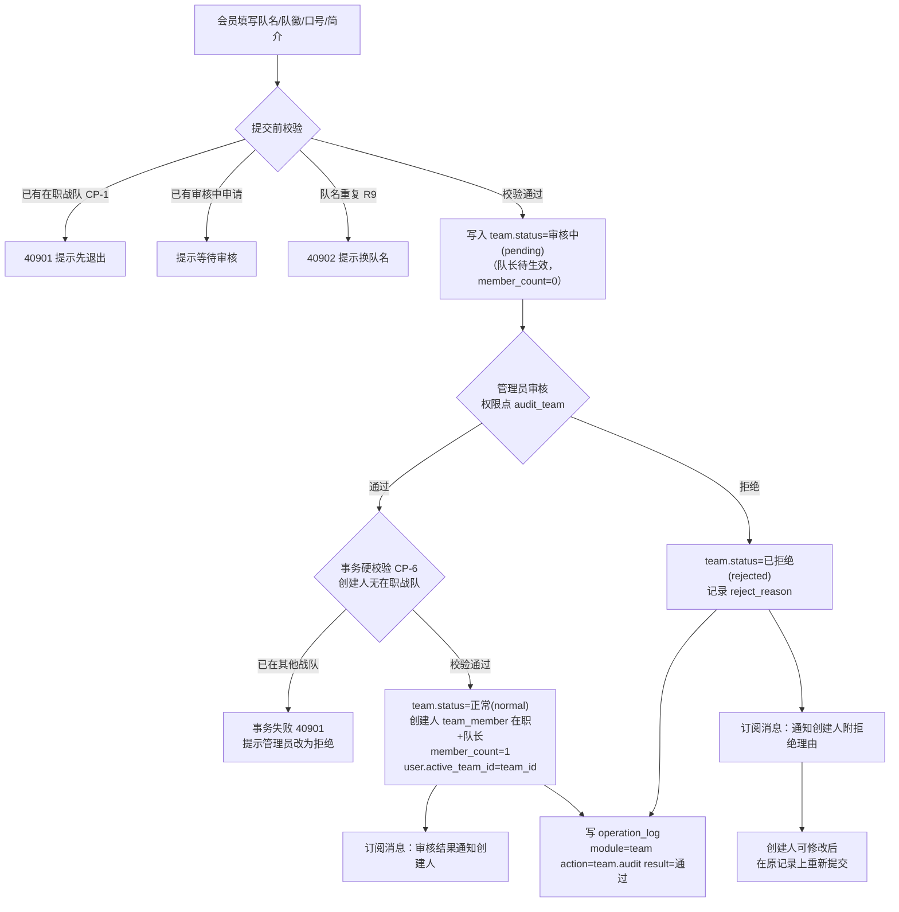
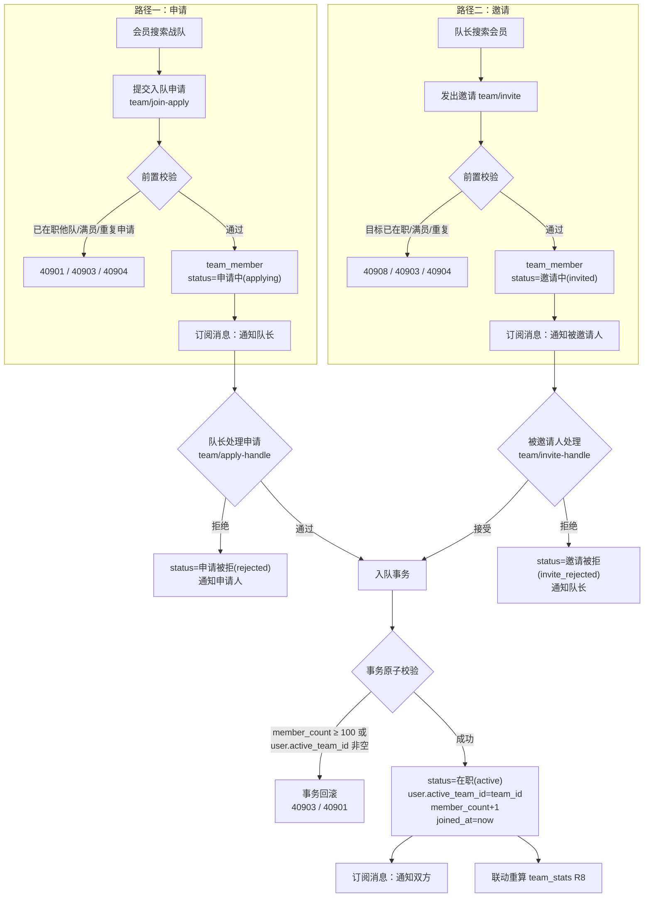
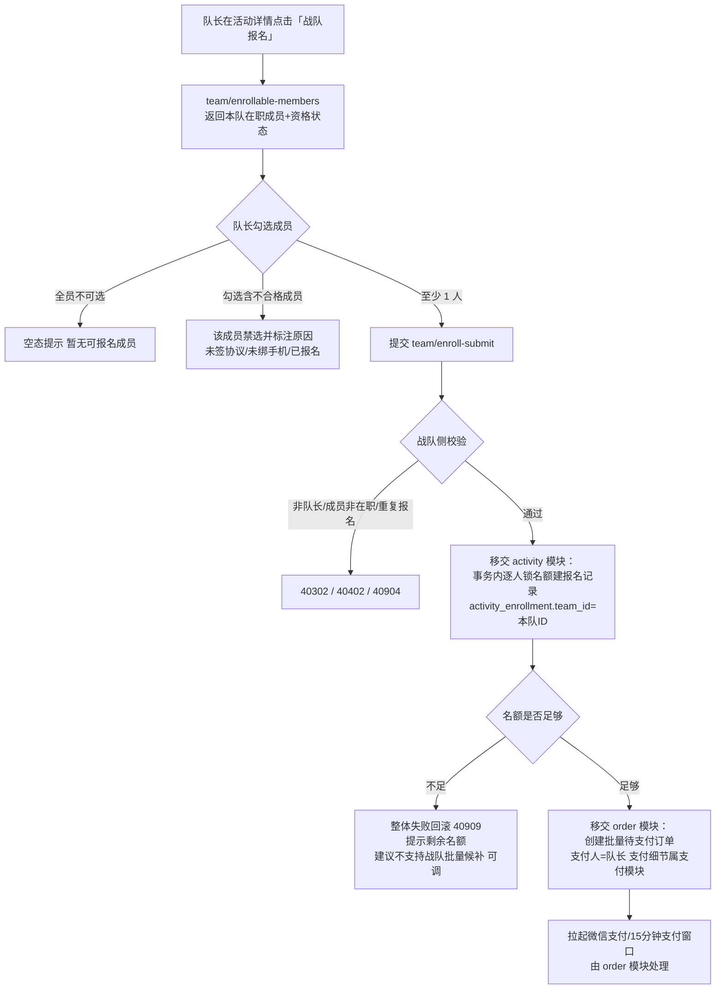
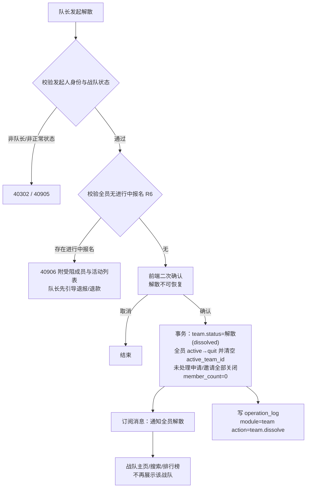
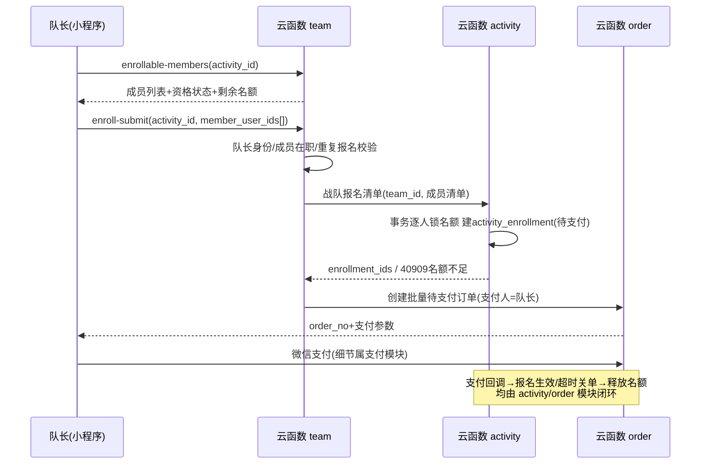

# 战队模块 · 详细设计文档

| 项目 | 内容 |
| --- | --- |
| 文档版本 | v1.0 |
| 依据架构文档 | v0.5（`docs/architecture.md`，唯一事实源） |
| 更新日期 | 2026-10-08 |
| 所属模块 | 战队（架构文档 §4） |
| 技术底座 | 微信云开发：云函数（Node.js + wx-server-sdk）+ 云数据库（文档型）+ 云存储 + 云调用（订阅消息） |
| 开发阶段归属 | M2（P0），M3（P1/P2），详见第 9 章 |

> 约定：全文中标注「建议，可调」的内容为实现层建议，未在架构文档中定死，开发期可调整；未标注的内容均严格对应架构文档已确认决策（Q9/Q10/Q11 等）。本模块**不涉及积分体系**（架构 Q8 已砍掉，任何设计不出现积分概念）。

---

## 1. 模块概述

### 1.1 职责边界

| 范围 | 说明 |
| --- | --- |
| 本模块负责 | 战队创建（提交管理员审核）、资料维护、成员关系管理（申请/邀请/通过/拒绝/退出/移除/转让队长/解散）、人数上限与「一人一队」约束、战队战绩统计缓存（team_stats）与按胜率排序的排行榜、P1 战队报名活动中的「成员选择与提交」 |
| 本模块不负责 | 战绩原始数据的录入与存储（属活动模块 activity_stats，本模块只做聚合缓存）；战队批量报名的**支付细节**（属支付模块 order，本模块只完成成员选择与报名清单提交）；订阅消息模板的申请与配置（只负责调用发送）；管理端角色权限配置（admin 模块）；活动名额锁定与订单创建（activity / order 模块，本模块移交） |

### 1.2 对应架构文档章节引用

| 主题 | 架构文档章节 |
| --- | --- |
| 战队功能清单与优先级 | §4.1 |
| 创建/加入流程（审核制、申请+邀请双路径） | §4.2 |
| 战队规则（100 人上限、一人一队、审核制、不限等级） | §4.3、§4.5（Q9/Q10/Q11） |
| team / team_member 集合定义 | §4.4 |
| 战绩聚合与 team_stats 建议 | §4.4（末段） |
| 报名流程与名额控制（战队报名承接）、activity_enrollment / activity_stats | §5.3、§5.6 |
| 战队批量支付场景 | §6.1 |
| 操作日志（战队创建审核、解散） | §1.5 |
| 订阅消息触达、权限控制 | §2.3 |
| 管理端形态（内嵌小程序，无 Web 后台） | §1.4 |
| 开发阶段（战队属 M2） | §9 |

### 1.3 功能优先级清单（与架构 §4.1 一致）

| 优先级 | 功能 | 阶段 |
| --- | --- | --- |
| P0 | 创建战队（队名/队徽/口号/简介，提交后管理员审核，通过后生效；**不限制创建者会员等级**） | M2 |
| P0 | 加入战队（搜索队名提交申请，队长审核制）/ 退出战队 | M2 |
| P0 | 成员管理（申请列表、通过/拒绝、移除成员、转让队长、队长邀请） | M2 |
| P0 | 战队主页（成员列表、战绩统计、近期活动入口） | M2 |
| P0 | 管理端战队审核入口（通过/拒绝 + 拒绝理由，写操作日志） | M2 |
| P1 | 战队排行榜（按**胜率**排序，team_stats 冗余缓存加速） | M3 |
| P1 | 战队报名活动（队长为全队或部分成员统一报名并支付；本模块负责成员选择与提交） | M3 |
| P2 | 战队解散（队长操作，需全员无进行中的报名） | M3 |

---

## 2. 页面设计

### 2.1 页面清单

> 页面路径为建议值，可调。TabBar 结构架构文档未定义：**建议，可调**——TabBar 为「首页 / 活动 / 战队 / 我的」四页，战队列表作为 TabBar 页之一，具体以总体 UI 设计为准。

| 页面路径 | 标题 | TabBar | 可见角色 | 主要交互 |
| --- | --- | --- | --- | --- |
| `pages/team/list` | 战队 | 是（建议） | 会员（游客建议引导登录后可见，架构 §1.3 游客仅可浏览活动列表与俱乐部介绍） | 搜索队名；战队卡片流（队徽/队名/口号/在职人数/胜率标签）；「创建战队」「我的战队」入口；下拉刷新、触底分页 |
| `pages/team/create` | 创建战队 | 否 | 会员（无在职战队且无审核中申请） | 填写队名/口号/简介；上传队徽至云存储；提交后进入审核中状态；队名失焦实时查重 |
| `pages/team/detail` | 战队主页 | 否 | 会员（审核中战队仅创建者可见） | 展示战队信息/队长卡片/成员列表（昵称+军衔徽章）/战绩统计区/近期活动；按身份显示「申请加入 / 退出战队 / 管理战队」 |
| `pages/team/manage` | 成员管理 | 否 | 队长（本队在职） | Tab 三页：成员（军衔徽章展示、移除/转让队长）、入队申请（通过/拒绝）、已发邀请（状态查看）；100 人上限提示条 |
| `pages/team/invite` | 邀请队员 | 否 | 队长（本队在职） | 按昵称/手机号搜索会员（调用 user 模块搜索能力）；选人发送邀请 |
| `pages/team/ranking` | 战队排行榜 | 否 | 会员 | 按胜率排序的榜单（队徽/队名/胜率/总场次）；我的战队名次定位；分页加载 |
| `pages/team/enroll-select` | 战队报名（P1） | 否 | 队长（本队在职） | 针对某活动勾选本队可报名成员；查看每人资格状态；提交报名清单 |
| `pages/admin/team-audit`（管理端） | 战队审核 | 否 | 持有 `audit_team` 权限点的角色（管理端入口，架构 §1.3/§1.4） | 待审核战队列表；查看申请详情（队名/队徽/口号/简介/创建人）；通过 / 拒绝（拒绝必填理由） |

### 2.2 页面空态与边界态

| 页面 | 状态 | 展示/处理 |
| --- | --- | --- |
| 战队列表 | 空态（无任何正常状态战队） | 插画 + 文案「暂无战队，来创建第一支战队」+ 创建按钮 |
| 战队列表 | 未登录 | 建议登录引导蒙层（登录后可见战队广场） |
| 战队列表 | 搜索无结果 | 「未找到相关战队，换个关键词试试」+ 清空按钮 |
| 战队列表 | 当前用户已在职 | 顶部置顶「我的战队」卡片（队徽/队名/我的角色/管理入口） |
| 创建战队 | 当前用户已有在职战队 | 页面顶部警示「你已属于战队，须先退出后才能创建」（`team/create` 返回 40901，前端据此拦截） |
| 创建战队 | 当前用户已有审核中申请 | 提示「你的创建申请审核中，请耐心等待」，禁用重复提交 |
| 创建战队 | 队名已存在（含审核中同名） | 输入框失焦实时提示「该队名已被使用」；提交时返回 40902 |
| 创建战队 | 队徽未上传 / 上传失败 | 前端限制单图 ≤ 2MB（建议，可调），上传失败可重试或使用默认占位图（默认图方案建议，可调） |
| 战队主页 | 战队为审核中 | 仅创建者可见，页面顶部横幅「审核中，通过后战队对外展示」 |
| 战队主页 | 战队已拒绝 | 仅创建者可见，横幅展示拒绝理由 + 「修改后重新提交」入口 |
| 战队主页 | 战队已解散 / 不存在 | 统一提示「战队不存在或已解散」 |
| 战队主页 | 访客为非成员 | 展示公开信息 + 「申请加入」按钮 |
| 战队主页 | 战队已满 100 人 | 「申请加入」置灰，文案「战队已满员（100/100）」 |
| 战队主页 | 战绩区（P0 阶段/M3 前无数据） | 「暂无战绩，参加活动后自动统计」 |
| 战队主页 | 当前用户是被移除/已退出成员 | 按非成员视角展示（可重新申请，重复申请限制见规则 R10） |
| 成员管理 | 申请列表空态 | 「暂无入队申请」 |
| 成员管理 | 通过申请失败（目标已入其他队 / 已满员） | 弹层提示具体原因（40901 / 40903），该申请记录标记处理失败原因，不打断列表 |
| 成员管理 | 成员数逼近上限 | 人数条显示「97/100」，满员后禁用邀请与通过入口 |
| 成员管理 | 移除成员 | 二次确认弹窗（提示将解除其战队关系，需填写/选择原因，建议可调） |
| 成员管理 | 转让队长 | 二次确认弹窗（提示转让后自己变为队员、不可自助撤回） |
| 邀请队员 | 目标已在其他战队 | 搜索结果列表项直接标注「已属于其他战队」，禁选 |
| 邀请队员 | 目标无在职战队但已有本队未处理申请 | 列表项标注「已提交申请，请到申请列表处理」，禁选（避免双记录） |
| 排行榜 | 空态 | 「暂无上榜战队」（未达到最低场次门槛的战队不入榜，见规则 R7） |
| 排行榜 | 胜率并列 | 相同胜率按总场次、创建时间排序展示（见规则 R7），不做并列同名次展示（建议，可调） |
| 排行榜 | 我的战队未上榜 | 底部提示「你的战队场次不足 N 场，暂未上榜」 |
| 战队报名（P1） | 无可选成员（全员已报名/资格不全） | 「暂无可报名成员」+ 各成员不可选原因标注 |
| 战队报名（P1） | 活动剩余名额 < 勾选人数 | 提交前前端预检提示；提交后 activity 模块整体校验失败返回 40909（见接口 `team/enroll-submit`） |
| 战队报名（P1） | 成员未签免责协议 / 未绑手机号 | 列表项标注原因并禁选（协议与手机号是报名前置，架构 §3.1/§3.2） |
| 管理端审核 | 待审核空态 | 「暂无待审核战队」 |
| 管理端审核 | 拒绝操作 | 理由为必填（建议，可调），长度 2~100 字 |

---

## 3. 业务规则详细设计

> 状态枚举建议值（可调，与架构 §4.4 中文状态一一对应）：
> - team.status：`pending`（审核中）/ `normal`（正常）/ `rejected`（已拒绝）/ `dissolved`（解散）
> - team_member.status：`applying`（申请中）/ `invited`（邀请中，**建议扩展值**）/ `active`（在职）/ `quit`（已退出）/ `removed`（被移除）/ `rejected`（申请被拒，**建议扩展值**）/ `invite_rejected`（邀请被拒，**建议扩展值**）
> - team_member.role：`captain`（队长）/ `member`（队员）

### R1 创建战队审核规则

| 项 | 内容 |
| --- | --- |
| 描述 | 会员提交战队创建申请（队名/队徽/口号/简介）后，战队处于「审核中」，须管理员在管理端审核，通过后战队才生效；拒绝时须给出理由并通知创建人。**不限制创建者的会员等级**（架构 Q9） |
| 触发时机 | `team/create` 提交时创建 pending 记录；`team/audit` 管理员审核时变更状态 |
| 校验/计算逻辑 | ① 创建者为已登录会员（无角色等级要求）；② 创建者当前**无在职战队**（一人一队，见 R3 校验点 CP-1）；③ 创建者无其他「审核中」的创建申请（避免重复占用队名，建议，可调）；④ 队名在 status ∈ {pending, normal} 的战队中全局唯一（软唯一，见 R9）；⑤ 队名为必填，建议长度 2~20 字符（可调）；口号/简介选填，简介建议 ≤200 字（可调）；⑥ 队徽为云存储 fileID（建议必填，可给默认占位图）；⑦ 审核通过时在**事务内**再次校验创建者无在职战队（审核期间其可能已加入他队，见第 8 章 E7），通过后：team.status=normal、创建人写入 team_member（role=captain、status=active、joined_at=now）、team.member_count=1、user.active_team_id=team_id |
| 边界条件 | 审核通过时创建者已加入其他战队 → 事务失败，接口报 40901，提示管理员可改为拒绝（理由示例：创建人已加入其他战队）；被拒后创建者可修改资料在原记录上重新提交（status 置回 pending、reject_reason 清空，建议，可调）；重新提交时同样执行全部校验 |

### R2 人数上限 100 人/队

| 项 | 内容 |
| --- | --- |
| 描述 | 每支战队在职成员上限 **100 人**（架构 Q10）；在职人数以 team_member.status=active 计数，冗余存 team.member_count |
| 触发时机 | ① 队长通过入队申请（`team/apply-handle`）；② 被邀请人接受邀请（`team/invite-handle`）；③ 战队报名（P1，报名不改变在职人数但需成员在职，不校验上限以外人数逻辑） |
| 校验/计算逻辑 | 通过/接受的事务内对 team 记录做**条件更新**：`where _id=team_id && member_count < 100 && status=normal`，执行 `member_count + 1`；条件不满足则事务回滚并返回 40903（满员）或 40905（状态异常）。提交入队申请与发出邀请时做**前置软校验**（member_count ≥ 100 时直接返回 40903，不产生申请/邀请记录） |
| 边界条件 | 并发场景（多个申请同时通过）由条件更新原子性保证不超 100；member_count 与实际 active 记录数漂移时由定时校对任务修正（见 §6.4，建议，可调）；申请中/邀请中记录不计入人数 |

### R3 一人一队约束（全部校验点）

同一 user_id 在 team_member 中仅允许一条 status=active 记录；入队申请与创建战队时均校验当前无在职战队，须先退出（架构 §4.3/Q10）。实现机制见 §6.3（user.active_team_id 原子条件更新 + team_member 组合查询双保险）。

| 校验点 | 触发时机 | 校验逻辑 | 失败处理 |
| --- | --- | --- | --- |
| CP-1 | 提交创建战队（`team/create`） | user.active_team_id 为空（且无 active 的 team_member 记录） | 返回 40901，提示先退出当前战队 |
| CP-2 | 提交入队申请（`team/join-apply`） | 同 CP-1 | 返回 40901 |
| CP-3 | 队长发出邀请（`team/invite`） | 目标用户 active_team_id 为空（软校验，发出后目标状态可能变化，接受时硬校验兜底） | 返回 40908，列表项禁选 |
| CP-4 | 队长通过申请（`team/apply-handle` accept，事务内硬校验） | 条件更新 user：`where _id=user_id && active_team_id==null` → set active_team_id=team_id；更新失败即已在职他队 | 事务回滚，返回 40901，申请记录保留并标注失败原因（建议，可调） |
| CP-5 | 被邀请人接受邀请（`team/invite-handle` accept，事务内硬校验） | 同 CP-4 | 同 CP-4 |
| CP-6 | 创建战队审核通过（`team/audit` accept，事务内硬校验） | 同 CP-4（针对创建人） | 事务回滚，返回 40901，管理员可改为拒绝（见 E7） |
| CP-7 | 转让队长（`team/transfer-captain`） | 目标必须为本队 status=active 且 role=member 的成员——从源头排除他队成员；事务内复核 team_id 与 active 状态 | 返回 40402/40905 |
| CP-8 | 退出战队（`team/quit`）/ 移除成员（`team/remove-member`） | 事务内：team_member.status → quit/removed，user.active_team_id 置空，member_count-1 | 无（释放约束） |
| CP-9 | 解散战队（`team/dissolve`） | 事务内批量：全员 active → quit、清空各成员 user.active_team_id、member_count=0 | 无（释放约束） |
| 备注 | 同一用户允许多条**申请中**记录并存（架构未限制，向多个战队投递申请是允许的）；每次「通过/接受」时 CP-4/CP-5 硬校验保证最终只成功一支 | — | 后到者失败并提示 |

### R4 队长转让规则

| 项 | 内容 |
| --- | --- |
| 描述 | 队长可将队长身份转让给本队一名在职队员，自己降为队员 |
| 触发时机 | `team/transfer-captain`，成员管理页操作 |
| 校验/计算逻辑 | ① 操作人为本队队长（team.captain_user_id = 操作人）；② 目标为本队 team_member 中 status=active、role=member 的成员（不能是自己、不能是非本队成员）；③ 事务内：旧队长记录 role → member，新队长记录 role → captain，team.captain_user_id → 目标 user_id、updated_at=now；④ 通知新旧队长（订阅消息） |
| 边界条件 | 新队长从在职队员中选出，天然满足一人一队（不存在新队长属于其他在职队伍的情况）；并发转让（同时两次转让）以 team.captain_user_id 条件更新保证只生效一次；转让不可自助撤回（须再次反向转让，需新队长配合） |

### R5 退出 / 移除规则

| 项 | 内容 |
| --- | --- |
| 描述 | 队员可自主退出战队；队长可移除在职队员。**队长本人不可直接退出、也不可被移除**（须先转让或解散，建议，可调——team.captain_user_id 不可为空的必然推导） |
| 触发时机 | `team/quit`（自助退出）、`team/remove-member`（队长移除） |
| 校验/计算逻辑 | 退出：① 操作人是本队 active 成员且 role=member（队长返回 40910）；② 事务内 status → quit、user.active_team_id 置空、member_count-1。移除：① 操作人是本队队长；② 目标为本队 active 成员且 role=member；③ 事务内 status → removed（含移除原因，建议存 remark 字段）、user.active_team_id 置空、member_count-1；④ 通知被移除人 |
| 边界条件 | 退出/移除时该成员存在进行中报名（待支付/已报名/候补）：报名记录**不强制取消**，保留其个人报名与费用关系（报名属于个人与活动的关系；建议，可调，活动模块的退款/退报流程不受战队关系影响）；被移除成员可再次申请加入（R10 限制频率）；退队后战绩归属按当前在职成员口径重算（R7/R8） |

### R6 解散前置条件

| 项 | 内容 |
| --- | --- |
| 描述 | 队长可解散战队，前置条件为**全员均无进行中的报名**（架构 §4.1 P2） |
| 触发时机 | `team/dissolve` |
| 校验/计算逻辑 | ① 操作人是本队队长且 team.status=normal；② 「进行中的报名」定义（建议，可调）：activity_enrollment 中存在记录满足 `team_id = 本队ID` 且 `status ∈ {待支付, 已报名, 候补}` 且对应活动 `status ∈ {已发布(报名中), 报名截止, 进行中}`（活动未结束）；③ 校验通过后二次确认（前端弹窗），事务内：team.status → dissolved、全员 active → quit 并清空 active_team_id、未处理申请/邀请记录全部关闭（applying/invited → rejected/invite_rejected，remark=战队解散）、member_count=0；④ 订阅消息通知全员；⑤ 写操作日志（module=team，action=team.dissolve，架构 §1.5 战队行明确包含解散） |
| 边界条件 | 有关联报名时返回 40906 并附受阻成员与活动列表（前端展示，便于队长先处理退报）；解散后队名释放（同名可再创建，见 R9）；解散是不可恢复操作；解散时 team_stats 保留作历史归档（排行榜自动将其移出，见 R7）；若存在活动**已结束但该队报名记录未完成**（如已签到/已完成），不阻塞解散 |

### R7 胜率计算公式与排行榜规则

| 项 | 内容 |
| --- | --- |
| 描述 | 战队战绩（总场次/胜场/胜率）从 activity_stats 聚合，缓存于 team_stats；战队排行榜**按胜率降序**（架构 Q11） |
| 触发时机 | team_stats 重算（R8）后排行榜读取；`team/ranking` 查询 |
| 计算逻辑 | **统计口径（建议，可调）**：按「成员人次」聚合——统计范围为**当前在职成员**（team_member.status=active 的 user_id 集合，成员退队后其历史战绩不再计入本队，随人迁移至新战队）：`total_games = count(activity_stats where user_id ∈ 在职成员)`；`wins = count(activity_stats where user_id ∈ 在职成员 && is_win = true)`；`win_rate = wins / total_games`，保留 4 位小数（前端展示百分比，保留 1 位）。排序：win_rate 降序 → 同胜率按 total_games 降序 → 仍同按 team.created_at 升序（先建者靠前，建议，可调） |
| 边界条件 | `total_games = 0` 的战队 win_rate 置 0 且不入榜；建议设置入榜门槛 `total_games ≥ 5`（人次，防止 1 场 100% 胜率霸榜，建议，可调，门槛参数化存配置）；只统计 status=normal 的战队（pending/rejected/dissolved 不入榜）；入榜门槛不足的战队在排行榜底部提示（见 §2.2） |

### R8 team_stats 更新时机

| 项 | 内容 |
| --- | --- |
| 描述 | team_stats 为 activity_stats 聚合结果的冗余缓存集合（架构 §4.4 建议），加速排行榜与战队主页 |
| 触发时机与方式 | ① **战绩写入后联动增量重算**：活动模块战绩录入（手动/Excel 导入）写入 activity_stats 完成后，对「本场有战绩记录的战队」触发重算（建议通过云函数间调用 team 云函数的内部重算方法，或直接更新 team_stats，建议，可调）；② **成员变动联动重算**：入队/退队/移除/解散改变在职成员集合，按 R7 口径重算该战队（解散时保留末值归档）；③ **定时触发器兜底校对**：每日凌晨（建议 03:00，可调）全量重算所有 normal 战队，修正冗余漂移（架构 §2.3 定时任务能力） |
| 计算逻辑 | 重算为「删除重建式」：按 R7 公式对单支战队全量聚合 activity_stats 后覆盖写 team_stats（单队数据量小，全量重算简单可靠；不做增量加减，避免漂移累积） |
| 边界条件 | 重算失败不阻断触发源业务（fire-and-forget，记告警日志）；排行榜读 team_stats 而非实时聚合，允许 T+1（含兜底校对）内的统计延迟 |

### R9 队名唯一规则

| 项 | 内容 |
| --- | --- |
| 描述 | 队名全局唯一；「审核中」的战队同样占用队名（避免审核通过后出现重名） |
| 触发时机 | 创建战队、被拒后重新提交、修改队名（`team/update`） |
| 校验/计算逻辑 | 云函数事务内查询 `team where name = 新队名 && status ∈ {pending, normal} && _id ≠ 本队ID`，存在即返回 40902；**不建库级唯一索引**：需允许解散/已拒绝战队释放队名复用（软唯一校验更灵活）；人工审核频率下并发窗口极小，可接受（建议，可调；若坚持库级约束可对 name 建唯一索引并接受历史占用问题） |
| 边界条件 | 同名不同状态：dissolved/rejected 战队不占名；审核中战队占名（第 8 章 E2）；修改队名与创建走同一校验 |

### R10 申请与邀请记录规则

| 项 | 内容 |
| --- | --- |
| 描述 | 入队申请与队长邀请共用 team_member 集合承载（status=applying / invited 区分路径） |
| 触发时机 | `team/join-apply` / `team/invite` |
| 校验/计算逻辑 | 提交申请：① 战队 status=normal 且未满员（R2 前置软校验）；② CP-2 一人一队；③ 同一用户对同一战队**不存在未处理记录**（applying/invited）→ 否则返回 40904；④ 同一用户对同一战队的历史被拒记录：建议 7 天内不可重复申请（防骚扰，建议，可调）。发出邀请：① CP-3；③ 同上查重（对同一目标无未处理记录）；④ 目标已有本队未处理申请时提示去申请列表处理（见 §2.2） |
| 边界条件 | 处理记录时若记录状态已非 applying/invited（并发处理）返回 40907；战队解散时未处理记录统一关闭（R6）；申请人在申请处理前已入他队，通过时 CP-4 失败（R3） |

### R11 冗余计数与展示字段同步规则

| 项 | 内容 |
| --- | --- |
| 描述 | team.member_count、各集合冗余昵称/头像/队名等展示字段与主数据保持一致 |
| 触发时机 | 任何写入主数据的事务；用户资料变更（user 模块）；队名/队徽变更（`team/update`） |
| 校验/计算逻辑 | member_count 在入队/退队/移除/解散事务内同步增减；昵称/头像冗余由 user 模块资料变更时按架构 §3.4 约定同步（本模块被动承接）；队名/队徽冗余同步策略见 §6.4 |
| 边界条件 | 定时校对任务（与 R8 ③ 合并执行，建议，可调）比对 member_count 与实际计数、修正漂移 |

---

## 4. 流程图

### 4.1 创建战队审核流程



### 4.2 加入战队流程（申请 + 邀请双路径）



### 4.3 战队报名活动选择流程（P1）



### 4.4 战队解散流程



---

## 5. 云函数接口设计

### 5.0 公共约定

- **部署形态（建议，可调）**：单一云函数 `team` + `action` 参数分发（对应架构 §2.2 「云函数 team/*」），接口名记作 `team/<action>`；单函数多 action 可减少冷启动实例、共享鉴权/日志封装（架构 §8.2 冷启动要求）。
- **调用方式**：`wx.cloud.callFunction({ name: 'team', data: { action: 'create', ... } })`；前端只调云函数，不直连数据库（架构 §2.1 设计约束）。
- **统一返回**：`{ code, msg, data }`，`code=0` 成功；入参一律在云函数侧校验。
- **鉴权**：云函数天然携带 openid（架构 §2.3）；登录态、业务身份（队长）、权限点（audit_team）三层校验在函数入口统一封装。
- **时间字段**：统一毫秒时间戳，字段名 `*_at`。
- **分页**：`page`（从 1 开始）、`page_size`（默认 10，最大 50，建议，可调）。
- **金额**：本模块不涉及金额字段（战队报名支付由 order 模块处理）。

#### 公共错误码（team 模块统一）

| code | 含义 | 说明 |
| --- | --- | --- |
| 0 | 成功 | — |
| 40001 | 参数缺失或格式错误 | 入参校验失败（必填缺失/类型错误/长度超限） |
| 40101 | 未登录或身份无效 | openid 未落库 / user 不存在 |
| 40301 | 无权限点 | 缺少所需权限点（如 audit_team） |
| 40302 | 非本队队长 | 需要队长身份的操作由非队长发起 |
| 40401 | 战队不存在 | team_id 无效，或战队状态对外不可见（审核中/已拒绝对非创建者按不存在处理） |
| 40402 | 记录不存在 | 申请/邀请/成员记录无效 |
| 40901 | 已属于战队（一人一队冲突） | 创建战队/入队时已有在职战队，或事务硬校验失败 |
| 40902 | 队名已存在 | 软唯一校验失败（R9） |
| 40903 | 战队人数已达上限（100） | 满员（R2） |
| 40904 | 存在未处理申请/邀请 | 同一战队+同一用户的重复提交（R10）；战队报名时成员重复报名也复用此码 |
| 40905 | 战队状态不允许该操作 | 非正常（normal）状态的战队被写入操作 |
| 40906 | 存在进行中的报名 | 解散前置校验失败（R6） |
| 40907 | 记录已被处理 | 申请/邀请状态已变更（并发处理） |
| 40908 | 目标已属于其他战队 | 邀请发出时软校验失败（CP-3） |
| 40909 | 名额不足 | 战队报名整体失败（activity 模块回传） |
| 40910 | 队长不可执行此操作 | 队长直接退出/移除自己（R5） |
| 50001 | 服务端内部错误 | 未知异常，前端提示「服务繁忙，请稍后重试」 |

> 各接口小节的「错误码」仅列该接口特有或重点关注的码；40001/40101/50001 全接口通用，不再重复列出。

---

### 5.1 `team/create` — 创建战队（提交审核）

| 项 | 内容 |
| --- | --- |
| 用途 | 会员提交创建申请，进入管理员审核（R1） |
| 所需权限点 | 无（登录会员即可，不限会员等级） |
| 优先级 | P0 |

入参示例：

```json
{
  "action": "create",
  "name": "夜枭突击队",
  "logo": "cloud://env.xxx.team-logo/xxx.png",
  "slogan": "夜战无声",
  "intro": "周末夜场常驻队伍，欢迎新老玩家。"
}
```

出参示例：

```json
{ "code": 0, "msg": "ok", "data": { "team_id": "t_9f2a...", "status": "pending" } }
```

核心处理逻辑：

1. 校验入参：name 必填 2~20 字符、logo fileID 格式、intro ≤200 字（建议，可调）。
2. CP-1：校验操作人无在职战队、无审核中申请。
3. R9：事务内校验队名未被 pending/normal 战队占用。
4. 写入 team（status=pending、captain_user_id=操作人、member_count=0、created_at=now）；此时不写 team_member（审核通过才生效）。
5. 返回 team_id。

| 错误码 | 场景 |
| --- | --- |
| 40901 | 已有在职战队 |
| 40902 | 队名已存在 |
| 40904 | 已有审核中的创建申请 |

### 5.2 `team/list` — 战队列表 / 搜索

| 项 | 内容 |
| --- | --- |
| 用途 | 战队广场列表、队名搜索（默认仅返回 normal 战队） |
| 所需权限点 | 无（登录会员） |
| 优先级 | P0 |

入参示例：

```json
{ "action": "list", "keyword": "夜枭", "page": 1, "page_size": 10 }
```

出参示例：

```json
{
  "code": 0, "msg": "ok",
  "data": {
    "total": 23,
    "list": [
      {
        "team_id": "t_9f2a...",
        "name": "夜枭突击队",
        "logo": "cloud://env.xxx/xxx.png",
        "slogan": "夜战无声",
        "member_count": 18,
        "win_rate": 0.6234,
        "captain_name": "阿K"
      }
    ]
  }
}
```

核心处理逻辑：

1. 校验分页参数。
2. 查询 team：status=normal，keyword 命中 name（前缀/包含，建议，可调），按 member_count 降序 + created_at 升序（建议，可调）。
3. 每条联查 team_stats 取 win_rate（无记录置 null）。
4. 返回分页列表。

| 错误码 | 场景 |
| --- | --- |
| — | 仅通用错误码 |

### 5.3 `team/detail` — 战队详情（战队主页）

| 项 | 内容 |
| --- | --- |
| 用途 | 战队主页聚合数据：基础信息、战绩统计、成员摘要、当前用户视角身份 |
| 所需权限点 | 无（登录会员；pending/rejected 战队仅创建者可见） |
| 优先级 | P0（战绩区 P1 起有值） |

入参示例：

```json
{ "action": "detail", "team_id": "t_9f2a..." }
```

出参示例：

```json
{
  "code": 0, "msg": "ok",
  "data": {
    "team": {
      "team_id": "t_9f2a...", "name": "夜枭突击队", "logo": "cloud://env.xxx/xxx.png",
      "slogan": "夜战无声", "intro": "……", "captain_user_id": "u_1001",
      "captain_name": "阿K", "captain_avatar": "cloud://env.xxx/a.png",
      "member_count": 18, "status": "normal", "created_at": 1767200000000
    },
    "stats": { "total_games": 260, "wins": 162, "win_rate": 0.6234, "participated_members": 12 },
    "members_preview": [
      { "user_id": "u_1001", "nickname": "阿K", "avatar": "cloud://env.xxx/a.png", "role": "captain", "rank": "corporal", "joined_at": 1767200000000 }
    ],
    "my_relation": { "in_team": true, "role": "member", "member_status": "active" },
    "recent_activities": []
  }
}
```

核心处理逻辑：

1. 查 team；若 status ∈ {pending, rejected} 且操作人非创建者 → 40401。
2. 若 status=dissolved：仅创建者可见「已解散」详情页（建议，可调），他人返回 40401。
3. 联查 team_stats（P0 阶段无记录时 stats 置 null，前端显示「暂无战绩」）。
4. members_preview 取 active 成员前 10（按 joined_at，队长置顶）；`rank` 为军衔 code，按用户模块 R15 口径**读时批量联查 user**（`user_id in` 查询取 rank）——军衔随战绩写入频繁变更，不落 team_member 冗余避免级联同步（建议，可调），徽章素材映射由前端按 R15 表渲染。
5. my_relation：查操作人在本队的 team_member 最新记录与 user.active_team_id。
6. recent_activities：P1 起由活动模块提供本队近期报名活动（本接口仅透传聚合位，建议，可调）。

| 错误码 | 场景 |
| --- | --- |
| 40401 | 战队不存在或不可见 |

### 5.4 `team/my` — 我的战队

| 项 | 内容 |
| --- | --- |
| 用途 | 当前用户的战队关系聚合：在职战队、审核中创建申请、申请中记录、收到的邀请 |
| 所需权限点 | 无（登录会员） |
| 优先级 | P0 |

入参示例：

```json
{ "action": "my" }
```

出参示例：

```json
{
  "code": 0, "msg": "ok",
  "data": {
    "active_team": {
      "team_id": "t_9f2a...", "name": "夜枭突击队", "logo": "cloud://env.xxx/xxx.png",
      "role": "member", "member_count": 18, "win_rate": 0.6234
    },
    "creating": { "team_id": "t_3b7c...", "name": "黎明之翼", "status": "pending" },
    "applying": [
      { "record_id": "tm_1...", "team_id": "t_8a01...", "team_name": "铁血军团", "applied_at": 1767100000000 }
    ],
    "invited": [
      { "record_id": "tm_2...", "team_id": "t_7b02...", "team_name": "幽灵小队", "invited_at": 1767050000000 }
    ]
  }
}
```

核心处理逻辑：

1. active_team 由 user.active_team_id 直查 team（冗余字段与 team_member 双保险，见 §6.3）。
2. creating：查 team where captain_user_id=操作人 && status=pending。
3. applying / invited：查 team_member where user_id=操作人 && status ∈ {applying, invited}，冗余 team_name 直接展示。
4. 四块均可为 null / 空数组（前端空态见 §2.2）。

| 错误码 | 场景 |
| --- | --- |
| — | 仅通用错误码 |

### 5.5 `team/update` — 更新战队资料

| 项 | 内容 |
| --- | --- |
| 用途 | 队长修改队名/队徽/口号/简介（不改变状态与人数） |
| 所需权限点 | 无（登录 + 本队队长身份） |
| 优先级 | P0 |

入参示例：

```json
{
  "action": "update",
  "team_id": "t_9f2a...",
  "name": "夜枭突击队",
  "logo": "cloud://env.xxx/new.png",
  "slogan": "夜战无声·出击",
  "intro": "更新后的简介"
}
```

出参示例：

```json
{ "code": 0, "msg": "ok", "data": { "updated_fields": ["slogan", "intro", "logo"] } }
```

核心处理逻辑：

1. 校验操作人是本队队长且 team.status=normal（审核中战队资料走「被拒后重新提交」路径，不开放随意编辑，建议，可调）。
2. name 变更时执行 R9 队名唯一校验。
3. 事务更新 team 各字段与 updated_at。
4. 触发冗余同步（§6.4）：team_member.team_name、team_stats.team_name 同步更新；进行中（活动未结束）的 activity_enrollment 冗余队名/队徽回刷（fire-and-forget）。
5. 旧队徽云存储文件不主动删除（建议保留，可调，避免 CDN 缓存失效问题）。

| 错误码 | 场景 |
| --- | --- |
| 40302 | 非本队队长 |
| 40902 | 新队名已存在 |
| 40905 | 战队非正常状态 |

### 5.6 `team/join-apply` — 提交入队申请

| 项 | 内容 |
| --- | --- |
| 用途 | 会员对某战队发起入队申请（申请路径） |
| 所需权限点 | 无（登录会员） |
| 优先级 | P0 |

入参示例：

```json
{ "action": "join-apply", "team_id": "t_9f2a...", "apply_note": "老玩家，周末常驻，求收留" }
```

出参示例：

```json
{ "code": 0, "msg": "ok", "data": { "record_id": "tm_1..." } }
```

核心处理逻辑：

1. R10 前置校验：战队 status=normal；未满员（member_count < 100）；无本队未处理记录；被拒 7 天冷却（建议，可调）；被移除记录同冷却处理（建议，可调）。
2. CP-2：校验操作人无在职战队。
3. 写 team_member：status=applying、role=member（待生效）、冗余 nickname/avatar/team_name、apply_note（≤100 字建议，可调）、created_at=now。
4. 云调用 subscribeMessage 通知队长「新入队申请」。

| 错误码 | 场景 |
| --- | --- |
| 40901 | 已有在职战队 |
| 40903 | 战队已满员 |
| 40904 | 已有本队未处理申请/邀请，或冷却期内重复申请 |
| 40905 | 战队非正常状态 |

### 5.7 `team/apply-list` — 入队申请列表（队长）

| 项 | 内容 |
| --- | --- |
| 用途 | 队长查看本队待处理申请（含近 30 天已处理记录，建议，可调） |
| 所需权限点 | 无（登录 + 本队队长身份） |
| 优先级 | P0 |

入参示例：

```json
{ "action": "apply-list", "team_id": "t_9f2a...", "status": "applying", "page": 1, "page_size": 20 }
```

出参示例：

```json
{
  "code": 0, "msg": "ok",
  "data": {
    "total": 3,
    "list": [
      {
        "record_id": "tm_1...",
        "user_id": "u_2002", "nickname": "小炮", "avatar": "cloud://env.xxx/b.png",
        "apply_note": "老玩家求收留", "status": "applying", "applied_at": 1767100000000
      }
    ]
  }
}
```

核心处理逻辑：

1. 校验操作人是本队队长。
2. 查 team_member where team_id && status ∈ {applying, rejected}，applying 在前、按 created_at 倒序分页。
3. 返回列表（冗余昵称头像直接展示，不联查 user）。

| 错误码 | 场景 |
| --- | --- |
| 40302 | 非本队队长 |

### 5.8 `team/apply-handle` — 处理入队申请

| 项 | 内容 |
| --- | --- |
| 用途 | 队长通过/拒绝申请；通过即入队事务（R2/R3） |
| 所需权限点 | 无（登录 + 本队队长身份） |
| 优先级 | P0 |

入参示例：

```json
{ "action": "apply-handle", "team_id": "t_9f2a...", "record_id": "tm_1...", "operate": "accept" }
```

出参示例：

```json
{ "code": 0, "msg": "ok", "data": { "member_count": 19, "user_id": "u_2002", "result": "active" } }
```

核心处理逻辑：

1. 校验操作人是本队队长、记录属于本队且 status=applying（否则 40907/40402）。
2. 拒绝：更新 status=rejected、remark=拒绝原因（可选）、通知申请人（订阅消息），结束。
3. 通过：执行入队事务（见 4.2 图）：条件更新 team（member_count<100 && status=normal → +1）→ 条件更新 user（active_team_id==null → set team_id）→ 更新记录 status=active、joined_at=now；任一步失败整体回滚。
4. 成功后通知双方；联动重算 team_stats（R8）。

| 错误码 | 场景 |
| --- | --- |
| 40302 | 非本队队长 |
| 40402 | 申请记录不存在/不属于本队 |
| 40901 | 申请人已加入其他战队（CP-4） |
| 40903 | 战队已满员 |
| 40907 | 记录已被处理 |

### 5.9 `team/invite` — 队长发出邀请

| 项 | 内容 |
| --- | --- |
| 用途 | 队长主动邀请会员入队（邀请路径）；目标会员由 user 模块搜索接口提供 |
| 所需权限点 | 无（登录 + 本队队长身份） |
| 优先级 | P0 |

入参示例：

```json
{ "action": "invite", "team_id": "t_9f2a...", "target_user_id": "u_3003", "invite_note": "周日夜场缺人，来吗" }
```

出参示例：

```json
{ "code": 0, "msg": "ok", "data": { "record_id": "tm_2..." } }
```

核心处理逻辑：

1. 校验操作人是本队队长、team.status=normal、未满员。
2. CP-3：目标无在职战队；R10：目标与本队无未处理记录（若目标已有本队申请，返回 40904 并提示到申请列表处理）。
3. 写 team_member：status=invited、role=member（待生效）、冗余 nickname/avatar/team_name、invite_note、created_at=now。
4. 云调用 subscribeMessage 通知被邀请人。

| 错误码 | 场景 |
| --- | --- |
| 40302 | 非本队队长 |
| 40903 | 战队已满员 |
| 40904 | 已有未处理记录（含目标已提交申请的情况） |
| 40908 | 目标已属于其他战队 |

### 5.10 `team/invite-handle` — 被邀请人处理邀请

| 项 | 内容 |
| --- | --- |
| 用途 | 被邀请人接受/拒绝邀请；接受即入队事务（R2/R3） |
| 所需权限点 | 无（登录，操作人须为被邀请人本人） |
| 优先级 | P0 |

入参示例：

```json
{ "action": "invite-handle", "record_id": "tm_2...", "operate": "accept" }
```

出参示例：

```json
{ "code": 0, "msg": "ok", "data": { "team_id": "t_9f2a...", "team_name": "夜枭突击队", "result": "active" } }
```

核心处理逻辑：

1. 校验记录 user_id=操作人且 status=invited（否则 40402/40907）。
2. 拒绝：status=invite_rejected，通知队长，结束。
3. 接受：执行入队事务（同 5.8 第 3 步，CP-5 硬校验）。
4. 成功后通知双方；联动重算 team_stats。

| 错误码 | 场景 |
| --- | --- |
| 40402 | 邀请记录不存在/非本人 |
| 40901 | 本人已加入其他战队（CP-5） |
| 40903 | 战队已满员 |
| 40905 | 战队已非正常状态（如解散/被拒后邀请失效） |
| 40907 | 记录已被处理 |
### 5.11 `team/member-list` — 成员列表

| 项 | 内容 |
| --- | --- |
| 用途 | 战队主页/成员管理页的成员列表（分页） |
| 所需权限点 | 无（登录会员；正常战队成员列表对外可见，建议，可调） |
| 优先级 | P0 |

入参示例：

```json
{ "action": "member-list", "team_id": "t_9f2a...", "status": "active", "page": 1, "page_size": 20 }
```

出参示例：

```json
{
  "code": 0, "msg": "ok",
  "data": {
    "total": 18,
    "member_count": 18,
    "list": [
      {
        "user_id": "u_1001", "nickname": "阿K", "avatar": "cloud://env.xxx/a.png",
        "role": "captain", "rank": "corporal", "joined_at": 1767200000000
      }
    ]
  }
}
```

核心处理逻辑：

1. 查 team_member where team_id && status（默认 active），队长置顶、按 joined_at 升序分页。
2. 冗余 nickname/avatar 直接返回；`rank` 为读时批量联查 user 的军衔 code（R15 口径，徽章展示用，不冗余进 team_member，见 5.3 逻辑 4）；total 与 team.member_count 一并返回供前端展示 x/100。

| 错误码 | 场景 |
| --- | --- |
| 40401 | 战队不存在 |

### 5.12 `team/remove-member` — 移除成员

| 项 | 内容 |
| --- | --- |
| 用途 | 队长移除在职队员（R5） |
| 所需权限点 | 无（登录 + 本队队长身份） |
| 优先级 | P0 |

入参示例：

```json
{ "action": "remove-member", "team_id": "t_9f2a...", "target_user_id": "u_2002", "reason": "长期不参与活动" }
```

出参示例：

```json
{ "code": 0, "msg": "ok", "data": { "member_count": 17 } }
```

核心处理逻辑：

1. 校验操作人是本队队长；目标为本队 active 且 role=member（队长不可被移除，40910）。
2. 事务：记录 status=removed、remark=reason、user.active_team_id 置空、team.member_count-1。
3. 订阅消息通知被移除人（含战队名）。
4. 联动重算 team_stats（R8：在职成员集合变化）。

| 错误码 | 场景 |
| --- | --- |
| 40302 | 非本队队长 |
| 40402 | 目标不是本队在职成员 |
| 40910 | 目标是队长（即操作人自己） |

### 5.13 `team/quit` — 退出战队

| 项 | 内容 |
| --- | --- |
| 用途 | 队员自助退出（R5） |
| 所需权限点 | 无（登录，本人操作） |
| 优先级 | P0 |

入参示例：

```json
{ "action": "quit", "team_id": "t_9f2a..." }
```

出参示例：

```json
{ "code": 0, "msg": "ok", "data": { "member_count": 17 } }
```

核心处理逻辑：

1. 校验操作人是本队 active 成员；role=captain 则返回 40910（提示先转让或解散）。
2. 前端已二次确认（存在进行中报名时提示报名不受影响，见 R5 边界）。
3. 事务：记录 status=quit、user.active_team_id 置空、team.member_count-1。
4. 联动重算 team_stats。

| 错误码 | 场景 |
| --- | --- |
| 40402 | 非本队在职成员 |
| 40910 | 队长不可直接退出 |

### 5.14 `team/transfer-captain` — 转让队长

| 项 | 内容 |
| --- | --- |
| 用途 | 队长转让队长身份给本队在职队员（R4） |
| 所需权限点 | 无（登录 + 本队队长身份） |
| 优先级 | P0 |

入参示例：

```json
{ "action": "transfer-captain", "team_id": "t_9f2a...", "target_user_id": "u_2002" }
```

出参示例：

```json
{ "code": 0, "msg": "ok", "data": { "captain_user_id": "u_2002" } }
```

核心处理逻辑：

1. 校验操作人是本队队长、team.status=normal。
2. CP-7：目标为本队 active、role=member 的成员（事务内复核，防并发变更）。
3. 事务：目标记录 role=captain、操作人记录 role=member、team.captain_user_id=target、updated_at=now。
4. 订阅消息通知新队长（操作人前端已知结果）。

| 错误码 | 场景 |
| --- | --- |
| 40302 | 非本队队长 |
| 40402 | 目标不是本队在职队员 |

### 5.15 `team/audit` — 管理员审核战队创建

| 项 | 内容 |
| --- | --- |
| 用途 | 管理端对 pending 战队执行通过/拒绝（R1） |
| 所需权限点 | `audit_team`（架构 §1.3 权限点示例） |
| 优先级 | P0 |

入参示例：

```json
{ "action": "audit", "team_id": "t_3b7c...", "operate": "reject", "reject_reason": "队名含敏感词，请修改后重新提交" }
```

出参示例：

```json
{ "code": 0, "msg": "ok", "data": { "team_id": "t_3b7c...", "status": "rejected" } }
```

核心处理逻辑：

1. 入口统一鉴权：openid → user.role → role_permission，校验含 `audit_team`（架构 §1.3/§2.3）。
2. 校验 team.status=pending（已处理返回 40907）。
3. 拒绝：status=rejected、reject_reason 必填（2~100 字）。
4. 通过：执行审核生效事务（CP-6）：条件更新创建人 user（active_team_id==null → set team_id）→ 创建人 team_member（role=captain、status=active、joined_at=now）→ team.status=normal、member_count=1；失败整体回滚返回 40901。
5. 云调用 subscribeMessage 通知创建人审核结果（拒绝附理由）。
6. 写 operation_log：module=team、action=team.audit、target_type=team、target_id=team_id、detail 含 before/after 状态、operator 信息、result；fire-and-forget 不阻断业务（架构 §1.5）。

| 错误码 | 场景 |
| --- | --- |
| 40301 | 无 audit_team 权限点 |
| 40401 / 40907 | 战队不存在 / 已审核 |
| 40901 | 通过时创建人已加入其他战队 |

### 5.16 `team/audit-list` — 管理端待审核列表

| 项 | 内容 |
| --- | --- |
| 用途 | 管理端战队审核页的数据源（待审核 + 近期已审核记录） |
| 所需权限点 | `audit_team` |
| 优先级 | P0 |

入参示例：

```json
{ "action": "audit-list", "status": "pending", "page": 1, "page_size": 20 }
```

出参示例：

```json
{
  "code": 0, "msg": "ok",
  "data": {
    "total": 2,
    "list": [
      {
        "team_id": "t_3b7c...", "name": "黎明之翼", "logo": "cloud://env.xxx/c.png",
        "slogan": "……", "intro": "……", "status": "pending",
        "creator": { "user_id": "u_4004", "nickname": "大白", "phone": "138****0000" },
        "created_at": 1767150000000
      }
    ]
  }
}
```

核心处理逻辑：

1. 鉴权 audit_team。
2. 查 team where status ∈ {pending, rejected}（pending 优先），按 created_at 倒序分页；rejected 附 reject_reason、audit_at。
3. creator 信息联查 user（管理端展示用，手机号脱敏后返回）。

| 错误码 | 场景 |
| --- | --- |
| 40301 | 无 audit_team 权限点 |

### 5.17 `team/ranking` — 战队排行榜

| 项 | 内容 |
| --- | --- |
| 用途 | 按胜率排序的俱乐部战队排行榜（R7，读 team_stats） |
| 所需权限点 | 无（登录会员） |
| 优先级 | P1 |

入参示例：

```json
{ "action": "ranking", "page": 1, "page_size": 20 }
```

出参示例：

```json
{
  "code": 0, "msg": "ok",
  "data": {
    "total": 8,
    "my_rank": 3,
    "list": [
      { "rank": 1, "team_id": "t_8a01...", "name": "铁血军团", "logo": "cloud://env.xxx/d.png", "win_rate": 0.7150, "total_games": 310, "wins": 222, "member_count": 22 }
    ]
  }
}
```

核心处理逻辑：

1. 查 team_stats（与 team 联取 name/logo/member_count，team_stats 冗余 team_name 但 logo/member_count 联查，建议，可调）。
2. 过滤：total_games ≥ 最低场次门槛（默认 5，参数化配置，建议，可调）。
3. 排序：win_rate 降序 → total_games 降序 → team.created_at 升序（R7）。
4. my_rank：计算操作人所在战队名次（未上榜返回 null）。
5. 分页返回。

| 错误码 | 场景 |
| --- | --- |
| — | 仅通用错误码 |

### 5.18 `team/enrollable-members` — 战队报名可选成员（P1）

| 项 | 内容 |
| --- | --- |
| 用途 | 队长为某活动选人时，返回本队在职成员及各自报名资格状态 |
| 所需权限点 | 无（登录 + 本队队长身份） |
| 优先级 | P1 |

入参示例：

```json
{ "action": "enrollable-members", "activity_id": "a_5005..." }
```

出参示例：

```json
{
  "code": 0, "msg": "ok",
  "data": {
    "activity_left_quota": 6,
    "list": [
      {
        "user_id": "u_2002", "nickname": "小炮", "avatar": "cloud://env.xxx/b.png",
        "role": "member", "enrollable": false, "block_reason": "已报名该活动"
      },
      {
        "user_id": "u_3003", "nickname": "老赵", "avatar": "cloud://env.xxx/e.png",
        "role": "member", "enrollable": true, "block_reason": null
      }
    ]
  }
}
```

核心处理逻辑：

1. 校验操作人是在职队长（user.active_team_id 对应战队）。
2. 取本队全部 active 成员（冗余昵称头像）。
3. 逐人标记 block_reason（多项时拼接，建议取首项）：`已报名该活动`（查 activity_enrollment，由 activity 模块数据判定）、`未签免责协议`、`未绑定手机号`（读 user 字段；两项为报名前置，架构 §3.1/§3.2）；enrollable = 无阻碍项。
4. 返回列表与活动剩余名额（供前端预检展示）。

| 错误码 | 场景 |
| --- | --- |
| 40302 | 非在职队长（无战队/非队长） |

### 5.19 `team/enroll-submit` — 战队报名提交（P1）

| 项 | 内容 |
| --- | --- |
| 用途 | 队长提交为所选成员统一报名的清单；完成战队侧校验后移交 activity/order 模块（本模块不处理支付） |
| 所需权限点 | 无（登录 + 本队队长身份） |
| 优先级 | P1 |

入参示例：

```json
{
  "action": "enroll-submit",
  "activity_id": "a_5005...",
  "member_user_ids": ["u_3003", "u_6006", "u_1001"]
}
```

出参示例：

```json
{ "code": 0, "msg": "ok", "data": { "order_no": "O20261008xxxx", "enrollment_ids": ["e_1...", "e_2...", "e_3..."], "expire_at": 1767171000000 } }
```

核心处理逻辑：

1. 校验操作人是本队在职队长；member_user_ids 非空（1~剩余名额上限，去重）且全部为本队 active 成员（40402）。
2. 校验成员未报名该活动（重复返回 40904）；资格项（协议/手机号）已由 5.18 前端禁选，此处兜底校验（返回 40001 并指明成员）。
3. 组装报名清单（含 team_id、各成员 user_id 与冗余昵称/头像/队名），调用 activity 模块战队报名接口（云函数间调用，建议，可调）：其事务内逐人条件更新扣减名额并创建 activity_enrollment（team_id=本队、status=待支付）；名额不足整体回滚返回 40909。
4. activity 侧成功后由 order 模块创建批量待支付订单（支付人=队长、biz_type=活动报名），返回 order_no 与 expire_at（15 分钟支付窗口，架构 §5.3）。
5. 后续支付成功回调、超时关单、退款均由 order/activity 模块处理；战队模块职责到「提交成功」为止。

| 错误码 | 场景 |
| --- | --- |
| 40302 | 非本队队长 |
| 40402 | 含非本队在职成员 |
| 40904 | 含已报名该活动成员 |
| 40909 | 活动名额不足（activity 模块回传） |

### 5.20 `team/dissolve` — 解散战队

| 项 | 内容 |
| --- | --- |
| 用途 | 队长解散战队（R6，P2） |
| 所需权限点 | 无（登录 + 本队队长身份） |
| 优先级 | P2 |

入参示例：

```json
{ "action": "dissolve", "team_id": "t_9f2a..." }
```

出参示例：

```json
{ "code": 0, "msg": "ok", "data": { "status": "dissolved", "released_members": 17 } }
```

核心处理逻辑：

1. 校验操作人是本队队长、team.status=normal。
2. R6 前置校验：查 activity_enrollment（team_id=本队、status ∈ {待支付, 已报名, 候补}、活动未结束）；存在则返回 40906 + 受阻明细（成员昵称/活动标题/状态）。
3. 事务：team.status=dissolved、dissolved_at=now；全员 active 记录批量置 quit、并清空各成员 user.active_team_id；未处理 applying/invited 记录置 rejected/invite_rejected（remark=战队解散）；member_count=0。
4. 批量订阅消息通知全员（受订阅消息一次性授权限制，建议通知队长+在职成员中已授权者，未触达容忍，建议，可调）。
5. 写 operation_log：module=team、action=team.dissolve、detail 含解散时成员数与队长（架构 §1.5 战队行含解散）。
6. team_stats 保留归档；排行榜查询天然过滤（status≠normal）。

| 错误码 | 场景 |
| --- | --- |
| 40302 | 非本队队长 |
| 40905 | 战队非正常状态 |
| 40906 | 存在进行中的报名 |

---

## 6. 数据模型设计

### 6.1 集合 `team`（战队主表）

| 字段 | 类型 | 必填 | 默认值 | 说明 | 索引建议 |
| --- | --- | --- | --- | --- | --- |
| _id | string | 是 | 自动 | 战队 ID | 主键 |
| name | string | 是 | — | 队名，全局软唯一（R9），2~20 字符 | 建议普通索引（查询热点；不建唯一索引，见 R9） |
| logo | string | 是 | — | 队徽云存储 fileID | — |
| slogan | string | 否 | null | 口号，≤30 字（建议，可调） | — |
| intro | string | 否 | null | 简介，≤200 字（建议，可调） | — |
| captain_user_id | string | 是 | — | 队长 user_id（转让时事务更新，R4） | 建议普通索引（team/my 查询创建中申请） |
| captain_name | string | 是 | — | 队长昵称冗余（列表展示，队长变更/改名时同步） | — |
| member_count | number | 是 | 0 | 在职成员数冗余（0~100，事务增减 + 定时校对） | — |
| status | string | 是 | pending | pending 审核中 / normal 正常 / rejected 已拒绝 / dissolved 解散 | 组合索引 (status, member_count)（列表）；(status, created_at)（审核列表） |
| reject_reason | string | 否 | null | 审核拒绝理由（rejected 时有值） | — |
| auditor_id / auditor_name | string | 否 | null | 审核人信息（冗余，与 operation_log 呼应，建议，可调） | — |
| audit_at | number | 否 | null | 审核时间戳（建议，可调） | — |
| created_at | number | 是 | — | 创建（提交申请）时间戳 | — |
| updated_at | number | 是 | — | 最近更新时间戳 | — |

### 6.2 集合 `team_member`（成员关系表，兼承载申请/邀请记录）

| 字段 | 类型 | 必填 | 默认值 | 说明 | 索引建议 |
| --- | --- | --- | --- | --- | --- |
| _id | string | 是 | 自动 | 记录 ID（申请/邀请记录 ID 复用） | 主键 |
| team_id | string | 是 | — | 所属战队 | **组合索引 (team_id, status)**（成员/申请/邀请列表） |
| team_name | string | 是 | — | 队名冗余（申请/邀请通知与列表展示；队名变更同步） | — |
| user_id | string | 是 | — | 成员/申请人/被邀请人 | **组合索引 (user_id, status)**（一人一队校验、team/my 查询） |
| nickname / avatar | string | 是/否 | — / null | 用户昵称/头像冗余（高频展示免联查；user 模块资料变更时同步，架构 §3.4） | — |
| role | string | 是 | member | captain 队长 / member 队员（申请/邀请阶段为待生效 member） | — |
| status | string | 是 | — | applying 申请中 / invited 邀请中（建议扩展）/ active 在职 / quit 已退出 / removed 被移除 / rejected 申请被拒（建议扩展）/ invite_rejected 邀请被拒（建议扩展） | — |
| note | string | 否 | null | 申请留言或邀请留言或移除/拒绝原因（≤100 字，建议，可调） | — |
| joined_at | number | 否 | null | 成为在职成员时间戳（active 时写入） | — |
| created_at / updated_at | number | 是 | — | 记录创建/更新时间戳 | — |

> 同一 user_id 仅一条 status=active 记录的约束实现见 §6.3；历史记录（quit/removed/rejected 等）允许多条，故**不能**建 (user_id, status) 库级唯一索引。

### 6.3 集合 `team_stats`（战绩冗余缓存，架构 §4.4 建议）

| 字段 | 类型 | 必填 | 默认值 | 说明 | 索引建议 |
| --- | --- | --- | --- | --- | --- |
| _id | string | 是 | team_id | 与 team 一对一（_id 直接取 team_id） | 主键 |
| team_id | string | 是 | — | 战队 ID | — |
| team_name | string | 是 | — | 队名冗余（排行榜展示；队名变更同步） | — |
| total_games | number | 是 | 0 | 总场次（成员人次口径，R7） | — |
| wins | number | 是 | 0 | 胜场（人次） | — |
| win_rate | number | 是 | 0 | 胜率 wins/total_games，保留 4 位小数 | **组合索引 (win_rate 降序, total_games 降序)**（排行榜） |
| participated_members | number | 是 | 0 | 有过战绩记录的在职成员数（建议，可调） | — |
| last_games_at | number | 否 | null | 最近一次有战绩的活动时间戳（建议，可调） | — |
| recalculated_at | number | 是 | — | 最近一次重算时间戳（R8） | — |

### 6.4 一人一队唯一约束的实现方式

文档型数据库无外键与跨集合库级唯一约束，且 (user_id, status) 唯一索引会阻断历史记录留存（一人可有多条 quit/removed），故采用**「user 集合冗余字段 + 事务条件更新」**方案（与用户模块协调，在 user 集合增加下述字段；该字段为本模块提出的需求，落地归属用户模块维护）：

| 项 | 说明 |
| --- | --- |
| 字段 | `user.active_team_id`（string，null=无在职战队）；冗余 `user.active_team_name`（展示用，可选，建议，可调） |
| 写入 | 入队事务内**条件更新**：`where _id=user_id && active_team_id==null` → `set active_team_id=team_id`；条件更新原子失败即「已在职他队」→ 40901 回滚 |
| 清空 | 退出/移除/解散/转让（转让不改变在职关系，无需清空）事务内同步置 null |
| 双保险 | 入队入口同时查询 team_member (user_id, status=active) 复核；两处不一致以事务写入为准，由定时校对任务（与 R8 ③ 合并）比对修正 |
| 演进 | 若云数据库后续支持部分唯一索引（partial unique index），可迁移为 (user_id) where status=active 的库级约束，当前版本不支持（标注现状，建议，可调） |

### 6.5 冗余字段与同步策略（无外键，冗余 + 同步）

| 冗余处 | 冗余字段 | 主数据源 | 同步时机 | 同步方式 |
| --- | --- | --- | --- | --- |
| team_member | nickname / avatar | user | 用户资料变更 | user 模块资料更新事务后联动更新（fire-and-forget，架构 §3.4 约定，本模块被动承接） |
| team_member | team_name | team.name | 队名变更（team/update） | 事务内批量 update where team_id（单队 ≤100 条，量小可同步执行） |
| team | captain_name | user.nickname（队长） | 队长转让、队长改名 | 转让事务同步；队长改名随 user 模块联动（fire-and-forget） |
| team | member_count | team_member 计数 | 入队/退队/移除/解散 | 事务内 ±1 / 置 0；定时校对兜底（建议，可调） |
| team_stats | team_name | team.name | 队名变更 | fire-and-forget 单条更新 |
| activity_enrollment（P1 战队报名记录，归属活动模块） | team_name / team_logo（建议活动模块冗余，可调） | team | 报名创建时快照写入；**进行中（活动未结束）的记录在队名/队徽变更时回刷，已结束历史记录保留快照**（保证历史账单信息稳定，建议，可调） | team/update 事务后 fire-and-forget 批量回刷 |

> 同步失败不阻断主业务，记告警日志；下次变更或定时校对补偿。全部冗余字段仅作**展示加速**，权威数据始终以主表为准。

---

## 7. 与其他模块的依赖与交互

### 7.1 交互总览

| 对端模块 | 交互点 | 方向 | 约定 |
| --- | --- | --- | --- |
| user | 成员昵称/头像冗余同步；`active_team_id` 字段；申请/邀请/报名资格涉及的手机号、免责协议签署状态；**成员军衔徽章（读 user.rank 冗余字段，R15 口径，读时联查不冗余同步，见 5.3/5.11）** | 战队读 ← user；user 变更推送 → 战队冗余 | user 模块提供：资料变更联动更新 team_member 冗余（架构 §3.4）；战队报名时战队模块读取 user.phone/waiver_record 判定资格（报名前置，架构 §3.1/§3.2）；军衔体系定义见用户模块 R15/架构 §3.3 |
| activity | 战队报名（activity_enrollment.team_id）、战绩聚合（activity_stats）、解散/报名状态判定、近期活动展示 | 战队 → activity（提交报名清单）；activity → 战队（战绩写入后通知重算） | 战队报名：本模块完成选人与提交，名额事务锁定与报名记录创建在 activity 模块（§5.19）；战绩：activity_stats 写入（手动/Excel）后触发 team_stats 重算（R8）；解散校验读取 activity_enrollment 与 activity.status（R6） |
| order | 战队批量报名的订单创建与支付 | 战队 → 移交 → order | 队长为所选成员统一支付（架构 §6.1）：订单创建、支付、退款、超时关单全在 order 模块；本模块仅透传报名清单，不在本模块设计支付细节 |
| admin | 战队审核入口与操作日志 | 战队 ← admin（审核操作）；战队 → operation_log | 审核页（`pages/admin/team-audit`）调用本模块 `team/audit`（权限点 audit_team）；`team/audit` 与 `team/dissolve` 写 operation_log（module=team，action=team.audit / team.dissolve，架构 §1.5，fire-and-forget 不阻断业务） |
| subscribeMessage | 审核结果、申请/邀请、成员变动、解散等通知 | 战队 → 云调用 | 模板 ID 在小程序后台申请后配置于云函数环境（本模块只调用发送，不管理模板） |

### 7.2 订阅消息通知场景（建议触点，可调）

| 场景 | 接收人 | 触发接口 |
| --- | --- | --- |
| 创建审核结果（通过/拒绝附理由） | 创建人 | team/audit |
| 新入队申请提醒 | 队长 | team/join-apply |
| 申请结果（通过/拒绝） | 申请人 | team/apply-handle |
| 收到入队邀请 | 被邀请人 | team/invite |
| 邀请结果（接受/拒绝） | 队长 | team/invite-handle |
| 成为新队长 | 新队长 | team/transfer-captain |
| 被移出战队通知 | 被移除人 | team/remove-member |
| 战队解散通知 | 全体在职成员 | team/dissolve |

> 订阅消息为一次性授权，发送前需前端提前请求授权；未授权/未触达时容忍失败（记日志，不重试轰炸），关键结果（审核结果）用户主动查询兜底（战队主页/我的战队页展示状态）。

### 7.3 战队报名跨模块时序（P1）



---

## 8. 异常与边界处理

| 编号 | 场景 | 处理方案 |
| --- | --- | --- |
| E1 | 队长尝试直接退出战队 | 拦截（40910）：提示「队长须先转让队长或解散战队」；不产生 quit 记录（R5） |
| E2 | 队长尝试移除自己 / 移除队长身份成员 | 拦截（40910/40402）：移除操作目标限定本队 role=member 的在职成员（R5） |
| E3 | 审核中战队队名重复 | pending 战队占用队名（R9）：后提交者 40902；审核通过才转 normal；解散/拒绝释放队名可复用 |
| E4 | 被拒战队重新提交时队名冲突 | 重新提交在原记录上更新资料（status→pending、reject_reason 清空，R1），更新时仍执行 R9 校验（排除自身 _id） |
| E5 | 解散时存在候补报名 | 候补计入「进行中的报名」（R6 定义：status ∈ {待支付, 已报名, 候补} 且活动未结束）→ 40906 阻止解散并附明细；队长先处理（引导退报/退款，走活动与支付模块流程）后重试 |
| E6 | 解散时存在未处理申请/邀请 | 事务内统一关闭（applying→rejected、invited→invite_rejected，note=战队解散），不通知或并入解散通知（建议，可调） |
| E7 | 审核通过时创建人已加入其他战队 | 审核生效事务 CP-6 失败 → 40901，战队保持 pending；前端提示管理员「创建人已加入其他战队，可与其确认后改为拒绝」；管理员选择拒绝（理由注明）或通知创建人先退队再通过（建议，可调） |
| E8 | 转让队长时新队长属于其他在职队伍 | 规则从源头排除：转让目标必须为本队在职 role=member 成员（CP-7），不存在跨队转让路径；事务内复核 team_id 与 status=active 防并发变更（如目标恰在此刻被移除则 40402 回滚） |
| E9 | 同一用户并发接受邀请/通过申请（或同时命中多个战队） | 入队事务条件更新 user.active_team_id（null→team_id）原子互斥：仅先到者成功，后到者回滚 40901「已加入其他战队」；失败方记录保留（applying/invited 保持原状或标记失败原因，建议，可调） |
| E10 | 并发入队导致逼近/超出 100 人 | team 条件更新（member_count<100 → +1）原子保证严格 ≤100；后到者 40903（R2） |
| E11 | 申请处理与申请人退队并发 | 退队事务先提交则申请通过时 CP-4 通过（其已无在职队）正常入队；申请通过先提交则退队时非本队成员 40402；两者顺序均有确定性结果 |
| E12 | 邀请发出后战队被解散/被审核拒绝（pending 邀请仅存在于 normal 战队，此场景为解散） | 接受时校验 team.status=normal 失败 → 40905；解散事务已批量关闭未处理邀请（E6），此为兜底 |
| E13 | 退出/被移除成员存在进行中报名 | 报名记录保留不强制取消（R5 边界）：个人报名与费用关系不受战队关系影响；解散则全队无进行中报名为前置（R6） |
| E14 | 队长被管理员在用户模块封禁（user.status 异常） | user 模块封禁不自动传导战队关系（本模块不感知，建议，可调）；其队长操作因登录态失效自然受阻；如需强制接管由运营线下联系转让（后续可在 admin 模块增加战队治理工具，P2 演进项，不在本期） |
| E15 | 队徽云存储文件删除/丢失 | 展示层兜底占位图；`team/update` 重新上传覆盖 fileID |
| E16 | team_stats 与 activity_stats 漂移（冗余不一致） | 定时触发器每日全量重算校对（R8③），排行榜读缓存允许 T+1 延迟 |
| E17 | user.active_team_id 与 team_member 不一致（异常中断遗留） | 定时校对任务比对：以 team_member status=active 实际记录为准修正 active_team_id（或反向，以记录数多的一方为源，建议以 team_member 为准，可调）；修正记告警日志 |
| E18 | 战队报名提交后 15 分钟未支付 | order 模块超时关单释放全部名额（批量报名整体回滚，架构 §5.3/§6.2），本模块无需处理；成员可重新发起 |
| E19 | 战队报名勾选了正在进行中的候补成员个人报名 | 已报名（含候补）成员在 `team/enrollable-members` 标记「已报名该活动」禁选（§5.18），提交侧 40904 兜底 |

---

## 9. 开发阶段落点

> 战队模块整体归属 **M2**（架构 §9），P1/P2 功能落 M3。

### 9.1 M1（不涉及）

本模块 M1 不开发。建议仅在 M2 建库时一次性创建三个集合并部署索引（§6），不在 M1 预建（避免空集合管理成本，建议，可调）。

### 9.2 M2（P0 全量）

| 交付项 | 内容 |
| --- | --- |
| 数据库 | team / team_member 集合 + 索引（team_stats 集合结构一并创建，M3 启用）；user.active_team_id 字段（与用户模块协调上线） |
| 云函数 | team 云函数及 action：create / list / detail / my / update / join-apply / apply-list / apply-handle / invite / invite-handle / member-list / remove-member / quit / transfer-captain / audit / audit-list |
| 页面 | pages/team/list、create、detail、manage、invite；管理端 pages/admin/team-audit |
| 通知 | 审核结果、申请/邀请、成员变动订阅消息（模板申请与联调） |
| 日志 | team/audit 写 operation_log（module=team，接入 admin 模块公共日志封装，架构 §1.5） |

**验收要点（M2）**：

1. 创建战队进入审核中，管理端可见并可「通过（含生效事务）/拒绝（必填理由）」；通过后创建人即队长（member_count=1），拒绝后创建人收到附理由通知且可修改重提。
2. 无任何会员等级门槛的用户均可提交创建（不限等级）。
3. 人数上限 100：第 101 人通过申请/接受邀请被拒绝并提示满员；并发 5 个申请同时通过最终恰为 100。
4. 一人一队：有在职战队者创建/申请被拦（40901）；用户向 2 支战队投递申请，两队长先后通过，仅第一次成功；退队后可立即加入他队。
5. 申请与邀请双路径闭环：搜索队名申请→队长通过/拒绝→双方通知；队长搜索会员邀请→接受/拒绝→双方通知。
6. 退出/移除释放约束与 member_count 准确；队长不可直接退出/被移除；转让后新旧队长权限即时切换且旧队长变队员。
7. 队名唯一：审核中战队占名；解散/拒绝后队名可复用。
8. operation_log 中可查到 team.audit 记录（操作人/前后状态/结果）；日志写入失败不阻断审核。
9. 战队主页各身份（非成员/队员/队长/创建者-审核中）视角正确，满员时申请按钮置灰。
10. 冗余昵称/头像在用户改名后于成员列表同步更新（依赖 user 模块联动）。

### 9.3 M3（P1 + P2）

| 交付项 | 内容 |
| --- | --- |
| 战绩缓存与排行榜（P1） | team_stats 集合启用：战绩录入联动重算 + 成员变动重算 + 定时触发器每日全量校对；`team/ranking` 按胜率排序（含同胜率次级排序与最低场次门槛）；战队主页战绩区出数 |
| 战队报名（P1） | `team/enrollable-members` / `team/enroll-submit`；pages/team/enroll-select；与 activity 模块（批量报名事务）和 order 模块（批量订单）联调 |
| 解散（P2） | `team/dissolve`：前置校验（全员无进行中报名含候补）、事务批量释放、全员通知、写 operation_log（team.dissolve） |

**验收要点（M3）**：

1. 排行榜按胜率降序，胜率相同按总场次、创建时间排序；不足最低场次门槛的战队不入榜且有底部提示；解散战队自动出榜。
2. 战绩 Excel 批量导入后受影响战队 team_stats 于联动重算后更新；人为篡改 team_stats 后次日凌晨校对任务修正。
3. 成员退队/移除后该队 total_games/win_rate 按当前在职成员口径重算。
4. 队长为部分成员报名：资格不全成员禁选；提交后批量报名记录均带 team_id；支付成功全员报名生效；15 分钟未支付整体释放名额。
5. 名额不足时战队报名整体失败（40909）并提示剩余名额，不产生部分报名。
6. 存在进行中报名（待支付/已报名/候补且活动未结束）时解散被阻止（40906）且明细可查；全部处理完后可解散，全员约束释放、通知送达、操作日志可查。
7. 队名/队徽变更后：进行中的报名记录回刷，已结束历史记录保留快照；team_member/team_stats 冗余队名同步。

---

## 附：本模块接口索引（20 个）

| 接口 | 用途 | 优先级 | 权限点 |
| --- | --- | --- | --- |
| team/create | 创建战队（提交审核） | P0 | 登录 |
| team/list | 战队列表/搜索 | P0 | 登录 |
| team/detail | 战队详情（主页聚合） | P0 | 登录 |
| team/my | 我的战队关系 | P0 | 登录 |
| team/update | 更新战队资料 | P0 | 本队队长 |
| team/join-apply | 提交入队申请 | P0 | 登录 |
| team/apply-list | 申请列表（队长） | P0 | 本队队长 |
| team/apply-handle | 处理申请 | P0 | 本队队长 |
| team/invite | 发出邀请 | P0 | 本队队长 |
| team/invite-handle | 处理邀请 | P0 | 被邀请人 |
| team/member-list | 成员列表 | P0 | 登录 |
| team/remove-member | 移除成员 | P0 | 本队队长 |
| team/quit | 退出战队 | P0 | 本人 |
| team/transfer-captain | 转让队长 | P0 | 本队队长 |
| team/audit | 管理员审核 | P0 | audit_team |
| team/audit-list | 待审核列表 | P0 | audit_team |
| team/ranking | 战队排行榜（胜率） | P1 | 登录 |
| team/enrollable-members | 报名可选成员 | P1 | 本队队长 |
| team/enroll-submit | 战队报名提交 | P1 | 本队队长 |
| team/dissolve | 解散战队 | P2 | 本队队长 |
