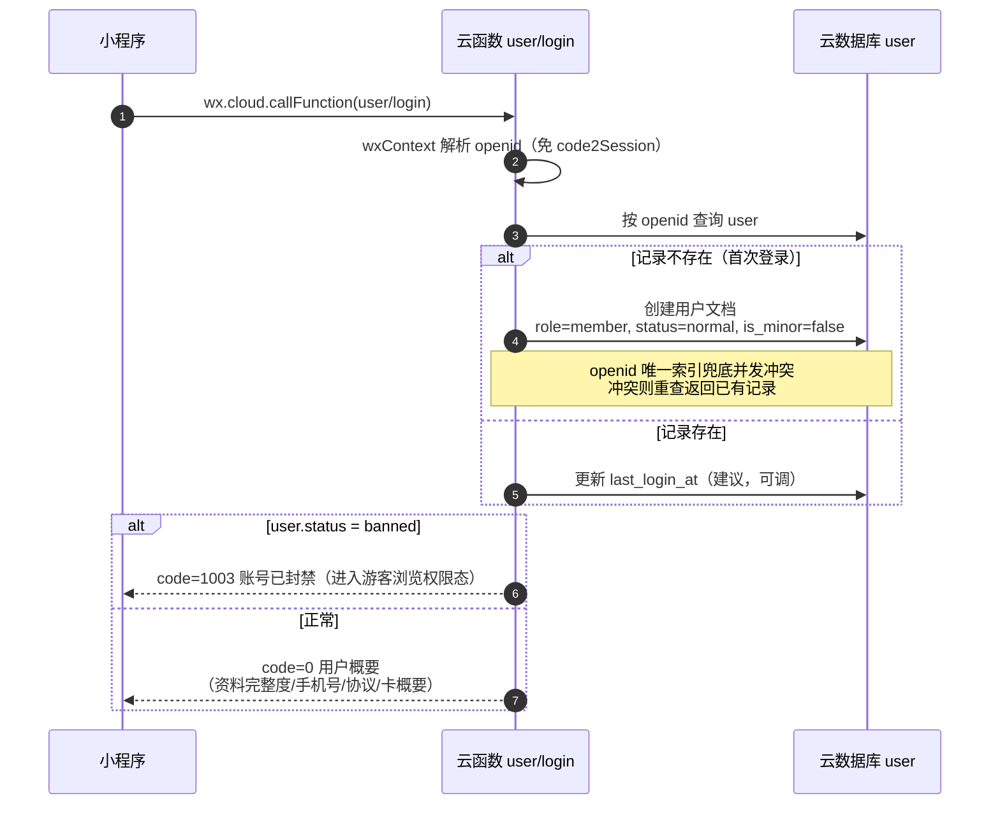
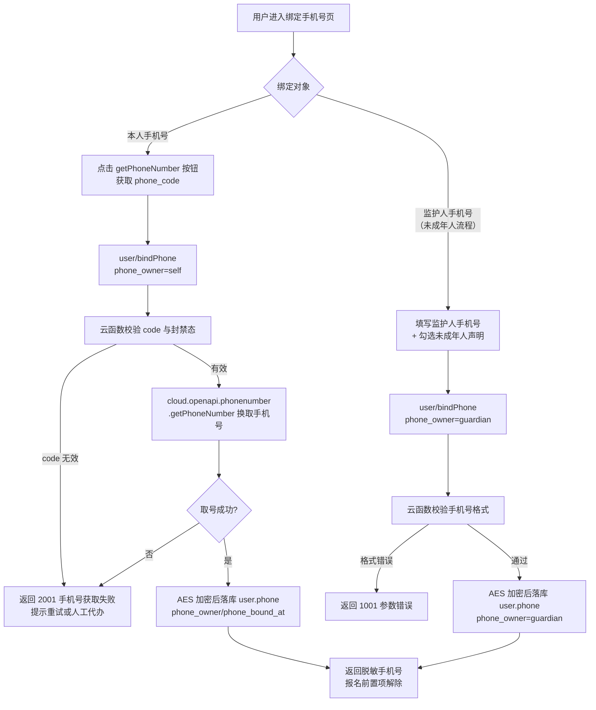
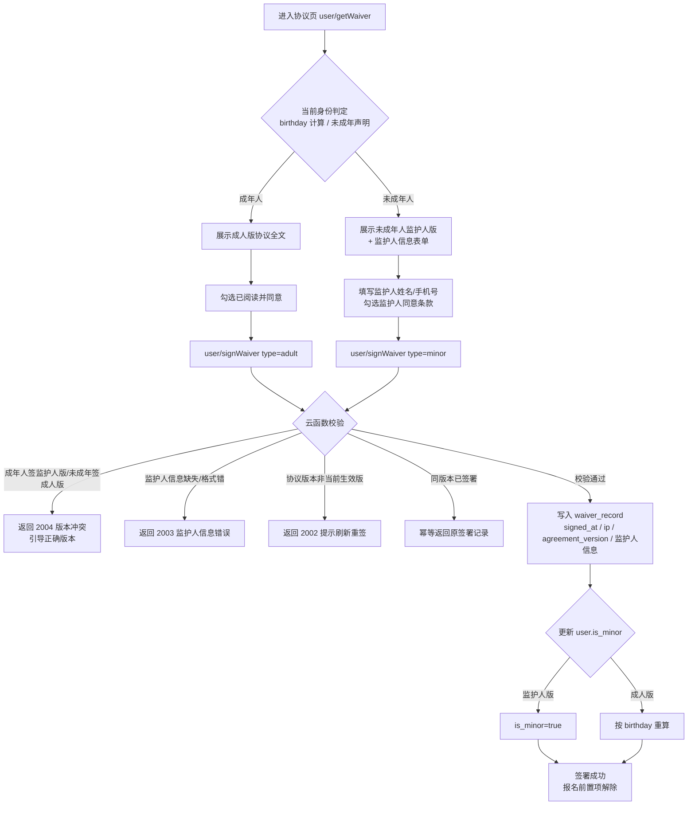
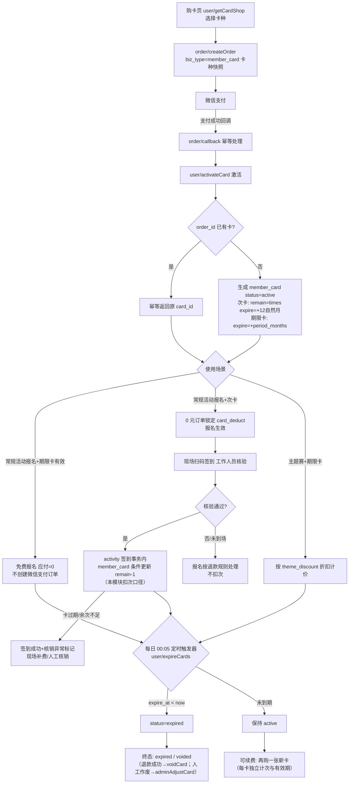

# 真人CS俱乐部小程序 · 用户（会员）模块详细设计文档

| 项目 | 内容 |
| --- | --- |
| 文档版本 | v1.0 |
| 依据文档 | 架构设计文档 v0.5（`docs/architecture.md`，唯一事实源） |
| 更新日期 | 2026-10-08 |
| 模块范围 | 登录 / 个人资料 / 手机号绑定 / 免责协议 / 会员卡 / 会员等级 / 收货地址 / 用户维度管理端操作（云函数 user/*） |
| 技术底座 | 微信云开发（云函数 Node.js + wx-server-sdk、云数据库、云存储、云调用、定时触发器） |

> 约定：全文金额单位为**分**（整数）；时间为**毫秒时间戳**（字段以 `_at` 结尾）；云函数统一返回 `{ code, msg, data }`，`code=0` 表示成功；所有入参均在**云函数侧**做校验（系统边界）；文档型数据库无外键，跨集合关联使用**冗余外键字段 + 同步策略**（见 6.9）。标注「建议，可调」的内容为实现细节建议，不构成已确认决策。
>
> **明确不做**（依据架构文档已确认决策）：积分获取/抵扣（Q8 已砍，本文任何位置不得出现积分设计）；储值卡（Q5）；独立 Web 管理后台（Q3，管理功能全部内嵌小程序）；未成年人限制参与（Q7：不限参与，走监护人流程）。

---

## 1. 模块概述

### 1.1 职责边界

| 归属 | 内容 |
| --- | --- |
| **本模块负责** | 微信授权登录与账号落库（openid 免 code2Session）、个人资料维护与冗余展示字段同步、手机号绑定（含监护人手机号，Q6 强制）、免责协议双版本签署与电子留痕（Q7）、会员卡（次卡 + 期限卡）数据口径、购买激活、有效期与过期处理、多卡并存规则、会员卡人工调整（管理端）、会员等级（仅按累计场次，Q8）、个人军衔规则定义与展示（总击杀 + 胜场双门槛，Q21，见 R15）、收货地址（P2）、用户维度管理端操作（角色分配、封禁/解封）及其操作日志埋点（module=user） |
| **活动模块负责** | 报名前置校验（已绑手机号 + 已签协议）的执行、扫码签到时的次卡核销扣次执行（按本模块定义的数据口径，见第 7 章）、累计场次的写入（user.total_games 冗余维护）、**军衔冗余字段的异步重算执行**（user.total_kills/total_wins/rank，按本模块 R15 军衔表换算，架构 §3.3） |
| **支付模块负责** | 会员卡购买订单创建与微信支付、支付回调后调用本模块激活卡、会员卡退款（未使用 7 天无理由退 / 次卡按剩余次数比例退）的金额计算与执行、次卡核销的 0 元订单流水 |
| **管理端模块（admin）负责** | 角色权限管理界面（role_permission 集合的维护接口归 admin/*）、操作日志查询页面 |
| **战队模块负责** | 队长附加身份（team_member.role），与 user.role 全局角色互不干扰 |

### 1.2 架构文档章节引用

| 主题 | 架构文档章节 |
| --- | --- |
| 用户模块功能清单与优先级 | §3.1 |
| 会员卡方案（次卡 + 期限卡，不做储值卡） | §3.2、Q5 |
| 会员等级与军衔规则（等级按累计场次，积分已砍；军衔按总击杀 + 胜场双门槛） | §3.3、Q8、Q21 |
| 核心数据模型（user / member_card / waiver_record / role_permission / user_address） | §3.4 |
| Q6/Q7（手机号强制绑定、监护人同意） | §3.5、§8.1 |
| 角色定义与权限点配置机制 | §1.3 |
| 管理端内嵌小程序、无独立 Web 后台 | §1.4、Q3 |
| 操作审计日志（记录内容与机制） | §1.5 |
| 登录鉴权（openid 天然携带、首次落库） | §2.3 |
| 个人信息保护（手机号 AES 加密、日志脱敏） | §8.1 |
| 退款规则中会员卡部分（7 天无理由 / 按剩余次数比例） | §6.4 |
| 支付场景（会员卡购买/续费、次卡核销不走微信支付） | §6.1 |
| 定时触发器（会员卡过期处理） | §2.3、§8.2 |
| 开发阶段 M1/M2/M3 | §9 |

### 1.3 功能优先级清单（与架构 §3.1 一致）

| 优先级 | 功能 | 说明 |
| --- | --- | --- |
| P0 | 微信授权登录 | 云函数天然携带 openid，免 code2Session；首次登录落库 user 集合 |
| P0 | 个人资料 | 昵称、头像（新版小程序用户主动填写）、性别、生日、紧急联系人 |
| P0 | 手机号绑定 | **强制**（报名前必须绑定）；未成年人绑定**监护人**手机号；云调用获取，需企业认证主体 |
| P0 | 免责协议签署 | 参与前必须签署，电子留痕（时间、IP、协议版本）；协议分**成人版 / 未成年人监护人版** |
| P0 | 操作日志埋点 | 本模块管理端写操作（角色分配、会员卡人工调整、封禁/解封）全量记日志（§1.5） |
| P1 | 会员卡 | 次卡（10/30 次、12 个月有效）/ 期限卡（月/季/年）：购买、激活、核销口径、续费、过期 |
| P1 | 会员等级 | 累计参与场次 → 等级 → 报名折扣（LV3 95 折、LV4 9 折） |
| P1 | 个人军衔 | 总击杀数 + 胜场数双门槛晋升（14 档，徽章展示，不绑折扣/权益，Q21，见 R15） |
| P1 | 用户管理（管理端） | 用户列表/搜索/详情、角色分配、封禁/解封、会员卡人工调整 |
| P2 | 实名认证 | 身份证号加密存储，可用于未成年人年龄核验（非本期强制，本文仅预留字段位与接口位，不展开） |
| P2 | 收货地址 | 仅当有周边商城/纪念品时需要，接口与集合已定义，页面 P2 |

---

## 2. 页面设计

### 2.1 页面清单

> 页面路径与 TabBar 归属为建议（可调），最终以全局路由设计为准；管理端页面均从小程序主页「管理」入口按权限点可见（架构 §1.4），无独立 Web 后台。

| # | 页面路径 | 标题 | TabBar? | 可见角色 / 权限点 | 主要交互 |
| --- | --- | --- | --- | --- | --- |
| 1 | /pages/profile/profile | 我的 | 是（建议，可调） | 游客（未登录态）/ 会员 | 用户信息卡（头像、昵称、等级徽章、军衔徽章）、「去完善资料/绑定手机/签协议」前置任务提示条、会员卡概要卡（余次/有效期）、功能入口（我的订单、我的报名、我的战队、会员卡、协议、收货地址、等级与军衔）、管理入口透传（由全局主页控制，本页不重复） |
| 2 | /pages/profile/edit | 编辑资料 | 否 | 会员 | 头像选择（chooseAvatar）、昵称填写（input type=nickname）、性别单选、生日日期选择、紧急联系人姓名/电话；保存提交 |
| 3 | /pages/profile/bind-phone | 绑定手机号 | 否 | 会员 | 成年流程：`getPhoneNumber` 按钮一键获取微信手机号；未成年人流程：表单填写监护人手机号 + 未成年人声明勾选；已绑定态展示脱敏号码与「换绑」 |
| 4 | /pages/profile/waiver | 免责协议 | 否 | 会员 | 展示当前生效版本协议全文（成人版/监护人版自动切换）、监护人信息表单（监护人版）、勾选「已阅读并同意」、签署提交；已签署态展示签署时间/版本留痕，版本升级时提示重签 |
| 5 | /pages/profile/card/list | 我的会员卡 | 否 | 会员 | 有效卡（置顶，余次进度条/期限倒计时）与历史卡（已过期/已作废）分组；「购买会员卡」入口 |
| 6 | /pages/profile/card/buy | 购买会员卡 | 否 | 会员 | 在售卡种卡片式列表（名称、价格、权益说明、有效期）；选择卡种 → 跳转订单确认页（order 模块收口支付） |
| 7 | /pages/profile/card/detail | 会员卡详情 | 否 | 会员 | 卡面信息、余次/有效期、使用记录（0 元核销订单流水，来自 order 模块）、购买订单号 |
| 8 | /pages/profile/level | 等级与军衔 | 否 | 会员 | 上下两区：等级区（当前等级徽章与折扣权益、距下一级进度条（已累计场次/门槛）、等级规则表 LV1–LV4）；军衔区（当前军衔徽章与名称、总击杀/胜场**双进度条**（当前值/下一档门槛）、军衔晋升规则表（R15，14 档）） |
| 9 | /pages/profile/address/list | 收货地址（P2） | 否 | 会员 | 地址列表、默认地址标记、新增/编辑入口 |
| 10 | /pages/profile/address/edit | 编辑地址（P2） | 否 | 会员 | 收件人/电话/地区选择器/详细地址/设为默认 |
| 11 | /pages/admin/user/list | 用户管理 | 否 | 权限点 `user.manage` | 昵称关键词/完整手机号/角色/状态筛选、分页列表（头像昵称、角色、状态、累计场次、卡概要）、点击进详情 |
| 12 | /pages/admin/user/detail | 用户详情 | 否 | 权限点 `user.manage` | 资料卡（脱敏）、角色分配（adminUpdateRole）、封禁/解封（需 `user.ban`）、会员卡人工调整（需 `user.card.adjust`，人工开卡/增减次/改有效期/作废）、协议签署记录列表、该用户卡列表 |

### 2.2 空态 / 加载态 / 错误态（通用 + 特例）

**通用约定（建议，可调）**：

- **加载态**：列表/详情页骨架屏（skeleton）；提交类按钮点击后置 loading 并防连点（前端节流 + 云函数幂等双保险）。
- **错误态**：云函数返回 `code≠0` 时页面顶部轻提示（toast）展示 `msg`；`code=1003`（封禁）跳转封禁说明页；`code=1099` 展示「服务开小差了，请稍后重试」并提供重试按钮；网络失败由全局 `callFunction` 封装统一兜底。
- **空态**：统一插画 + 一句话说明 + 主操作按钮。

| 页面 | 空态 | 错误态特例 |
| --- | --- | --- |
| 我的（未登录） | 游客态：默认头像 + 「点击登录」按钮，登录后拉起 user/login | 登录失败重试；封禁态显示封禁提示，仅保留浏览类入口 |
| 编辑资料 | 新用户首进：昵称/头像为空，引导填写（不强制） | 昵称超长/敏感词（前端预校验 + 云函数 1001 返回具体字段错误） |
| 绑定手机号 | 未绑定：两个流程入口（本人/监护人）；已绑定：脱敏号码 + 换绑 | 2001 手机号获取失败：提示重试或改走人工表单（P1 人工录入手机号，管理端可代办，见 8.2） |
| 免责协议 | 未签署：协议全文 + 同意勾选禁用直至滚动到底（建议，可调） | 2002 协议版本失效：自动刷新最新版本重新展示 |
| 我的会员卡 | 「还没有会员卡，去看看卡种」+ 购卡入口 | — |
| 购买会员卡 | 无在售卡种（运营未配置）：「暂无在售卡种」 | — |
| 卡详情 | 无使用记录：「购买后首次使用将在此展示」 | 2006/2007 卡已过期/作废：卡片置灰 + 状态说明 |
| 会员等级 | 0 场：显示「参加 1 场解锁 LV1 新兵」引导 | — |
| 等级与军衔（军衔区） | 新兵（recruit）态：显示「获得 15 击杀 + 1 胜场晋升一等兵」引导（文案门槛值随 R15 规则表动态读取，不硬编码） | 军衔数据读取失败时军衔区隐藏，不影响等级区展示（rank 冗余字段缺失按 recruit 兜底） |
| 用户管理（管理端） | 无匹配结果：「未找到该用户」 | 1004 无权限：隐藏入口/按钮置灰（前端按权限点渲染） |
| 用户详情 | 卡/协议为空的分组各自显示占位说明 | 人工调整失败保留表单原值并提示 msg |

---

## 3. 业务规则详细设计

### R1 微信授权登录与账号落库

| 项 | 内容 |
| --- | --- |
| 规则描述 | 云函数调用天然携带 openid（架构 §2.3，免 code2Session），首次调用 `user/login` 时自动创建账号（静默注册），无需用户手动注册；union_id 非必填（未绑定微信开放平台时为空，绑定后可回填）。 |
| 触发时机 | 小程序启动进入需登录页面 / 「我的」页游客态点击登录 / 任何需登录接口前的会话初始化。 |
| 计算/校验逻辑 | ① 从 `wxContext` 取 openid；② 按 openid 查 user 集合；③ 不存在则创建默认文档：`role='member'`、`status='normal'`、`is_minor=false`、`created_at=now`；④ 存在则更新 `last_login_at`（建议，可调）；⑤ `status='banned'` 时返回 `code=1003`，前端进入封禁态（仍可游客浏览）。 |
| 边界条件 | ① 并发首次登录（多端同时触发）：openid 唯一索引兜底，插入冲突后重查返回已有记录；② 同一用户 openid 与 union_id 均以微信侧为准，不做合并账号（无手机号登录体系，不存在账号合并诉求）；③ 昵称头像初始为空串，由 R2 用户主动填写（新版小程序规范，见 R2）。 |

### R2 个人资料

| 项 | 内容 |
| --- | --- |
| 规则描述 | 资料字段：昵称、头像、性别、生日、紧急联系人（架构 §3.1 P0）。头像与昵称使用小程序「头像昵称填写能力」（`button open-type="chooseAvatar"` + `input type="nickname"`）由用户主动提供，不做静默拉取。 |
| 触发时机 | 用户在「编辑资料」页保存；新用户首次完善资料引导。 |
| 计算/校验逻辑 | ① 云函数侧白名单校验：nickname 长度 1–20；gender ∈ {0 未知, 1 男, 2 女}；birthday 为毫秒时间戳且在 1900-01-01 至当前时间之间；紧急联系人 name ≤ 20 字、phone 为 11 位手机号格式；② **服务端字段保护**：`phone`/`role`/`status`/`is_minor`/`total_games` 不允许经本接口修改（phone 走 R3，role/status 走管理端接口）；③ 提交 birthday 时按 R4 重算 `is_minor`；④ 更新成功后触发冗余字段异步同步（见 6.7）。 |
| 边界条件 | ① 资料不完整不阻断浏览，仅在报名前置校验链中被 activity 模块拦截（手机号/协议项）；② 紧急联系人与监护人手机号是两个概念（前者任意联系人，后者须为监护人且与协议留痕一致，见 R3/R5）；③ 头像上传云存储后以 fileID 存 user.avatar，前端展示用临时链接（cloud.getTempFileURL，建议缓存）。 |

### R3 手机号绑定（强制，Q6）

| 项 | 内容 |
| --- | --- |
| 规则描述 | **报名前必须绑定手机号**（activity 报名前置校验项）。成年人绑定本人手机号（微信手机号快捷获取）；未成年人绑定**监护人**手机号（`phone_owner='guardian'`）。手机号 AES 加密存储（架构 §8.1），任何出参仅返回脱敏格式（如 `138****5678`）。 |
| 触发时机 | 「绑定手机号」页主动操作；报名被前置校验拦截（activity 返回 3011）后的引导跳转。 |
| 计算/校验逻辑 | ① 本人手机号：小程序 `getPhoneNumber` 事件取 `code`（基础库 ≥ 2.21.2，推荐）或 `cloudID`，云函数侧调 `cloud.openapi.phonenumber.getPhoneNumber({ code })` 或 `cloud.getOpenData()` 解密取号（建议，可调：两种方式按基础库最低版本择一）；② 监护人手机号：表单填写，仅做格式校验（11 位、1 开头）——无法经微信取号核验属实，真实性由监护人版协议留痕 + 线下回访保障（建议，可调：如需强核验可接短信验证，成本另计，架构默认不使用短信）；③ 绑定结果 AES 加密落库 `user.phone` + `phone_owner` + `phone_bound_at`；④ 换绑 = 直接覆盖旧值（见 8.2 解绑/换绑规则）。 |
| 边界条件 | ① 同一手机号允许被多个账号绑定（家人共用监护人手机号为正常场景，不做唯一限制，建议，可调）；② 解绑不开放（报名强制），仅允许换绑；③ 已签监护人版协议后换绑监护人手机号，协议留痕不回改（留痕语义），但与 `user.phone` 不一致时前端展示提示（见 8.2）；④ 企业认证主体是获取手机号的前置条件（架构 §8.1）。 |

### R4 未成年人标识（is_minor）

| 项 | 内容 |
| --- | --- |
| 规则描述 | `is_minor` 判定依据优先级：**birthday 实时计算 > 用户声明 > 已签署协议版本推断**。不限制未成年人参与（Q7），仅影响协议版本选择与监护人信息要求。 |
| 触发时机 | 保存资料（含 birthday）时；签署协议时；报名前置校验时（activity 模块读取）。 |
| 计算/校验逻辑 | ① birthday 存在：年龄 = 当前日期 − birthday（按周岁），< 18 → `is_minor=true`；② birthday 缺失：签署页允许勾选「我是未成年人」声明，勾选后 `is_minor=true`（声明留痕于签署入参，建议同时引导补填 birthday）；③ 签署监护人版协议 → 强制 `is_minor=true`；签署成人版 → 按 ①② 重算。 |
| 边界条件 | ① 年满 18 后（birthday 推算）：下次保存资料或签署协议时自动翻转 `is_minor=false`，此后签成人版协议；**已签的监护人版协议留痕保留**（历史事实），报名校验取最新有效签署；② birthday 未填且未声明：视为成年人（默认 `is_minor=false`），签成人版；③ 生日当天跨界的判定以签署时刻计算（17 岁最后一天签监护人版有效，留痕不追改）。 |

### R5 免责协议双版本签署（Q7）

| 项 | 内容 |
| --- | --- |
| 规则描述 | 协议分**成人版 / 未成年人监护人版**两版本，参与前必须签署**当前生效版本**。监护人版额外要求监护人姓名 + 监护人手机号（waiver_record.guardian_name / guardian_phone，与架构 §3.4 一致）。签署电子留痕：时间、IP、协议版本。 |
| 触发时机 | 用户主动进入协议页；报名前置校验拦截（activity 返回 3010）后引导。 |
| 计算/校验逻辑 | ① 取 agreement 集合当前 `status='active'` 的版本（建议集合，见 6.6）；② 版本选择校验：签署成人版时若 birthday 推算未成年 → 拒绝（2004）并引导监护人版；签署监护人版时监护人姓名（≤20 字）与手机号（11 位格式）必填（缺失 2003）；③ `guardian_phone` 与 `user.phone`（当 `phone_owner='guardian'`）一致性提示（不一致不阻断，返回 warning，建议，可调）；④ 幂等：同一 user 同一 version 已签署 → 直接返回原签署记录（code=0）；⑤ 写入 waiver_record（含 wxContext 取得的 CLIENTIP）；⑥ 同步更新 `user.is_minor`（按 R4）。 |
| 边界条件 | ① 一个用户可有多条签署记录（版本升级重签、未成年转成年换签成人版），**报名校验取最新一条**且其版本须等于当前生效版本；② 监护人手机号建议同样 AES 加密存储（与 user.phone 同策略，建议，可调）；③ 协议正文存云存储（fileID）或富文本字段，协议页渲染当前生效版本全文；④ 未成年用户本人 + 监护人双确认：由监护人版协议条款 + 监护人手机号绑定共同构成留痕（不引入线下纸质回传，建议，可调）。 |

### R6 协议版本升级与重签

| 项 | 内容 |
| --- | --- |
| 规则描述 | 运营在管理端发布新版本协议（旧版本下线）后，**老用户已签版本失效，须重签**后方可继续报名。 |
| 触发时机 | 管理端发布新协议版本（admin 模块操作，记操作日志）之后，老用户发起报名。 |
| 计算/校验逻辑 | ① 报名前置校验（activity 模块执行）：取用户最新签署记录的 `agreement_version`，与 agreement 集合当前 active 版本比对，不一致 → 拦截并引导重签；② 协议页 `user/getWaiver` 返回 `need_resign=true` 与新旧版本说明。 |
| 边界条件 | ① 重签不影响历史签署记录（留痕不可变）；② 已完成的历史报名不受影响（不追改）；③ 建议新版本发布时通过订阅消息批量通知已注册用户（P2 可选，可调）。 |

### R7 会员卡卡种与定价（Q5：次卡 + 期限卡，不做储值卡）

| 项 | 内容 |
| --- | --- |
| 规则描述 | 仅两类卡：**次卡**（10 次 / 30 次，购买后 12 个月内有效，1 次 = 1 场常规活动）与**期限卡**（月/季/年，期限内常规活动免费，主题赛享折扣）。卡种配置（名称、价格、权益）存 card_product 集合（建议，可调），运营可改价/上下架无需发版。 |
| 触发时机 | 购卡页展示卡种；订单计价读取卡种快照。 |
| 计算/校验逻辑 | ① 次卡字段：`times`（10/30）、`valid_months=12`；期限卡字段：`period_months`（1/3/12）；② 价格以**分**存储；③ 主题赛折扣率 `theme_discount_percent`（整数百分比，如 90 表示 9 折）为预留运营配置项（架构 §3.2「主题赛享折扣」，具体折扣率由俱乐部方提供后填入）；④ 卡种 `status: on/off` 控制上下架。 |
| 边界条件 | ① 具体定价由俱乐部方提供（架构 §3.2 注），上线前由管理端配置，本文示例价格仅为占位；② 不做储值余额、不做充值、不做积分（Q5/Q8）；③ 下架卡种不影响已购卡（已购卡按快照执行）。 |

### R8 会员卡购买与激活

| 项 | 内容 |
| --- | --- |
| 规则描述 | 购卡 = 创建 `biz_type='member_card'` 订单（order 模块）→ 微信支付 → 支付回调成功后调用本模块 `user/activateCard` 激活。激活时按下单时刻的卡种快照生成卡实例。 |
| 触发时机 | 购卡页选择卡种提交 → order/createOrder；微信支付回调 → order/callback → user/activateCard。 |
| 计算/校验逻辑 | ① 激活幂等：按 `order_id` 唯一约束防重复激活（微信回调可能重推）；② 次卡：`remain_times = total_times = times`，`expire_at = activated_at + 12 个自然月`（到期日当天 23:59:59.999，建议，可调）；③ 期限卡：`expire_at = activated_at + period_months 个自然月`（月卡 +1、季卡 +3、年卡 +12），`remain_times=null`；④ 「续费」= 再次购买一张新卡（每张卡独立计次、独立有效期，不做余额顺延，建议，可调：次卡续期顺延规则若运营需要，可扩展为「未过期购新次卡，新卡有效期自旧卡到期日起算」，需运营确认后启用）。 |
| 边界条件 | ① 支付成功但激活失败（极端）：order 模块重试调用 + 告警，用户侧以订单已支付为准，卡可由管理端按订单号人工补开（adminAdjustCard 人工开卡）；② 购卡不要求已签协议/已绑手机（非参与动作），但使用（核销/免费权益）受报名前置校验约束。 |

### R9 多卡并存与使用优先级

| 项 | 内容 |
| --- | --- |
| 规则描述 | 一个用户可同时持有多张卡（多次购卡、次卡与期限卡混持）。规则：**期限卡权益独立生效；次卡核销按「先到期先用」排序**。 |
| 触发时机 | 报名选择支付方式时（activity/order 展示可用卡）；签到核销扣次时（R10）。 |
| 计算/校验逻辑 | ① 可用次卡定义：`status='active'` 且 `expire_at > now` 且 `remain_times > 0` 且 `card_type='count'`；② 可用期限卡定义：`status='active'` 且 `expire_at > now` 且 `card_type='period'`；③ 次卡核销排序：`expire_at` 升序，同 `expire_at` 时 `remain_times` 少者优先（建议，可调）；④ 常规活动报名：用户存在可用期限卡时默认走期限卡免费；选择次卡时按 ③ 扣卡；⑤ 期限卡多张并存：均有效，权益不叠加（免费即免费），到期日展示取最近一张；⑥ 次卡仅可用于**常规对抗赛**，主题赛事不可用次卡（架构 §3.2「1 次 = 1 场常规活动」）。 |
| 边界条件 | ① 已作废（voided）卡不参与任何校验与排序；② 卡数据口径（字段含义、可用性判定、排序）以本模块定义为准，activity/order 模块透传执行（见第 7 章）；③ 支付方式选择界面同时展示「微信支付」与可用卡（不强制用卡，用户可选全额支付，建议，可调）。 |

### R10 次卡核销（1 次 = 1 场常规活动）

| 项 | 内容 |
| --- | --- |
| 规则描述 | 次卡核销不走微信支付（架构 §6.1）：报名常规活动时选择次卡作为支付方式（0 元订单，order 模块流水），**扣次发生在扫码签到核验成功时**（与 activity 模块 3.7 节约定一致，避免「报名后未到场白扣一次」；扣次时机为已与 activity/order 模块对齐的建议，可调）。 |
| 触发时机 | 工作人员签到核验确认（activity/confirmCheckin）→ 事务内对 member_card 执行本模块定义的条件更新口径。 |
| 计算/校验逻辑 | **扣次条件更新口径（本模块统一定义，各模块执行同一口径）**：`where { card_id, status: 'active', expire_at > now, remain_times > 0 }` → `update { remain_times: remain_times - 1, used_times: used_times + 1 }`；条件不满足即失败（不会扣成负数）。云数据库事务不能跨云函数，故执行方为发起事务的模块（activity 签到事务内直接更新 member_card 集合）；无法纳入同事务的场景调用本模块原子接口 `user/deductTimes`。 |
| 边界条件 | ① 并发多端核销同一张卡：条件更新保证不超扣；② 核销失败（卡过期/余次不足）：**签到仍成功**，返回核销异常标记，由工作人员现场处理（现场补费/人工核销），与 activity 模块 3.7 约定一致；③ 核销流水以 order 模块 0 元订单（`pay_type='card_deduct'`，冗余 card_id）记录，卡详情页的使用记录读取该流水；④ 人工核销/人工调整走 R13。 |

### R11 期限卡权益

| 项 | 内容 |
| --- | --- |
| 规则描述 | 期限卡有效期内**常规活动免费**（报名应付 = 0，不创建微信支付订单）；**主题赛事享折扣**（折扣率运营配置，见 R7）。 |
| 触发时机 | 报名计价（activity/order 模块执行，本模块提供数据口径）。 |
| 计算/校验逻辑 | ① 常规活动 + 存在可用期限卡 → 应付 0 元，报名直接生效；② 主题赛 + 存在可用期限卡 → `pay_amount = price × theme_discount_percent / 100`（服务端计算，分，向下取整）；③ 期限卡与会员等级折扣**不叠加**：存在期限卡折扣的场景不再叠加等级折扣（以期限卡折扣为准，建议，可调，待运营确认）。 |
| 边界条件 | ① 新手体验课/团建等非「常规活动」类型是否可用期限卡，由 activity 模块按活动类型判定（常规对抗赛适用）；② 期限卡到期当天（见 8.5）以活动开始时间判断可用性。 |

### R12 会员卡到期处理（定时触发器）

| 项 | 内容 |
| --- | --- |
| 规则描述 | 定时触发器每日将已过期的有效卡置为 `expired`；卡的实际可用性以**使用时刻实时校验 `expire_at`** 为准（定时器仅做状态落库与兜底，不承担可用性判断）。 |
| 触发时机 | `user/expireCards` 定时触发器（建议每日 00:05 执行，可调）。 |
| 计算/校验逻辑 | `where { status: 'active', expire_at < now }` → 批量 `update { status: 'expired' }`；返回处理条数并记执行日志（建议：云函数日志即可，量级小）。 |
| 边界条件 | ① 过期当天的可用性见 8.5；② 定时器失败不影响业务正确性（所有使用路径均实时校验 `expire_at`），次日补偿处理；③ 到期前 7 天订阅消息提醒持卡用户（P2 可选，可调）。 |

### R13 会员卡人工调整（管理端）

| 项 | 内容 |
| --- | --- |
| 规则描述 | 管理员可对会员卡执行：人工开卡（补偿/线下收款场景）、增减次数、修改有效期、作废。**全量记操作日志**（§1.5：module=user，action=card.adjust，detail 含 before/after）。 |
| 触发时机 | 管理端用户详情页卡操作（权限点 `user.card.adjust`）。 |
| 计算/校验逻辑 | ① 人工开卡：指定 user + 卡种（可覆盖 expire_at），`source='admin'`、`order_id=null`；② 增次：`remain_times + times`（不设上限，补卡场景）；减次：`remain_times - times`，结果不得 < 0（1001）；③ 改有效期：`expire_at` 为毫秒时间戳，不得早于当前时间（提前作废请用 void，1001）；④ 作废：`status='voided'`；⑤ 调整后若 `expire_at > now` 且 `status='expired'` → 联动置回 `active`（延期场景自动恢复，建议，可调）；⑥ 期限卡不适用增减次操作（1001 拒绝）。 |
| 边界条件 | ① 人工调整绕过支付链路，**必须留痕**（操作日志 + 调整 remark），管理员权限二次确认弹窗（与退款同级敏感操作）；② 日志写入失败不阻断业务（fire-and-forget，§1.5）。 |

### R14 会员等级（仅按累计场次，Q8）

| 项 | 内容 |
| --- | --- |
| 规则描述 | 等级由**累计参与场次**驱动（与架构 §3.3 一致），无积分、无成长值。等级带来报名费折扣：LV3 95 折、LV4 9 折（折扣作用于**微信支付实付金额**，由 order 模块计价时应用）。 |
| 触发时机 | 战绩录入后（场次累计变化）；报名计价时（order 读等级折扣）；个人主页展示时。 |
| 计算/校验逻辑 | ① 累计场次口径：已完成的报名场次（activity_enrollment status=已完成 或 已签到，与 activity 模块战绩口径一致）；② 本模块在 `user.total_games` 维护冗余计数（建议，可调：由 activity 模块在活动结束批量置已完成时累加，或由 activity_stats 聚合回填），等级计算恒等式：`total_games 0 → 未定级；1–9 → LV1 新兵；10–29 → LV2 老兵；30–59 → LV3 精英（discount 95）；60+ → LV4 王牌（discount 90）`；③ 折扣表达为整数百分比 `discount_percent`（95/90/null），出参统一返回该字段，order 计价 `pay_amount = amount × discount_percent / 100`（分，向下取整）。 |
| 边界条件 | ① 等级只升不降（历史场次累计口径，取消/退款场次是否扣减由 activity 模块口径决定，本模块仅消费 total_games 值）；② 折扣不与期限卡折扣叠加（R11，建议，可调）；次卡支付（0 元）与免费活动不涉及折扣；③ M1 无等级折扣（M3 落地，见第 9 章）。 |

### R15 个人军衔（总击杀 + 胜场双门槛，Q21）

| 项 | 内容 |
| --- | --- |
| 规则描述 | 军衔是**实力线**荣誉体系（区别于 R14 等级资历线）：由**总击杀数 + 胜场数**双门槛驱动晋升，纯徽章荣誉，**不绑定任何折扣/权益**（避免与等级折扣、期限卡折扣形成两套权益体系冲突）。军衔表（与架构 §3.3 一致，**按年均 10~30 场活动标定**，门槛数值为默认提案，可调）：`recruit` 新兵(0/0)、`pfc` 一等兵(15/1)、`corporal` 下士(50/4)、`sergeant` 中士(100/8)、`staff_sergeant` 上士(180/14)、`master_sergeant` 军士长(300/21)、`second_lieutenant` 少尉(450/30)、`first_lieutenant` 中尉(650/40)、`captain` 上尉(900/52)、`major` 少校(1200/66)、`lieutenant_colonel` 中校(1600/88)、`colonel` 上校(2100/112)、`senior_colonel` 大校(2800/140)、`major_general` 少将(3600/180)（括号内 = 击杀门槛/胜场门槛） |
| 触发时机 | ① 战绩写入（手动录入/Excel 导入/覆盖修正）成功后，由 activity 模块**异步重算**（fire-and-forget，重算执行方为 activity，见第 7 章）；② 展示时：个人主页、战队成员列表、排行榜读 `user.rank` 冗余字段，本模块不实时聚合。 |
| 计算/校验逻辑 | ① 数据源：activity_stats 聚合，`total_kills = Σ kills`、`total_wins = Σ (is_win = true)`（全量聚合而非增量累加，天然兼容覆盖修正纠错）；② 晋升恒等式（**与门，短板决定**）：`rank = 军衔表中同时满足 total_kills ≥ 击杀门槛 且 total_wins ≥ 胜场门槛的最高档`；③ `user.rank` 存军衔 code（英文，新用户默认 `recruit`）——**落库**，区别于等级不落库实时换算（军衔重算是批量异步触发、多模块消费，落库避免各处重复聚合）；④ 冗余字段 `total_kills/total_wins/rank/rank_updated_at` 归 activity 模块写入（6.1/6.9），本模块仅定义规则与消费。 |
| 边界条件 | ① 军衔**如实升降**：战绩覆盖修正（录入纠错）后按新数据重算，可能降衔（区别于 R14 等级只升不降，建议，可调）；② 重算失败不阻断战绩录入（fire-and-forget），下次战绩写入时全量聚合自愈；③ 门槛数值调整后，存量用户军衔需一次性刷新（P2 运营批处理，见第 9 章）；④ 军衔无任何权益绑定，不与等级折扣/期限卡折扣叠加；⑤ 胜负平局口径：胜场仅计 `is_win=true`，负与平不计（口径与 activity 模块战绩一致）。 |

### R16 账号状态（封禁/解封）

| 项 | 内容 |
| --- | --- |
| 规则描述 | `user.status: normal / banned`。封禁后所有写操作与需登录态的业务接口拒绝（code=1003），游客可浏览的内容（活动列表/详情、俱乐部介绍）不受影响（封禁用户等同游客浏览权限）。 |
| 触发时机 | 管理端封禁/解封操作（权限点 `user.ban`，记操作日志）。 |
| 计算/校验逻辑 | ① 封禁即时生效：所有云函数入口统一校验（公共鉴权封装，建议在公共入口读取 user.status）；② 解封即时恢复；③ 均写 operation_log（action=user.ban / user.unban，detail 含 reason）。 |
| 边界条件 | ① 管理员不能封禁自己（防锁死，建议，可调）；② 封禁不影响已有报名/订单/卡的存量数据，仅阻断新操作（退款类接口是否放行由 order 模块定义，建议放行——用户有权拿回资金）。 |

### R17 角色分配与权限校验

| 项 | 内容 |
| --- | --- |
| 规则描述 | `user.role` 存角色标识，角色 → 权限点映射存 role_permission 集合（架构 §1.3，管理端在线配置、不硬编码）。本模块负责：user.role 的写入（adminUpdateRole）与**权限校验公共口径**（checkPermission 供各模块云函数复用，建议以公共库/公共层实现，可调）。 |
| 触发时机 | 管理端角色分配（权限点 `user.role.assign`）；所有管理端接口入口鉴权。 |
| 计算/校验逻辑 | ① 角色分配：目标 role 必须存在于 role_permission.role_key（1005）；更新 `user.role` + 记操作日志（action=role.update，detail before/after）；② 权限校验口径：`openid → user.role → role_permission.permissions ⊇ 所需权限点`；③ 权限点变更（admin 模块维护 role_permission）无需发版即时生效（每次请求实时读取，建议可加进程内短 TTL 缓存，可调）。 |
| 边界条件 | ① 队长（战队队长）是 team_member 附加身份，不是 user.role 取值；② role_permission 维护接口归 admin 模块（admin/*），本模块只消费；③ 预置角色种子数据见 6.4。 |

### R18 会员卡退款数据口径（供 order 模块）

| 项 | 内容 |
| --- | --- |
| 规则描述 | 会员卡退款规则（架构 §6.4 默认提案，待运营最终确认）：未使用可 7 天无理由退；次卡已使用按剩余次数比例退。**金额计算与退款执行归 order 模块**，本模块提供数据口径与退款后置状态。 |
| 触发时机 | 用户对 `biz_type='member_card'` 订单申请退款（order 模块处理）。 |
| 计算/校验逻辑 | ① 本模块供数：`remain_times`、`total_times`、`used_times`、`activated_at`（7 天窗口计算）、`status`；② 比例退口径（order 计算）：`可退金额 = pay_amount × remain_times / total_times`（分，向下取整，由 order 模块最终定义）；③ 退款成功后 order 调用本模块 `user/voidCard` 将卡置 `voided`；次卡回补场景（活动取消退报名）调用 `user/restoreTimes`。 |
| 边界条件 | ① 「未使用」判定 = `used_times = 0`（人工调整增减次同样改变 remain/used，以数据库实时值为准）；② 已 voided 的卡不可再退（order 侧校验）；③ 部分使用后 7 天内是否仍可按比例退——沿用架构默认提案（可退），最终以运营确认为准。 |

---

## 4. 流程图

### 4.1 登录流程



### 4.2 手机号绑定流程



### 4.3 免责协议签署流程



### 4.4 会员卡购买与核销生命周期



---

## 5. 云函数接口设计

### 5.0 公共约定

- **部署形态（建议，可调）**：单云函数 `user`，内部按 `action` 路由（与架构图 `user/*` 命名空间对应，接口记作 `user/<action>`）；前端一律 `wx.cloud.callFunction({ name: 'user', data: { action, payload } })`，前端不直连数据库。
- **统一返回**：`{ code, msg, data }`，`code=0` 成功；错误 msg 为可直接展示的简体中文。
- **鉴权三档**：① `登录态`（云函数天然携带 openid，无需权限点）；② `权限点`（管理端接口，入参校验 + role_permission 权限点校验，双重防线）；③ `系统内部`（仅允许云函数间调用：入参携带 `internal_token` 环境变量比对，或云函数调用白名单——实现方式为建议，可调，原则是**不可被前端直接调用**）。
- **入参校验**：所有接口在云函数侧做类型/长度/枚举/格式校验（系统边界），校验失败返回 `1001`，msg 注明字段。
- **通用处理顺序**：解析 action → 参数校验 → 登录态/封禁校验（管理接口再做权限点校验）→ 业务逻辑 → 统一返回；管理端写操作追加操作日志（fire-and-forget，§1.5）。
- **时间与金额**：入出参时间一律毫秒时间戳；金额一律分。

### 5.1 接口总览

| # | 接口 | 用途 | 鉴权 |
| --- | --- | --- | --- |
| 1 | `user/login` | 登录/静默注册 | 登录态 |
| 2 | `user/getProfile` | 个人中心聚合资料 | 登录态 |
| 3 | `user/updateProfile` | 更新个人资料 | 登录态 |
| 4 | `user/bindPhone` | 绑定/换绑手机号 | 登录态 |
| 5 | `user/getWaiver` | 获取当前生效协议与签署状态 | 登录态 |
| 6 | `user/signWaiver` | 签署免责协议 | 登录态 |
| 7 | `user/getCardShop` | 在售卡种列表 | 登录态 |
| 8 | `user/getMyCards` | 我的会员卡列表 | 登录态 |
| 9 | `user/getCardDetail` | 卡详情与核销流水 | 登录态 |
| 10 | `user/listAddress` | 收货地址列表（P2） | 登录态 |
| 11 | `user/saveAddress` | 新增/编辑收货地址（P2） | 登录态 |
| 12 | `user/deleteAddress` | 删除收货地址（P2） | 登录态 |
| 13 | `user/activateCard` | 支付回调后激活会员卡 | 系统内部（order 调用） |
| 14 | `user/deductTimes` | 次卡原子扣次 | 系统内部（activity/order 调用） |
| 15 | `user/restoreTimes` | 次卡回补次数 | 系统内部（order/activity 调用） |
| 16 | `user/voidCard` | 退款成功后作废会员卡 | 系统内部（order 调用） |
| 17 | `user/adminList` | 用户列表/搜索 | 权限点 `user.manage` |
| 18 | `user/adminDetail` | 用户详情聚合 | 权限点 `user.manage` |
| 19 | `user/adminUpdateRole` | 角色分配/变更 | 权限点 `user.role.assign` |
| 20 | `user/adminSetStatus` | 封禁/解封 | 权限点 `user.ban` |
| 21 | `user/adminAdjustCard` | 会员卡人工调整/人工开卡 | 权限点 `user.card.adjust` |
| 22 | `user/expireCards` | 定时触发器：过期卡处理 | 定时触发器 |

> 权限点命名（`user.manage` / `user.role.assign` / `user.ban` / `user.card.adjust`）为建议（可调），须与 admin 模块「角色权限管理」配置界面中的权限点标识保持一致；权限点机制本身为架构 §1.3 已确认决策。

### 5.2 user/login

| 项 | 内容 |
| --- | --- |
| 用途 | 登录并静默注册（首次落库），返回用户概要与前置项完成度 |
| 权限 | 登录态（无需权限点） |

入参（payload 为空对象即可）：

```json
{ "action": "login", "payload": {} }
```

出参：

```json
{
  "code": 0,
  "msg": "ok",
  "data": {
    "is_new": true,
    "user": {
      "user_id": "oXf1s2...",
      "nickname": "",
      "avatar": "",
      "role": "member",
      "status": "normal",
      "is_minor": false,
      "phone_bound": false,
      "phone_masked": null,
      "waiver_signed": false,
      "level": null,
      "created_at": 1735660800000
    }
  }
}
```

核心处理逻辑：
1. `wxContext` 取 openid（免 code2Session）；
2. 按 openid 查 user；不存在则插入默认文档（`role='member'`、`status='normal'`、`is_minor=false`、`created_at=now`），`is_new=true`；openid 唯一索引冲突（并发首登）则重查返回已有记录；
3. 存在则更新 `last_login_at`（建议，可调）；
4. `status='banned'` → 返回 `code=1003`，data 附 `banned: true`；
5. 聚合返回概要（手机号/协议状态按 R3/R5 口径实时查询）。

| code | 说明 |
| --- | --- |
| 1003 | 账号已封禁 |
| 1099 | 系统异常 |

### 5.3 user/getProfile

| 项 | 内容 |
| --- | --- |
| 用途 | 「我的」页聚合资料：用户信息、等级、军衔、协议状态、卡概要、紧急联系人 |
| 权限 | 登录态 |

入参：`{ "action": "getProfile", "payload": {} }`

出参：

```json
{
  "code": 0,
  "msg": "ok",
  "data": {
    "user": {
      "user_id": "oXf1s2...",
      "nickname": "阿虎",
      "avatar": "cloud://prod.7a2f.png",
      "gender": 1,
      "birthday": 752419200000,
      "phone_masked": "138****5678",
      "phone_owner": "guardian",
      "phone_bound": true,
      "is_minor": true,
      "emergency_contact": { "name": "王女士", "phone_masked": "139****0000" },
      "total_games": 12
    },
    "level": { "key": "LV2", "name": "老兵", "discount_percent": null, "next_threshold": 30 },
    "rank": { "key": "sergeant", "name": "中士", "total_kills": 132, "total_wins": 14, "next_thresholds": { "total_kills": 180, "total_wins": 14 } },
    "waiver": { "signed": true, "agreement_version": "v2026.1", "agreement_type": "minor", "signed_at": 1735747200000, "need_resign": false },
    "cards": [
      { "card_id": "mc_1001", "card_type": "count", "card_name": "10次卡", "remain_times": 7, "expire_at": 1767225599999, "status": "active" }
    ]
  }
}
```

核心处理逻辑：
1. 按 openid 取 user；封禁态返回 1003；
2. `phone_masked` 出参脱敏（`138****5678`），紧急联系人电话同样脱敏；
3. 等级按 R14 恒等式由 `total_games` 计算；
4. 军衔块 `rank` 直接读 `user.rank/total_kills/total_wins` 冗余字段（R15，activity 重算写入，本模块不聚合），`next_thresholds` 为 R15 军衔表下一档双门槛（少将封顶无下一档返回 null）；
5. 协议状态取最新签署记录并与当前生效版本比对（`need_resign`）；
6. 卡概要取全部 `active` 卡（次卡按 R9 排序、期限卡取最近到期）。

| code | 说明 |
| --- | --- |
| 1003 | 账号已封禁 |

### 5.4 user/updateProfile

| 项 | 内容 |
| --- | --- |
| 用途 | 更新昵称、头像、性别、生日、紧急联系人 |
| 权限 | 登录态 |

入参（字段全部可选，仅提交需修改的字段）：

```json
{
  "action": "updateProfile",
  "payload": {
    "nickname": "阿虎",
    "avatar": "cloud://prod.7a2f.png",
    "gender": 1,
    "birthday": 752419200000,
    "emergency_contact": { "name": "王女士", "phone": "13912340000" }
  }
}
```

出参：`{ "code": 0, "msg": "ok", "data": { "updated_fields": ["nickname", "avatar"] } }`

核心处理逻辑：
1. 白名单校验（R2）：nickname 1–20 字；gender ∈ {0,1,2}；birthday ∈ [−2208960000000, now]（约 1900 年起）；emergency_contact.phone 11 位手机号格式、name ≤ 20 字；
2. **字段保护**：入参出现 `phone` / `role` / `status` / `is_minor` / `total_games` 等服务端字段 → 直接忽略（不报错，建议，可调：也可返回 1001 提示）；
3. 提交 birthday → 按 R4 重算 `is_minor` 一并更新；
4. 更新 user（`updated_at=now`）；
5. **冗余同步（fire-and-forget）**：异步条件更新 activity_enrollment / team_member 中的冗余 nickname/avatar（见 6.7），失败仅记告警不阻断。

| code | 说明 |
| --- | --- |
| 1001 | 参数校验失败（msg 注明字段与原因） |
| 1003 | 账号已封禁 |

### 5.5 user/bindPhone

| 项 | 内容 |
| --- | --- |
| 用途 | 绑定/换绑手机号（本人微信手机号 或 监护人手机号表单） |
| 权限 | 登录态 |

入参（两种模式二选一）：

```json
{
  "action": "bindPhone",
  "payload": {
    "phone_owner": "self",
    "phone_code": "e31968a7f94cc5e25f646f223cdf0e3f6c9a2f9e"
  }
}
```

```json
{
  "action": "bindPhone",
  "payload": {
    "phone_owner": "guardian",
    "phone": "13912345678"
  }
}
```

出参：

```json
{ "code": 0, "msg": "ok", "data": { "phone_masked": "139****5678", "phone_owner": "guardian", "phone_bound_at": 1735750000000, "warning": null } }
```

核心处理逻辑：
1. `phone_owner` ∈ {self, guardian}；self 需 `phone_code`（基础库 ≥ 2.21.2，推荐）或 `cloud_id`（兼容模式，建议，可调）；guardian 需 `phone` 明文（仅格式校验，R3）；
2. self 模式：调 `cloud.openapi.phonenumber.getPhoneNumber({ code })`（或 `cloud.getOpenData`）取手机号，失败返回 2001；
3. AES 加密后写入 `user.phone`、`phone_owner`、`phone_bound_at`（换绑直接覆盖）；
4. guardian 模式且已签监护人版协议：与 `waiver_record.guardian_phone` 比对，不一致在 `data.warning` 返回提示文案（不阻断，建议，可调）；
5. 幂等：与当前已绑号码相同 → 直接成功返回。

| code | 说明 |
| --- | --- |
| 1001 | 参数校验失败（owner 枚举错/手机号格式错/code 缺失） |
| 1003 | 账号已封禁 |
| 2001 | 手机号获取失败（微信侧解密/接口失败，可重试） |

### 5.6 user/getWaiver

| 项 | 内容 |
| --- | --- |
| 用途 | 获取当前生效协议全文与本人签署状态（版本升级时 `need_resign=true`） |
| 权限 | 登录态 |

入参：`{ "action": "getWaiver", "payload": {} }`

出参：

```json
{
  "code": 0,
  "msg": "ok",
  "data": {
    "latest": {
      "agreement_version": "v2026.2",
      "agreement_type": "minor",
      "title": "真人CS参与免责协议（未成年人监护人版）",
      "content_file_id": "cloud://prod.waiver.minor.v2026.2.pdf",
      "published_at": 1735660800000
    },
    "signed": { "agreement_version": "v2026.1", "agreement_type": "minor", "signed_at": 1735747200000 },
    "need_resign": true,
    "is_minor": true,
    "suggest_type": "minor"
  }
}
```

核心处理逻辑：
1. 查 agreement 集合 `status='active'` 版本（6.6，建议集合）；
2. 查本人最新签署记录（按 `signed_at` 倒序第一条）；
3. `need_resign` = 无签署记录 或 最新签署版本 ≠ 当前生效版本；
4. `suggest_type` 按当前身份（birthday 计算/已签记录推断）建议应签版本。

| code | 说明 |
| --- | --- |
| 1005 | 无生效协议版本（运营未配置，提示联系俱乐部） |

### 5.7 user/signWaiver

| 项 | 内容 |
| --- | --- |
| 用途 | 签署当前生效版本免责协议（成人版 / 未成年人监护人版） |
| 权限 | 登录态 |

入参：

```json
{
  "action": "signWaiver",
  "payload": {
    "agreement_type": "minor",
    "agreement_version": "v2026.2",
    "birthday": 1104537600000,
    "guardian_name": "张强",
    "guardian_phone": "13912345678"
  }
}
```

出参：

```json
{ "code": 0, "msg": "ok", "data": { "agreement_version": "v2026.2", "agreement_type": "minor", "signed_at": 1735750800000, "ip": "203.0.113.7" } }
```

核心处理逻辑：
1. 校验 `agreement_type` ∈ {adult, minor}，且 `agreement_version` 必须等于当前 active 版本（防旧版本提交，2002）；
2. minor：`guardian_name`（1–20 字）、`guardian_phone`（11 位格式）必填（2003）；birthday 缺失时要求随入参提交；
3. 版本-身份一致性校验（2004）：签 adult 时 birthday 推算未成年 → 拒绝；签 minor 时 birthday 推算已成年 → 拒绝（除非 birthday 缺失走声明流程）；
4. 幂等：同 user 同 version 已存在签署记录 → 返回原记录（code=0）；
5. 插入 waiver_record：`signed_at=now`、`ip=wxContext.CLIENTIP`、guardian 字段（guardian_phone AES 加密，建议，可调）；
6. 更新 `user.is_minor`（R4）与 `birthday`（若首次提交）；
7. 与 `user.phone`（guardian 模式）一致性 warning（同 5.5）。

| code | 说明 |
| --- | --- |
| 1001 | 参数校验失败 |
| 1003 | 账号已封禁 |
| 2002 | 协议版本不存在或已下线（须重取最新版本） |
| 2003 | 监护人信息缺失或格式错误 |
| 2004 | 签署版本与年龄身份冲突 |

### 5.8 user/getCardShop

| 项 | 内容 |
| --- | --- |
| 用途 | 购卡页展示在售卡种（名称、价格、权益、有效期） |
| 权限 | 登录态（游客亦可查看，前端未登录时也允许调用，建议，可调） |

入参：`{ "action": "getCardShop", "payload": {} }`

出参：

```json
{
  "code": 0,
  "msg": "ok",
  "data": {
    "list": [
      {
        "product_id": "cp_count_10",
        "card_type": "count",
        "name": "10次卡",
        "times": 10,
        "valid_months": 12,
        "price": 99900,
        "benefit_desc": "常规对抗赛10场，购买后12个月内有效"
      },
      {
        "product_id": "cp_period_month",
        "card_type": "period",
        "name": "月卡",
        "period_months": 1,
        "price": 29900,
        "theme_discount_percent": 90,
        "benefit_desc": "期限内常规对抗赛免费，主题赛事9折"
      }
    ]
  }
}
```

核心处理逻辑：
1. 查 card_product `status='on'`，按 `sort` 升序返回（6.6，建议集合）；
2. 价格以分返回；`theme_discount_percent` 为运营配置预留（折扣率由俱乐部方提供后填入，架构 §3.2）；
3. 不校验签署/绑定状态（购卡非参与动作，R8）。

| code | 说明 |
| --- | --- |
| 1003 | 账号已封禁 |

### 5.9 user/getMyCards

| 项 | 内容 |
| --- | --- |
| 用途 | 「我的会员卡」列表：有效卡与历史卡分组 |
| 权限 | 登录态 |

入参：`{ "action": "getMyCards", "payload": {} }`

出参：

```json
{
  "code": 0,
  "msg": "ok",
  "data": {
    "active_cards": [
      {
        "card_id": "mc_1001",
        "card_type": "count",
        "card_name": "10次卡",
        "remain_times": 7,
        "total_times": 10,
        "expire_at": 1767225599999,
        "status": "active"
      },
      { "card_id": "mc_1002", "card_type": "period", "card_name": "季卡", "expire_at": 1743436799999, "status": "active" }
    ],
    "history_cards": [
      { "card_id": "mc_0999", "card_type": "count", "card_name": "10次卡", "remain_times": 0, "total_times": 10, "used_times": 10, "expire_at": 1703951999999, "status": "expired" }
    ]
  }
}
```

核心处理逻辑：
1. 查本人全部 member_card；
2. `active_cards`：实时校验 `expire_at > now` 且 `status='active'`（定时器可能滞后，见 R12），次卡按 R9 排序（先到期先用），期限卡取最近到期在前；
3. 其余进入 `history_cards`（expired / voided / 已用完），按 `expire_at` 倒序。

| code | 说明 |
| --- | --- |
| 1003 | 账号已封禁 |

### 5.10 user/getCardDetail

| 项 | 内容 |
| --- | --- |
| 用途 | 卡详情：卡面信息 + 核销流水（0 元订单） |
| 权限 | 登录态 |

入参：`{ "action": "getCardDetail", "payload": { "card_id": "mc_1001" } }`

出参：

```json
{
  "code": 0,
  "msg": "ok",
  "data": {
    "card": {
      "card_id": "mc_1001",
      "card_type": "count",
      "card_name": "10次卡",
      "remain_times": 7,
      "total_times": 10,
      "used_times": 3,
      "expire_at": 1767225599999,
      "status": "active",
      "source": "purchase",
      "order_no": "20260101MC0001",
      "activated_at": 1735750800000
    },
    "usage_records": [
      { "activity_id": "act_88", "activity_title": "周六晚场常规对抗赛", "used_at": 1736010000000 }
    ]
  }
}
```

核心处理逻辑：
1. 校验 card 归属（`card.user_id` = 当前 openid 对应用户，否则 1005）；
2. 核销流水查询 order 集合：`biz_type='activity_signup'` 且 `pay_type='card_deduct'` 且 `card_id=本卡` 的 0 元订单（含活动标题冗余，倒序分页，本接口内部直查集合，建议，可调：也可改为调 order 模块查询接口）；
3. 期限卡 `usage_records` 返回空数组（期限内免费无扣次流水）。

| code | 说明 |
| --- | --- |
| 1001 | 参数校验失败（card_id 缺失/格式错） |
| 1005 | 卡不存在或不属于当前用户 |

### 5.11 user/listAddress（P2）

| 项 | 内容 |
| --- | --- |
| 用途 | 收货地址列表 |
| 权限 | 登录态 |

入参：`{ "action": "listAddress", "payload": {} }`

出参：`{ "code": 0, "msg": "ok", "data": { "list": [ { "address_id": "ad_1", "receiver": "李雷", "phone_masked": "138****0000", "region": "广东省深圳市南山区", "detail": "科技园XX路1号", "is_default": true } ] } }`

核心处理逻辑：查本人 user_address，默认地址置顶、其余按 `updated_at` 倒序；电话出参脱敏。

| code | 说明 |
| --- | --- |
| 1003 | 账号已封禁 |

### 5.12 user/saveAddress（P2）

| 项 | 内容 |
| --- | --- |
| 用途 | 新增/编辑收货地址（含设默认） |
| 权限 | 登录态 |

入参：

```json
{
  "action": "saveAddress",
  "payload": {
    "address_id": "ad_1",
    "receiver": "李雷",
    "phone": "13812340000",
    "region": "广东省深圳市南山区",
    "detail": "科技园XX路1号",
    "is_default": true
  }
}
```

出参：`{ "code": 0, "msg": "ok", "data": { "address_id": "ad_1" } }`

核心处理逻辑：
1. 校验：receiver 1–20 字；phone 11 位格式；region 非空 ≤ 60 字；detail 1–100 字；
2. 无 `address_id` 为新增（校验数量上限 20 条，建议，可调，超限 2008）；有则为编辑（校验归属，1005）；
3. `is_default=true` 时事务/两步更新：先清除本人其他默认，再保存本条；
4. 写 `updated_at=now`。

| code | 说明 |
| --- | --- |
| 1001 | 参数校验失败 |
| 1005 | 地址不存在或不属于当前用户 |
| 2008 | 地址数量超上限 |

### 5.13 user/deleteAddress（P2）

| 项 | 内容 |
| --- | --- |
| 用途 | 删除收货地址 |
| 权限 | 登录态 |

入参：`{ "action": "deleteAddress", "payload": { "address_id": "ad_1" } }`

出参：`{ "code": 0, "msg": "ok", "data": {} }`

核心处理逻辑：校验归属（1005）后删除；删除的是默认地址时不自动指定新默认（下次保存时设置，建议，可调）。

| code | 说明 |
| --- | --- |
| 1001 | 参数校验失败 |
| 1005 | 地址不存在或不属于当前用户 |

### 5.14 内部接口通用约定（系统间调用）

以下 5.15–5.18 为**系统内部接口**，供 order / activity / admin 等模块的云函数通过 `cloud.callFunction` 调用，**不对小程序前端暴露**（前端调用直接返回 1004）：

- 入参统一携带 `payload.system_call = true` 与 `payload.caller`（调用方模块名：`order` / `activity` / `admin`），用于调用链路与操作日志归属（建议，可调）；
- 全部接口要求**幂等**：重复提交同一业务请求返回与首次一致的结果；
- 与扣次相关的原子性口径见规则 R10；云数据库事务不能跨云函数，因此**能并入调用方事务的操作（如签到核销）由调用方在自身事务内直接更新 `member_card`**（activity 模块 `confirmCheckin` 已按此口径设计），`user/deductTimes` 仅用于无法并入同一事务的场景（如活动取消退次）。

### 5.15 user/activateCard（P0，内部）

| 项 | 内容 |
| --- | --- |
| 用途 | 会员卡订单支付成功后，写入并激活会员卡 |
| 权限 | 系统内部（order 模块支付回调 / admin 人工补开场景经 adminAdjustCard） |
| 调用方 | order |

入参：

```json
{
  "action": "activateCard",
  "payload": {
    "system_call": true,
    "caller": "order",
    "order_id": "or_1001",
    "order_no": "202610080001",
    "user_id": "usr_1001",
    "card_name": "次卡·10次",
    "card_type": "count",
    "times": 10,
    "valid_months": 12,
    "price": 19900
  }
}
```

出参：`{ "code": 0, "msg": "ok", "data": { "card_id": "mc_1001" } }`

核心处理逻辑：
1. **幂等**：按 `member_card.order_id` 唯一约束查询，已存在则直接返回该 `card_id`（不重复发卡）；
2. 卡种参数取调用方传入的**下单时快照**（order 已冗余），不实时读 `card_product`，避免卡种改价改名影响已售卡；
3. `card_type=count`：`remain_times = times`、`total_times = times`；`expire_at = now + valid_months 个自然月`，取到期日 23:59:59.999（见 R7）；
4. `card_type=period`：`remain_times` 不设置，`expire_at = now + period_months 个自然月`；
5. 写入 `status='active'`、`source='purchase'`、`activated_at=now`、`created_at=now`。

| code | 说明 |
| --- | --- |
| 1001 | 参数校验失败（缺 order_id / 卡种参数非法） |
| 1005 | user_id 对应用户不存在 |
| 2007 | 该订单已绑定其他卡（数据异常，需人工介入） |

### 5.16 user/deductTimes（P0，内部）

| 项 | 内容 |
| --- | --- |
| 用途 | 跨云函数场景的原子扣次（条件更新口径见 R10） |
| 权限 | 系统内部 |
| 调用方 | activity（签到核销的兜底路径）/ order（0 元下单扣次场景，若采用） |

入参：

```json
{
  "action": "deductTimes",
  "payload": {
    "system_call": true,
    "caller": "activity",
    "card_id": "mc_1001",
    "user_id": "usr_1001",
    "times": 1,
    "order_no": "202610080002"
  }
}
```

出参：`{ "code": 0, "msg": "ok", "data": { "card_id": "mc_1001", "remain_times": 3 } }`

核心处理逻辑：
1. 执行 R10 条件更新：`where { _id: card_id, user_id, card_type: 'count', status: 'active', expire_at > now, remain_times >= times }` → `remain_times - times`、`used_times + times`；
2. 更新影响行数为 0 时回读该卡区分失败原因：不存在/非本人 → 1005；已过期 → 2006；次数不足 → 2005；
3. `order_no` 仅用于调用方流水关联（核销流水由 order 的 0 元订单承担，见 §7.2），本接口不写流水。

| code | 说明 |
| --- | --- |
| 1001 | 参数校验失败 |
| 1005 | 卡不存在或不属于该用户 |
| 2005 | 剩余次数不足 |
| 2006 | 会员卡已过期 |
| 2007 | 会员卡状态不可用（已作废） |

### 5.17 user/restoreTimes（P0，内部）

| 项 | 内容 |
| --- | --- |
| 用途 | 活动取消等场景退还已核销次数 |
| 权限 | 系统内部 |
| 调用方 | activity（活动取消）/ order（按次退款） |

入参：

```json
{
  "action": "restoreTimes",
  "payload": {
    "system_call": true,
    "caller": "activity",
    "card_id": "mc_1001",
    "user_id": "usr_1001",
    "times": 1,
    "ref_order_no": "202610080002"
  }
}
```

出参：`{ "code": 0, "msg": "ok", "data": { "card_id": "mc_1001", "remain_times": 4 } }`

核心处理逻辑：
1. 条件更新：`where { _id, user_id, card_type: 'count', used_times >= times }` → `remain_times + times`、`used_times - times`；
2. 卡已过期仍退还次数（状态不变更，次数留在卡上但不可用；调用方在退款规则中按剩余口径处理，见 payment 模块），返回 0；
3. 卡已 `voided` 不再恢复（整卡退款已作废，卡上数据冻结作为退款依据）。

| code | 说明 |
| --- | --- |
| 1001 | 参数校验失败 |
| 1005 | 卡不存在或不属于该用户 |
| 2007 | 会员卡已作废，不允许恢复 |

### 5.18 user/voidCard（P1，内部）

| 项 | 内容 |
| --- | --- |
| 用途 | 会员卡退款成功后作废整卡 |
| 权限 | 系统内部 |
| 调用方 | order |

入参：

```json
{
  "action": "voidCard",
  "payload": {
    "system_call": true,
    "caller": "order",
    "card_id": "mc_1001",
    "order_id": "or_1001",
    "reason": "7天无理由退款"
  }
}
```

出参：`{ "code": 0, "msg": "ok", "data": { "card_id": "mc_1001", "status": "voided" } }`

核心处理逻辑：
1. 幂等：`status` 已为 `voided` 直接返回成功；
2. 条件更新 `status: 'active' → 'voided'`，`remark` 追加 `reason`；
3. 已 `expired` 的卡不作废（状态不再变更，退款金额由 order 按 payment 模块退款规则计算）。

| code | 说明 |
| --- | --- |
| 1001 | 参数校验失败 |
| 1005 | 卡不存在 |

### 5.19 管理端接口通用约定

以下 5.20–5.24 为**管理端接口**（架构 §1.4：管理端内嵌于小程序，无独立 Web 后台），统一约定：

- 鉴权：登录态 + 权限点校验（`user` 表 `role` → `role_permission` 集合 → 权限点数组，见 R17）；无对应权限点返回 1004；
- 每个写操作接口（adminUpdateRole / adminSetStatus / adminAdjustCard）**必须**按架构 §1.5 写入 `operation_log`（埋点字段见 §6.6），fire-and-forget，失败不阻断主流程；
- 操作者自身受保护规则：不允许操作自己的角色与封禁状态（防呆，见 §8）。

### 5.20 user/adminList（P1）

| 项 | 内容 |
| --- | --- |
| 用途 | 管理端用户列表（分页、筛选、搜索） |
| 权限 | `user.manage` |

入参：

```json
{
  "action": "adminList",
  "payload": {
    "keyword": "13812345678",
    "role": "staff",
    "status": "banned",
    "is_minor": null,
    "page": 1,
    "page_size": 20
  }
}
```

出参：

```json
{
  "code": 0,
  "msg": "ok",
  "data": {
    "total": 132,
    "list": [
      {
        "user_id": "usr_1001",
        "nickname": "阿虎",
        "avatar": "cloud://xxx",
        "phone": "13812345678",
        "phone_owner": "self",
        "is_minor": false,
        "role": "member",
        "status": "normal",
        "total_games": 12,
        "created_at": 1760000000000
      }
    ]
  }
}
```

核心处理逻辑：
1. `keyword` 支持：完整手机号（等值匹配加密字段）/ 昵称（正则模糊，`regexp` 转义）/ `user_id` 精确（建议，可调）；
2. 管理端持有 `user.manage` 权限点，出参返回**完整手机号**（便于线下联系用户）；普通用户接口一律脱敏；
3. 排序固定 `created_at` 倒序（建议，可调）；`page_size` 上限 50；
4. 仅 `total_games` 供等级换算展示（等级字段不落库，见 R14），等级由前端按表换算展示。

| code | 说明 |
| --- | --- |
| 1001 | 参数校验失败 |
| 1004 | 无 user.manage 权限 |

### 5.21 user/adminDetail（P1）

| 项 | 内容 |
| --- | --- |
| 用途 | 管理端用户详情（资料 + 会员卡 + 协议签署 + 统计） |
| 权限 | `user.manage` |

入参：`{ "action": "adminDetail", "payload": { "user_id": "usr_1001" } }`

出参：

```json
{
  "code": 0,
  "msg": "ok",
  "data": {
    "profile": {
      "user_id": "usr_1001",
      "nickname": "阿虎",
      "avatar": "cloud://xxx",
      "phone": "13812345678",
      "phone_owner": "self",
      "is_minor": false,
      "gender": 1,
      "birthday": "2004-06-01",
      "role": "member",
      "status": "normal",
      "total_games": 12,
      "level": "LV2",
      "total_kills": 132,
      "total_wins": 14,
      "rank": "sergeant",
      "created_at": 1760000000000
      "phone_bound_at": 1760001000000,
      "last_login_at": 1760100000000
    },
    "cards": [
      {
        "card_id": "mc_1001",
        "card_name": "次卡·10次",
        "card_type": "count",
        "remain_times": 3,
        "total_times": 10,
        "expire_at": 1791500000000,
        "status": "active"
      }
    ],
    "waivers": [
      { "agreement_version": "v1.2", "agreement_type": "adult", "signed_at": 1760002000000 }
    ]
  }
}
```

核心处理逻辑：
1. 读取 user（1005）、member_card（user_id）、waiver_record（user_id）聚合返回；
2. `level` 按 R14 由 `total_games` 实时换算（不落库）；`rank/total_kills/total_wins` 直接读冗余字段（R15，前端按军衔表映射中文名展示，徽章由用户模块徽章资源统一提供）；
3. 涉及该用户的操作轨迹（角色变更/封禁/调卡）不在此返回，统一走 admin 模块的 operation_log 查询接口（模块职责边界，见 §7.3）。

| code | 说明 |
| --- | --- |
| 1001 | 参数校验失败 |
| 1004 | 无 user.manage 权限 |
| 1005 | 用户不存在 |

### 5.22 user/adminUpdateRole（P1）

| 项 | 内容 |
| --- | --- |
| 用途 | 变更用户角色（授权/收回管理员、工作人员） |
| 权限 | `user.role.assign` |

入参：`{ "action": "adminUpdateRole", "payload": { "user_id": "usr_1002", "role": "staff", "remark": "聘为兼职教练" } }`

出参：`{ "code": 0, "msg": "ok", "data": { "user_id": "usr_1002", "role": "staff" } }`

核心处理逻辑：
1. `role` 必须为 `role_permission` 集合中已存在的 `role_key`（2009）；
2. 保护规则：不允许修改**操作者本人**的 `role`（防呆，2010，建议，可调）；
3. 保护规则：不允许将**最后一名 admin** 角色改掉（防止无人可管理，2010，建议，可调）；
4. 条件更新 `user.role`，写 `updated_at=now`；
5. 写操作日志：`action='role.update'`，`detail={ user_id, before: 'member', after: 'staff', remark }`（§6.6）。

| code | 说明 |
| --- | --- |
| 1001 | 参数校验失败 |
| 1004 | 无 user.role.assign 权限 |
| 1005 | 用户不存在 |
| 2009 | 目标角色不存在 |
| 2010 | 不允许的操作对象（本人/最后一名管理员） |

### 5.23 user/adminSetStatus（P1）

| 项 | 内容 |
| --- | --- |
| 用途 | 封禁/解封用户 |
| 权限 | `user.ban` |

入参：`{ "action": "adminSetStatus", "payload": { "user_id": "usr_1003", "status": "banned", "reason": "现场滋事，临时封禁" } }`

出参：`{ "code": 0, "msg": "ok", "data": { "user_id": "usr_1003", "status": "banned" } }`

核心处理逻辑：
1. `status ∈ {normal, banned}`；封禁必须带 `reason`（1–200 字）；
2. 不允许封禁**操作者本人**（2010）；
3. 条件更新 `user.status`；封禁后该用户所有云函数请求返回 1003（登录除外，登录允许返回 1003 提示被封，见 §8.7）；
4. 写操作日志：`action='user.ban'` / `'user.unban'`，`detail={ user_id, reason }`。

| code | 说明 |
| --- | --- |
| 1001 | 参数校验失败 |
| 1004 | 无 user.ban 权限 |
| 1005 | 用户不存在 |
| 2010 | 不允许封禁操作者本人 |

### 5.24 user/adminAdjustCard（P1）

| 项 | 内容 |
| --- | --- |
| 用途 | 人工调整会员卡：补开卡（grant）/ 加次数（add_times）/ 延期（extend）/ 作废（void） |
| 权限 | `user.card.adjust` |

入参（按 `adjust_type` 取不同字段）：

```json
{
  "action": "adminAdjustCard",
  "payload": {
    "adjust_type": "grant",
    "user_id": "usr_1001",
    "card_name": "次卡·10次（补偿）",
    "card_type": "count",
    "times": 10,
    "valid_months": 12,
    "remark": "签到系统故障补偿"
  }
}
```

出参：`{ "code": 0, "msg": "ok", "data": { "card_id": "mc_1050" } }`

核心处理逻辑：
1. `adjust_type=grant`：直接写一张新卡，`source='admin'`、`order_id=null`，其余口径同 activateCard 第 3–5 步；
2. `adjust_type=add_times`：`card_id + times`（正整数），条件 `card_type='count'` 且 `status='active'`，更新 `remain_times + times`、`total_times + times`；
3. `adjust_type=extend`：`card_id + days`（正整数，自然日），更新 `expire_at + days*86400000`，已 `expired` 的卡同时回置 `status='active'`（续期即复活，建议，可调）；
4. `adjust_type=void`：`card_id + reason`，口径同 user/voidCard；
5. 所有分支均写操作日志：`action='card.adjust'`，`detail={ adjust_type, user_id, card_id, times/days, before, after, remark }`（before/after 记录调整前后的 remain_times/expire_at/status 快照）。

| code | 说明 |
| --- | --- |
| 1001 | 参数校验失败（adjust_type 非法/对应字段缺失） |
| 1004 | 无 user.card.adjust 权限 |
| 1005 | 卡或用户不存在 |
| 2007 | 会员卡状态不支持该调整 |

### 5.25 user/expireCards（P0，定时触发器）

| 项 | 内容 |
| --- | --- |
| 用途 | 每日批量将过期会员卡落库为 `expired` 状态 |
| 触发 | 定时触发器，建议每日 00:05（避开 00:00 整点队列，建议，可调） |

入参（定时触发器事件，无业务入参）：`{ "action": "expireCards", "payload": {} }`

出参：`{ "code": 0, "msg": "ok", "data": { "expired": 17 } }`

核心处理逻辑：
1. `updateMany where { status: 'active', expire_at < now }` → `status='expired'`，分批（每批 100 条）执行，返回处理条数；
2. **实时兜底**（R12）：所有读卡/扣次路径同时校验 `expire_at > now`，定时任务只负责落库展示状态，不承担正确性；任务失败不影响当日业务，次日重跑自然收敛。

错误码：无业务错误码（系统异常 1099 由调度层告警）。

### 5.26 公共错误码表

全模块统一错误码段（与架构 §2「统一返回结构」及兄弟模块约定一致）：

| code | 说明 | 触发场景（本模块） |
| --- | --- | --- |
| 0 | 成功 | — |
| 1001 | 参数校验失败（含必填缺失/格式非法/越界） | 各接口入参校验 |
| 1002 | 未登录 / 身份获取失败 | openid 缺失（理论上不会出现，防御性返回） |
| 1003 | 账号已被封禁 | user.status='banned' |
| 1004 | 无权限（权限点不足 / 前端调用内部接口） | 管理端/内部接口鉴权失败 |
| 1005 | 目标资源不存在或不属于当前用户 | 用户/卡/地址/协议记录不存在 |
| 1006 | 请求过于频繁（限流） | signWaiver 提交、bindPhone 频次限制 |
| 1099 | 系统异常（DB/云调用失败） | 服务端异常兜底 |

本模块业务错误码段为 **2001–2099**：

| code | 说明 |
| --- | --- |
| 2001 | 手机号获取失败（code 无效或云调用失败） |
| 2002 | 协议版本不存在或已下线 |
| 2003 | 未成年人签署缺少监护人信息（姓名/手机号格式） |
| 2004 | 协议版本与年龄身份冲突（成年签未成年版 / 未成年签成年版） |
| 2005 | 会员卡剩余次数不足 |
| 2006 | 会员卡已过期 |
| 2007 | 会员卡状态不可用（已作废/不支持该操作） |
| 2008 | 收货地址数量超上限 |
| 2009 | 目标角色不存在 |
| 2010 | 不允许的操作对象（本人/最后一名管理员） |

## 6. 数据模型设计

本节 5 个核心集合与架构文档 §3.4 的用户模块数据模型**逐字段对齐**（不增删架构已确认字段）；标注「扩展」的字段为本模块落地所需的工程补充（默认值/时间戳/冗余统计），均标注「建议，可调」。通用约定：

- 主键 `_id` 为云数据库自动生成，业务层返回给前端时统一映射为 `*_id`（如 `user_id`）；
- 金额字段单位为**分**（整数），时间字段为**毫秒时间戳**、后缀 `_at`；
- 无外键约束，跨集合引用一律冗余外键 + 同步策略（见 §6.9）。

### 6.1 user（用户主表）

| 字段 | 类型 | 必填 | 默认值 | 说明 | 索引建议 |
| --- | --- | --- | --- | --- | --- |
| _id | string | 是 | 自动 | 主键，即 user_id | — |
| openid | string | 是 | — | 微信 openid，云函数天然携带 | **唯一索引** |
| union_id | string | 否 | null | 微信 union_id（需开放平台绑定后才有，见 §8.8） | 普通索引 |
| nickname | string | 是 | "微信用户" | 昵称（新版头像昵称填写能力） | — |
| avatar | string | 否 | null | 头像云文件 fileID | — |
| phone | string | 否 | null | 手机号，**AES 加密存储**（见 R3） | phone_hash 唯一（建议，可调） |
| phone_hash | string | 否 | null | 手机号哈希（SHA-256），用于等值查询（扩展，建议，可调） | 普通索引 |
| phone_owner | string | 否 | null | 手机号归属：`self` 本人 / `guardian` 监护人（R4） | — |
| phone_bound_at | number | 否 | null | 手机号绑定时间（扩展） | — |
| is_minor | boolean | 否 | false | 是否未成年人（依据身份证实名信息或监护人确认，R5） | 普通索引 |
| gender | number | 否 | 0 | 性别：0 未知 / 1 男 / 2 女 | — |
| birthday | string | 否 | null | 出生日期 `YYYY-MM-DD`（未成年人必填相关判断辅助，建议，可调） | — |
| role | string | 是 | `member` | 角色标识，对应 role_permission.role_key | 普通索引 |
| status | string | 是 | `normal` | 账号状态：`normal` / `banned` | 普通索引 |
| total_games | number | 是 | 0 | 累计完成场次（冗余统计，activity 维护，R14 等级换算依据） | — |
| total_kills | number | 是 | 0 | **总击杀数**（冗余统计，activity 战绩写入后重算维护，R15 军衔击杀门槛依据） | — |
| total_wins | number | 是 | 0 | **胜场数**（冗余统计，activity 战绩写入后重算维护，R15 军衔胜场门槛依据） | — |
| rank | string | 是 | `recruit` | **军衔 code**（落库，R15 军衔表 14 档：recruit/pfc/corporal/sergeant/staff_sergeant/master_sergeant/second_lieutenant/first_lieutenant/captain/major/lieutenant_colonel/colonel/senior_colonel/major_general；activity 重算写入） | — |
| rank_updated_at | number | 否 | null | 军衔最近重算时间（扩展，activity 重算时更新） | — |
| last_login_at | number | 否 | null | 最近登录时间（扩展，登录时更新） | — |
| created_at | number | 是 | now | 首次登录落库时间 | 倒序索引（列表排序） |
| updated_at | number | 是 | now | 资料最近更新时间（扩展） | — |

说明：
- 架构 §3.4 已确认字段：openid / union_id / nickname / avatar / phone / phone_owner / is_minor / gender / birthday / role / status / total_games / total_kills / total_wins / rank / created_at（v0.6 军衔系统新增后四个统计/军衔字段），本表**未做任何删改**；phone_hash / phone_bound_at / rank_updated_at / last_login_at / updated_at 为工程扩展字段；
- 昵称/头像未设置时的兜底展示（"微信用户"+ 默认头像）由前端处理，字段允许空；
- `emergency_contact`（紧急联系人）如线下运营需要可再扩展（建议，可调，当前协议监护人信息已在 waiver_record 中留痕，不重复建模）。

### 6.2 member_card（会员卡表）

| 字段 | 类型 | 必填 | 默认值 | 说明 | 索引建议 |
| --- | --- | --- | --- | --- | --- |
| _id | string | 是 | 自动 | 主键，即 card_id | — |
| user_id | string | 是 | — | 持卡用户（冗余外键 user._id） | 复合索引 (user_id, status) |
| card_type | string | 是 | — | `count` 次卡 / `period` 期限卡 | 复合索引 (status, expire_at)（定时任务扫描） |
| card_name | string | 是 | — | 卡名称快照（购买时冗余，如「次卡·10次」） | — |
| remain_times | number | 条件 | — | 剩余次数（仅 count 卡有值；period 卡不设置该字段） | — |
| total_times | number | 条件 | — | 累计总次数 = 初始购买次数 + 人工加次（仅 count 卡） | — |
| used_times | number | 否 | 0 | 已核销次数（仅 count 卡） | — |
| expire_at | number | 是 | — | 到期时间（毫秒），见 R7/R8 | — |
| status | string | 是 | `active` | `active` 生效 / `expired` 已过期 / `voided` 已作废 | — |
| order_id | string | 条件 | — | 关联购买订单（purchase 来源必有；admin 补开为 null） | 唯一索引（purchase 卡幂等，见 activateCard） |
| source | string | 是 | `purchase` | 来源：`purchase` 购买 / `admin` 人工补开 | — |
| price | number | 否 | null | 购买金额（分，快照；admin 补开为 null） | — |
| activated_at | number | 是 | now | 激活时间（有效期起算点） | — |
| remark | string | 否 | null | 备注（人工调整原因、作废原因等） | — |
| created_at | number | 是 | now | 落库时间 | — |

说明：
- 架构 §3.4 已确认字段：user_id / card_type / remain_times / expire_at / status，本表未删改；其余为下单快照与审计扩展字段；
- 次卡使用流水（谁、何时、哪场活动核销）**不单独建表**：常规核销流水由 order 模块以 0 元订单（`pay_type='card_deduct'`、冗余 card_id）承担，人工调整由 operation_log 承担（口径与 payment / activity 模块文档对齐）。

### 6.3 waiver_record（免责协议签署记录表）

| 字段 | 类型 | 必填 | 默认值 | 说明 | 索引建议 |
| --- | --- | --- | --- | --- | --- |
| _id | string | 是 | 自动 | 主键 | — |
| user_id | string | 是 | — | 签署用户（冗余外键） | 复合唯一索引 (user_id, agreement_version) |
| agreement_type | string | 是 | — | 协议版本类型：`adult` 成人版 / `minor` 监护人版（R6） | — |
| agreement_version | string | 是 | — | 协议版本号（如 `v1.2`） | — |
| guardian_name | string | 条件 | — | 监护人姓名（minor 版必填） | — |
| guardian_phone | string | 条件 | — | 监护人手机号（minor 版必填，AES 加密存储，同 user.phone；管理端持有 user.manage 权限时解密返回完整号码用于线下联系，建议，可调） | — |
| signed_at | number | 是 | now | 签署时间（点击同意时刻） | — |
| ip | string | 否 | null | 签署时客户端 IP（云函数侧无法直接获取用户 IP，微信侧提供有限信息，尽力留痕，建议，可调） | — |

说明：
- 架构 §3.4 已确认字段：user_id / agreement_version / guardian_name / guardian_phone / signed_at / ip，本表仅增加 agreement_type（区分成人版/监护人版，属架构 §3.1「双版本协议」决策的必要落地字段，建议，可调）；
- 协议正文内容不存本表，见 §6.7 建议集合 agreement。

### 6.4 role_permission（角色权限表）

| 字段 | 类型 | 必填 | 默认值 | 说明 | 索引建议 |
| --- | --- | --- | --- | --- | --- |
| _id | string | 是 | 自动 | 主键 | — |
| role_key | string | 是 | — | 角色标识（user.role 引用此值） | **唯一索引** |
| name | string | 是 | — | 角色显示名 | — |
| permissions | string[] | 是 | [] | 权限点数组（如 ["user.manage","order.refund"]） | — |
| is_preset | boolean | 是 | false | 是否预置角色（预置角色不可删除，建议，可调） | — |
| updated_at | number | 是 | now | 最近更新时间（扩展） | — |
| created_at | number | 是 | now | 创建时间（扩展） | — |

预置角色种子数据（上线初始化，权限点标识为**建议命名，可调**，须与 admin 模块最终命名对齐）：

| role_key | name | permissions（建议） |
| --- | --- | --- |
| member | 普通会员 | [] |
| staff | 工作人员 | ["activity.checkin", "activity.manage", "user.manage"] |
| admin | 管理员 | ["*"]（全部权限，或显式全量列举，建议，可调） |

说明：
- 本集合的**增删改查接口归 admin 模块**（架构 §1.3：角色权限由管理端配置）；用户模块仅读取它做权限点校验（R17），以及 adminUpdateRole 校验 role 合法性；
- 权限点命名全局唯一，本模块拥有的权限点见 §1.3；`*` 通配规则由 admin 模块定义（建议，可调）。

### 6.5 user_address（收货地址表，P2）

| 字段 | 类型 | 必填 | 默认值 | 说明 | 索引建议 |
| --- | --- | --- | --- | --- | --- |
| _id | string | 是 | 自动 | 主键，即 address_id | — |
| user_id | string | 是 | — | 归属用户 | 普通索引 |
| receiver | string | 是 | — | 收件人姓名 | — |
| phone | string | 是 | — | 收件人手机号（明文，11 位） | — |
| region | string | 是 | — | 省/市/区（picker 组合值，顿号分隔） | — |
| detail | string | 是 | — | 详细地址 | — |
| is_default | boolean | 是 | false | 是否默认地址（每用户至多一条 true，业务层保证） | — |
| created_at | number | 是 | now | 创建时间 | — |
| updated_at | number | 是 | now | 更新时间 | — |

说明：
- 架构 §3.4 已确认字段：user_id / receiver / phone / region / detail / is_default，本表未删改；时间戳为扩展字段。

### 6.6 operation_log（本模块埋点字段，集合归 admin 模块）

集合本身与查询接口归 admin 模块（架构 §1.5），本模块为**写入方**。用户模块固定埋点清单：

| action | 触发接口 | detail 关键内容 |
| --- | --- | --- |
| `role.update` | user/adminUpdateRole | user_id、before/after 角色、remark |
| `user.ban` / `user.unban` | user/adminSetStatus | user_id、reason |
| `card.adjust` | user/adminAdjustCard | adjust_type、user_id、card_id、before/after（remain_times/expire_at/status）、remark |

写入字段约定（与 admin 模块对齐）：`module='user'`、`action`、`operator_id`（操作者 user_id）、`operator_name`（操作者昵称冗余）、`detail`（JSON 对象）、`created_at`。fire-and-forget：日志写入失败不影响主操作。

### 6.7 建议扩展集合（新增，标注「建议，可调」）

架构 §3.4 未定义以下两个配置类集合，但用户模块落地需要；为避免编造架构决策，明确标注为建议新增，最终由架构评审确认：

**agreement（免责协议版本表）**

| 字段 | 类型 | 必填 | 说明 |
| --- | --- | --- | --- |
| _id | string | 是 | 主键，即 agreement_id |
| type | string | 是 | `adult` 成人版 / `minor` 未成年人监护人版 |
| version | string | 是 | 版本号（如 `v1.2`，同 type 内唯一） |
| title | string | 是 | 协议标题 |
| content_file_id | string | 是 | 协议正文（云存储 fileID，富文本/长文本不适合直接入库） |
| status | string | 是 | `draft` 草稿 / `published` 已发布 / `offline` 已下线 |
| published_at | number | 否 | 发布时间 |
| created_at / updated_at | number | 是 | 时间戳 |

**card_product（会员卡种配置表）**

| 字段 | 类型 | 必填 | 说明 |
| --- | --- | --- | --- |
| _id | string | 是 | 主键，即 product_id |
| name | string | 是 | 卡名称（如「次卡·10次」「季卡」） |
| card_type | string | 是 | `count` / `period` |
| times | number | 条件 | 次数（count 卡必填：10 / 30，规格由运营配置，默认 10/30） |
| valid_months | number | 条件 | 次卡有效期（自然月，count 卡必填，默认 12） |
| period_months | number | 条件 | 期限卡时长（月）（period 卡必填：1 / 3 / 12） |
| price | number | 是 | 售价（分） |
| discount_percent | number | 否 | 期限内主题赛折扣（仅 period 卡；季卡 95 折即 95，年卡 90 即 90，null 无折扣） |
| status | string | 是 | `on` 上架 / `off` 下架 |
| sort | number | 是 | 排序权重 |
| created_at / updated_at | number | 是 | 时间戳 |

说明：上架/下架与定价调整由管理端维护（接口可归 admin 模块，建议，可调）；本模块仅读取用于 getCardShop 展示与下单快照。

### 6.8 唯一约束与索引汇总

| 集合 | 唯一约束 | 说明 |
| --- | --- | --- |
| user | openid | 首次登录防重（见 §8.1） |
| member_card | order_id（purchase 来源） | 支付回调幂等防重发卡 |
| waiver_record | (user_id, agreement_version) | 同版本不重复签署（重复提交幂等返回） |
| role_permission | role_key | 角色标识唯一 |
| agreement（建议） | (type, version) | 版本唯一 |

云数据库不支持复合唯一索引时，以 `type + ':' + version` 组合键字段实现（建议，可调）。

### 6.9 冗余字段同步策略

| 冗余字段 | 所在集合/使用方 | 源字段 | 同步策略 |
| --- | --- | --- | --- |
| nickname / avatar | activity_enrollment、team_member、operation_log.operator_name | user.nickname / user.avatar | user/updateProfile 成功后 fire-and-forget 更新本人未结束报名记录与队伍成员冗余（建议，可调）；历史记录不同步（留痕当时的昵称） |
| total_games | user.total_games | activity 模块场次统计 | activity 在签到核验完成事务中 `total_games + 1`（R14），用户模块只读 |
| total_kills / total_wins / rank / rank_updated_at | user 同名字段 | activity_stats 聚合（R15 军衔表换算） | activity 战绩写入（录入/导入/覆盖修正）成功后**异步全量聚合重算**（fire-and-forget，与录入非同事务）：`total_kills = Σ kills`、`total_wins = Σ (is_win=true)`、按 R15 与门换算 rank 一并写回；重算失败不阻断录入，下次战绩写入自愈（8.12） |
| card_name / price 快照 | member_card、order | card_product | 下单/激活时一次性快照，此后**永不同步**（已售卡不受改价改名影响） |
| guardian_phone | waiver_record | 用户手填 | 签署时一次性留痕，不与 user.phone 联动 |
| user_id 冗余 | member_card / waiver_record / user_address | user._id | 用户不可注销（无注销功能，见 §8），不存在悬挂引用问题 |

## 7. 与其他模块的依赖与交互

### 7.1 模块间交互总表

| 交互方 | 方向 | 交互内容 | 实现方式 |
| --- | --- | --- | --- |
| activity | activity → user（读） | 报名前置校验：手机号已绑定（3011）、协议已签（3010） | 直读 `user` / `waiver_record` 集合（activity 模块文档 §报名流程已按此设计，避免链式云函数调用） |
| activity | activity → user（写） | 签到核验成功扣次：次卡 `remain_times - 1`（R10 条件更新口径） | activity `confirmCheckin` 事务内**直接更新** `member_card`（云数据库事务不跨云函数，口径由本模块定义并负责演进） |
| activity | activity → user（写） | 累计场次 `total_games + 1`（R14） | 同上，签到核验事务内更新 `user.total_games` |
| activity | activity → user（写） | **军衔重算**：战绩写入后聚合 `total_kills/total_wins` 并按 R15 军衔表换算 `rank` 写回 | activity 战绩写入成功后异步执行（fire-and-forget，非同事务，口径见 6.9；失败自愈见 8.12） |
| activity | activity → user（调） | 活动取消退次 | `cloud.callFunction` 调 `user/restoreTimes`（非同事务场景） |
| order | order → user（调） | 支付成功激活会员卡 | 支付回调内调 `user/activateCard`（幂等） |
| order | order → user（调） | 会员卡退款：整卡作废 / 按次退款 | 调 `user/voidCard` / `user/restoreTimes` |
| order | order → user（写） | 次卡核销流水 | order 以 0 元订单记录（`pay_type='card_deduct'`、冗余 card_id），**不写入**本模块任何集合 |
| admin | admin → user（读/写） | role_permission 集合增删改、operation_log 查询 | 归 admin 模块（本模块仅读 role_permission 做鉴权、写 operation_log 做埋点） |
| 定时触发器 | 调度 → user | 会员卡到期落库 | 定时触发 `user/expireCards`（建议每日 00:05） |

### 7.2 本模块对外提供的依赖（被依赖方）

| 提供物 | 使用方 | 说明 |
| --- | --- | --- |
| `user` / `waiver_record` 集合读取口径 | activity | 手机号、协议签署状态判断字段：`user.phone != null && user.status='normal'`；`waiver_record` 存在 `agreement_version = 当前生效版本` 且（未成年时 `agreement_type='minor'`）的记录 |
| R10 扣次条件更新口径 | activity（事务内执行） | 详见 §3 规则 R10；口径变更须同步修订 activity 文档 |
| `user/activateCard` 等内部接口 | order | 详见 §5.15–5.18 |
| 权限点校验公共函数 | 全部模块 | 建议抽取 `checkPermission(openid, permission)` 公共工具（云函数公共层/npm 包，建议，可调，归 admin 模块牵头） |
| 等级折扣换算 | order | order 计算优惠时读 `user.total_games` 按 R14 换算 discount_percent（等级不落库，实时换算） |
| R15 军衔规则表与 rank 消费口径 | activity（重算执行方）、team（成员列表徽章展示）、activity 排行榜（个人榜徽章展示） | 军衔表数值与与门换算口径变更须同步修订 activity / team 模块文档；展示方一律读 `user.rank/total_kills/total_wins` 冗余字段，不自行聚合 |

### 7.3 本模块依赖的外部能力（依赖方）

| 依赖项 | 提供方 | 用途 | 备注 |
| --- | --- | --- | --- |
| `cloud.openapi.phonenumber.getPhoneNumber` | 微信云调用 | 手机号快速验证 | 需小程序认证主体，云调用免 access_token |
| `member_card` 扣次执行的调用方事务 | activity | 签到核销原子扣次 | 事务边界在 activity `confirmCheckin` |
| 支付回调 | order | `user/activateCard` 触发源 | 幂等设计容忍回调重试 |
| role_permission 维护 | admin | 角色权限配置 | 本模块只读 |
| agreement / card_product 集合维护 | admin（建议，可调） | 协议版本与卡种配置 | 建议新增集合，见 §6.7 |

## 8. 异常与边界处理

### 8.1 首次登录并发落库冲突

两个并发请求同时判定"用户不存在"并插入：`openid` 唯一索引使后插入失败 → 捕获冲突后改为按 openid 重读并返回已有记录（登录接口天然幂等）。不使用"先查后插"的乐观策略兜底以外的额外锁（建议，可调）。

### 8.2 手机号换绑与解绑

- 换绑：直接用新 `code` 重新调 `bindPhone` 覆盖（新号须通过微信手机号验证组件校验，天然为本人手机号或监护人代填）；
- **不提供解绑**：解绑后用户将无法报名（R1），业务上无意义（建议，可调）；
- 换绑不清理 `waiver_record`：监护人信息与绑定手机号是两份独立留痕（R6）。

### 8.3 协议版本升级后的老用户

运营发布新版本（如 `v1.3`）后：老用户已签 `v1.2` 记录**保留不删**（留痕）；activity 报名校验的"当前生效版本"随 agreement 集合最新 published 版本变化 → 老用户下次报名时被拦截重签（3010）。此机制为版本升级的预期行为，非异常（R6）。

### 8.4 会员卡到期临界

到期时间取到期日 `23:59:59.999`（R7）；到期时刻前后 1 秒内的扣次请求以**服务端 now 判断**为准（不信任客户端时间）。定时任务次日 00:05 才将 status 落库为 `expired`，期间一切读取/扣次路径均带 `expire_at > now` 实时条件（R12），状态字段仅用于展示，不承担正确性。

### 8.5 多卡并存与扣次选卡

同一用户可同时持有多张 active 卡（如次卡 + 年卡 + 补偿卡）：选卡优先级见 R9（expire_at 升序、count 卡 remain_times 少者优先）；签到核销时 activity 按同一排序取第一张可用 count 卡执行扣次（与 activity 文档口径一致）。用户可在下单/报名页手动指定用卡（activity 负责），本模块仅保证 getMyCards 返回排序后的列表。

### 8.6 未成年用户成年后身份切换

`is_minor` 依据 birthday 每次读取时实时判断（满 18 周岁按成人处理，建议，可调）：成年后首次报名要求签署**成人版协议**（新版本记录，旧监护人版记录保留留痕）；手机号仍可为监护人手机号（架构允许 `phone_owner='guardian'` 不强制改绑，建议，可调）。

### 8.7 封禁用户的接口行为

- 所有业务接口（含内部接口）返回 `1003`；登录接口特殊：仍返回 1003 + msg 提示"账号已被封禁"，前端展示并可线下联系；
- 封禁**不冻结会员卡**：卡数据与有效期照常流转（权益不没收），运营如需收回用 `adminAdjustCard(void)` 人工作废（建议，可调）；
- 解封后一切自动恢复，无需数据修复。

### 8.8 union_id 缺失

微信开放平台未绑定主体时 `union_id` 为 null：当前无跨小程序/公众号场景，不影响业务；后续若接入公众号通知等能力，需绑定开放平台后通过登录时增量回填（低优先级，P3，建议，可调）。

### 8.9 新版头像昵称填写能力兼容

小程序已收回 getUserProfile：头像昵称一律由用户在「我的资料」页通过 `open-type="chooseAvatar"` 按钮 + `type="nickname"` 输入框自填（R2）；`user/login` 不拉取微信资料，头像昵称为空时前端兜底显示默认样式。

### 8.10 支付成功但激活失败

`user/activateCard` 为幂等接口，order 支付回调侧做至多 3 次重试；仍失败（如 DB 抖动）时订单已支付、卡未发：以 order 侧对账任务/人工介入，用 `adminAdjustCard(grant, source='admin')` 补开，remark 关联 order_no（与 payment 模块"异常订单人工处理"口径一致，建议，可调）。

### 8.11 手机号获取组件失败

`getPhoneNumber` 用户拒绝或 code 过期 → 2001，前端提示重试；code 为一次性，重复提交须重新获取（bindPhone 入参校验拒绝空 code）。

### 8.12 军衔重算失败与战绩覆盖修正

- **重算失败自愈**：军衔重算与战绩录入非同事务（fire-and-forget，6.9）。重算失败（DB 抖动等）不阻断录入、不回滚战绩；下次任意战绩写入触发全量聚合自愈；期间 `user.rank` 停留在旧值，仅展示影响（无权益绑定），不产生资损；
- **覆盖修正降衔**：工作人员纠错重录（upsert 覆盖，activity 模块 3.9）后聚合值下降 → rank 如实下调（R15 边界①，区别于等级只升不降）；降衔无通知（荣誉体系不建议打扰，建议，可调）；
- **冗余与聚合源不一致对账**：展示读冗余、源数据在 activity_stats，二者短暂不一致可接受（分钟级，异步重算间隔）；如需对账可由 activity 侧提供人工触发的重算任务（同对账修复任务口径，建议，可调）；
- **军衔门槛调整的存量刷新**：R15 门槛数值变更后存量用户 rank 不自动跟随——需 P2 运营批处理任务全量重刷（见 §9.3 暂缓项）。

## 9. 开发阶段落点

与架构文档 §9 的 M1/M2/M3 阶段划分对齐（架构将用户模块整体列为 M1 核心）：

### 9.1 M1（基础可用：注册链路与角色骨架）

| 落点 | 内容 |
| --- | --- |
| 接口 | `user/login`、`user/getProfile`、`user/updateProfile`、`user/bindPhone`、`user/getWaiver`、`user/signWaiver`、`user/adminUpdateRole`（最小角色管理，支撑管理端登录） |
| 集合 | user、waiver_record、role_permission（含预置角色种子数据）；agreement（建议集合，至少插入 v1.0 成人版/监护人版两条） |
| 页面 | pages/profile/protocol-sign、pages/profile/bind-phone、pages/profile/info、pages/profile/index（TabBar"我的"骨架） |
| 埋点 | `role.update` 操作日志 |
| 验收要点 | 新用户冷启动 → 静默登录 → 被引导完成手机号绑定、协议签署、（未成年）监护人信息填写 → 可进入报名；管理员可为用户授予 staff/admin 角色；activity 报名前置校验（3010/3011）联调通过 |

### 9.2 M2（会员体系与管理端闭环）

| 落点 | 内容 |
| --- | --- |
| 接口 | `user/getCardShop`、`user/getMyCards`、`user/getCardDetail`、内部四接口（activateCard/deductTimes/restoreTimes/voidCard）、管理五接口（adminList/adminDetail/adminUpdateRole 完善/adminSetStatus/adminAdjustCard）、定时 `user/expireCards`（上线触发器）；**军衔展示**（getProfile/adminDetail 出参 rank 块，与 activity 战绩录入同批联调） |
| 集合 | member_card、card_product（建议集合）；user 新增 total_kills/total_wins/rank/rank_updated_at 四字段（R15，由 activity 重算写入）；order 侧联调 0 元核销订单 |
| 埋点 | `user.ban`/`user.unban`、`card.adjust` |
| 验收要点 | 次卡全链路：购买（order）→ 支付回调激活 → 签到核销扣次（activity 事务内，R10 口径）→ 用尽/到期；期限卡期限内报名免费、主题赛折扣入价；定时任务将到期卡落库 `expired`；活动取消退次、退款作废卡回归通过；管理端可搜索用户、改角色、封禁、人工调卡，全部留痕 operation_log；**军衔链路：战绩录入 → user 冗余四字段重算 → getProfile rank 块与「等级与军衔」页展示（双进度条）** |

### 9.3 M3（体验完善与联动）

| 落点 | 内容 |
| --- | --- |
| 接口 | `user/listAddress`、`user/saveAddress`、`user/deleteAddress`（P2 地址，服务奖品邮寄）；等级折扣换算口径交付 order 使用（读 total_games 按 R14） |
| 验收要点 | getProfile/getMyCards 展示等级徽章与折扣标签（LV3 95 折 / LV4 9 折）；order 下单金额应用会员折扣回归通过；地址增删改查与默认地址切换回归通过；军衔徽章资源上线（14 档一套）并在战队成员列表与 activity 个人排行榜展示（读 user.rank，联调 team/activity） |
| 暂缓项 | 实名认证（P3，待运营确定方案）；union_id 回填（P3，待开放平台绑定）；紧急联系人字段（建议，可调）；**军衔门槛数值调整后的存量用户全量重刷任务**（P2 运营批处理，见 8.12） |

---

> 本文档所有「建议，可调」标注项均为实现层建议，不构成架构级决策变更；如需调整，请在评审时同步修订关联模块文档（activity / payment / admin）。